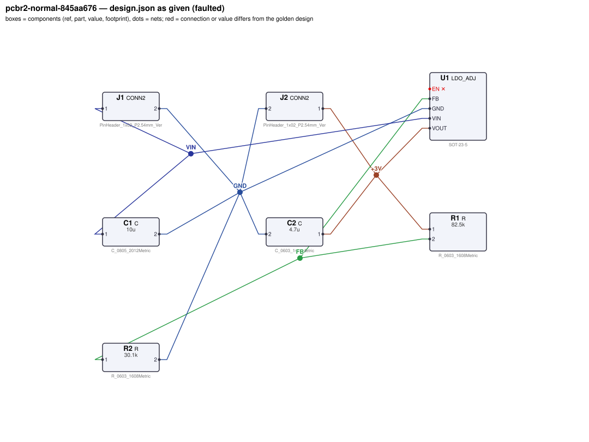
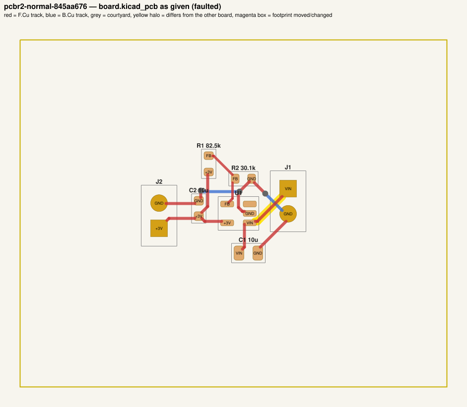
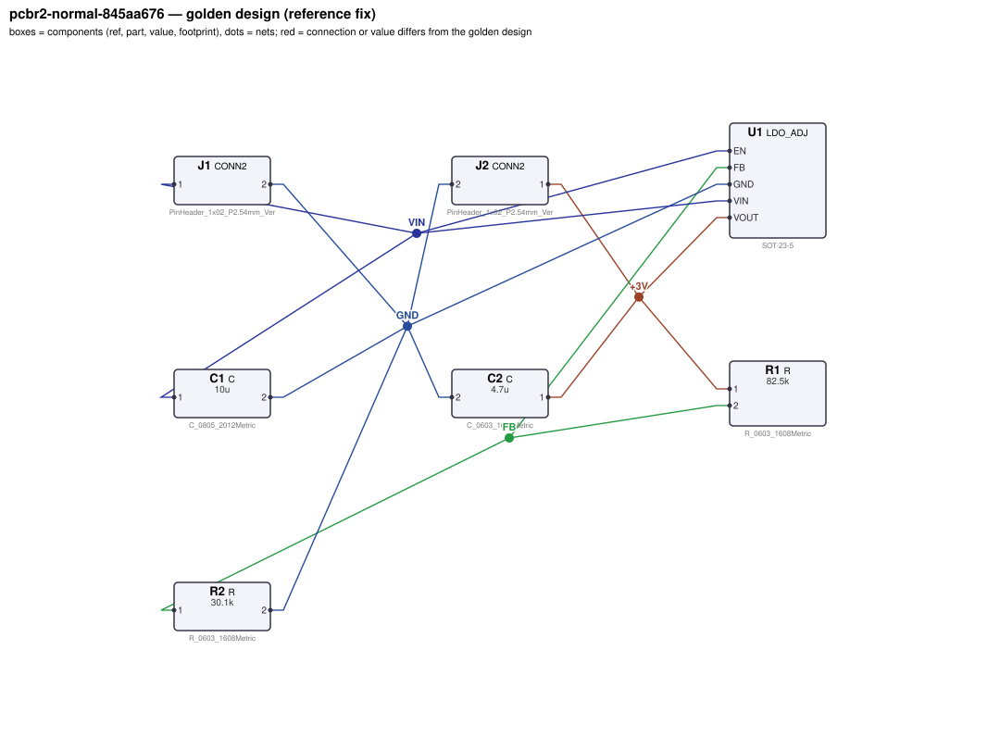
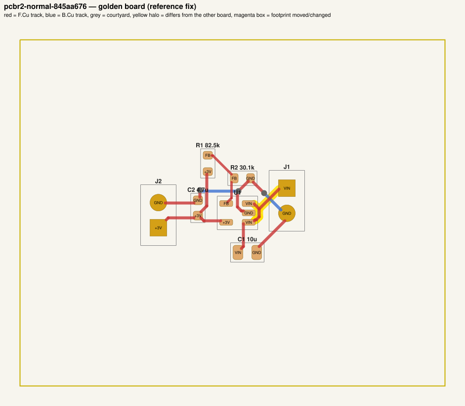

# QA packet 010: `pcbr2-normal-845aa676`

| family | tier | tool mode | hint level | intent in TASK.md | faults | latent | predicted difficulty |
|---|---|---|---|---|---|---|---|
| ldo_reg | normal | full | explicit | full | 2 | 0 | medium |

Task files: [`../../../tasks/v2/normal/pcbr2-normal-845aa676/public/`](../../../tasks/v2/normal/pcbr2-normal-845aa676/public/) (what the agent gets) and [`../../../tasks/v2/normal/pcbr2-normal-845aa676/hidden/`](../../../tasks/v2/normal/pcbr2-normal-845aa676/hidden/) (grader only). Why sampled: connectivity fault, disputable type bom_mismatch, value near bounds: C2=10u inside [1e-06, 2.2e-05].

**How to review (≈5 min):** read section 1 as if you were the agent, decide whether you could find and fix the problems from it; then check section 2 (faults, reference fix, verifier verdicts) and fill `review.yaml`. Do not let section 2 influence your fairness judgement of section 1.

## 1. What the agent sees

### 1.1 TASK.md (verbatim)

````markdown
# Task: 3 V LDO regulator

## Problem report

The first boards built from these files fail bring-up. Observations so far:

- Bench: J2.1 reads 0 V, expected 2.91 V to 3.09 V (`vout_loaded`).
- Bench: J2.1 reads 0 V, expected 2.91 V to 3.09 V (`vout_low_vin`).
- Bench: current through J2.1 is 0 A, expected 47.5 mA to 52.5 mA (`load_current`).
- Schematic ERC reports 1× unconnected_required.
- Incoming inspection: a part value on the layout does not match the design.json BOM.

A reviewer narrowed the failure down to these areas (each needs a fix):

- the connection of U1.EN
- the value of C2 on the board vs. design.json

Fix every problem (there may be more than the observations show directly).

## Design intent

# 3 V LDO regulator

Converts a 9 V input (J1: pin 1 = +9 V, pin 2 = GND) into a regulated 3 V rail
(J2: pin 1 = +3 V, pin 2 = GND) able to deliver 50 mA.

- U1 (LDO_ADJ) takes its input on VIN with C1 as the input capacitor from VIN to GND, placed at the pin.
- C2 is the output capacitor from VOUT to GND, placed at the VOUT pin.
- The output voltage is programmed by a divider: R1 from VOUT down to the FB pin, R2 from FB to GND
  (VOUT = 0.8 V x (1 + R1/R2)).
- EN is tied directly to VIN so the regulator is always on.


Spec: output 3 V ±3 % at 50 mA load, for input voltages from 3.6 V up to 9 V.
Supply and ground traces carrying the load current must be at least 0.3 mm wide.
Component values: C1 and C2 are 1 µF–22 µF ceramics (datasheet range);
feedback divider Rbot (R2) 3.3 kΩ–150 kΩ (datasheet: 10k–50k typical) with R1 scaled to match.

Sub-circuits by purpose: input connector (J1); regulator (U1); input/output capacitors (C1, C2); output-voltage feedback divider (R1, R2); output connector (J2).

## Spec

The design must satisfy these assertions (`pcbtool sim` runs them; full definitions in `spec.json`):

- `vout_loaded`: DC voltage at J2.1 between 2.91 V and 3.09 V (J1.1 supplied with 9.0 V; load R=60 from J2.1 to ground; ground = J1.2)
- `vout_low_vin`: DC voltage at J2.1 between 2.91 V and 3.09 V (J1.1 supplied with 3.6 V; load R=60 from J2.1 to ground; ground = J1.2)
- `load_current`: DC current through J2.1 between 47.5 mA and 52.5 mA (J1.1 supplied with 9.0 V; load R=60 from J2.1 to ground; ground = J1.2)

Layout: every track of these nets must be at least the given width:

- +3V (the net of J2.1): ≥ 0.3 mm
- GND (the net of J1.2): ≥ 0.3 mm
- VIN (the net of J1.1): ≥ 0.3 mm

Decoupling: each capacitor's pad on the IC pin's net must reach the IC pin's pad within the given length of copper path (shortest path along that net's tracks, vias and pads, pad centre to pad centre; a cap wired to the pin the long way round does not decouple it), and every pad of the capacitor must lie within the given straight-line distance of the IC pin's pad:

- C1 within 6.0 mm of copper path of U1.VIN (and within 5.0 mm straight-line)
- C2 within 6.0 mm of copper path of U1.VOUT (and within 5.0 mm straight-line)

Component values: each value must lie in its acceptable range (inclusive; `value_bounds` in `spec.json`). Ranges come from the datasheets and the design intent; values the assertions already pin down get a wide sanity range, and the assertions still apply:

- C1 (C): 1 uF … 22 uF
- C2 (C): 1 uF … 22 uF
- R1 (R): 9.1 kΩ … 410 kΩ
- R2 (R): 3.3 kΩ … 150 kΩ

Resistor power rule: every resistor's continuous dissipation I²·R must stay at or below 50 % of its
footprint's rated power (0603 0.1 W, 0805 0.125 W, 1206 0.5 W; see `parts/R.md`). The grader checks
this under the spec's operating conditions; `pcbtool` does not.

Board rules: 2 copper layers, clearance 0.2 mm, min track 0.2 mm, vias 0.6/0.3 mm, copper-to-edge 0.3 mm. DRC must be clean with no unconnected items.

## Deliverable

- Edit only `design.json` (the schematic of record) and `board.kicad_pcb` (the layout).
- Do not add, remove or rename components; keep each component's part.
- Keep the two files consistent: same connectivity, values and footprints on both.
- Values: `<number><SI prefix><unit>` such as `4.7k`, `100n`, `10kΩ`, `1meg`; unit letters, if any, must match the part (R: Ω/ohm/R, C: F, L: H, crystal: Hz); no spaces or control characters inside (full grammar: "Value notation" in `parts/R.md`, `parts/C.md`, ...).
- Do not change the board outline, add zones, or add DRC exclusions.
- Footprints must be unmodified library footprints from the part's allowed list (see `parts/<PART>.md`).
- Grading is pass/fail: topology, consistency, DRC, ERC, spec, component values and layout must all pass.

## Tools

Run `pcbtool <command>` inside this directory (you may also edit the two files directly).

Read-only:
- `pcbtool show` — components, values, footprints, positions and nets
- `pcbtool netlist` — design nets vs. board pad nets, with differences highlighted
- `pcbtool drc` — KiCad DRC under the canonical rules (the same rules the grader uses)
- `pcbtool erc` — electrical rule check of design.json
- `pcbtool sim` — run the spec assertions (spec.json) on design.json
- `pcbtool parts [PART]` — list parts / print a part's datasheet (also in `parts/`)
- `pcbtool check` — all of the above in one summary

Mutating (each keeps design.json and board.kicad_pcb consistent and saves both):
- `pcbtool set-value REF VALUE`
- `pcbtool set-footprint REF LIB:FOOTPRINT`
- `pcbtool connect REF.PIN NET` / `pcbtool disconnect REF.PIN`
- `pcbtool move REF X Y ROT` (absolute mm, degrees; tracks do not follow)
- `pcbtool unroute NET` / `pcbtool route NET [--width W]` (re-routes the whole net)
- `pcbtool sync` — push design.json connectivity and values onto the board pads
````

### 1.2 Public files

The agent also gets `design.json`, `board.kicad_pcb`, `spec.json` and the part datasheets below, plus the `pcbtool` commands listed in TASK.md (DRC, ERC, simulation of the public assertions, value-range check). Renders of the faulted files:





<details><summary>Datasheet <code>parts/C.md</code></summary>

````markdown
# C — ceramic capacitor

Two-terminal non-polarised capacitor. Pins `1`, `2`. Value in farads.

## Value notation (all parts)

A value is `<number><SI prefix?><unit?>`, e.g. `4.7k`, `100n`, `2.2u`, `10R`, `1meg`, `1.5e3`:
- number: digits with an optional decimal point and an optional exponent (`1e3`); no sign, no
  digit grouping, no RKM notation (`4k7`);
- SI prefix (case-sensitive): `p` `n` `u`/`µ`/`μ` (micro) `m` (milli) `k`/`K` `M`/`meg`/`MEG` (mega) `G`;
  an exponent and a prefix together (`1e3k`) are rejected;
- unit letters, optional, must match the part: R `Ω`/`ohm`/`Ohm`/`R`; C `F`; L `H`; crystals `Hz`;
  other parts none (`100nH` on a capacitor is rejected);
- no whitespace or control characters inside the value (leading/trailing spaces are ignored).

design.json and the board must carry the same value; they are compared as numbers (`1k` == `1000`).
````

</details>

<details><summary>Datasheet <code>parts/CONN2.md</code></summary>

````markdown
# CONN2 — 2-pin header

Pin `1` = signal/supply, pin `2` = ground by board convention.
````

</details>

<details><summary>Datasheet <code>parts/LDO_ADJ.md</code></summary>

````markdown
# LDO_ADJ — adjustable 300 mA low-dropout regulator (SOT-23-5)

## Pinout
| Pin | Pad | Function |
|---|---|---|
| VIN | 1 | input supply, 2.5–16 V |
| GND | 2 | ground |
| EN | 3 | enable, active high. Internal 2 MΩ pull-down: floating = OFF |
| FB | 4 | feedback; regulates to VREF = 0.800 V |
| VOUT | 5 | regulated output |

## Electrical characteristics
- VREF = 0.800 V ±1 %
- Output current 300 mA max; current limit ~500 mA
- Dropout 250 mV typ at 300 mA
- EN threshold 1.2 V (high = on); EN low or floating -> output off (0 V)
- Quiescent current 50 µA; package dissipation max 0.5 W

## Application notes
- Output voltage is set by a divider from VOUT to FB (Rtop) and FB to GND (Rbot):
  **VOUT = VREF × (1 + Rtop / Rbot)**. Rbot of 10k–50k is typical.
- Connect EN to VIN for always-on operation (or drive it from logic / a pull-up). A pull-up
  Rpu from VIN forms a divider with the internal 2 MΩ pull-down: VIN·2M/(Rpu + 2M) must exceed
  the 1.2 V threshold at the lowest VIN.
- Place a 1 µF–22 µF ceramic input capacitor and a 1 µF–22 µF ceramic output capacitor (the
  output capacitor range is the stability range of the regulation loop) within
  5 mm of the VIN and VOUT pins respectively, returned to GND.
- Power dissipation = (VIN - VOUT) × IOUT must stay below 0.5 W.
````

</details>

<details><summary>Datasheet <code>parts/R.md</code></summary>

````markdown
# R — resistor

Two-terminal resistor. Pins `1`, `2` (non-polarised). Value in ohms.

## Value notation (all parts)

A value is `<number><SI prefix?><unit?>`, e.g. `4.7k`, `100n`, `2.2u`, `10R`, `1meg`, `1.5e3`:
- number: digits with an optional decimal point and an optional exponent (`1e3`); no sign, no
  digit grouping, no RKM notation (`4k7`);
- SI prefix (case-sensitive): `p` `n` `u`/`µ`/`μ` (micro) `m` (milli) `k`/`K` `M`/`meg`/`MEG` (mega) `G`;
  an exponent and a prefix together (`1e3k`) are rejected;
- unit letters, optional, must match the part: R `Ω`/`ohm`/`Ohm`/`R`; C `F`; L `H`; crystals `Hz`;
  other parts none (`100nH` on a capacitor is rejected);
- no whitespace or control characters inside the value (leading/trailing spaces are ignored).

design.json and the board must carry the same value; they are compared as numbers (`1k` == `1000`).

## Ratings by footprint (high-power thick-film series used on this board)

| Size | Rated power (70 C) | Design limit (50 % derating) |
|---|---|---|
| 0603 | 0.1 W | 50.0 mW |
| 0805 | 0.125 W | 62.5 mW |
| 1206 | 0.5 W | 250.0 mW |

**Design rule:** the continuous dissipation P = I²·R of every resistor must not exceed 50 % of its
footprint's rated power. Pick the footprint for the power, not just the value.
````

</details>

## 2. Reviewer-only (hidden from the agent)

### 2.1 Injected faults

| # | type | category | DRC/ERC-invisible | latent (pcbtool-clean) | detail | verifier, this fault alone |
|---|---|---|---|---|---|---|
| 1 | `floating_pin` | connectivity | no |  | U1.EN left unconnected (should be on VIN) | reward 0.0; fails erc, spec, topology |
| 2 | `bom_mismatch` | value | yes |  | board value of C2 is 10u, design.json says 4.7u | reward 0.0; fails consistency |

### 2.2 Reference fix (faulted → golden)

The reference repair is the hidden golden pair (`golden_design.json`, `golden_board.kicad_pcb`). Any repair that passes every gate and check scores 1.0; it need not be byte-identical.

**design.json: component changes**

- none

**design.json: connection changes** (per pin: what it connects to)

- `U1.EN`: faulted unconnected → golden net `VIN` (C1.1, J1.1, U1.VIN)

**board.kicad_pcb: footprints moved / changed**

- none

**board.kicad_pcb: footprint values (BOM)**

- `C2` board value `10u` → `4.7u`

**board.kicad_pcb: pad-net changes**

- `U1` pad 3: net `(none)` → `VIN`

**board.kicad_pcb: nets re-routed** (track/via geometry differs)

- net `VIN`: 2 track/via item(s) removed, 6 added

Golden renders (compare with 1.2; highlighted items differ):





### 2.3 Verifier verdicts

Reward is 1 only if every gate and check passes.

| stage | kind | faulted files | golden files |
|---|---|---|---|
| parse | gate | pass | pass |
| components | gate | pass | pass |
| topology | gate | **FAIL** | pass |
| consistency | gate | **FAIL** | pass |
| integrity | gate | pass | pass |
| drc | check | pass | pass |
| erc | check | **FAIL** | pass |
| spec | check | **FAIL** | pass |
| values | check | pass | pass |
| layout | check | pass | pass |
| rules | check | pass | pass |
| **reward** | | **0** | **1** |

Verifier messages on the faulted files:

- **consistency**: C2: board value '10u' != design value '4.7u'
- **erc**: unconnected_required: U1.EN must be connected
- **layout_skipped**: no board net has the pins of golden net VIN (connectivity differs: see topology)
- **spec**: vout_loaded: measured 0.0 expected [2.91, 3.09]
- **spec**: vout_low_vin: measured 0.0 expected [2.91, 3.09]
- **spec**: load_current: measured 0.0 expected [0.0475, 0.0525]
- **topology**: nets only in candidate: [['C1.1', 'J1.1', 'U1.VIN']]; nets only in reference: [['C1.1', 'J1.1', 'U1.EN', 'U1.VIN']]

### 2.4 Spec assertions before / after

| assertion | what | allowed | faulted: measured | | golden: measured | |
|---|---|---|---|---|---|---|
| `vout_loaded` | DC voltage at J2.1 (J1.1 supplied with 9.0 V; load R=60 from J2.1 to ground; ground = J1.2) | 2.91 V … 3.09 V | 0 V | ❌ | 2.992 V | ✅ |
| `vout_low_vin` | DC voltage at J2.1 (J1.1 supplied with 3.6 V; load R=60 from J2.1 to ground; ground = J1.2) | 2.91 V … 3.09 V | 0 V | ❌ | 2.992 V | ✅ |
| `load_current` | DC current through J2.1 (J1.1 supplied with 9.0 V; load R=60 from J2.1 to ground; ground = J1.2) | 47.5 mA … 52.5 mA | 0 A | ❌ | 49.86 mA | ✅ |

### 2.5 Value bounds

Bounds are public (TASK.md / spec.json); `values` check = every value inside its range.

| ref | part | acceptable range | faulted design.json | faulted board | golden | touched by a fault |
|---|---|---|---|---|---|---|
| `C1` | C | 1 uF … 22 uF | `10u` | `10u` | `10u` |  |
| `C2` | C | 1 uF … 22 uF | `4.7u` | `10u` | `4.7u` | **yes** |
| `R1` | R | 9.1 kΩ … 410 kΩ | `82.5k` | `82.5k` | `82.5k` |  |
| `R2` | R | 3.3 kΩ … 150 kΩ | `30.1k` | `30.1k` | `30.1k` |  |

### 2.6 Layout rules

- power net `+3V` (golden pins C2.1, J2.1, R1.1, U1.VOUT): every track ≥ 0.3 mm
- power net `GND` (golden pins C1.2, C2.2, J1.2, J2.2, R2.2, U1.GND): every track ≥ 0.3 mm
- power net `VIN` (golden pins C1.1, J1.1, U1.EN, U1.VIN): every track ≥ 0.3 mm
- decoupling: `C1` within 6.0 mm of copper path (and 5.0 mm straight-line) of `U1.VIN`
- decoupling: `C2` within 6.0 mm of copper path (and 5.0 mm straight-line) of `U1.VOUT`

### 2.8 Design rules (`rules` check, not run by pcbtool)

Scope: resistor power only (`rules_power`, all v2 tiers); 2 operating condition(s) from the spec's stimuli; 2 rule quantities evaluated per design. Rows shown: violated on either side, on a part a fault touches (if ≥ 5 % of its limit or changed by ≥ 5 points or by a footprint change), or at ≥ 80% of the limit. Values are the worst case over the conditions (computed with `pcbenv.rules.operating_point`; limits from `pcbenv/rules.py`, stated in `parts/<PART>.md` and TASK.md "Design rules").

- no rule quantity is violated, touched by a fault, or within 80 % of a limit

Rule violations reported by the verifier: faulted: none; golden: none.

## 3. Review

Fill `review.yaml` in this directory (second reviewer: copy `../../review_template.yaml` to `review-<initials>.yaml` here, without looking at the first form). Questions to answer:

1. **task_fair / solvable_from_public_material**: from section 1 only, can a competent engineer locate and fix every injected fault? Is anything required that is not stated (a value with no assertion and no published range, a connection only the golden reveals)?
2. **reference_fix_correct**: is the golden (2.2) a correct design that meets the stated intent?
3. **verifier_verdict_agrees**: do you agree the faulted files fail and the golden passes, for the reasons given in 2.3?
4. **alternative_valid_fixes_rejected**: is there an engineering-valid repair the grader would reject (e.g. a different E-series value that meets intent but fails an assertion window or value bound; keeping a swapped footprint and re-routing; a different valid placement)?
5. **rule_stated_clearly**: is every design rule / layout rule / latent requirement this task grades (2.7–2.9) stated in the public material clearly enough that an engineer would apply it the way the grader does (limit, which part, which condition)? Normal-tier tasks: answer for the resistor-power rule (`yes` if no rule is involved).
6. **layout_rule_reasonable**: hard_layout tasks only (else `n/a`): are the layout-rule limits and their geometric definitions (2.9) defensible engineering practice for this board, i.e. would you reject the faulted layout in a design review, and accept the golden one?

