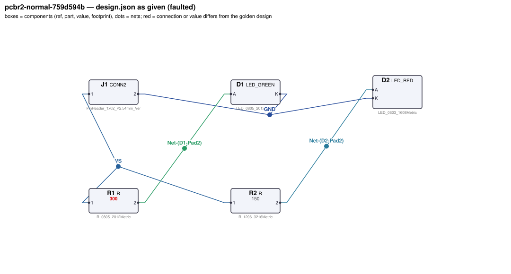
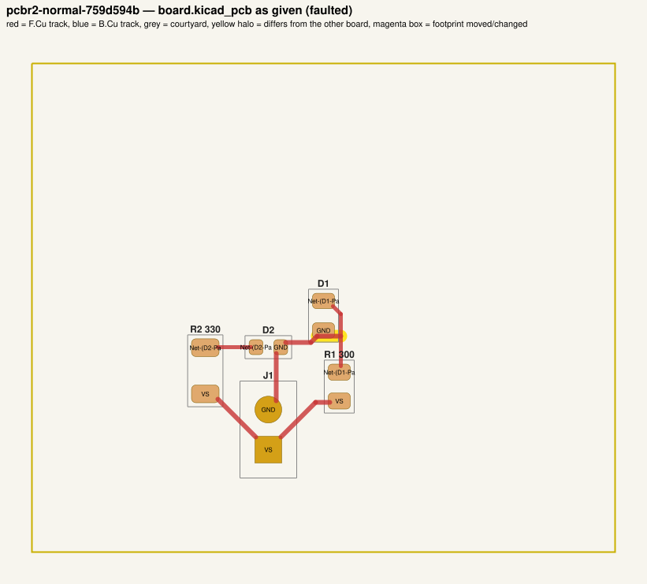
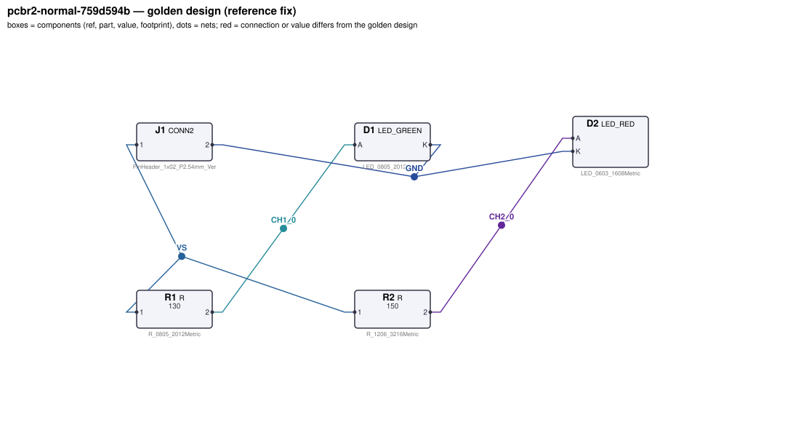
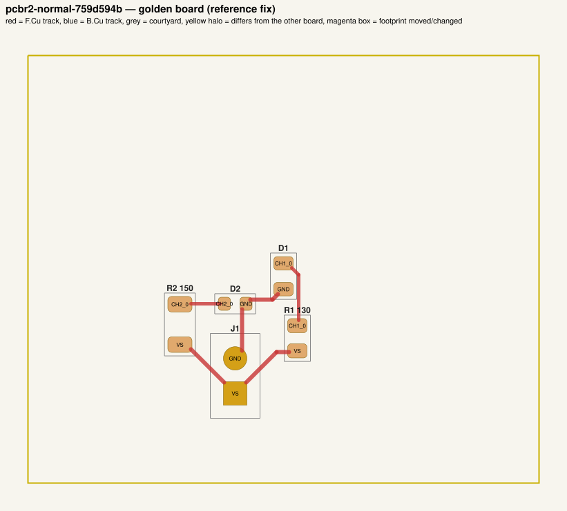

# QA packet 015: `pcbr2-normal-759d594b`

| family | tier | tool mode | hint level | intent in TASK.md | faults | latent | predicted difficulty |
|---|---|---|---|---|---|---|---|
| led_driver | normal | full | vague | reduced | 3 | 0 | hard |

Task files: [`../../../tasks/v2/normal/pcbr2-normal-759d594b/public/`](../../../tasks/v2/normal/pcbr2-normal-759d594b/public/) (what the agent gets) and [`../../../tasks/v2/normal/pcbr2-normal-759d594b/hidden/`](../../../tasks/v2/normal/pcbr2-normal-759d594b/hidden/) (grader only). Why sampled: 3 faults, vague hint, disputable type bom_mismatch, value near bounds: R1=300 inside [35, 410]; R2=330 inside [53, 410].

**How to review (≈5 min):** read section 1 as if you were the agent, decide whether you could find and fix the problems from it; then check section 2 (faults, reference fix, verifier verdicts) and fill `review.yaml`. Do not let section 2 influence your fairness judgement of section 1.

## 1. What the agent sees

### 1.1 TASK.md (verbatim)

````markdown
# Task: 2-channel LED indicator board

## Problem report

The first boards built from these files fail bring-up. Find and fix all problems: the design must meet its purpose and spec, the layout must match design.json, and DRC/ERC must be clean.

## Design intent

# 2-channel LED indicator board

Lights 2 indicator LEDs from a 5 V supply on J1
(pin 1 = +5 V, pin 2 = GND). Each channel is a series string of LEDs fed through its own
current-limiting resistor; the resistor sets the current from (Vs - n*Vf)/R.

Spec: each channel's LED current within ±10 % of its target. Resistors dissipating more than
~60 mW use a 1206 footprint.

Sub-circuits by purpose: supply connector (J1); channel 1 current-limiting resistor and LED string (R1, D1); channel 2 current-limiting resistor and LED string (R2, D2).

_Connection details are intentionally not repeated here: wire each part as its datasheet in `parts/` describes (pinout and application notes), so that the circuit does what the purpose, interfaces and spec above require._

## Spec

The design must satisfy these assertions (`pcbtool sim` runs them; full definitions in `spec.json`):

- `string1_current`: DC current through D1 between 18 mA and 22 mA (J1.1 supplied with 5.0 V; ground = J1.2)
- `string2_current`: DC current through D2 between 18 mA and 22 mA (J1.1 supplied with 5.0 V; ground = J1.2)

Layout: every track of these nets must be at least the given width:

- GND (the net of J1.2): ≥ 0.3 mm
- VS (the net of J1.1): ≥ 0.3 mm

Component values: each value must lie in its acceptable range (inclusive; `value_bounds` in `spec.json`). Ranges come from the datasheets and the design intent; values the assertions already pin down get a wide sanity range, and the assertions still apply:

- R1 (R): 35 Ω … 410 Ω
- R2 (R): 53 Ω … 410 Ω

Resistor power rule: every resistor's continuous dissipation I²·R must stay at or below 50 % of its
footprint's rated power (0603 0.1 W, 0805 0.125 W, 1206 0.5 W; see `parts/R.md`). The grader checks
this under the spec's operating conditions; `pcbtool` does not.

Board rules: 2 copper layers, clearance 0.2 mm, min track 0.2 mm, vias 0.6/0.3 mm, copper-to-edge 0.3 mm. DRC must be clean with no unconnected items.

## Deliverable

- Edit only `design.json` (the schematic of record) and `board.kicad_pcb` (the layout).
- Do not add, remove or rename components; keep each component's part.
- Keep the two files consistent: same connectivity, values and footprints on both.
- Values: `<number><SI prefix><unit>` such as `4.7k`, `100n`, `10kΩ`, `1meg`; unit letters, if any, must match the part (R: Ω/ohm/R, C: F, L: H, crystal: Hz); no spaces or control characters inside (full grammar: "Value notation" in `parts/R.md`, `parts/C.md`, ...).
- Do not change the board outline, add zones, or add DRC exclusions.
- Footprints must be unmodified library footprints from the part's allowed list (see `parts/<PART>.md`).
- Grading is pass/fail: topology, consistency, DRC, ERC, spec, component values and layout must all pass.

## Tools

Run `pcbtool <command>` inside this directory (you may also edit the two files directly).

Read-only:
- `pcbtool show` — components, values, footprints, positions and nets
- `pcbtool netlist` — design nets vs. board pad nets, with differences highlighted
- `pcbtool drc` — KiCad DRC under the canonical rules (the same rules the grader uses)
- `pcbtool erc` — electrical rule check of design.json
- `pcbtool sim` — run the spec assertions (spec.json) on design.json
- `pcbtool parts [PART]` — list parts / print a part's datasheet (also in `parts/`)
- `pcbtool check` — all of the above in one summary

Mutating (each keeps design.json and board.kicad_pcb consistent and saves both):
- `pcbtool set-value REF VALUE`
- `pcbtool set-footprint REF LIB:FOOTPRINT`
- `pcbtool connect REF.PIN NET` / `pcbtool disconnect REF.PIN`
- `pcbtool move REF X Y ROT` (absolute mm, degrees; tracks do not follow)
- `pcbtool unroute NET` / `pcbtool route NET [--width W]` (re-routes the whole net)
- `pcbtool sync` — push design.json connectivity and values onto the board pads
````

### 1.2 Public files

The agent also gets `design.json`, `board.kicad_pcb`, `spec.json` and the part datasheets below, plus the `pcbtool` commands listed in TASK.md (DRC, ERC, simulation of the public assertions, value-range check). Renders of the faulted files:





<details><summary>Datasheet <code>parts/CONN2.md</code></summary>

````markdown
# CONN2 — 2-pin header

Pin `1` = signal/supply, pin `2` = ground by board convention.
````

</details>

<details><summary>Datasheet <code>parts/LED_GREEN.md</code></summary>

````markdown
# LED_GREEN — green SMD indicator LED (570 nm)

## Pinout
| Pin | Pad | Function |
|---|---|---|
| A | 2 | anode |
| K | 1 | cathode (marked) |

## Electrical characteristics (25 C)
- Forward voltage Vf = 2.2 V typ at IF = 10 mA
- Max continuous forward current 25 mA; reverse voltage max 5 V

| IF | Vf (typ) |
|---|---|
| 2 mA | 2.10 V |
| 5 mA | 2.15 V |
| 10 mA | 2.20 V |
| 15 mA | 2.23 V |
| 20 mA | 2.26 V |

## Application notes
- Always drive through a current-limiting resistor: R = (Vsupply - n*Vf) / IF for n LEDs in series.
- Current flows anode -> cathode; reversed LEDs do not light.
````

</details>

<details><summary>Datasheet <code>parts/LED_RED.md</code></summary>

````markdown
# LED_RED — red SMD indicator LED (625 nm)

## Pinout
| Pin | Pad | Function |
|---|---|---|
| A | 2 | anode |
| K | 1 | cathode (marked) |

## Electrical characteristics (25 C)
- Forward voltage Vf = 2.0 V typ at IF = 10 mA
- Max continuous forward current 25 mA; reverse voltage max 5 V

| IF | Vf (typ) |
|---|---|
| 2 mA | 1.90 V |
| 5 mA | 1.95 V |
| 10 mA | 2.00 V |
| 15 mA | 2.03 V |
| 20 mA | 2.06 V |

## Application notes
- Always drive through a current-limiting resistor: R = (Vsupply - n*Vf) / IF for n LEDs in series.
- Current flows anode -> cathode; reversed LEDs do not light.
````

</details>

<details><summary>Datasheet <code>parts/R.md</code></summary>

````markdown
# R — resistor

Two-terminal resistor. Pins `1`, `2` (non-polarised). Value in ohms.

## Value notation (all parts)

A value is `<number><SI prefix?><unit?>`, e.g. `4.7k`, `100n`, `2.2u`, `10R`, `1meg`, `1.5e3`:
- number: digits with an optional decimal point and an optional exponent (`1e3`); no sign, no
  digit grouping, no RKM notation (`4k7`);
- SI prefix (case-sensitive): `p` `n` `u`/`µ`/`μ` (micro) `m` (milli) `k`/`K` `M`/`meg`/`MEG` (mega) `G`;
  an exponent and a prefix together (`1e3k`) are rejected;
- unit letters, optional, must match the part: R `Ω`/`ohm`/`Ohm`/`R`; C `F`; L `H`; crystals `Hz`;
  other parts none (`100nH` on a capacitor is rejected);
- no whitespace or control characters inside the value (leading/trailing spaces are ignored).

design.json and the board must carry the same value; they are compared as numbers (`1k` == `1000`).

## Ratings by footprint (high-power thick-film series used on this board)

| Size | Rated power (70 C) | Design limit (50 % derating) |
|---|---|---|
| 0603 | 0.1 W | 50.0 mW |
| 0805 | 0.125 W | 62.5 mW |
| 1206 | 0.5 W | 250.0 mW |

**Design rule:** the continuous dissipation P = I²·R of every resistor must not exceed 50 % of its
footprint's rated power. Pick the footprint for the power, not just the value.
````

</details>

## 2. Reviewer-only (hidden from the agent)

### 2.1 Injected faults

| # | type | category | DRC/ERC-invisible | latent (pcbtool-clean) | detail | verifier, this fault alone |
|---|---|---|---|---|---|---|
| 1 | `wrong_led_resistor` | value | yes |  | R1 (LED current-limiting resistor) is 300, should be 130 | reward 0.0; fails spec |
| 2 | `bom_mismatch` | value | yes |  | board value of R2 is 330, design.json says 150 | reward 0.0; fails consistency |
| 3 | `short_between_nets` | board | no |  | track of net GND on F.Cu runs into net CH1_0 at (119.60, 117.30) | reward 0.0; fails drc |

### 2.2 Reference fix (faulted → golden)

The reference repair is the hidden golden pair (`golden_design.json`, `golden_board.kicad_pcb`). Any repair that passes every gate and check scores 1.0; it need not be byte-identical.

**design.json: component changes**

- `R1` value: `300` → `130`

**design.json: connection changes** (per pin: what it connects to)

- none

**board.kicad_pcb: footprints moved / changed**

- none

**board.kicad_pcb: footprint values (BOM)**

- `R1` board value `300` → `130`
- `R2` board value `330` → `150`

**board.kicad_pcb: pad-net changes**

- `D1` pad 2: net `Net-(D1-Pad2)` → `CH1_0`
- `D2` pad 2: net `Net-(D2-Pad2)` → `CH2_0`
- `R1` pad 2: net `Net-(D1-Pad2)` → `CH1_0`
- `R2` pad 2: net `Net-(D2-Pad2)` → `CH2_0`

**board.kicad_pcb: nets re-routed** (track/via geometry differs)

- net `CH1_0`: 0 track/via item(s) removed, 2 added
- net `CH2_0`: 0 track/via item(s) removed, 1 added
- net `GND`: 1 track/via item(s) removed, 0 added
- net `Net-(D1-Pad2)`: 2 track/via item(s) removed, 0 added
- net `Net-(D2-Pad2)`: 1 track/via item(s) removed, 0 added

Golden renders (compare with 1.2; highlighted items differ):





### 2.3 Verifier verdicts

Reward is 1 only if every gate and check passes.

| stage | kind | faulted files | golden files |
|---|---|---|---|
| parse | gate | pass | pass |
| components | gate | pass | pass |
| topology | gate | pass | pass |
| consistency | gate | **FAIL** | pass |
| integrity | gate | pass | pass |
| drc | check | **FAIL** | pass |
| erc | check | pass | pass |
| spec | check | **FAIL** | pass |
| values | check | pass | pass |
| layout | check | pass | pass |
| rules | check | pass | pass |
| **reward** | | **0** | **1** |

Verifier messages on the faulted files:

- **consistency**: R2: board value '330' != design value '150'
- **drc**: clearance: Clearance violation (netclass 'Default' clearance 0.2000 mm; actual 0.0000 mm) @ (118.1, 117.3)
- **spec**: string1_current: measured 0.0093491933623 expected [0.018, 0.022]

### 2.4 Spec assertions before / after

| assertion | what | allowed | faulted: measured | | golden: measured | |
|---|---|---|---|---|---|---|
| `string1_current` | DC current through D1 (J1.1 supplied with 5.0 V; ground = J1.2) | 18 mA … 22 mA | 9.349 mA | ❌ | 21.07 mA | ✅ |
| `string2_current` | DC current through D2 (J1.1 supplied with 5.0 V; ground = J1.2) | 18 mA … 22 mA | 19.64 mA | ✅ | 19.64 mA | ✅ |

### 2.5 Value bounds

Bounds are public (TASK.md / spec.json); `values` check = every value inside its range.

| ref | part | acceptable range | faulted design.json | faulted board | golden | touched by a fault |
|---|---|---|---|---|---|---|
| `R1` | R | 35 Ω … 410 Ω | `300` | `300` | `130` | **yes** |
| `R2` | R | 53 Ω … 410 Ω | `150` | `330` | `150` | **yes** |

### 2.6 Layout rules

- power net `GND` (golden pins D1.K, D2.K, J1.2): every track ≥ 0.3 mm
- power net `VS` (golden pins J1.1, R1.1, R2.1): every track ≥ 0.3 mm

### 2.8 Design rules (`rules` check, not run by pcbtool)

Scope: resistor power only (`rules_power`, all v2 tiers); 1 operating condition(s) from the spec's stimuli; 2 rule quantities evaluated per design. Rows shown: violated on either side, on a part a fault touches (if ≥ 5 % of its limit or changed by ≥ 5 points or by a footprint change), or at ≥ 80% of the limit. Values are the worst case over the conditions (computed with `pcbenv.rules.operating_point`; limits from `pcbenv/rules.py`, stated in `parts/<PART>.md` and TASK.md "Design rules").

| rule | subject | quantity | limit | faulted (of limit) | golden (of limit) | shown because | worst condition (faulted) |
|---|---|---|---|---|---|---|---|
| `resistor_power` | `R1` | I²R | 62.5 mW | 0805: 26.22 mW of 62.5 mW (42%) | 0805: 57.72 mW of 62.5 mW (92%) | fault target | cond 0 |
| `resistor_power` | `R2` | I²R | 250 mW | 1206: 57.85 mW of 250 mW (23%) | 1206: 57.85 mW of 250 mW (23%) | fault target | cond 0 |

Rule violations reported by the verifier: faulted: none; golden: none.

## 3. Review

Fill `review.yaml` in this directory (second reviewer: copy `../../review_template.yaml` to `review-<initials>.yaml` here, without looking at the first form). Questions to answer:

1. **task_fair / solvable_from_public_material**: from section 1 only, can a competent engineer locate and fix every injected fault? Is anything required that is not stated (a value with no assertion and no published range, a connection only the golden reveals)?
2. **reference_fix_correct**: is the golden (2.2) a correct design that meets the stated intent?
3. **verifier_verdict_agrees**: do you agree the faulted files fail and the golden passes, for the reasons given in 2.3?
4. **alternative_valid_fixes_rejected**: is there an engineering-valid repair the grader would reject (e.g. a different E-series value that meets intent but fails an assertion window or value bound; keeping a swapped footprint and re-routing; a different valid placement)?
5. **rule_stated_clearly**: is every design rule / layout rule / latent requirement this task grades (2.7–2.9) stated in the public material clearly enough that an engineer would apply it the way the grader does (limit, which part, which condition)? Normal-tier tasks: answer for the resistor-power rule (`yes` if no rule is involved).
6. **layout_rule_reasonable**: hard_layout tasks only (else `n/a`): are the layout-rule limits and their geometric definitions (2.9) defensible engineering practice for this board, i.e. would you reject the faulted layout in a design review, and accept the golden one?

