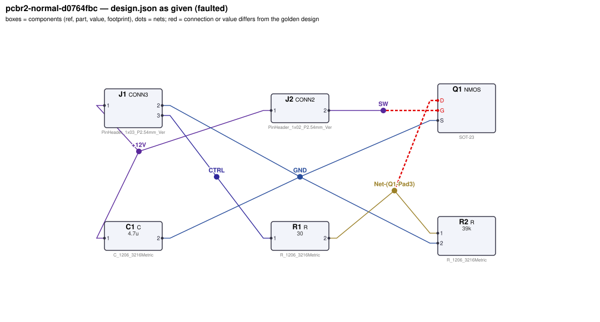
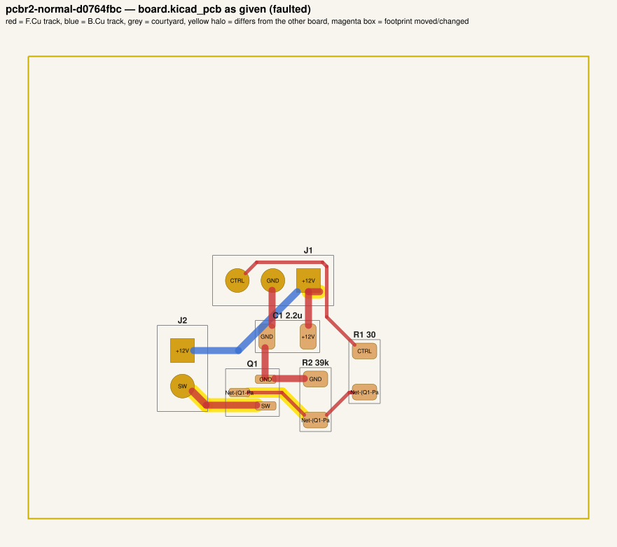
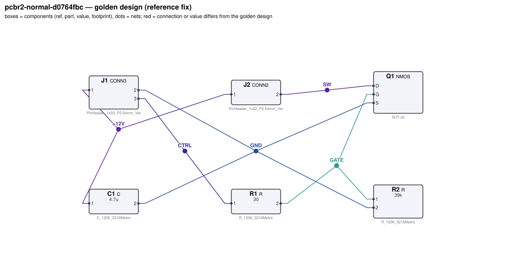
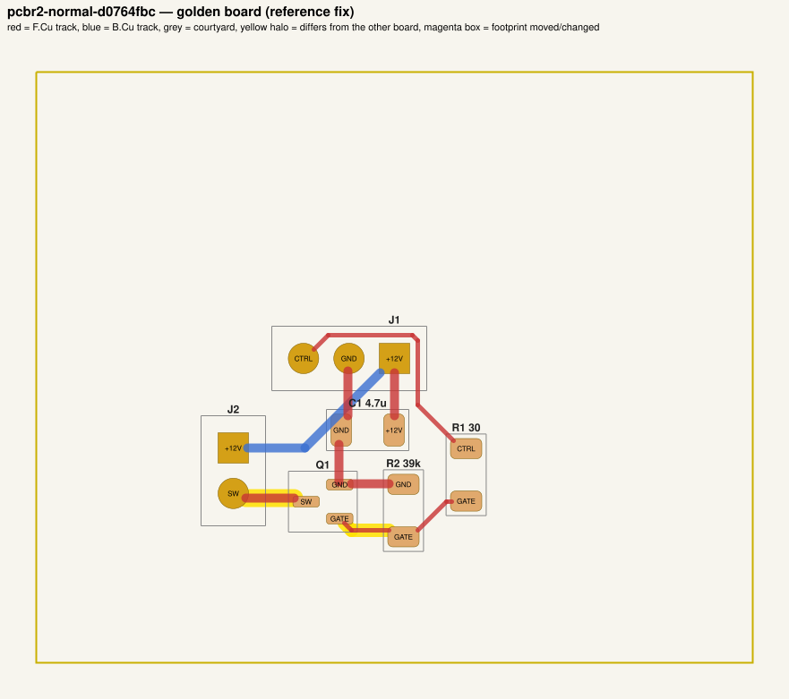

# QA packet 025: `pcbr2-normal-d0764fbc`

| family | tier | tool mode | hint level | intent in TASK.md | faults | latent | predicted difficulty |
|---|---|---|---|---|---|---|---|
| nmos_switch | normal | full | symptom | reduced | 3 | 0 | hard |

Task files: [`../../../tasks/v2/normal/pcbr2-normal-d0764fbc/public/`](../../../tasks/v2/normal/pcbr2-normal-d0764fbc/public/) (what the agent gets) and [`../../../tasks/v2/normal/pcbr2-normal-d0764fbc/hidden/`](../../../tasks/v2/normal/pcbr2-normal-d0764fbc/hidden/) (grader only). Why sampled: 3 faults, connectivity fault, disputable type bom_mismatch, value near bounds: C1=2.2u inside [1e-06, 2.2e-05].

**How to review (≈5 min):** read section 1 as if you were the agent, decide whether you could find and fix the problems from it; then check section 2 (faults, reference fix, verifier verdicts) and fill `review.yaml`. Do not let section 2 influence your fairness judgement of section 1.

## 1. What the agent sees

### 1.1 TASK.md (verbatim)

````markdown
# Task: 12 V low-side MOSFET switch

## Problem report

The first boards built from these files fail bring-up. Observations so far:

- Bench: current through J2.2 is 12 pA, expected 285 mA to 315 mA (`load_on_current`).
- Bench: current through R1 is 41.22 mA, expected 0 A to 1 mA (`ctrl_current_on`).
- The fab's DRC run rejects the layout: 1 error(s) (1× clearance).
- Incoming inspection: a part value on the layout does not match the design.json BOM.

Fix every problem (there may be more than the observations show directly).

## Design intent

# 12 V low-side MOSFET switch

A 3.3 V logic signal switches a 0.3 A load from a 12 V supply.
J1 is the input header: pin 1 = +12 V, pin 2 = GND, pin 3 = CTRL (logic input).
J2 connects the off-board load: pin 1 = +12 V, pin 2 = switched return to the MOSFET drain.
The load is a resistive load (heater, ~40 Ω); no flyback diode is needed.

Spec: CTRL = 3.3 V -> load current 0.3 A ±5 % with VDS ≤ 0.12 V; CTRL floating ->
load off (< 0.1 mA) even with 10 MΩ of leakage from the supply to the gate. Load-current
traces (supply, switched node, GND) at least 0.5 mm wide.
Component values: gate series R1 4.7 Ω–220 Ω (datasheet: 10–100 Ω); gate pull-down R2 4.7 kΩ–220 kΩ
(datasheet: 10k–100k); bulk C1 1 µF–22 µF.

Sub-circuits by purpose: input header (J1); load connector (J2); low-side MOSFET (Q1); gate series resistor and gate pull-down (R1, R2); supply bulk capacitor (C1).

_Connection details are intentionally not repeated here: wire each part as its datasheet in `parts/` describes (pinout and application notes), so that the circuit does what the purpose, interfaces and spec above require._

## Spec

The design must satisfy these assertions (`pcbtool sim` runs them; full definitions in `spec.json`):

- `load_on_current`: DC current through J2.2 between 285 mA and 315 mA (J1.1 supplied with 12.0 V; 3.3 V DC source on J1.3; load R=40 from J2.1 to J2.2; ground = J1.2)
- `vds_on`: DC voltage at Q1.D between 0 V and 120 mV (J1.1 supplied with 12.0 V; 3.3 V DC source on J1.3; load R=40 from J2.1 to J2.2; ground = J1.2)
- `load_off_current`: DC current through J2.2 between 0 A and 100 uA (J1.1 supplied with 12.0 V; load R=40 from J2.1 to J2.2; load R=1e+07 from Q1.G to J1.1; ground = J1.2)
- `ctrl_current_on`: DC current through R1 between 0 A and 1 mA (J1.1 supplied with 12.0 V; 3.3 V DC source on J1.3; load R=40 from J2.1 to J2.2; ground = J1.2)

Layout: every track of these nets must be at least the given width:

- +12V (the net of J1.1): ≥ 0.5 mm
- GND (the net of J1.2): ≥ 0.5 mm
- SW (the net of J2.2): ≥ 0.5 mm

Component values: each value must lie in its acceptable range (inclusive; `value_bounds` in `spec.json`). Ranges come from the datasheets and the design intent; values the assertions already pin down get a wide sanity range, and the assertions still apply:

- C1 (C): 1 uF … 22 uF
- R1 (R): 4.7 Ω … 220 Ω
- R2 (R): 4.7 kΩ … 220 kΩ

Resistor power rule: every resistor's continuous dissipation I²·R must stay at or below 50 % of its
footprint's rated power (0603 0.1 W, 0805 0.125 W, 1206 0.5 W; see `parts/R.md`). The grader checks
this under the spec's operating conditions; `pcbtool` does not.

Board rules: 2 copper layers, clearance 0.2 mm, min track 0.2 mm, vias 0.6/0.3 mm, copper-to-edge 0.3 mm. DRC must be clean with no unconnected items.

## Deliverable

- Edit only `design.json` (the schematic of record) and `board.kicad_pcb` (the layout).
- Do not add, remove or rename components; keep each component's part.
- Keep the two files consistent: same connectivity, values and footprints on both.
- Values: `<number><SI prefix><unit>` such as `4.7k`, `100n`, `10kΩ`, `1meg`; unit letters, if any, must match the part (R: Ω/ohm/R, C: F, L: H, crystal: Hz); no spaces or control characters inside (full grammar: "Value notation" in `parts/R.md`, `parts/C.md`, ...).
- Do not change the board outline, add zones, or add DRC exclusions.
- Footprints must be unmodified library footprints from the part's allowed list (see `parts/<PART>.md`).
- Grading is pass/fail: topology, consistency, DRC, ERC, spec, component values and layout must all pass.

## Tools

Run `pcbtool <command>` inside this directory (you may also edit the two files directly).

Read-only:
- `pcbtool show` — components, values, footprints, positions and nets
- `pcbtool netlist` — design nets vs. board pad nets, with differences highlighted
- `pcbtool drc` — KiCad DRC under the canonical rules (the same rules the grader uses)
- `pcbtool erc` — electrical rule check of design.json
- `pcbtool sim` — run the spec assertions (spec.json) on design.json
- `pcbtool parts [PART]` — list parts / print a part's datasheet (also in `parts/`)
- `pcbtool check` — all of the above in one summary

Mutating (each keeps design.json and board.kicad_pcb consistent and saves both):
- `pcbtool set-value REF VALUE`
- `pcbtool set-footprint REF LIB:FOOTPRINT`
- `pcbtool connect REF.PIN NET` / `pcbtool disconnect REF.PIN`
- `pcbtool move REF X Y ROT` (absolute mm, degrees; tracks do not follow)
- `pcbtool unroute NET` / `pcbtool route NET [--width W]` (re-routes the whole net)
- `pcbtool sync` — push design.json connectivity and values onto the board pads
````

### 1.2 Public files

The agent also gets `design.json`, `board.kicad_pcb`, `spec.json` and the part datasheets below, plus the `pcbtool` commands listed in TASK.md (DRC, ERC, simulation of the public assertions, value-range check). Renders of the faulted files:





<details><summary>Datasheet <code>parts/C.md</code></summary>

````markdown
# C — ceramic capacitor

Two-terminal non-polarised capacitor. Pins `1`, `2`. Value in farads.

## Value notation (all parts)

A value is `<number><SI prefix?><unit?>`, e.g. `4.7k`, `100n`, `2.2u`, `10R`, `1meg`, `1.5e3`:
- number: digits with an optional decimal point and an optional exponent (`1e3`); no sign, no
  digit grouping, no RKM notation (`4k7`);
- SI prefix (case-sensitive): `p` `n` `u`/`µ`/`μ` (micro) `m` (milli) `k`/`K` `M`/`meg`/`MEG` (mega) `G`;
  an exponent and a prefix together (`1e3k`) are rejected;
- unit letters, optional, must match the part: R `Ω`/`ohm`/`Ohm`/`R`; C `F`; L `H`; crystals `Hz`;
  other parts none (`100nH` on a capacitor is rejected);
- no whitespace or control characters inside the value (leading/trailing spaces are ignored).

design.json and the board must carry the same value; they are compared as numbers (`1k` == `1000`).
````

</details>

<details><summary>Datasheet <code>parts/CONN2.md</code></summary>

````markdown
# CONN2 — 2-pin header

Pin `1` = signal/supply, pin `2` = ground by board convention.
````

</details>

<details><summary>Datasheet <code>parts/CONN3.md</code></summary>

````markdown
# CONN3 — 3-pin 2.54 mm header

Generic vertical pin header used for off-board power, signal and bus connections.

| Pin | Pad | Typical use |
|---|---|---|
| 1 | 1 | signal / supply |
| 2 | 2 | ground (board convention) |
| 3 | 3 | signal / supply |

## Notes
- Pin 2 is ground by board convention; the function of the other pins is set by the design.
- Rated 3 A per contact. Has no electrical model of its own (it is where external
  supplies, signals and loads attach).
````

</details>

<details><summary>Datasheet <code>parts/NMOS.md</code></summary>

````markdown
# NMOS — logic-level N-channel MOSFET (SOT-23)

## Pinout
| Pin | Pad | Function |
|---|---|---|
| G | 1 | gate |
| S | 2 | source |
| D | 3 | drain |

## Electrical characteristics
- VDS max 30 V, ID max 2 A continuous, VGS max ±12 V
- VGS(th) 1.2 V typ (0.8–1.5 V)
- RDS(on) 0.10 Ω at VGS = 4.5 V; 0.15 Ω at VGS = 3.3 V; 0.25 Ω at 2.5 V
- Ciss ~300 pF; internal body diode source -> drain

## Application notes
- Low-side switch: source to ground, load between supply and drain.
- Gate series resistor 10–100 Ω limits ringing / driver current.
- Gate pull-down 10k–100k to source keeps the FET off when the control input floats.
- Inductive loads need a flyback diode across the load (cathode to supply).
````

</details>

<details><summary>Datasheet <code>parts/R.md</code></summary>

````markdown
# R — resistor

Two-terminal resistor. Pins `1`, `2` (non-polarised). Value in ohms.

## Value notation (all parts)

A value is `<number><SI prefix?><unit?>`, e.g. `4.7k`, `100n`, `2.2u`, `10R`, `1meg`, `1.5e3`:
- number: digits with an optional decimal point and an optional exponent (`1e3`); no sign, no
  digit grouping, no RKM notation (`4k7`);
- SI prefix (case-sensitive): `p` `n` `u`/`µ`/`μ` (micro) `m` (milli) `k`/`K` `M`/`meg`/`MEG` (mega) `G`;
  an exponent and a prefix together (`1e3k`) are rejected;
- unit letters, optional, must match the part: R `Ω`/`ohm`/`Ohm`/`R`; C `F`; L `H`; crystals `Hz`;
  other parts none (`100nH` on a capacitor is rejected);
- no whitespace or control characters inside the value (leading/trailing spaces are ignored).

design.json and the board must carry the same value; they are compared as numbers (`1k` == `1000`).

## Ratings by footprint (high-power thick-film series used on this board)

| Size | Rated power (70 C) | Design limit (50 % derating) |
|---|---|---|
| 0603 | 0.1 W | 50.0 mW |
| 0805 | 0.125 W | 62.5 mW |
| 1206 | 0.5 W | 250.0 mW |

**Design rule:** the continuous dissipation P = I²·R of every resistor must not exceed 50 % of its
footprint's rated power. Pick the footprint for the power, not just the value.
````

</details>

## 2. Reviewer-only (hidden from the agent)

### 2.1 Injected faults

| # | type | category | DRC/ERC-invisible | latent (pcbtool-clean) | detail | verifier, this fault alone |
|---|---|---|---|---|---|---|
| 1 | `transistor_pinout` | connectivity | yes |  | Q1.G and Q1.D connections exchanged (pinout error) | reward 0.0; fails spec, topology |
| 2 | `bom_mismatch` | value | yes |  | board value of C1 is 2.2u, design.json says 4.7u | reward 0.0; fails consistency |
| 3 | `clearance_violation` | board | no |  | track stub of net +12V on F.Cu ends 0.13 mm from net CTRL at (120.80, 116.80) | reward 0.0; fails drc |

### 2.2 Reference fix (faulted → golden)

The reference repair is the hidden golden pair (`golden_design.json`, `golden_board.kicad_pcb`). Any repair that passes every gate and check scores 1.0; it need not be byte-identical.

**design.json: component changes**

- none

**design.json: connection changes** (per pin: what it connects to)

- `Q1.D`: faulted net `Net-(Q1-Pad3)` (R1.2, R2.1) → golden net `SW` (J2.2)
- `Q1.G`: faulted net `SW` (J2.2) → golden net `GATE` (R1.2, R2.1)

**board.kicad_pcb: footprints moved / changed**

- none

**board.kicad_pcb: footprint values (BOM)**

- `C1` board value `2.2u` → `4.7u`

**board.kicad_pcb: pad-net changes**

- `Q1` pad 1: net `SW` → `GATE`
- `Q1` pad 3: net `Net-(Q1-Pad3)` → `SW`
- `R1` pad 2: net `Net-(Q1-Pad3)` → `GATE`
- `R2` pad 1: net `Net-(Q1-Pad3)` → `GATE`

**board.kicad_pcb: nets re-routed** (track/via geometry differs)

- net `+12V`: 1 track/via item(s) removed, 0 added
- net `GATE`: 0 track/via item(s) removed, 4 added
- net `Net-(Q1-Pad3)`: 4 track/via item(s) removed, 0 added
- net `SW`: 2 track/via item(s) removed, 1 added

Golden renders (compare with 1.2; highlighted items differ):





### 2.3 Verifier verdicts

Reward is 1 only if every gate and check passes.

| stage | kind | faulted files | golden files |
|---|---|---|---|
| parse | gate | pass | pass |
| components | gate | pass | pass |
| topology | gate | **FAIL** | pass |
| consistency | gate | **FAIL** | pass |
| integrity | gate | pass | pass |
| drc | check | **FAIL** | pass |
| erc | check | pass | pass |
| spec | check | **FAIL** | pass |
| values | check | pass | pass |
| layout | check | pass | pass |
| rules | check | pass | pass |
| **reward** | | **0** | **1** |

Verifier messages on the faulted files:

- **consistency**: C1: board value '2.2u' != design value '4.7u'
- **drc**: clearance: Clearance violation (netclass 'Default' clearance 0.2000 mm; actual 0.1280 mm) @ (120.0, 116.8)
- **layout_skipped**: no board net has the pins of golden net SW (connectivity differs: see topology)
- **spec**: load_on_current: measured 1.1999999999e-11 expected [0.285, 0.315]
- **spec**: ctrl_current_on: measured 0.041219847497 expected [0.0, 0.001]
- **topology**: nets only in candidate: [['J2.2', 'Q1.G'], ['Q1.D', 'R1.2', 'R2.1']]; nets only in reference: [['J2.2', 'Q1.D'], ['Q1.G', 'R1.2', 'R2.1']]

### 2.4 Spec assertions before / after

| assertion | what | allowed | faulted: measured | | golden: measured | |
|---|---|---|---|---|---|---|
| `load_on_current` | DC current through J2.2 (J1.1 supplied with 12.0 V; 3.3 V DC source on J1.3; load R=40 from J2.1 to J2.2; ground = J1.2) | 285 mA … 315 mA | 12 pA | ❌ | 299 mA | ✅ |
| `vds_on` | DC voltage at Q1.D (J1.1 supplied with 12.0 V; 3.3 V DC source on J1.3; load R=40 from J2.1 to J2.2; ground = J1.2) | 0 V … 120 mV | 2.412 mV | ✅ | 40.8 mV | ✅ |
| `load_off_current` | DC current through J2.2 (J1.1 supplied with 12.0 V; load R=40 from J2.1 to J2.2; load R=1e+07 from Q1.G to J1.1; ground = J1.2) | 0 A … 100 uA | 12 pA | ✅ | 1.014 nA | ✅ |
| `ctrl_current_on` | DC current through R1 (J1.1 supplied with 12.0 V; 3.3 V DC source on J1.3; load R=40 from J2.1 to J2.2; ground = J1.2) | 0 A … 1 mA | 41.22 mA | ❌ | 84.44 uA | ✅ |

### 2.5 Value bounds

Bounds are public (TASK.md / spec.json); `values` check = every value inside its range.

| ref | part | acceptable range | faulted design.json | faulted board | golden | touched by a fault |
|---|---|---|---|---|---|---|
| `C1` | C | 1 uF … 22 uF | `4.7u` | `2.2u` | `4.7u` | **yes** |
| `R1` | R | 4.7 Ω … 220 Ω | `30` | `30` | `30` |  |
| `R2` | R | 4.7 kΩ … 220 kΩ | `39k` | `39k` | `39k` |  |

### 2.6 Layout rules

- power net `+12V` (golden pins C1.1, J1.1, J2.1): every track ≥ 0.5 mm
- power net `GND` (golden pins C1.2, J1.2, Q1.S, R2.2): every track ≥ 0.5 mm
- power net `SW` (golden pins J2.2, Q1.D): every track ≥ 0.5 mm

### 2.8 Design rules (`rules` check, not run by pcbtool)

Scope: resistor power only (`rules_power`, all v2 tiers); 2 operating condition(s) from the spec's stimuli; 2 rule quantities evaluated per design. Rows shown: violated on either side, on a part a fault touches (if ≥ 5 % of its limit or changed by ≥ 5 points or by a footprint change), or at ≥ 80% of the limit. Values are the worst case over the conditions (computed with `pcbenv.rules.operating_point`; limits from `pcbenv/rules.py`, stated in `parts/<PART>.md` and TASK.md "Design rules").

- no rule quantity is violated, touched by a fault, or within 80 % of a limit

Rule violations reported by the verifier: faulted: none; golden: none.

## 3. Review

Fill `review.yaml` in this directory (second reviewer: copy `../../review_template.yaml` to `review-<initials>.yaml` here, without looking at the first form). Questions to answer:

1. **task_fair / solvable_from_public_material**: from section 1 only, can a competent engineer locate and fix every injected fault? Is anything required that is not stated (a value with no assertion and no published range, a connection only the golden reveals)?
2. **reference_fix_correct**: is the golden (2.2) a correct design that meets the stated intent?
3. **verifier_verdict_agrees**: do you agree the faulted files fail and the golden passes, for the reasons given in 2.3?
4. **alternative_valid_fixes_rejected**: is there an engineering-valid repair the grader would reject (e.g. a different E-series value that meets intent but fails an assertion window or value bound; keeping a swapped footprint and re-routing; a different valid placement)?
5. **rule_stated_clearly**: is every design rule / layout rule / latent requirement this task grades (2.7–2.9) stated in the public material clearly enough that an engineer would apply it the way the grader does (limit, which part, which condition)? Normal-tier tasks: answer for the resistor-power rule (`yes` if no rule is involved).
6. **layout_rule_reasonable**: hard_layout tasks only (else `n/a`): are the layout-rule limits and their geometric definitions (2.9) defensible engineering practice for this board, i.e. would you reject the faulted layout in a design review, and accept the golden one?

