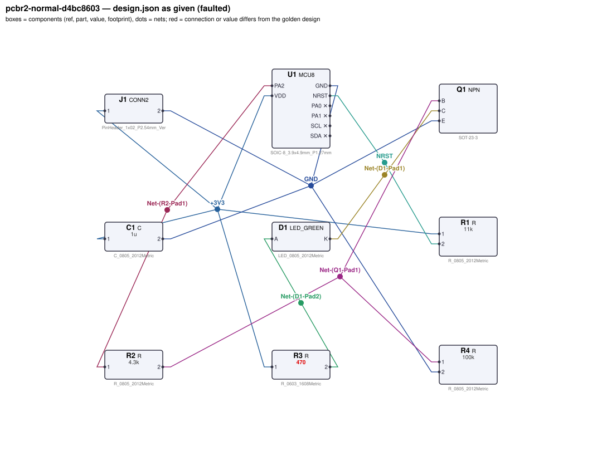
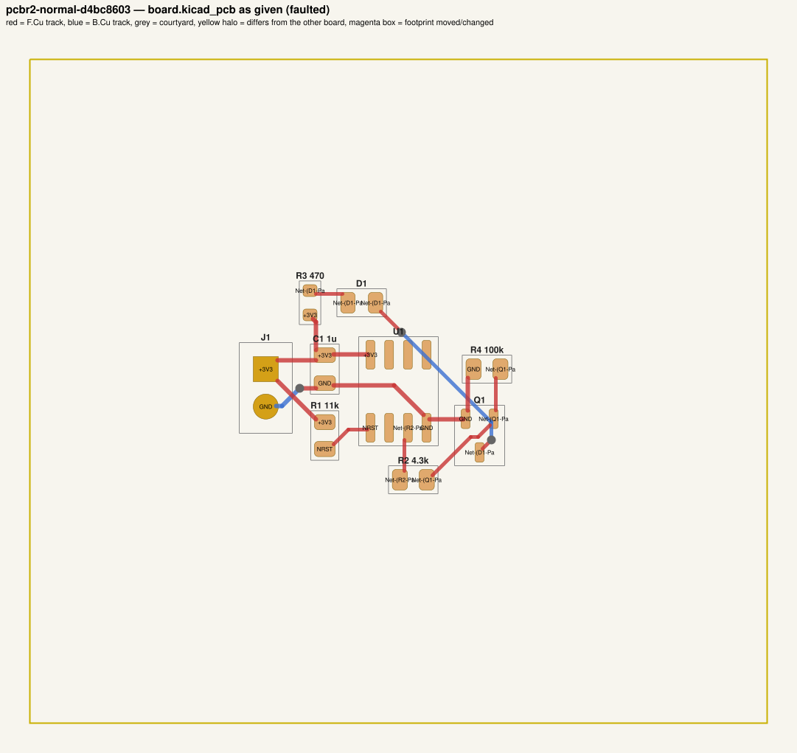
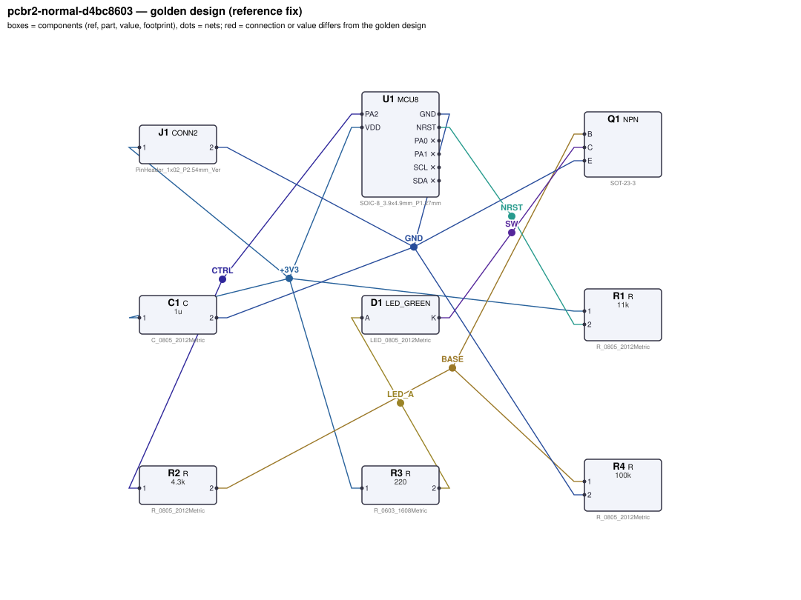
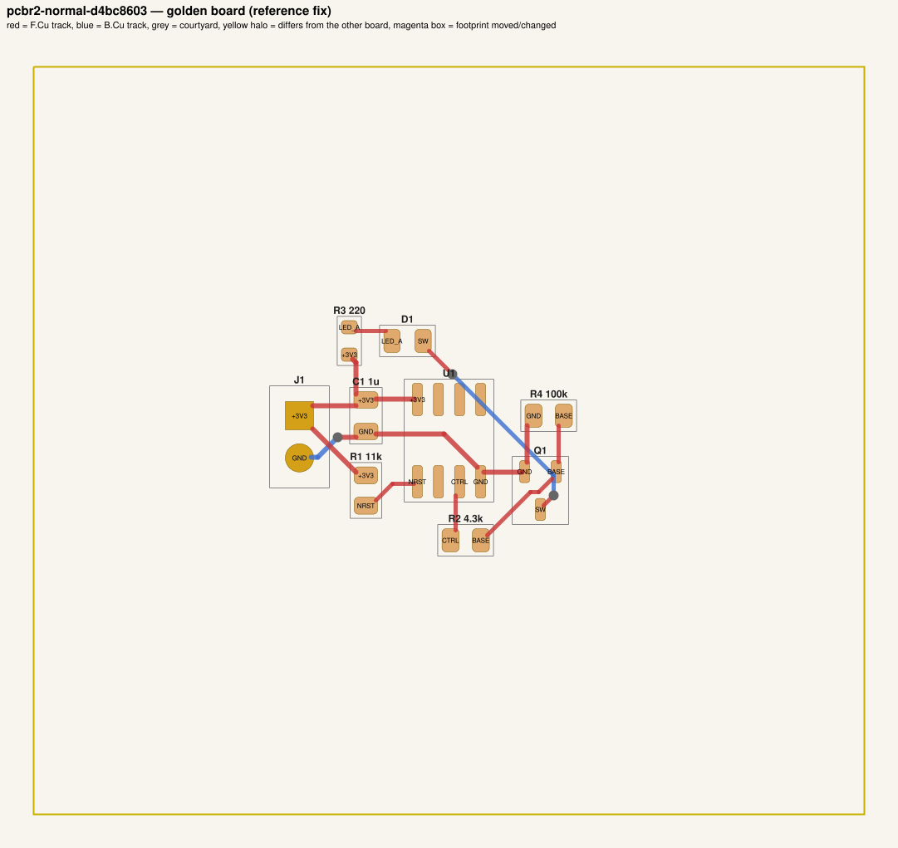

# QA packet 032: `pcbr2-normal-d4bc8603`

| family | tier | tool mode | hint level | intent in TASK.md | faults | latent | predicted difficulty |
|---|---|---|---|---|---|---|---|
| npn_switch | normal | full | vague | reduced | 1 | 0 | medium |

Task files: [`../../../tasks/v2/normal/pcbr2-normal-d4bc8603/public/`](../../../tasks/v2/normal/pcbr2-normal-d4bc8603/public/) (what the agent gets) and [`../../../tasks/v2/normal/pcbr2-normal-d4bc8603/hidden/`](../../../tasks/v2/normal/pcbr2-normal-d4bc8603/hidden/) (grader only). Why sampled: vague hint, value near bounds: R3=470 inside [40, 560].

**How to review (≈5 min):** read section 1 as if you were the agent, decide whether you could find and fix the problems from it; then check section 2 (faults, reference fix, verifier verdicts) and fill `review.yaml`. Do not let section 2 influence your fairness judgement of section 1.

## 1. What the agent sees

### 1.1 TASK.md (verbatim)

````markdown
# Task: MCU-controlled LED switch

## Problem report

The first boards built from these files fail bring-up. Find and fix all problems: the design must meet its purpose and spec, the layout must match design.json, and DRC/ERC must be clean.

## Design intent

# MCU-controlled low-side switch

A small MCU (U1, MCU8) switches a load through an NPN low-side transistor Q1. Power (3.3 V) comes in
on J1 (pin 1 = +3.3 V, pin 2 = GND); the MCU runs from the same rail.

Spec: with PA2 driven high the load current is 5.0 mA ±15 % and Q1 is saturated (VCE ≤ 0.3 V);
with PA2 high-impedance the load stays off even with 1 MΩ of leakage from the supply into the base.
Component values: decoupling C1 47 nF–10 µF (100 nF typical); NRST pull-up R1 2.2 kΩ–100 kΩ;
base pull-down R4 4.7 kΩ–220 kΩ (datasheet: 10k–100k).

Sub-circuits by purpose: supply connector (J1); MCU (U1); VDD decoupling (C1); reset pull-up (R1); transistor switch with base resistor and base pull-down (Q1, R2, R4); LED load with series resistor (D1, R3).

_Connection details are intentionally not repeated here: wire each part as its datasheet in `parts/` describes (pinout and application notes), so that the circuit does what the purpose, interfaces and spec above require._

## Spec

The design must satisfy these assertions (`pcbtool sim` runs them; full definitions in `spec.json`):

- `load_on_current`: DC current through D1 between 4.25 mA and 5.75 mA (J1.1 supplied with 3.3 V; 3.3 V DC source on U1.PA2; ground = J1.2)
- `vce_sat`: DC voltage at Q1.C between 0 V and 300 mV (J1.1 supplied with 3.3 V; 3.3 V DC source on U1.PA2; ground = J1.2)
- `gpio_current`: DC current through R2 between 0 A and 8 mA (J1.1 supplied with 3.3 V; 3.3 V DC source on U1.PA2; ground = J1.2)
- `load_off_current`: DC current through D1 between 0 A and 100 uA (J1.1 supplied with 3.3 V; load R=1e+06 from Q1.B to J1.1; ground = J1.2)
- `vdd`: DC voltage at U1.VDD relative to U1.GND between 3.234 V and 3.366 V (J1.1 supplied with 3.3 V; ground = J1.2)
- `nrst_high`: DC voltage at U1.NRST between 2.97 V and 3.333 V (J1.1 supplied with 3.3 V; ground = J1.2)

Layout: every track of these nets must be at least the given width:

- +3V3 (the net of J1.1): ≥ 0.3 mm
- GND (the net of J1.2): ≥ 0.3 mm

Decoupling: each capacitor's pad on the IC pin's net must reach the IC pin's pad within the given length of copper path (shortest path along that net's tracks, vias and pads, pad centre to pad centre; a cap wired to the pin the long way round does not decouple it), and every pad of the capacitor must lie within the given straight-line distance of the IC pin's pad:

- C1 within 6.0 mm of copper path of U1.VDD (and within 5.0 mm straight-line)

Component values: each value must lie in its acceptable range (inclusive; `value_bounds` in `spec.json`). Ranges come from the datasheets and the design intent; values the assertions already pin down get a wide sanity range, and the assertions still apply:

- C1 (C): 47 nF … 10 uF
- R1 (R): 2.2 kΩ … 100 kΩ
- R2 (R): 310 Ω … 11 kΩ
- R3 (R): 40 Ω … 560 Ω
- R4 (R): 4.7 kΩ … 220 kΩ

Resistor power rule: every resistor's continuous dissipation I²·R must stay at or below 50 % of its
footprint's rated power (0603 0.1 W, 0805 0.125 W, 1206 0.5 W; see `parts/R.md`). The grader checks
this under the spec's operating conditions; `pcbtool` does not.

Board rules: 2 copper layers, clearance 0.2 mm, min track 0.2 mm, vias 0.6/0.3 mm, copper-to-edge 0.3 mm. DRC must be clean with no unconnected items.

## Deliverable

- Edit only `design.json` (the schematic of record) and `board.kicad_pcb` (the layout).
- Do not add, remove or rename components; keep each component's part.
- Keep the two files consistent: same connectivity, values and footprints on both.
- Values: `<number><SI prefix><unit>` such as `4.7k`, `100n`, `10kΩ`, `1meg`; unit letters, if any, must match the part (R: Ω/ohm/R, C: F, L: H, crystal: Hz); no spaces or control characters inside (full grammar: "Value notation" in `parts/R.md`, `parts/C.md`, ...).
- Do not change the board outline, add zones, or add DRC exclusions.
- Footprints must be unmodified library footprints from the part's allowed list (see `parts/<PART>.md`).
- Grading is pass/fail: topology, consistency, DRC, ERC, spec, component values and layout must all pass.

## Tools

Run `pcbtool <command>` inside this directory (you may also edit the two files directly).

Read-only:
- `pcbtool show` — components, values, footprints, positions and nets
- `pcbtool netlist` — design nets vs. board pad nets, with differences highlighted
- `pcbtool drc` — KiCad DRC under the canonical rules (the same rules the grader uses)
- `pcbtool erc` — electrical rule check of design.json
- `pcbtool sim` — run the spec assertions (spec.json) on design.json
- `pcbtool parts [PART]` — list parts / print a part's datasheet (also in `parts/`)
- `pcbtool check` — all of the above in one summary

Mutating (each keeps design.json and board.kicad_pcb consistent and saves both):
- `pcbtool set-value REF VALUE`
- `pcbtool set-footprint REF LIB:FOOTPRINT`
- `pcbtool connect REF.PIN NET` / `pcbtool disconnect REF.PIN`
- `pcbtool move REF X Y ROT` (absolute mm, degrees; tracks do not follow)
- `pcbtool unroute NET` / `pcbtool route NET [--width W]` (re-routes the whole net)
- `pcbtool sync` — push design.json connectivity and values onto the board pads
````

### 1.2 Public files

The agent also gets `design.json`, `board.kicad_pcb`, `spec.json` and the part datasheets below, plus the `pcbtool` commands listed in TASK.md (DRC, ERC, simulation of the public assertions, value-range check). Renders of the faulted files:





<details><summary>Datasheet <code>parts/C.md</code></summary>

````markdown
# C — ceramic capacitor

Two-terminal non-polarised capacitor. Pins `1`, `2`. Value in farads.

## Value notation (all parts)

A value is `<number><SI prefix?><unit?>`, e.g. `4.7k`, `100n`, `2.2u`, `10R`, `1meg`, `1.5e3`:
- number: digits with an optional decimal point and an optional exponent (`1e3`); no sign, no
  digit grouping, no RKM notation (`4k7`);
- SI prefix (case-sensitive): `p` `n` `u`/`µ`/`μ` (micro) `m` (milli) `k`/`K` `M`/`meg`/`MEG` (mega) `G`;
  an exponent and a prefix together (`1e3k`) are rejected;
- unit letters, optional, must match the part: R `Ω`/`ohm`/`Ohm`/`R`; C `F`; L `H`; crystals `Hz`;
  other parts none (`100nH` on a capacitor is rejected);
- no whitespace or control characters inside the value (leading/trailing spaces are ignored).

design.json and the board must carry the same value; they are compared as numbers (`1k` == `1000`).
````

</details>

<details><summary>Datasheet <code>parts/CONN2.md</code></summary>

````markdown
# CONN2 — 2-pin header

Pin `1` = signal/supply, pin `2` = ground by board convention.
````

</details>

<details><summary>Datasheet <code>parts/LED_GREEN.md</code></summary>

````markdown
# LED_GREEN — green SMD indicator LED (570 nm)

## Pinout
| Pin | Pad | Function |
|---|---|---|
| A | 2 | anode |
| K | 1 | cathode (marked) |

## Electrical characteristics (25 C)
- Forward voltage Vf = 2.2 V typ at IF = 10 mA
- Max continuous forward current 25 mA; reverse voltage max 5 V

| IF | Vf (typ) |
|---|---|
| 2 mA | 2.10 V |
| 5 mA | 2.15 V |
| 10 mA | 2.20 V |
| 15 mA | 2.23 V |
| 20 mA | 2.26 V |

## Application notes
- Always drive through a current-limiting resistor: R = (Vsupply - n*Vf) / IF for n LEDs in series.
- Current flows anode -> cathode; reversed LEDs do not light.
````

</details>

<details><summary>Datasheet <code>parts/MCU8.md</code></summary>

````markdown
# MCU8 — generic 8-pin microcontroller (SOIC-8)

## Pinout
| Pin | Pad | Function |
|---|---|---|
| NRST | 1 | active-low reset input. **No internal pull-up**: needs an external pull-up to VDD, 2.2k–100k (10k typical); optional 10 nF–1 µF to GND (100 nF typical) for a power-on reset delay |
| PA1 | 2 | GPIO / ADC1 / XIN (crystal oscillator input) |
| PA2 | 3 | GPIO / ADC2 / XOUT (crystal oscillator output) |
| GND | 4 | ground |
| SDA | 5 | I2C data (open-drain) / GPIO |
| PA0 | 6 | GPIO / PWM output / ADC0 |
| SCL | 7 | I2C clock (open-drain) / GPIO |
| VDD | 8 | supply 1.8–5.5 V |

## Electrical characteristics
- Supply current 1.5 mA typ at 3.3 V
- GPIO output: VOH ≥ VDD - 0.4 V at 8 mA source (≈50 Ω output resistance); 8 mA max per pin
- Open-drain I2C pins sink max 3 mA at VOL = 0.4 V; no internal I2C pull-ups
- ADC (PA0, PA1, PA2): 12-bit, full scale = VDD, input range 0..VDD (never above VDD); the pin
  is high impedance (5 pF), so an RC anti-alias filter at the pin sets the input bandwidth
- Pin capacitance 5 pF per I/O; idle / reset I/O pins are high-impedance (no pulls)
- Crystal oscillator: 4–25 MHz fundamental crystal between XIN (PA1) and XOUT (PA2), each pin
  with a load capacitor to GND

## Application notes
- Decouple VDD with 100 nF ceramic (47 nF–10 µF) to GND within 5 mm of the VDD pin.
- I2C pull-ups: Rp ≥ (VDD - 0.4 V) / 3 mA (sink limit) and Rp ≤ tr / (0.8473 × Cbus) (rise time),
  where tr is the I2C rise time as defined by the I2C specification (UM10204): 30 % to 70 % of
  VDD, max 1000 ns standard-mode / 300 ns fast-mode; 0.8473 = ln(0.7/0.3). Cbus includes
  the 5 pF pin capacitance.
- Crystal load caps: CL = C1·C2/(C1+C2) + Cstray, i.e. C1 = C2 = 2·(CL - Cstray).
````

</details>

<details><summary>Datasheet <code>parts/NPN.md</code></summary>

````markdown
# NPN — general-purpose NPN BJT (SOT-23)

## Pinout
| Pin | Pad | Function |
|---|---|---|
| B | 1 | base |
| E | 2 | emitter |
| C | 3 | collector |

## Electrical characteristics
- VCEO 40 V, IC max 200 mA, Ptot 250 mW
- hFE 100–300 at IC = 10 mA, VCE = 1 V
- VBE(on) ~0.65–0.8 V
- VCE(sat) < 0.2 V at IC = 50 mA, IB = 5 mA

## Application notes
- Low-side switch: emitter to ground, load between supply and collector.
- For hard saturation size the base resistor for a forced beta of ~10:
  RB = (Vdrive - 0.75 V) / (IC / 10).
- Add a base-emitter pull-down (10k–100k) so the transistor stays off while the driver
  is high-impedance (e.g. MCU in reset).
- Inductive loads need a flyback diode across the load.
````

</details>

<details><summary>Datasheet <code>parts/R.md</code></summary>

````markdown
# R — resistor

Two-terminal resistor. Pins `1`, `2` (non-polarised). Value in ohms.

## Value notation (all parts)

A value is `<number><SI prefix?><unit?>`, e.g. `4.7k`, `100n`, `2.2u`, `10R`, `1meg`, `1.5e3`:
- number: digits with an optional decimal point and an optional exponent (`1e3`); no sign, no
  digit grouping, no RKM notation (`4k7`);
- SI prefix (case-sensitive): `p` `n` `u`/`µ`/`μ` (micro) `m` (milli) `k`/`K` `M`/`meg`/`MEG` (mega) `G`;
  an exponent and a prefix together (`1e3k`) are rejected;
- unit letters, optional, must match the part: R `Ω`/`ohm`/`Ohm`/`R`; C `F`; L `H`; crystals `Hz`;
  other parts none (`100nH` on a capacitor is rejected);
- no whitespace or control characters inside the value (leading/trailing spaces are ignored).

design.json and the board must carry the same value; they are compared as numbers (`1k` == `1000`).

## Ratings by footprint (high-power thick-film series used on this board)

| Size | Rated power (70 C) | Design limit (50 % derating) |
|---|---|---|
| 0603 | 0.1 W | 50.0 mW |
| 0805 | 0.125 W | 62.5 mW |
| 1206 | 0.5 W | 250.0 mW |

**Design rule:** the continuous dissipation P = I²·R of every resistor must not exceed 50 % of its
footprint's rated power. Pick the footprint for the power, not just the value.
````

</details>

## 2. Reviewer-only (hidden from the agent)

### 2.1 Injected faults

| # | type | category | DRC/ERC-invisible | latent (pcbtool-clean) | detail | verifier, this fault alone |
|---|---|---|---|---|---|---|
| 1 | `wrong_led_resistor` | value | yes |  | R3 (LED current-limiting resistor) is 470, should be 220 | reward 0.0; fails spec |

### 2.2 Reference fix (faulted → golden)

The reference repair is the hidden golden pair (`golden_design.json`, `golden_board.kicad_pcb`). Any repair that passes every gate and check scores 1.0; it need not be byte-identical.

**design.json: component changes**

- `R3` value: `470` → `220`

**design.json: connection changes** (per pin: what it connects to)

- none

**board.kicad_pcb: footprints moved / changed**

- none

**board.kicad_pcb: footprint values (BOM)**

- `R3` board value `470` → `220`

**board.kicad_pcb: pad-net changes**

- `D1` pad 1: net `Net-(D1-Pad1)` → `SW`
- `D1` pad 2: net `Net-(D1-Pad2)` → `LED_A`
- `Q1` pad 1: net `Net-(Q1-Pad1)` → `BASE`
- `Q1` pad 3: net `Net-(D1-Pad1)` → `SW`
- `R2` pad 1: net `Net-(R2-Pad1)` → `CTRL`
- `R2` pad 2: net `Net-(Q1-Pad1)` → `BASE`
- `R3` pad 2: net `Net-(D1-Pad2)` → `LED_A`
- `R4` pad 1: net `Net-(Q1-Pad1)` → `BASE`
- `U1` pad 3: net `Net-(R2-Pad1)` → `CTRL`

**board.kicad_pcb: nets re-routed** (track/via geometry differs)

- net `BASE`: 0 track/via item(s) removed, 4 added
- net `CTRL`: 0 track/via item(s) removed, 1 added
- net `LED_A`: 0 track/via item(s) removed, 1 added
- net `Net-(D1-Pad1)`: 6 track/via item(s) removed, 0 added
- net `Net-(D1-Pad2)`: 1 track/via item(s) removed, 0 added
- net `Net-(Q1-Pad1)`: 4 track/via item(s) removed, 0 added
- net `Net-(R2-Pad1)`: 1 track/via item(s) removed, 0 added
- net `SW`: 0 track/via item(s) removed, 6 added

Golden renders (compare with 1.2; highlighted items differ):





### 2.3 Verifier verdicts

Reward is 1 only if every gate and check passes.

| stage | kind | faulted files | golden files |
|---|---|---|---|
| parse | gate | pass | pass |
| components | gate | pass | pass |
| topology | gate | pass | pass |
| consistency | gate | pass | pass |
| integrity | gate | pass | pass |
| drc | check | pass | pass |
| erc | check | pass | pass |
| spec | check | **FAIL** | pass |
| values | check | pass | pass |
| layout | check | pass | pass |
| rules | check | pass | pass |
| **reward** | | **0** | **1** |

Verifier messages on the faulted files:

- **spec**: load_on_current: measured 0.0024063855141 expected [0.00425, 0.00575]

### 2.4 Spec assertions before / after

| assertion | what | allowed | faulted: measured | | golden: measured | |
|---|---|---|---|---|---|---|
| `load_on_current` | DC current through D1 (J1.1 supplied with 3.3 V; 3.3 V DC source on U1.PA2; ground = J1.2) | 4.25 mA … 5.75 mA | 2.406 mA | ❌ | 4.87 mA | ✅ |
| `vce_sat` | DC voltage at Q1.C (J1.1 supplied with 3.3 V; 3.3 V DC source on U1.PA2; ground = J1.2) | 0 V … 300 mV | 57.88 mV | ✅ | 76.07 mV | ✅ |
| `gpio_current` | DC current through R2 (J1.1 supplied with 3.3 V; 3.3 V DC source on U1.PA2; ground = J1.2) | 0 A … 8 mA | 596.7 uA | ✅ | 593.3 uA | ✅ |
| `load_off_current` | DC current through D1 (J1.1 supplied with 3.3 V; load R=1e+06 from Q1.B to J1.1; ground = J1.2) | 0 A … 100 uA | 755.7 pA | ✅ | 755.7 pA | ✅ |
| `vdd` | DC voltage at U1.VDD relative to U1.GND (J1.1 supplied with 3.3 V; ground = J1.2) | 3.234 V … 3.366 V | 3.3 V | ✅ | 3.3 V | ✅ |
| `nrst_high` | DC voltage at U1.NRST (J1.1 supplied with 3.3 V; ground = J1.2) | 2.97 V … 3.333 V | 3.3 V | ✅ | 3.3 V | ✅ |

### 2.5 Value bounds

Bounds are public (TASK.md / spec.json); `values` check = every value inside its range.

| ref | part | acceptable range | faulted design.json | faulted board | golden | touched by a fault |
|---|---|---|---|---|---|---|
| `C1` | C | 47 nF … 10 uF | `1u` | `1u` | `1u` |  |
| `R1` | R | 2.2 kΩ … 100 kΩ | `11k` | `11k` | `11k` |  |
| `R2` | R | 310 Ω … 11 kΩ | `4.3k` | `4.3k` | `4.3k` |  |
| `R3` | R | 40 Ω … 560 Ω | `470` | `470` | `220` | **yes** |
| `R4` | R | 4.7 kΩ … 220 kΩ | `100k` | `100k` | `100k` |  |

### 2.6 Layout rules

- power net `+3V3` (golden pins C1.1, J1.1, R1.1, R3.1, U1.VDD): every track ≥ 0.3 mm
- power net `GND` (golden pins C1.2, J1.2, Q1.E, R4.2, U1.GND): every track ≥ 0.3 mm
- decoupling: `C1` within 6.0 mm of copper path (and 5.0 mm straight-line) of `U1.VDD`

### 2.8 Design rules (`rules` check, not run by pcbtool)

Scope: resistor power only (`rules_power`, all v2 tiers); 3 operating condition(s) from the spec's stimuli; 4 rule quantities evaluated per design. Rows shown: violated on either side, on a part a fault touches (if ≥ 5 % of its limit or changed by ≥ 5 points or by a footprint change), or at ≥ 80% of the limit. Values are the worst case over the conditions (computed with `pcbenv.rules.operating_point`; limits from `pcbenv/rules.py`, stated in `parts/<PART>.md` and TASK.md "Design rules").

| rule | subject | quantity | limit | faulted (of limit) | golden (of limit) | shown because | worst condition (faulted) |
|---|---|---|---|---|---|---|---|
| `resistor_power` | `R3` | I²R | 50 mW | 0603: 2.722 mW of 50 mW (5%) | 0603: 5.218 mW of 50 mW (10%) | fault target | cond 0 |

Rule violations reported by the verifier: faulted: none; golden: none.

## 3. Review

Fill `review.yaml` in this directory (second reviewer: copy `../../review_template.yaml` to `review-<initials>.yaml` here, without looking at the first form). Questions to answer:

1. **task_fair / solvable_from_public_material**: from section 1 only, can a competent engineer locate and fix every injected fault? Is anything required that is not stated (a value with no assertion and no published range, a connection only the golden reveals)?
2. **reference_fix_correct**: is the golden (2.2) a correct design that meets the stated intent?
3. **verifier_verdict_agrees**: do you agree the faulted files fail and the golden passes, for the reasons given in 2.3?
4. **alternative_valid_fixes_rejected**: is there an engineering-valid repair the grader would reject (e.g. a different E-series value that meets intent but fails an assertion window or value bound; keeping a swapped footprint and re-routing; a different valid placement)?
5. **rule_stated_clearly**: is every design rule / layout rule / latent requirement this task grades (2.7–2.9) stated in the public material clearly enough that an engineer would apply it the way the grader does (limit, which part, which condition)? Normal-tier tasks: answer for the resistor-power rule (`yes` if no rule is involved).
6. **layout_rule_reasonable**: hard_layout tasks only (else `n/a`): are the layout-rule limits and their geometric definitions (2.9) defensible engineering practice for this board, i.e. would you reject the faulted layout in a design review, and accept the golden one?

