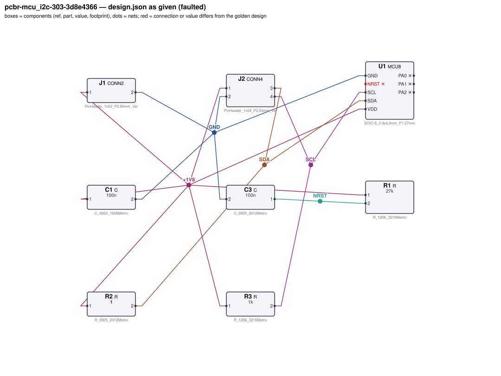
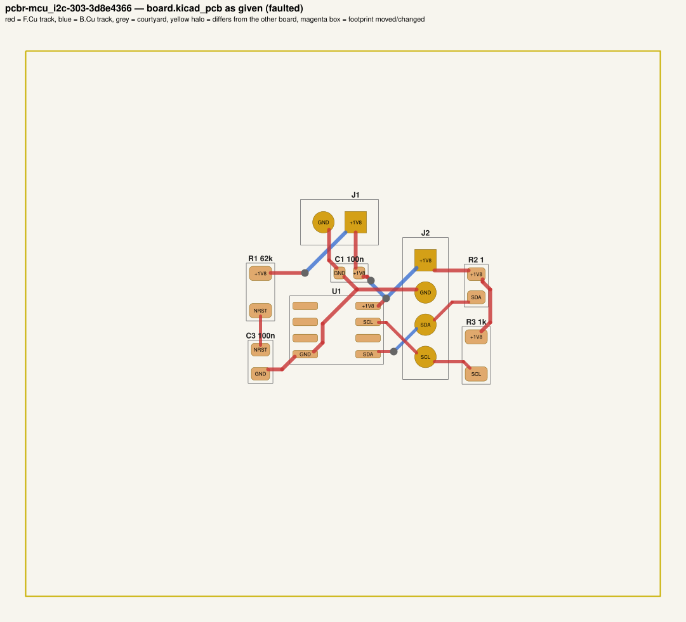
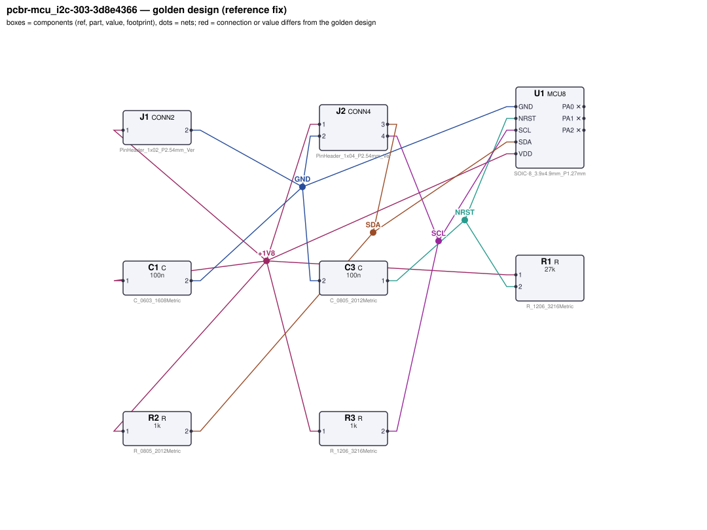
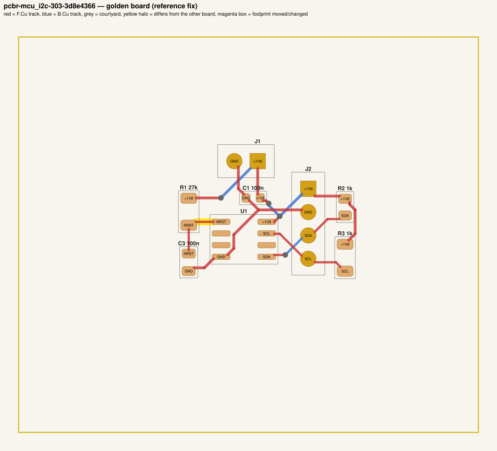

# QA packet 035: `pcbr-mcu_i2c-303-3d8e4366`

| family | seed | hint level | intent in TASK.md | faults | predicted difficulty |
|---|---|---|---|---|---|
| mcu_i2c | 303 | vague | reduced | 3 | hard |

Task files: [`../../../tasks/train/pcbr-mcu_i2c-303-3d8e4366/public/`](../../../tasks/train/pcbr-mcu_i2c-303-3d8e4366/public/) (what the agent gets) and [`../../../tasks/train/pcbr-mcu_i2c-303-3d8e4366/hidden/`](../../../tasks/train/pcbr-mcu_i2c-303-3d8e4366/hidden/) (grader only). Why sampled: 3 faults, vague hint, connectivity fault, disputable type bom_mismatch, value near bounds: R1=62k inside [2200, 100000].

**How to review (≈5 min):** read section 1 as if you were the agent, decide whether you could find and fix the problems from it; then check section 2 (faults, reference fix, verifier verdicts) and fill `review.yaml`. Do not let section 2 influence your fairness judgement of section 1.

## 1. What the agent sees

### 1.1 TASK.md (verbatim)

````markdown
# Task: MCU with I2C bus (standard-mode)

## Problem report

The first boards built from these files fail bring-up. Find and fix all problems: the design must meet its purpose and spec, the layout must match design.json, and DRC/ERC must be clean.

## Design intent

# MCU with I2C bus header

An MCU (U1, MCU8) running from 1.8 V (J1: pin 1 = +1.8 V, pin 2 = GND) acts as I2C controller
for off-board devices on the 4-pin bus header J2 (pin 1 = VDD, pin 2 = GND, pin 3 = SDA, pin 4 = SCL).

Bus: standard-mode I2C with up to 300 pF of off-board bus capacitance per line (plus 5 pF
MCU pin capacitance). Spec: 10–90 % rise time ≤ 1000 ns on both lines (nominal
670 ns), pull-up current ≤ 3 mA with a line held at VOL = 0.4 V, NRST ≥ 0.9·VDD.
Component values: decoupling C1 47 nF–10 µF (100 nF typical); NRST pull-up R1 2.2 kΩ–100 kΩ; reset delay C3 10 nF–1 µF.

_Connection details are intentionally not repeated here: wire each part as its datasheet in `parts/` describes (pinout and application notes), so that the circuit does what the purpose, interfaces and spec above require._

## Spec

The design must satisfy these assertions (`pcbtool sim` runs them; full definitions in `spec.json`):

- `vdd`: DC voltage at U1.VDD relative to U1.GND between 1.764 V and 1.836 V (J1.1 supplied with 1.8 V; ground = J1.2)
- `nrst_high`: DC voltage at U1.NRST between 1.62 V and 1.818 V (J1.1 supplied with 1.8 V; ground = J1.2)
- `sda_rise_time`: 10-90 % transition time at U1.SDA between 0 s and 1 us (J1.1 supplied with 1.8 V; release source on U1.SDA; load C=3e-10 from J2.3 to ground; load C=3e-10 from J2.4 to ground; ground = J1.2)
- `sda_sink_current`: DC current through R2 between 0 A and 3 mA (J1.1 supplied with 1.8 V; dc source on U1.SDA; ground = J1.2)
- `scl_rise_time`: 10-90 % transition time at U1.SCL between 0 s and 1 us (J1.1 supplied with 1.8 V; release source on U1.SCL; load C=3e-10 from J2.3 to ground; load C=3e-10 from J2.4 to ground; ground = J1.2)
- `scl_sink_current`: DC current through R3 between 0 A and 3 mA (J1.1 supplied with 1.8 V; dc source on U1.SCL; ground = J1.2)

Layout: every track of these nets must be at least the given width:

- +1V8 (the net of J1.1): ≥ 0.3 mm
- GND (the net of J1.2): ≥ 0.3 mm

Decoupling: every pad of each capacitor within the given distance of the IC pin's pad:

- C1 within 5.0 mm of U1.VDD

Component values: each value must lie in its acceptable range (inclusive; `value_bounds` in `spec.json`). Ranges come from the datasheets and the design intent; values the assertions already pin down get a wide sanity range, and the assertions still apply:

- C1 (C): 47 nF … 10 uF
- C3 (C): 10 nF … 1 uF
- R1 (R): 2.2 kΩ … 100 kΩ
- R2 (R): 290 Ω … 2.7 kΩ
- R3 (R): 270 Ω … 3 kΩ

Board rules: 2 copper layers, clearance 0.2 mm, min track 0.2 mm, vias 0.6/0.3 mm, copper-to-edge 0.3 mm. DRC must be clean with no unconnected items.

## Deliverable

- Edit only `design.json` (the schematic of record) and `board.kicad_pcb` (the layout).
- Do not add, remove or rename components; keep each component's part.
- Keep the two files consistent: same connectivity, values and footprints on both.
- Do not change the board outline, add zones, or add DRC exclusions.
- Footprints must be unmodified library footprints from the part's allowed list (see `parts/<PART>.md`).
- Grading is pass/fail: topology, consistency, DRC, ERC, spec, component values and layout must all pass.

## Tools

Run `pcbtool <command>` inside this directory (you may also edit the two files directly).

Read-only:
- `pcbtool show` — components, values, footprints, positions and nets
- `pcbtool netlist` — design nets vs. board pad nets, with differences highlighted
- `pcbtool drc` — KiCad DRC under the canonical rules (the same rules the grader uses)
- `pcbtool erc` — electrical rule check of design.json
- `pcbtool sim` — run the spec assertions (spec.json) on design.json
- `pcbtool parts [PART]` — list parts / print a part's datasheet (also in `parts/`)
- `pcbtool check` — all of the above in one summary

Mutating (each keeps design.json and board.kicad_pcb consistent and saves both):
- `pcbtool set-value REF VALUE`
- `pcbtool set-footprint REF LIB:FOOTPRINT`
- `pcbtool connect REF.PIN NET` / `pcbtool disconnect REF.PIN`
- `pcbtool move REF X Y ROT` (absolute mm, degrees; tracks do not follow)
- `pcbtool unroute NET` / `pcbtool route NET [--width W]` (re-routes the whole net)
- `pcbtool sync` — push design.json connectivity and values onto the board pads
````

### 1.2 Public files

The agent also gets `design.json`, `board.kicad_pcb`, `spec.json` and the part datasheets below, plus the `pcbtool` commands listed in TASK.md (DRC, ERC, simulation of the public assertions, value-range check). Renders of the faulted files:





<details><summary>Datasheet <code>parts/C.md</code></summary>

````markdown
# C — ceramic capacitor

Two-terminal non-polarised capacitor. Pins `1`, `2`. Value in farads.
````

</details>

<details><summary>Datasheet <code>parts/CONN2.md</code></summary>

````markdown
# CONN2 — 2-pin header

Pin `1` = signal/supply, pin `2` = ground by board convention.
````

</details>

<details><summary>Datasheet <code>parts/CONN4.md</code></summary>

````markdown
# CONN4 — 4-pin 2.54 mm header

Generic vertical pin header used for off-board power, signal and bus connections.

| Pin | Pad | Typical use |
|---|---|---|
| 1 | 1 | signal / supply |
| 2 | 2 | ground (board convention) |
| 3 | 3 | signal / supply |
| 4 | 4 | signal / supply |

## Notes
- Pin 2 is ground by board convention; the function of the other pins is set by the design.
- Rated 3 A per contact. Has no electrical model of its own (it is where external
  supplies, signals and loads attach).
````

</details>

<details><summary>Datasheet <code>parts/MCU8.md</code></summary>

````markdown
# MCU8 — generic 8-pin microcontroller (SOIC-8)

## Pinout
| Pin | Pad | Function |
|---|---|---|
| NRST | 1 | active-low reset input. **No internal pull-up**: needs an external 10k pull-up to VDD (optional 100 nF to GND) |
| PA1 | 2 | GPIO / XIN (crystal oscillator input) |
| PA2 | 3 | GPIO / XOUT (crystal oscillator output) |
| GND | 4 | ground |
| SDA | 5 | I2C data (open-drain) / GPIO |
| PA0 | 6 | GPIO / PWM output |
| SCL | 7 | I2C clock (open-drain) / GPIO |
| VDD | 8 | supply 1.8–5.5 V |

## Electrical characteristics
- Supply current 1.5 mA typ at 3.3 V
- GPIO output: VOH ≥ VDD - 0.4 V at 8 mA source (≈50 Ω output resistance); 8 mA max per pin
- Open-drain I2C pins sink max 3 mA at VOL = 0.4 V; no internal I2C pull-ups
- Pin capacitance 5 pF per I/O; idle / reset I/O pins are high-impedance (no pulls)
- Crystal oscillator: 4–25 MHz fundamental crystal between XIN (PA1) and XOUT (PA2), each pin
  with a load capacitor to GND

## Application notes
- Decouple VDD with 100 nF ceramic to GND within 5 mm of the VDD pin.
- I2C pull-ups: Rp ≥ (VDD - 0.4 V) / 3 mA and Rp ≤ tr / (2.2 × Cbus) for a 10–90 % rise time tr
  (Cbus includes the 5 pF pin capacitance).
- Crystal load caps: CL = C1·C2/(C1+C2) + Cstray, i.e. C1 = C2 = 2·(CL - Cstray).
````

</details>

<details><summary>Datasheet <code>parts/R.md</code></summary>

````markdown
# R — resistor

Two-terminal resistor. Pins `1`, `2` (non-polarised). Value in ohms.
````

</details>

## 2. Reviewer-only (hidden from the agent)

### 2.1 Injected faults

| # | type | category | DRC/ERC-invisible | detail | verifier, this fault alone |
|---|---|---|---|---|---|
| 1 | `floating_pin` | connectivity | no | U1.NRST left unconnected (should be on NRST) | reward 0.0; fails erc, spec, topology |
| 2 | `magnitude_slip` | value | yes | R2 is 1 (unit slip), should be 1k | reward 0.0; fails spec, values |
| 3 | `bom_mismatch` | value | yes | board value of R1 is 62k, design.json says 27k | reward 0.0; fails consistency |

### 2.2 Reference fix (faulted → golden)

The reference repair is the hidden golden pair (`golden_design.json`, `golden_board.kicad_pcb`). Any repair that passes every gate and check scores 1.0; it need not be byte-identical.

**design.json: component changes**

- `R2` value: `1` → `1k`

**design.json: connection changes** (per pin: what it connects to)

- `U1.NRST`: faulted unconnected → golden net `NRST` (C3.1, R1.2)

**board.kicad_pcb: footprints moved / changed**

- none

**board.kicad_pcb: footprint values (BOM)**

- `R1` board value `62k` → `27k`
- `R2` board value `1` → `1k`

**board.kicad_pcb: pad-net changes**

- `U1` pad 1: net `(none)` → `NRST`

**board.kicad_pcb: nets re-routed** (track/via geometry differs)

- net `NRST`: 0 track/via item(s) removed, 1 added

Golden renders (compare with 1.2; highlighted items differ):





### 2.3 Verifier verdicts

Reward is 1 only if every gate and check passes.

| stage | kind | faulted files | golden files |
|---|---|---|---|
| parse | gate | pass | pass |
| components | gate | pass | pass |
| topology | gate | **FAIL** | pass |
| consistency | gate | **FAIL** | pass |
| integrity | gate | pass | pass |
| drc | check | pass | pass |
| erc | check | **FAIL** | pass |
| spec | check | **FAIL** | pass |
| values | check | **FAIL** | pass |
| layout | check | pass | pass |
| **reward** | | **0** | **1** |

Verifier messages on the faulted files:

- **consistency**: R1: board value '62k' != design value '27k'
- **erc**: unconnected_required: U1.NRST must be connected
- **spec**: nrst_high: measured 0.0 expected [1.62, 1.818]
- **spec**: sda_sink_current: measured 1.3972047729 expected [0.0, 0.003]
- **topology**: nets only in candidate: [['C3.1', 'R1.2']]; nets only in reference: [['C3.1', 'R1.2', 'U1.NRST']]
- **values**: R2: value '1' outside acceptable range [290, 2700]

### 2.4 Spec assertions before / after

| assertion | what | allowed | faulted: measured | | golden: measured | |
|---|---|---|---|---|---|---|
| `vdd` | DC voltage at U1.VDD relative to U1.GND (J1.1 supplied with 1.8 V; ground = J1.2) | 1.764 V … 1.836 V | 1.8 V | ✅ | 1.8 V | ✅ |
| `nrst_high` | DC voltage at U1.NRST (J1.1 supplied with 1.8 V; ground = J1.2) | 1.62 V … 1.818 V | 0 V | ❌ | 1.8 V | ✅ |
| `sda_rise_time` | 10-90 % transition time at U1.SDA (J1.1 supplied with 1.8 V; release source on U1.SDA; load C=3e-10 from J2.3 to ground; load C=3e-10 from J2.4 to ground; ground = J1.2) | 0 s … 1 us | 710.3 ps | ✅ | 670.2 ns | ✅ |
| `sda_sink_current` | DC current through R2 (J1.1 supplied with 1.8 V; dc source on U1.SDA; ground = J1.2) | 0 A … 3 mA | 1.397 A | ❌ | 1.4 mA | ✅ |
| `scl_rise_time` | 10-90 % transition time at U1.SCL (J1.1 supplied with 1.8 V; release source on U1.SCL; load C=3e-10 from J2.3 to ground; load C=3e-10 from J2.4 to ground; ground = J1.2) | 0 s … 1 us | 670.2 ns | ✅ | 670.2 ns | ✅ |
| `scl_sink_current` | DC current through R3 (J1.1 supplied with 1.8 V; dc source on U1.SCL; ground = J1.2) | 0 A … 3 mA | 1.4 mA | ✅ | 1.4 mA | ✅ |

### 2.5 Value bounds

Bounds are public (TASK.md / spec.json); `values` check = every value inside its range.

| ref | part | acceptable range | faulted design.json | faulted board | golden | touched by a fault |
|---|---|---|---|---|---|---|
| `C1` | C | 47 nF … 10 uF | `100n` | `100n` | `100n` |  |
| `C3` | C | 10 nF … 1 uF | `100n` | `100n` | `100n` |  |
| `R1` | R | 2.2 kΩ … 100 kΩ | `27k` | `62k` | `27k` | **yes** |
| `R2` | R | 290 Ω … 2.7 kΩ | `1` ⚠ out of range | `1` ⚠ out of range | `1k` | **yes** |
| `R3` | R | 270 Ω … 3 kΩ | `1k` | `1k` | `1k` |  |

### 2.6 Layout rules

- power net `+1V8` (golden pins C1.1, J1.1, J2.1, R1.1, R2.1, R3.1, U1.VDD): every track ≥ 0.3 mm
- power net `GND` (golden pins C1.2, C3.2, J1.2, J2.2, U1.GND): every track ≥ 0.3 mm
- decoupling: `C1` within 5.0 mm of `U1.VDD`

## 3. Review

Fill `review.yaml` in this directory (second reviewer: copy `../../review_template.yaml` to `review-<initials>.yaml` here, without looking at the first form). Questions to answer:

1. **task_fair / solvable_from_public_material**: from section 1 only, can a competent engineer locate and fix every injected fault? Is anything required that is not stated (a value with no assertion and no published range, a connection only the golden reveals)?
2. **reference_fix_correct**: is the golden (2.2) a correct design that meets the stated intent?
3. **verifier_verdict_agrees**: do you agree the faulted files fail and the golden passes, for the reasons given in 2.3?
4. **alternative_valid_fixes_rejected**: is there an engineering-valid repair the grader would reject (e.g. a different E-series value that meets intent but fails an assertion window or value bound; keeping a swapped footprint and re-routing; a different valid placement)?

