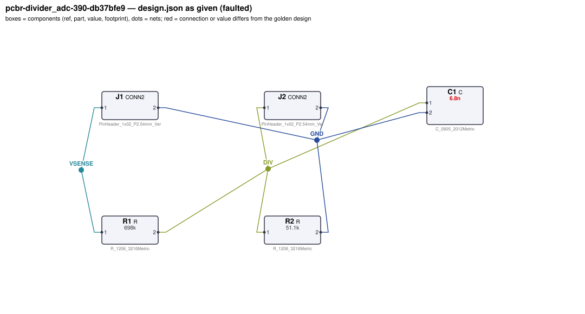
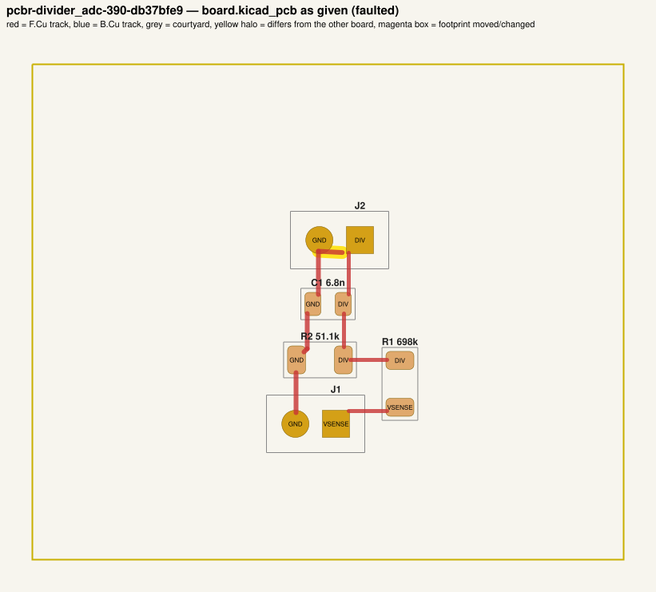
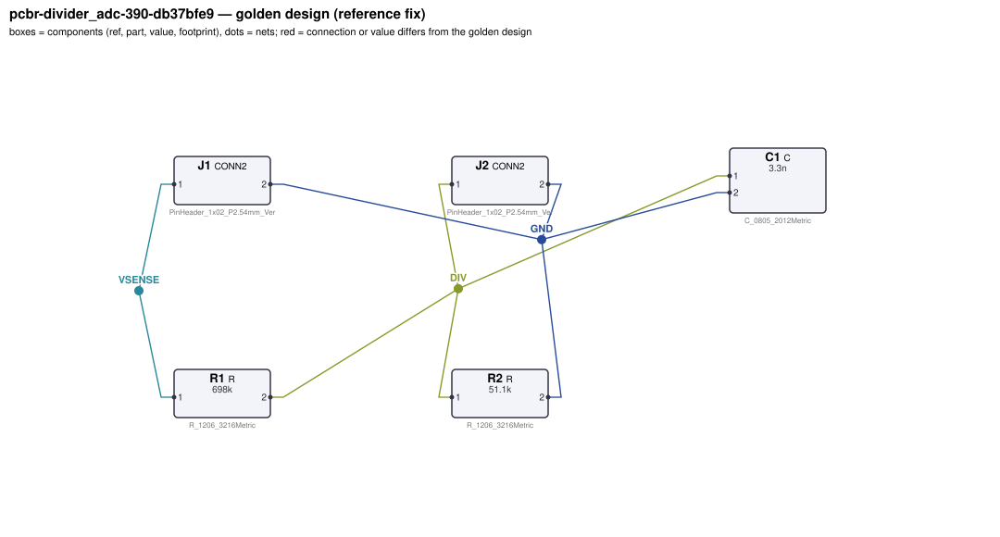
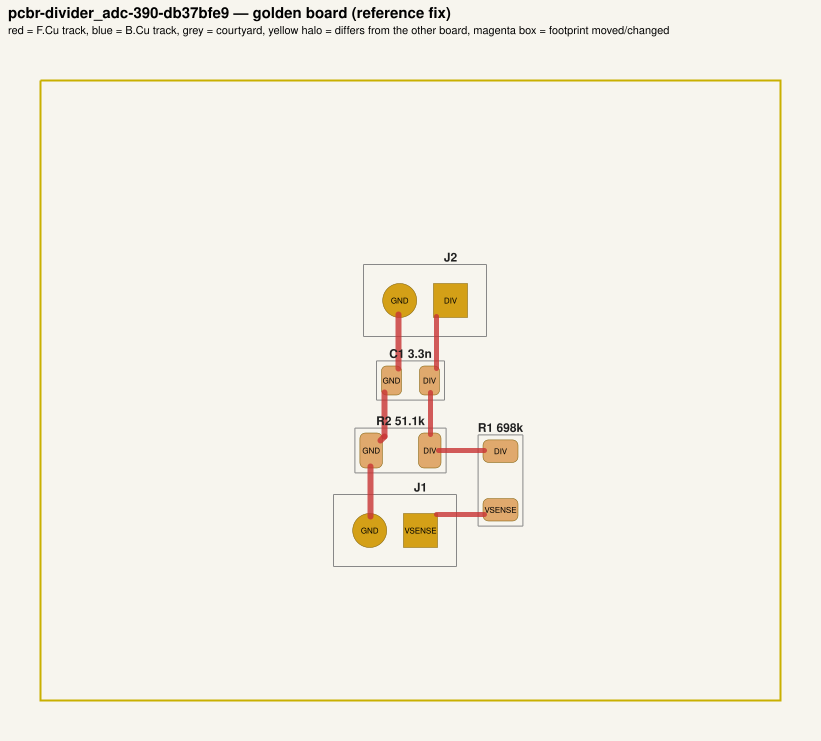

# QA packet 04: `pcbr-divider_adc-390-db37bfe9`

| family | seed | hint level | intent in TASK.md | faults | predicted difficulty |
|---|---|---|---|---|---|
| divider_adc | 390 | explicit | full | 2 | medium |

Task files: [`../../../tasks/train/pcbr-divider_adc-390-db37bfe9/public/`](../../../tasks/train/pcbr-divider_adc-390-db37bfe9/public/) (what the agent gets) and [`../../../tasks/train/pcbr-divider_adc-390-db37bfe9/hidden/`](../../../tasks/train/pcbr-divider_adc-390-db37bfe9/hidden/) (grader only). Why sampled: value near bounds: C1=6.8n inside [1e-09, 1.2e-08].

**How to review (≈5 min):** read section 1 as if you were the agent, decide whether you could find and fix the problems from it; then check section 2 (faults, reference fix, verifier verdicts) and fill `review.yaml`. Do not let section 2 influence your fairness judgement of section 1.

## 1. What the agent sees

### 1.1 TASK.md (verbatim)

````markdown
# Task: 0-24 V sense divider for a 1.8 V ADC

## Problem report

The first boards built from these files fail bring-up. Observations so far:

- Network analyser: −3 dB corner J1.1 → J2.1 measured at 491.4 Hz, expected 911.6 Hz to 1.114 kHz (`anti_alias_corner`).
- The fab's DRC run rejects the layout: 2 error(s) (2× clearance).

A reviewer narrowed the failure down to these areas (each needs a fix):

- the value of C1
- the routing of net GND near net DIV

Fix every problem (there may be more than the observations show directly).

## Design intent

# Voltage-sense divider for an ADC

Scales a 0–24 V signal on J1 (pin 1 = sensed voltage, pin 2 = GND) down so that 24 V reads as
1.62 V (90 % of a 1.8 V ADC full scale) on the ADC header J2 (pin 1 = ADC input, pin 2 = GND).

- Divider: R1 from the sensed input to the divider node, R2 from the divider node to GND
  (ratio R2/(R1+R2)).
- Anti-alias filter: C1 from the divider node to GND, corner 1/(2π·(R1||R2)·C1) ≈ 1000 Hz.
- The divider node goes directly to J2 pin 1.

Spec: ADC voltage = 0.0675 × input ±2 %; anti-alias -3 dB corner 1013 Hz ±10 %.

## Spec

The design must satisfy these assertions (`pcbtool sim` runs them; full definitions in `spec.json`):

- `full_scale`: DC voltage at J2.1 between 1.588 V and 1.652 V (J1.1 supplied with 24.0 V; ground = J1.2)
- `half_scale`: DC voltage at J2.1 between 793.8 mV and 826.2 mV (J1.1 supplied with 12.0 V; ground = J1.2)
- `anti_alias_corner`: -3 dB frequency from J1.1 to J2.1 between 911.6 Hz and 1.114 kHz (dc source on J1.1; ground = J1.2)

Layout: every track of these nets must be at least the given width:

- GND (the net of J1.2): ≥ 0.3 mm

Component values: each value must lie in its acceptable range (inclusive; `value_bounds` in `spec.json`). Ranges come from the datasheets and the design intent; values the assertions already pin down get a wide sanity range, and the assertions still apply:

- C1 (C): 1 nF … 12 nF
- R1 (R): 190 kΩ … 2 MΩ
- R2 (R): 16 kΩ … 180 kΩ

Board rules: 2 copper layers, clearance 0.2 mm, min track 0.2 mm, vias 0.6/0.3 mm, copper-to-edge 0.3 mm. DRC must be clean with no unconnected items.

## Deliverable

- Edit only `design.json` (the schematic of record) and `board.kicad_pcb` (the layout).
- Do not add, remove or rename components; keep each component's part.
- Keep the two files consistent: same connectivity, values and footprints on both.
- Do not change the board outline, add zones, or add DRC exclusions.
- Footprints must be unmodified library footprints from the part's allowed list (see `parts/<PART>.md`).
- Grading is pass/fail: topology, consistency, DRC, ERC, spec, component values and layout must all pass.

## Tools

Run `pcbtool <command>` inside this directory (you may also edit the two files directly).

Read-only:
- `pcbtool show` — components, values, footprints, positions and nets
- `pcbtool netlist` — design nets vs. board pad nets, with differences highlighted
- `pcbtool drc` — KiCad DRC under the canonical rules (the same rules the grader uses)
- `pcbtool erc` — electrical rule check of design.json
- `pcbtool sim` — run the spec assertions (spec.json) on design.json
- `pcbtool parts [PART]` — list parts / print a part's datasheet (also in `parts/`)
- `pcbtool check` — all of the above in one summary

Mutating (each keeps design.json and board.kicad_pcb consistent and saves both):
- `pcbtool set-value REF VALUE`
- `pcbtool set-footprint REF LIB:FOOTPRINT`
- `pcbtool connect REF.PIN NET` / `pcbtool disconnect REF.PIN`
- `pcbtool move REF X Y ROT` (absolute mm, degrees; tracks do not follow)
- `pcbtool unroute NET` / `pcbtool route NET [--width W]` (re-routes the whole net)
- `pcbtool sync` — push design.json connectivity and values onto the board pads
````

### 1.2 Public files

The agent also gets `design.json`, `board.kicad_pcb`, `spec.json` and the part datasheets below, plus the `pcbtool` commands listed in TASK.md (DRC, ERC, simulation of the public assertions, value-range check). Renders of the faulted files:





<details><summary>Datasheet <code>parts/C.md</code></summary>

````markdown
# C — ceramic capacitor

Two-terminal non-polarised capacitor. Pins `1`, `2`. Value in farads.
````

</details>

<details><summary>Datasheet <code>parts/CONN2.md</code></summary>

````markdown
# CONN2 — 2-pin header

Pin `1` = signal/supply, pin `2` = ground by board convention.
````

</details>

<details><summary>Datasheet <code>parts/R.md</code></summary>

````markdown
# R — resistor

Two-terminal resistor. Pins `1`, `2` (non-polarised). Value in ohms.
````

</details>

## 2. Reviewer-only (hidden from the agent)

### 2.1 Injected faults

| # | type | category | DRC/ERC-invisible | detail | verifier, this fault alone |
|---|---|---|---|---|---|
| 1 | `wrong_filter_cap` | value | yes | C1 (filter/timing capacitor) is 6.8n, should be 3.3n | reward 0.0; fails spec |
| 2 | `clearance_violation` | board | no | track stub of net GND on F.Cu ends 0.14 mm from net DIV at (119.39, 111.78) | reward 0.0; fails drc |

### 2.2 Reference fix (faulted → golden)

The reference repair is the hidden golden pair (`golden_design.json`, `golden_board.kicad_pcb`). Any repair that passes every gate and check scores 1.0; it need not be byte-identical.

**design.json: component changes**

- `C1` value: `6.8n` → `3.3n`

**design.json: connection changes** (per pin: what it connects to)

- none

**board.kicad_pcb: footprints moved / changed**

- none

**board.kicad_pcb: footprint values (BOM)**

- `C1` board value `6.8n` → `3.3n`

**board.kicad_pcb: pad-net changes**

- none

**board.kicad_pcb: nets re-routed** (track/via geometry differs)

- net `GND`: 1 track/via item(s) removed, 0 added

Golden renders (compare with 1.2; highlighted items differ):





### 2.3 Verifier verdicts

Reward is 1 only if every gate and check passes.

| stage | kind | faulted files | golden files |
|---|---|---|---|
| parse | gate | pass | pass |
| components | gate | pass | pass |
| topology | gate | pass | pass |
| consistency | gate | pass | pass |
| integrity | gate | pass | pass |
| drc | check | **FAIL** | pass |
| erc | check | pass | pass |
| spec | check | **FAIL** | pass |
| values | check | pass | pass |
| layout | check | pass | pass |
| **reward** | | **0** | **1** |

Verifier messages on the faulted files:

- **drc**: clearance: Clearance violation (netclass 'Default' clearance 0.2000 mm; actual 0.1370 mm) @ (117.9, 111.7)
- **drc**: clearance: Clearance violation (netclass 'Default' clearance 0.2000 mm; actual 0.1114 mm) @ (117.9, 111.7)
- **spec**: anti_alias_corner: measured 491.43044668659337 expected [911.614, 1114.19]

### 2.4 Spec assertions before / after

| assertion | what | allowed | faulted: measured | | golden: measured | |
|---|---|---|---|---|---|---|
| `full_scale` | DC voltage at J2.1 (J1.1 supplied with 24.0 V; ground = J1.2) | 1.588 V … 1.652 V | 1.637 V | ✅ | 1.637 V | ✅ |
| `half_scale` | DC voltage at J2.1 (J1.1 supplied with 12.0 V; ground = J1.2) | 793.8 mV … 826.2 mV | 818.6 mV | ✅ | 818.6 mV | ✅ |
| `anti_alias_corner` | -3 dB frequency from J1.1 to J2.1 (dc source on J1.1; ground = J1.2) | 911.6 Hz … 1.114 kHz | 491.4 Hz | ❌ | 1.013 kHz | ✅ |

### 2.5 Value bounds

Bounds are public (TASK.md / spec.json); `values` check = every value inside its range.

| ref | part | acceptable range | faulted design.json | faulted board | golden | touched by a fault |
|---|---|---|---|---|---|---|
| `C1` | C | 1 nF … 12 nF | `6.8n` | `6.8n` | `3.3n` | **yes** |
| `R1` | R | 190 kΩ … 2 MΩ | `698k` | `698k` | `698k` |  |
| `R2` | R | 16 kΩ … 180 kΩ | `51.1k` | `51.1k` | `51.1k` |  |

### 2.6 Layout rules

- power net `GND` (golden pins C1.2, J1.2, J2.2, R2.2): every track ≥ 0.3 mm

## 3. Review

Fill `review.yaml` in this directory (second reviewer: copy `../../review_template.yaml` to `review-<initials>.yaml` here, without looking at the first form). Questions to answer:

1. **task_fair / solvable_from_public_material**: from section 1 only, can a competent engineer locate and fix every injected fault? Is anything required that is not stated (a value with no assertion and no published range, a connection only the golden reveals)?
2. **reference_fix_correct**: is the golden (2.2) a correct design that meets the stated intent?
3. **verifier_verdict_agrees**: do you agree the faulted files fail and the golden passes, for the reasons given in 2.3?
4. **alternative_valid_fixes_rejected**: is there an engineering-valid repair the grader would reject (e.g. a different E-series value that meets intent but fails an assertion window or value bound; keeping a swapped footprint and re-routing; a different valid placement)?

