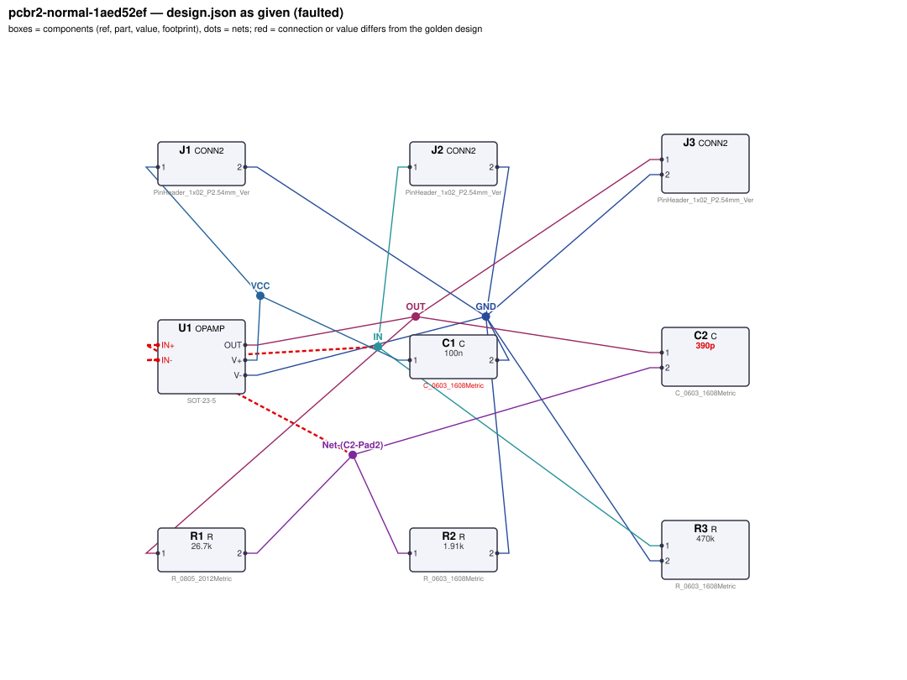
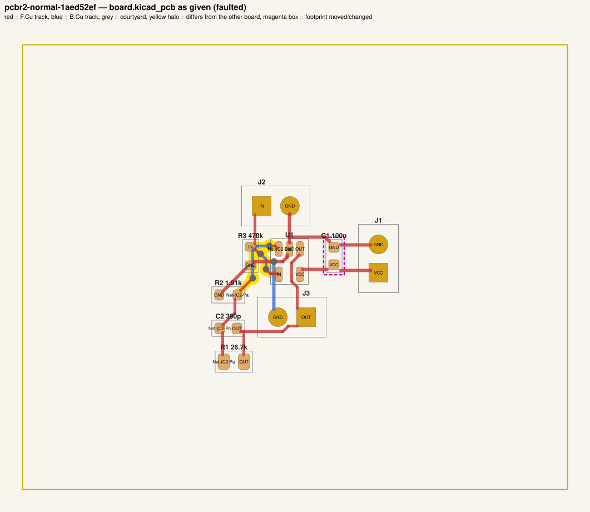
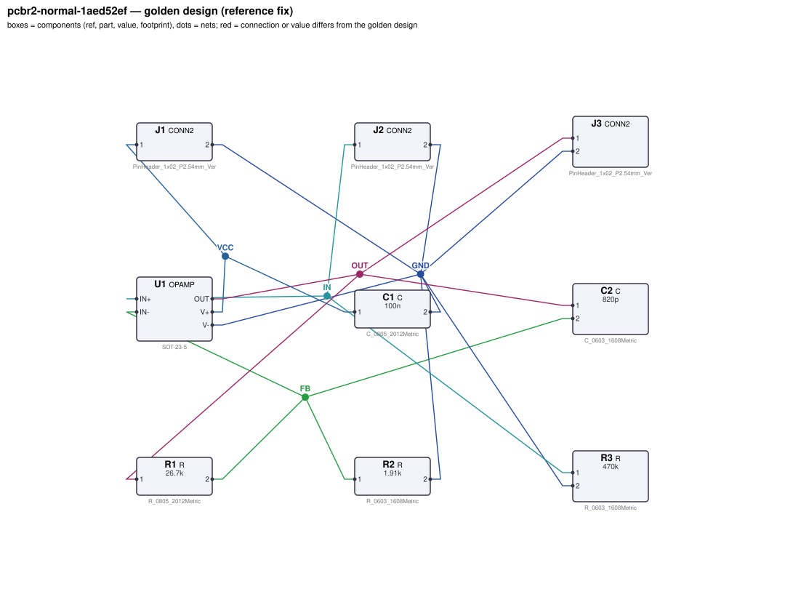
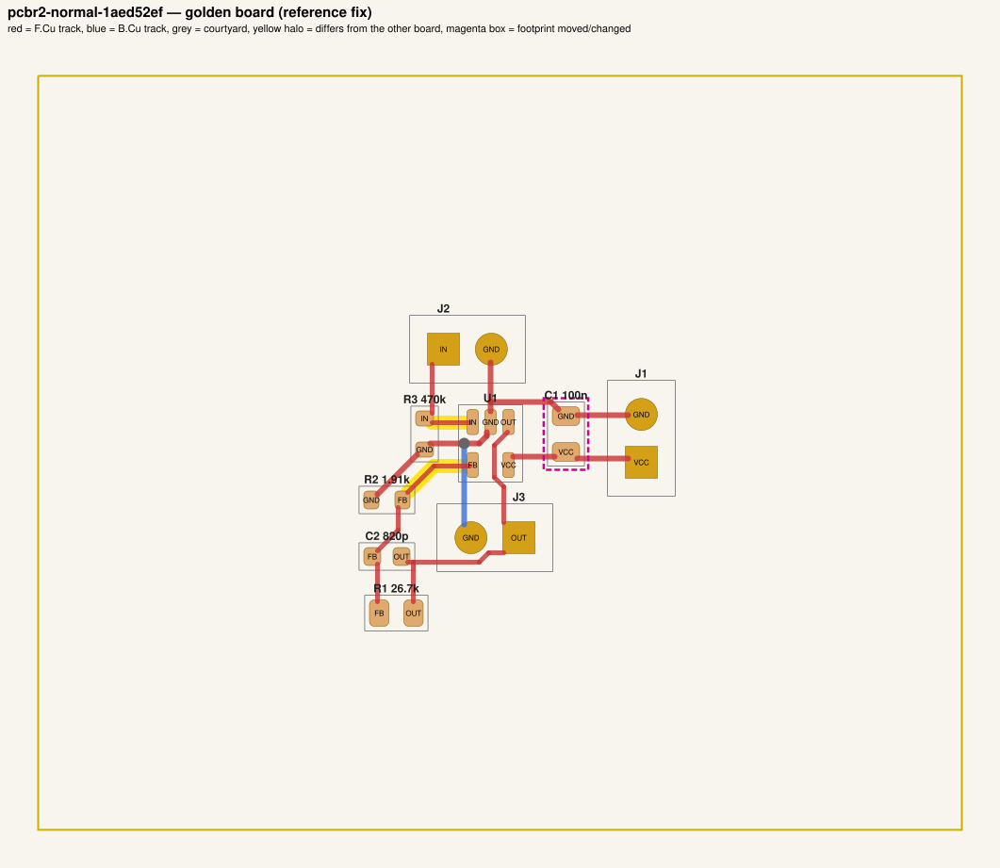

# QA packet 042: `pcbr2-normal-1aed52ef`

| family | tier | tool mode | hint level | intent in TASK.md | faults | latent | predicted difficulty |
|---|---|---|---|---|---|---|---|
| opamp_noninv | normal | full | explicit | full | 3 | 0 | hard |

Task files: [`../../../tasks/v2/normal/pcbr2-normal-1aed52ef/public/`](../../../tasks/v2/normal/pcbr2-normal-1aed52ef/public/) (what the agent gets) and [`../../../tasks/v2/normal/pcbr2-normal-1aed52ef/hidden/`](../../../tasks/v2/normal/pcbr2-normal-1aed52ef/hidden/) (grader only). Why sampled: 3 faults, connectivity fault, disputable type footprint_swap, value near bounds: C2=390p inside [2.4e-10, 2.1e-09].

**How to review (≈5 min):** read section 1 as if you were the agent, decide whether you could find and fix the problems from it; then check section 2 (faults, reference fix, verifier verdicts) and fill `review.yaml`. Do not let section 2 influence your fairness judgement of section 1.

## 1. What the agent sees

### 1.1 TASK.md (verbatim)

````markdown
# Task: x15 non-inverting amplifier

## Problem report

The first boards built from these files fail bring-up. Observations so far:

- Network analyser: gain J2.1 → J3.1 at 100 Hz is 2e-07, expected 14.55 to 15.45 (`gain`).
- Bench: J3.1 reads 4.995 mV, expected 1.935 V to 2.065 V (`dc_out`).
- `bandwidth`: no valid measurement — the circuit does not reach a sensible operating point.
- The fab's DRC run reports 2 unconnected item(s).
- Layout review: a decoupling capacitor sits too far from the IC pin it decouples.

A reviewer narrowed the failure down to these areas (each needs a fix):

- the connections of U1.IN+ / U1.IN-
- the value of C2
- the footprint of C1 and its tracks

Fix every problem (there may be more than the observations show directly).

## Design intent

# x15 non-inverting amplifier

Amplifies the signal on J2 (pin 1 = input, pin 2 = GND) by 15 and presents it on J3
(pin 1 = output, pin 2 = GND). Single 5 V supply on J1 (pin 1 = VCC, pin 2 = GND).

- U1 (OPAMP) runs from VCC on V+ with V- on GND; C1 decouples V+ at the pin.
- The input goes straight to IN+; R3 is a bias resistor from the input to GND so the input is
  defined when nothing is connected.
- Gain is set by R1 from OUT to IN- and R2 from IN- to GND (G = 1 + R1/R2).
- C2 across R1 rolls the response off at about 6.62 kHz (bandwidth limit).

Spec: gain 15 ±3 % at 100 Hz; -3 dB bandwidth 6.62 kHz ±10 %; DC-coupled
(input 0.1335 V DC -> output 2 V).
Component values: decoupling C1 47 nF–10 µF (100 nF typical); input bias resistor R3 47 kΩ–2.2 MΩ
(sets the input impedance).

Sub-circuits by purpose: supply connector (J1); op-amp with supply decoupling (U1, C1); input bias resistor (R3); gain-setting feedback divider (R1, R2); bandwidth-limiting feedback capacitor (C2); input connector (J2); output connector (J3).

## Spec

The design must satisfy these assertions (`pcbtool sim` runs them; full definitions in `spec.json`):

- `gain`: AC gain |V(J3.1)/V(J2.1)| at 100 Hz between 14.55 and 15.45 (J1.1 supplied with 5.0 V; 0.1335 V DC + 1.0 V AC source on J2.1; ground = J1.2)
- `dc_out`: DC voltage at J3.1 between 1.935 V and 2.065 V (J1.1 supplied with 5.0 V; 0.1335 V DC + 1.0 V AC source on J2.1; ground = J1.2)
- `bandwidth`: -3 dB frequency from J2.1 to J3.1 between 5.958 kHz and 7.282 kHz (J1.1 supplied with 5.0 V; 0.1335 V DC + 1.0 V AC source on J2.1; ground = J1.2)

Layout: every track of these nets must be at least the given width:

- GND (the net of J1.2): ≥ 0.3 mm
- VCC (the net of J1.1): ≥ 0.3 mm

Decoupling: each capacitor's pad on the IC pin's net must reach the IC pin's pad within the given length of copper path (shortest path along that net's tracks, vias and pads, pad centre to pad centre; a cap wired to the pin the long way round does not decouple it), and every pad of the capacitor must lie within the given straight-line distance of the IC pin's pad:

- C1 within 6.0 mm of copper path of U1.V+ (and within 5.0 mm straight-line)

Component values: each value must lie in its acceptable range (inclusive; `value_bounds` in `spec.json`). Ranges come from the datasheets and the design intent; values the assertions already pin down get a wide sanity range, and the assertions still apply:

- C1 (C): 47 nF … 10 uF
- C2 (C): 240 pF … 2.1 nF
- R1 (R): 8.7 kΩ … 85 kΩ
- R2 (R): 540 Ω … 7 kΩ
- R3 (R): 47 kΩ … 2.2 MΩ

Resistor power rule: every resistor's continuous dissipation I²·R must stay at or below 50 % of its
footprint's rated power (0603 0.1 W, 0805 0.125 W, 1206 0.5 W; see `parts/R.md`). The grader checks
this under the spec's operating conditions; `pcbtool` does not.

Board rules: 2 copper layers, clearance 0.2 mm, min track 0.2 mm, vias 0.6/0.3 mm, copper-to-edge 0.3 mm. DRC must be clean with no unconnected items.

## Deliverable

- Edit only `design.json` (the schematic of record) and `board.kicad_pcb` (the layout).
- Do not add, remove or rename components; keep each component's part.
- Keep the two files consistent: same connectivity, values and footprints on both.
- Values: `<number><SI prefix><unit>` such as `4.7k`, `100n`, `10kΩ`, `1meg`; unit letters, if any, must match the part (R: Ω/ohm/R, C: F, L: H, crystal: Hz); no spaces or control characters inside (full grammar: "Value notation" in `parts/R.md`, `parts/C.md`, ...).
- Do not change the board outline, add zones, or add DRC exclusions.
- Footprints must be unmodified library footprints from the part's allowed list (see `parts/<PART>.md`).
- Grading is pass/fail: topology, consistency, DRC, ERC, spec, component values and layout must all pass.

## Tools

Run `pcbtool <command>` inside this directory (you may also edit the two files directly).

Read-only:
- `pcbtool show` — components, values, footprints, positions and nets
- `pcbtool netlist` — design nets vs. board pad nets, with differences highlighted
- `pcbtool drc` — KiCad DRC under the canonical rules (the same rules the grader uses)
- `pcbtool erc` — electrical rule check of design.json
- `pcbtool sim` — run the spec assertions (spec.json) on design.json
- `pcbtool parts [PART]` — list parts / print a part's datasheet (also in `parts/`)
- `pcbtool check` — all of the above in one summary

Mutating (each keeps design.json and board.kicad_pcb consistent and saves both):
- `pcbtool set-value REF VALUE`
- `pcbtool set-footprint REF LIB:FOOTPRINT`
- `pcbtool connect REF.PIN NET` / `pcbtool disconnect REF.PIN`
- `pcbtool move REF X Y ROT` (absolute mm, degrees; tracks do not follow)
- `pcbtool unroute NET` / `pcbtool route NET [--width W]` (re-routes the whole net)
- `pcbtool sync` — push design.json connectivity and values onto the board pads
````

### 1.2 Public files

The agent also gets `design.json`, `board.kicad_pcb`, `spec.json` and the part datasheets below, plus the `pcbtool` commands listed in TASK.md (DRC, ERC, simulation of the public assertions, value-range check). Renders of the faulted files:





<details><summary>Datasheet <code>parts/C.md</code></summary>

````markdown
# C — ceramic capacitor

Two-terminal non-polarised capacitor. Pins `1`, `2`. Value in farads.

## Value notation (all parts)

A value is `<number><SI prefix?><unit?>`, e.g. `4.7k`, `100n`, `2.2u`, `10R`, `1meg`, `1.5e3`:
- number: digits with an optional decimal point and an optional exponent (`1e3`); no sign, no
  digit grouping, no RKM notation (`4k7`);
- SI prefix (case-sensitive): `p` `n` `u`/`µ`/`μ` (micro) `m` (milli) `k`/`K` `M`/`meg`/`MEG` (mega) `G`;
  an exponent and a prefix together (`1e3k`) are rejected;
- unit letters, optional, must match the part: R `Ω`/`ohm`/`Ohm`/`R`; C `F`; L `H`; crystals `Hz`;
  other parts none (`100nH` on a capacitor is rejected);
- no whitespace or control characters inside the value (leading/trailing spaces are ignored).

design.json and the board must carry the same value; they are compared as numbers (`1k` == `1000`).
````

</details>

<details><summary>Datasheet <code>parts/CONN2.md</code></summary>

````markdown
# CONN2 — 2-pin header

Pin `1` = signal/supply, pin `2` = ground by board convention.
````

</details>

<details><summary>Datasheet <code>parts/OPAMP.md</code></summary>

````markdown
# OPAMP — single rail-to-rail I/O operational amplifier (SOT-23-5)

## Pinout
| Pin | Pad | Function |
|---|---|---|
| OUT | 1 | output |
| V- | 2 | negative supply (GND in single-supply use) |
| IN+ | 3 | non-inverting input |
| IN- | 4 | inverting input |
| V+ | 5 | positive supply |

## Electrical characteristics
- Supply 1.8–5.5 V (V+ - V-); quiescent current 100 µA
- Open-loop gain 100 dB (1e5); gain-bandwidth product 1 MHz (single pole)
- Rail-to-rail input and output (output swings to within 5 mV of the rails, Rout 30 Ω)
- Input bias current < 1 pA; input offset modelled as 0

## Application notes
- Non-inverting gain: G = 1 + Rf / Rg (Rf from OUT to IN-, Rg from IN- to ground).
- Inverting gain: G = -Rf / Rin. In single-supply use bias IN+ at mid-supply (e.g. a
  resistor divider from V+ bypassed with a capacitor) and AC-couple the input.
- Closed-loop bandwidth ≈ 1 MHz / (noise gain).
- Decouple V+ with 100 nF ceramic (47 nF–10 µF) to ground within 5 mm of the pin.
````

</details>

<details><summary>Datasheet <code>parts/R.md</code></summary>

````markdown
# R — resistor

Two-terminal resistor. Pins `1`, `2` (non-polarised). Value in ohms.

## Value notation (all parts)

A value is `<number><SI prefix?><unit?>`, e.g. `4.7k`, `100n`, `2.2u`, `10R`, `1meg`, `1.5e3`:
- number: digits with an optional decimal point and an optional exponent (`1e3`); no sign, no
  digit grouping, no RKM notation (`4k7`);
- SI prefix (case-sensitive): `p` `n` `u`/`µ`/`μ` (micro) `m` (milli) `k`/`K` `M`/`meg`/`MEG` (mega) `G`;
  an exponent and a prefix together (`1e3k`) are rejected;
- unit letters, optional, must match the part: R `Ω`/`ohm`/`Ohm`/`R`; C `F`; L `H`; crystals `Hz`;
  other parts none (`100nH` on a capacitor is rejected);
- no whitespace or control characters inside the value (leading/trailing spaces are ignored).

design.json and the board must carry the same value; they are compared as numbers (`1k` == `1000`).

## Ratings by footprint (high-power thick-film series used on this board)

| Size | Rated power (70 C) | Design limit (50 % derating) |
|---|---|---|
| 0603 | 0.1 W | 50.0 mW |
| 0805 | 0.125 W | 62.5 mW |
| 1206 | 0.5 W | 250.0 mW |

**Design rule:** the continuous dissipation P = I²·R of every resistor must not exceed 50 % of its
footprint's rated power. Pick the footprint for the power, not just the value.
````

</details>

## 2. Reviewer-only (hidden from the agent)

### 2.1 Injected faults

| # | type | category | DRC/ERC-invisible | latent (pcbtool-clean) | detail | verifier, this fault alone |
|---|---|---|---|---|---|---|
| 1 | `swapped_ic_pins` | connectivity | yes |  | U1.IN+ and U1.IN- connections exchanged | reward 0.0; fails spec, topology |
| 2 | `wrong_filter_cap` | value | yes |  | C2 (filter/timing capacitor) is 390p, should be 820p | reward 0.0; fails spec |
| 3 | `footprint_swap` | board | no |  | C1 footprint changed to Capacitor_SMD:C_0603_1608Metric (was Capacitor_SMD:C_0805_2012Metric); tracks no longer fit | reward 0.0; fails drc, layout |

### 2.2 Reference fix (faulted → golden)

The reference repair is the hidden golden pair (`golden_design.json`, `golden_board.kicad_pcb`). Any repair that passes every gate and check scores 1.0; it need not be byte-identical.

**design.json: component changes**

- `C1` footprint: `Capacitor_SMD:C_0603_1608Metric` → `Capacitor_SMD:C_0805_2012Metric`
- `C2` value: `390p` → `820p`

**design.json: connection changes** (per pin: what it connects to)

- `U1.IN+`: faulted net `Net-(C2-Pad2)` (C2.2, R1.2, R2.1) → golden net `IN` (J2.1, R3.1)
- `U1.IN-`: faulted net `IN` (J2.1, R3.1) → golden net `FB` (C2.2, R1.2, R2.1)

**board.kicad_pcb: footprints moved / changed**

- `C1` footprint `Capacitor_SMD:C_0603_1608Metric` → `Capacitor_SMD:C_0805_2012Metric`

**board.kicad_pcb: footprint values (BOM)**

- `C2` board value `390p` → `820p`

**board.kicad_pcb: pad-net changes**

- `C2` pad 2: net `Net-(C2-Pad2)` → `FB`
- `R1` pad 2: net `Net-(C2-Pad2)` → `FB`
- `R2` pad 1: net `Net-(C2-Pad2)` → `FB`
- `U1` pad 3: net `Net-(C2-Pad2)` → `IN`
- `U1` pad 4: net `IN` → `FB`

**board.kicad_pcb: nets re-routed** (track/via geometry differs)

- net `FB`: 0 track/via item(s) removed, 5 added
- net `IN`: 8 track/via item(s) removed, 1 added
- net `Net-(C2-Pad2)`: 11 track/via item(s) removed, 0 added

Golden renders (compare with 1.2; highlighted items differ):





### 2.3 Verifier verdicts

Reward is 1 only if every gate and check passes.

| stage | kind | faulted files | golden files |
|---|---|---|---|
| parse | gate | pass | pass |
| components | gate | pass | pass |
| topology | gate | **FAIL** | pass |
| consistency | gate | pass | pass |
| integrity | gate | pass | pass |
| drc | check | **FAIL** | pass |
| erc | check | pass | pass |
| spec | check | **FAIL** | pass |
| values | check | pass | pass |
| layout | check | **FAIL** | pass |
| rules | check | pass | pass |
| **reward** | | **0** | **1** |

Verifier messages on the faulted files:

- **drc**: 2 unconnected items
- **layout**: decoupling: C1 has no pad connected by copper to U1.V+
- **spec**: gain: measured 2.0003839956557512e-07 expected [14.55, 15.45]
- **spec**: dc_out: measured 0.0049947892075 expected [1.93471, 2.0647]
- **spec**: bandwidth: measured None expected [5957.77, 7281.72] no -3 dB crossing in sweep
- **topology**: nets only in candidate: [['C2.2', 'R1.2', 'R2.1', 'U1.IN+'], ['J2.1', 'R3.1', 'U1.IN-']]; nets only in reference: [['C2.2', 'R1.2', 'R2.1', 'U1.IN-'], ['J2.1', 'R3.1', 'U1.IN+']]

### 2.4 Spec assertions before / after

| assertion | what | allowed | faulted: measured | | golden: measured | |
|---|---|---|---|---|---|---|
| `gain` | AC gain \|V(J3.1)/V(J2.1)\| at 100 Hz (J1.1 supplied with 5.0 V; 0.1335 V DC + 1.0 V AC source on J2.1; ground = J1.2) | 14.55 … 15.45 | 200 n | ❌ | 14.98 | ✅ |
| `dc_out` | DC voltage at J3.1 (J1.1 supplied with 5.0 V; 0.1335 V DC + 1.0 V AC source on J2.1; ground = J1.2) | 1.935 V … 2.065 V | 4.995 mV | ❌ | 2 V | ✅ |
| `bandwidth` | -3 dB frequency from J2.1 to J3.1 (J1.1 supplied with 5.0 V; 0.1335 V DC + 1.0 V AC source on J2.1; ground = J1.2) | 5.958 kHz … 7.282 kHz | — | ❌ | 6.619 kHz | ✅ |

### 2.5 Value bounds

Bounds are public (TASK.md / spec.json); `values` check = every value inside its range.

| ref | part | acceptable range | faulted design.json | faulted board | golden | touched by a fault |
|---|---|---|---|---|---|---|
| `C1` | C | 47 nF … 10 uF | `100n` | `100n` | `100n` | **yes** |
| `C2` | C | 240 pF … 2.1 nF | `390p` | `390p` | `820p` | **yes** |
| `R1` | R | 8.7 kΩ … 85 kΩ | `26.7k` | `26.7k` | `26.7k` |  |
| `R2` | R | 540 Ω … 7 kΩ | `1.91k` | `1.91k` | `1.91k` |  |
| `R3` | R | 47 kΩ … 2.2 MΩ | `470k` | `470k` | `470k` |  |

### 2.6 Layout rules

- power net `GND` (golden pins C1.2, J1.2, J2.2, J3.2, R2.2, R3.2, U1.V-): every track ≥ 0.3 mm
- power net `VCC` (golden pins C1.1, J1.1, U1.V+): every track ≥ 0.3 mm
- decoupling: `C1` within 6.0 mm of copper path (and 5.0 mm straight-line) of `U1.V+`

### 2.8 Design rules (`rules` check, not run by pcbtool)

Scope: resistor power only (`rules_power`, all v2 tiers); 1 operating condition(s) from the spec's stimuli; 3 rule quantities evaluated per design. Rows shown: violated on either side, on a part a fault touches (if ≥ 5 % of its limit or changed by ≥ 5 points or by a footprint change), or at ≥ 80% of the limit. Values are the worst case over the conditions (computed with `pcbenv.rules.operating_point`; limits from `pcbenv/rules.py`, stated in `parts/<PART>.md` and TASK.md "Design rules").

- no rule quantity is violated, touched by a fault, or within 80 % of a limit

Rule violations reported by the verifier: faulted: none; golden: none.

## 3. Review

Fill `review.yaml` in this directory (second reviewer: copy `../../review_template.yaml` to `review-<initials>.yaml` here, without looking at the first form). Questions to answer:

1. **task_fair / solvable_from_public_material**: from section 1 only, can a competent engineer locate and fix every injected fault? Is anything required that is not stated (a value with no assertion and no published range, a connection only the golden reveals)?
2. **reference_fix_correct**: is the golden (2.2) a correct design that meets the stated intent?
3. **verifier_verdict_agrees**: do you agree the faulted files fail and the golden passes, for the reasons given in 2.3?
4. **alternative_valid_fixes_rejected**: is there an engineering-valid repair the grader would reject (e.g. a different E-series value that meets intent but fails an assertion window or value bound; keeping a swapped footprint and re-routing; a different valid placement)?
5. **rule_stated_clearly**: is every design rule / layout rule / latent requirement this task grades (2.7–2.9) stated in the public material clearly enough that an engineer would apply it the way the grader does (limit, which part, which condition)? Normal-tier tasks: answer for the resistor-power rule (`yes` if no rule is involved).
6. **layout_rule_reasonable**: hard_layout tasks only (else `n/a`): are the layout-rule limits and their geometric definitions (2.9) defensible engineering practice for this board, i.e. would you reject the faulted layout in a design review, and accept the golden one?

