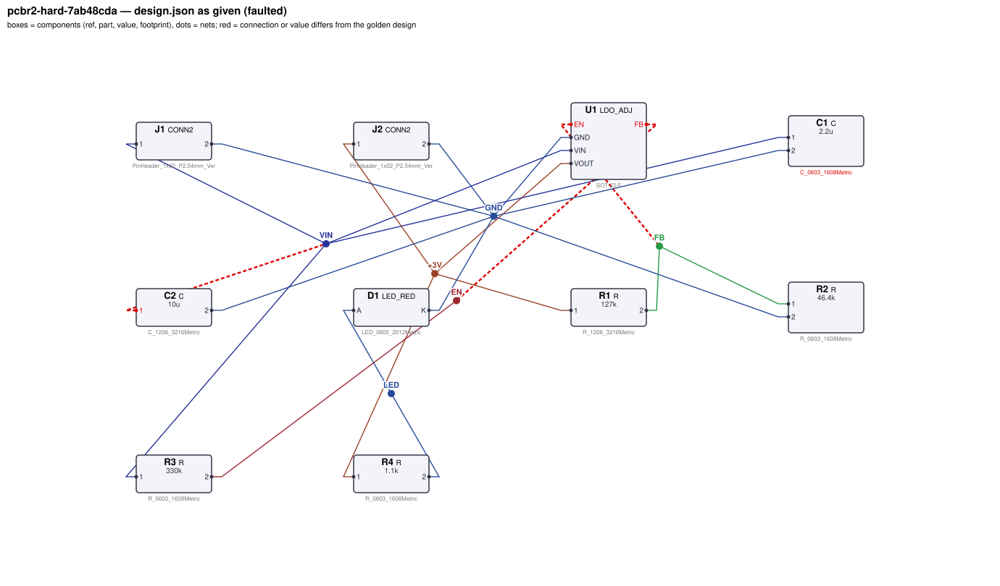
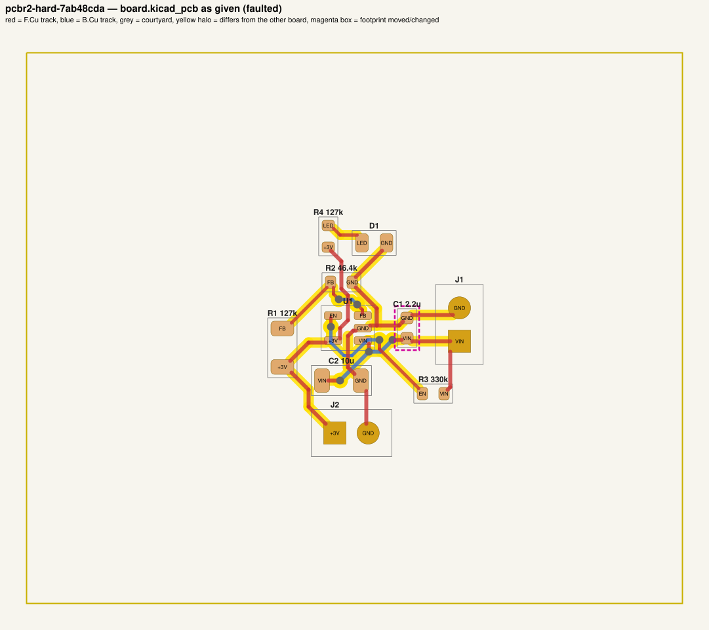
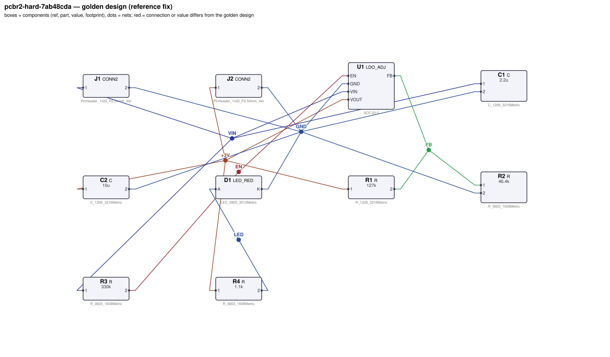
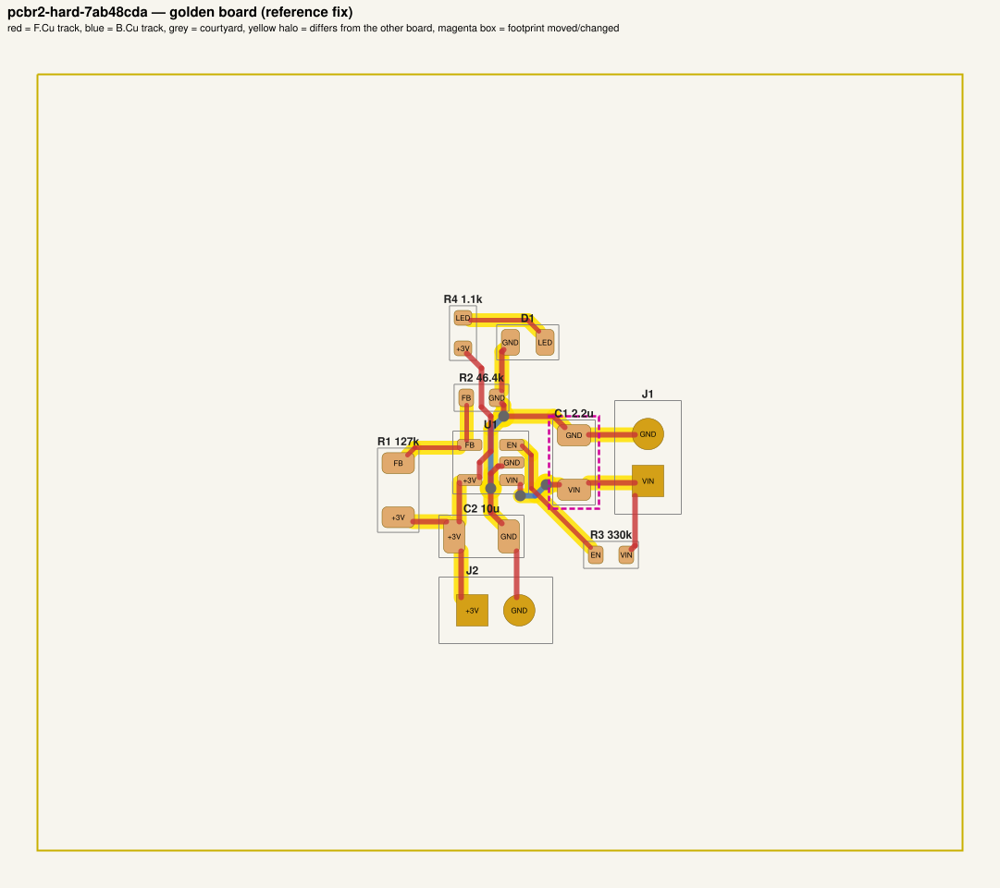

# QA packet 061: `pcbr2-hard-7ab48cda`

| family | tier | tool mode | hint level | intent in TASK.md | faults | latent | predicted difficulty |
|---|---|---|---|---|---|---|---|
| ldo_reg | hard | no_autoroute | vague | reduced | 5 | 2 |  |

Task files: [`../../../tasks/v2/hard/pcbr2-hard-7ab48cda/public/`](../../../tasks/v2/hard/pcbr2-hard-7ab48cda/public/) (what the agent gets) and [`../../../tasks/v2/hard/pcbr2-hard-7ab48cda/hidden/`](../../../tasks/v2/hard/pcbr2-hard-7ab48cda/hidden/) (grader only). Why sampled: 5 faults, vague hint, connectivity fault, disputable type bom_mismatch, 2 latent (capacitor_underrated, decap_wrong_rail), no_autoroute.

**How to review (≈5 min):** read section 1 as if you were the agent, decide whether you could find and fix the problems from it; then check section 2 (faults, reference fix, verifier verdicts) and fill `review.yaml`. Do not let section 2 influence your fairness judgement of section 1.

## 1. What the agent sees

### 1.1 TASK.md (verbatim)

````markdown
# Task: 3 V LDO regulator

## Problem report

The first boards built from these files fail bring-up. Find and fix all problems: the design must meet its purpose and spec, the layout must match design.json, and DRC/ERC must be clean.

## Design intent

# 3 V LDO regulator

Converts a 9 V input (J1: pin 1 = +9 V, pin 2 = GND) into a regulated 3 V rail
(J2: pin 1 = +3 V, pin 2 = GND) able to deliver 20 mA.

Spec: output 3 V ±3 % at 20 mA load, for input voltages from 3.6 V up to 9 V.
Supply and ground traces carrying the load current must be at least 0.3 mm wide.
Component values: C1 and C2 are 1 µF–22 µF ceramics (datasheet range); the EN pull-up R3 must keep EN above its 1.2 V threshold at the lowest input voltage (≤ 4 MΩ);
feedback divider Rbot (R2) 3.3 kΩ–150 kΩ (datasheet: 10k–50k typical) with R1 scaled to match.

Sub-circuits by purpose: input connector (J1); regulator (U1); input/output capacitors (C1, C2); output-voltage feedback divider (R1, R2); enable pull-up (R3); output indicator LED (D1, R4); output connector (J2).

Interfaces and pin assignments (fixed):

- The output voltage is programmed by a divider: R1 from VOUT down to the FB pin, R2 from FB to GND (VOUT = 0.8 V x (1 + R1/R2)).

_Connection details are intentionally not repeated here: wire each part as its datasheet in `parts/` describes (pinout and application notes), so that the circuit does what the purpose, interfaces and spec above require._

## Spec

The design must satisfy these assertions (`pcbtool sim` runs them; full definitions in `spec.json`):

- `vout_loaded`: DC voltage at J2.1 between 2.91 V and 3.09 V (J1.1 supplied with 9.0 V; load R=150 from J2.1 to ground; ground = J1.2)
- `vout_low_vin`: DC voltage at J2.1 between 2.91 V and 3.09 V (J1.1 supplied with 3.6 V; load R=150 from J2.1 to ground; ground = J1.2)
- `load_current`: DC current through J2.1 between 19 mA and 21 mA (J1.1 supplied with 9.0 V; load R=150 from J2.1 to ground; ground = J1.2)
- `indicator_current`: DC current through D1 between 878.7 uA and 1.189 mA (J1.1 supplied with 9.0 V; load R=150 from J2.1 to ground; ground = J1.2)

Layout: every track of these nets must be at least the given width:

- +3V (the net of J2.1): ≥ 0.3 mm
- GND (the net of J1.2): ≥ 0.3 mm
- VIN (the net of J1.1): ≥ 0.3 mm

Component values: each value must lie in its acceptable range (inclusive; `value_bounds` in `spec.json`). Ranges come from the datasheets and the design intent; values the assertions already pin down get a wide sanity range, and the assertions still apply:

- C1 (C): 1 uF … 22 uF
- C2 (C): 1 uF … 22 uF
- R1 (R): 9.1 kΩ … 410 kΩ
- R2 (R): 3.3 kΩ … 150 kΩ
- R3 (R): 1 Ω … 4 MΩ
- R4 (R): 36 Ω … 3.5 kΩ

Board rules: 2 copper layers, clearance 0.2 mm, min track 0.2 mm, vias 0.6/0.3 mm, copper-to-edge 0.3 mm. DRC must be clean with no unconnected items.

## Design rules (design review)

Besides the spec, the design must pass an engineering design review. **`pcbtool` does not check any
of this — review the design yourself** against the datasheets in `parts/` (see each part's ratings /
design-rule section) and the design intent:

- **Absolute maximum ratings** of every part under every operating condition of the spec (no MCU pin
  above its VDD + 0.3 V or below -0.3 V, op-amp inputs within the rails, LDO EN ≤ VIN, MOSFET |VGS|,
  transistor / diode voltage and current limits).
- **Current limits:** MCU pin currents, LED forward current (by LED package), transistor collector /
  base currents; a saturated NPN switch needs a forced beta IC/IB ≤ 20.
- **Power / voltage ratings:** every resistor's I²R ≤ 50 % of its footprint's rating; every capacitor's
  working voltage ≤ 80 % of its footprint's rated voltage. Footprint choice matters.
- **Inductive loads** have a flyback diode directly across the load, cathode to the supply side.
- **Interfaces and pin assignments** stated in the design intent (connector pinouts, MCU pin functions,
  which rail each part connects to) must be respected exactly, even where the circuit would still
  simulate with a different assignment.

The grader checks these rules under the spec's operating conditions. A design can pass every
`pcbtool` check and still fail review.

**Decoupling** (graded as part of `layout`; `pcbtool` does not check it, `spec.json` lists it under `design_rules`): each capacitor's pad on the IC pin's net must reach that pin within the given length of copper path (shortest path along the net's tracks, vias and pads, pad centre to pad centre), and every pad of the capacitor must lie within the given straight-line distance of the pin:

- C1 within 6.0 mm of copper path of U1.VIN (and within 5.0 mm straight-line)
- C2 within 6.0 mm of copper path of U1.VOUT (and within 5.0 mm straight-line)

## Deliverable

- Edit only `design.json` (the schematic of record) and `board.kicad_pcb` (the layout).
- Do not add, remove or rename components; keep each component's part.
- Keep the two files consistent: same connectivity, values and footprints on both.
- Values: `<number><SI prefix><unit>` such as `4.7k`, `100n`, `10kΩ`, `1meg`; unit letters, if any, must match the part (R: Ω/ohm/R, C: F, L: H, crystal: Hz); no spaces or control characters inside (full grammar: "Value notation" in `parts/R.md`, `parts/C.md`, ...).
- Do not change the board outline, add zones, or add DRC exclusions.
- Footprints must be unmodified library footprints from the part's allowed list (see `parts/<PART>.md`).
- Grading is pass/fail: topology, consistency, DRC, ERC, spec, component values, layout and the design rules above must all pass.

## Tools

Run `pcbtool <command>` inside this directory (you may also edit the two files directly).

Read-only:
- `pcbtool show` — components, values, footprints, positions and nets
- `pcbtool netlist` — design nets vs. board pad nets, with differences highlighted
- `pcbtool drc` — KiCad DRC under the canonical rules (the same rules the grader uses)
- `pcbtool erc` — electrical rule check of design.json
- `pcbtool sim` — run the spec assertions (spec.json) on design.json
- `pcbtool parts [PART]` — list parts / print a part's datasheet (also in `parts/`)
- `pcbtool check` — all of the above in one summary

Mutating (each keeps design.json and board.kicad_pcb consistent and saves both):
- `pcbtool set-value REF VALUE`
- `pcbtool set-footprint REF LIB:FOOTPRINT`
- `pcbtool connect REF.PIN NET` / `pcbtool disconnect REF.PIN`
- `pcbtool move REF X Y ROT` (absolute mm, degrees; tracks do not follow)
- `pcbtool unroute NET` / `pcbtool route NET [--width W]` (re-routes the whole net)
- `pcbtool sync` — push design.json connectivity and values onto the board pads

**Tool mode for this task: `no_autoroute`** (`tools.json`). `pcbtool route` and `pcbtool sync` are
disabled: after changing connectivity or footprints, edit the tracks (`segment` / `via` items) in
`board.kicad_pcb` yourself, or move parts with `pcbtool move`. All other commands work.
````

### 1.2 Public files

The agent also gets `design.json`, `board.kicad_pcb`, `spec.json` and the part datasheets below, plus the `pcbtool` commands listed in TASK.md (DRC, ERC, simulation of the public assertions, value-range check). Renders of the faulted files:





<details><summary>Datasheet <code>parts/C.md</code></summary>

````markdown
# C — ceramic capacitor

Two-terminal non-polarised capacitor. Pins `1`, `2`. Value in farads.

## Value notation (all parts)

A value is `<number><SI prefix?><unit?>`, e.g. `4.7k`, `100n`, `2.2u`, `10R`, `1meg`, `1.5e3`:
- number: digits with an optional decimal point and an optional exponent (`1e3`); no sign, no
  digit grouping, no RKM notation (`4k7`);
- SI prefix (case-sensitive): `p` `n` `u`/`µ`/`μ` (micro) `m` (milli) `k`/`K` `M`/`meg`/`MEG` (mega) `G`;
  an exponent and a prefix together (`1e3k`) are rejected;
- unit letters, optional, must match the part: R `Ω`/`ohm`/`Ohm`/`R`; C `F`; L `H`; crystals `Hz`;
  other parts none (`100nH` on a capacitor is rejected);
- no whitespace or control characters inside the value (leading/trailing spaces are ignored).

design.json and the board must carry the same value; they are compared as numbers (`1k` == `1000`).

## Ratings by footprint (X7R series used on this board)

| Size | Rated voltage | Design limit (80 %) |
|---|---|---|
| 0603 | 10 V | 8 V |
| 0805 | 25 V | 20 V |
| 1206 | 50 V | 40 V |

**Design rule:** the DC working voltage across a capacitor must not exceed 80 % of its rated voltage
(MLCC capacitance collapses and reliability drops near the rating). The rating follows the footprint.
````

</details>

<details><summary>Datasheet <code>parts/CONN2.md</code></summary>

````markdown
# CONN2 — 2-pin header

Pin `1` = signal/supply, pin `2` = ground by board convention.

## Interface rule
The pin assignment of every connector is fixed by the design intent (cable / mating board):
swapping two connector pins breaks the interface even if the board itself still simulates.
````

</details>

<details><summary>Datasheet <code>parts/LDO_ADJ.md</code></summary>

````markdown
# LDO_ADJ — adjustable 300 mA low-dropout regulator (SOT-23-5)

## Pinout
| Pin | Pad | Function |
|---|---|---|
| VIN | 1 | input supply, 2.5–16 V |
| GND | 2 | ground |
| EN | 3 | enable, active high. Internal 2 MΩ pull-down: floating = OFF |
| FB | 4 | feedback; regulates to VREF = 0.800 V |
| VOUT | 5 | regulated output |

## Electrical characteristics
- VREF = 0.800 V ±1 %
- Output current 300 mA max; current limit ~500 mA
- Dropout 250 mV typ at 300 mA
- EN threshold 1.2 V (high = on); EN low or floating -> output off (0 V)
- Quiescent current 50 µA; package dissipation max 0.5 W

## Application notes
- Output voltage is set by a divider from VOUT to FB (Rtop) and FB to GND (Rbot):
  **VOUT = VREF × (1 + Rtop / Rbot)**. Rbot of 10k–50k is typical.
- Connect EN to VIN for always-on operation (or drive it from logic / a pull-up). A pull-up
  Rpu from VIN forms a divider with the internal 2 MΩ pull-down: VIN·2M/(Rpu + 2M) must exceed
  the 1.2 V threshold at the lowest VIN.
- Place a 1 µF–22 µF ceramic input capacitor and a 1 µF–22 µF ceramic output capacitor (the
  output capacitor range is the stability range of the regulation loop) within
  5 mm of the VIN and VOUT pins respectively, returned to GND.
- Power dissipation = (VIN - VOUT) × IOUT must stay below 0.5 W.

## Absolute maximum ratings
- VIN 16 V; EN ≤ VIN + 0.3 V (EN must never be above VIN); output current 300 mA;
  package dissipation (VIN - VOUT)·IOUT ≤ 0.5 W.
````

</details>

<details><summary>Datasheet <code>parts/LED_RED.md</code></summary>

````markdown
# LED_RED — red SMD indicator LED (625 nm)

## Pinout
| Pin | Pad | Function |
|---|---|---|
| A | 2 | anode |
| K | 1 | cathode (marked) |

## Electrical characteristics (25 C)
- Forward voltage Vf = 2.0 V typ at IF = 10 mA
- Max continuous forward current 25 mA; reverse voltage max 5 V

| IF | Vf (typ) |
|---|---|
| 2 mA | 1.90 V |
| 5 mA | 1.95 V |
| 10 mA | 2.00 V |
| 15 mA | 2.03 V |
| 20 mA | 2.06 V |

## Application notes
- Always drive through a current-limiting resistor: R = (Vsupply - n*Vf) / IF for n LEDs in series.
- Current flows anode -> cathode; reversed LEDs do not light.

## Ratings by package

| Package | Max continuous IF | Design limit (80 %) |
|---|---|---|
| 0603 | 20 mA | 16 mA |
| 0805 | 30 mA | 24 mA |

**Design rule:** the forward current must not exceed 80 % of the package maximum; reverse voltage
≤ 5 V.
````

</details>

<details><summary>Datasheet <code>parts/R.md</code></summary>

````markdown
# R — resistor

Two-terminal resistor. Pins `1`, `2` (non-polarised). Value in ohms.

## Value notation (all parts)

A value is `<number><SI prefix?><unit?>`, e.g. `4.7k`, `100n`, `2.2u`, `10R`, `1meg`, `1.5e3`:
- number: digits with an optional decimal point and an optional exponent (`1e3`); no sign, no
  digit grouping, no RKM notation (`4k7`);
- SI prefix (case-sensitive): `p` `n` `u`/`µ`/`μ` (micro) `m` (milli) `k`/`K` `M`/`meg`/`MEG` (mega) `G`;
  an exponent and a prefix together (`1e3k`) are rejected;
- unit letters, optional, must match the part: R `Ω`/`ohm`/`Ohm`/`R`; C `F`; L `H`; crystals `Hz`;
  other parts none (`100nH` on a capacitor is rejected);
- no whitespace or control characters inside the value (leading/trailing spaces are ignored).

design.json and the board must carry the same value; they are compared as numbers (`1k` == `1000`).

## Ratings by footprint (high-power thick-film series used on this board)

| Size | Rated power (70 C) | Design limit (50 % derating) |
|---|---|---|
| 0603 | 0.1 W | 50.0 mW |
| 0805 | 0.125 W | 62.5 mW |
| 1206 | 0.5 W | 250.0 mW |

**Design rule:** the continuous dissipation P = I²·R of every resistor must not exceed 50 % of its
footprint's rated power. Pick the footprint for the power, not just the value.
````

</details>

## 2. Reviewer-only (hidden from the agent)

### 2.1 Injected faults

| # | type | category | DRC/ERC-invisible | latent (pcbtool-clean) | detail | verifier, this fault alone |
|---|---|---|---|---|---|---|
| 1 | `capacitor_underrated` | latent | yes | **yes** | C1 capacitor footprint downsized C_1206_3216Metric -> C_0603_1608Metric; it now exceeds the rating of the smaller part | reward 0.0; fails rules |
| 2 | `decap_wrong_rail` | latent | yes | **yes** | C2 sits at U1.VOUT but decouples VIN instead of +3V | reward 0.0; fails layout, topology |
| 3 | `swapped_ic_pins` | connectivity | yes |  | U1.FB and U1.EN connections exchanged | reward 0.0; fails spec, topology |
| 4 | `bom_mismatch` | value | yes |  | board value of R4 is 127k, design.json says 1.1k | reward 0.0; fails consistency |
| 5 | `board_pad_swap` | board | yes |  | board pads of D1.A (pad 2) and D1.K (pad 1) carry each other's nets | reward 0.0; fails consistency, layout |

### 2.2 Reference fix (faulted → golden)

The reference repair is the hidden golden pair (`golden_design.json`, `golden_board.kicad_pcb`). Any repair that passes every gate and check scores 1.0; it need not be byte-identical.

**design.json: component changes**

- `C1` footprint: `Capacitor_SMD:C_0603_1608Metric` → `Capacitor_SMD:C_1206_3216Metric`

**design.json: connection changes** (per pin: what it connects to)

- `C2.1`: faulted net `VIN` (C1.1, J1.1, R3.1, U1.VIN) → golden net `+3V` (J2.1, R1.1, R4.1, U1.VOUT)
- `U1.EN`: faulted net `FB` (R1.2, R2.1) → golden net `EN` (R3.2)
- `U1.FB`: faulted net `EN` (R3.2) → golden net `FB` (R1.2, R2.1)

**board.kicad_pcb: footprints moved / changed**

- `C1` footprint `Capacitor_SMD:C_0603_1608Metric` → `Capacitor_SMD:C_1206_3216Metric`

**board.kicad_pcb: footprint values (BOM)**

- `R4` board value `127k` → `1.1k`

**board.kicad_pcb: pad-net changes**

- `C2` pad 1: net `VIN` → `+3V`
- `D1` pad 1: net `LED` → `GND`
- `D1` pad 2: net `GND` → `LED`
- `U1` pad 3: net `FB` → `EN`
- `U1` pad 4: net `EN` → `FB`

**board.kicad_pcb: nets re-routed** (track/via geometry differs)

- net `+3V`: 5 track/via item(s) removed, 3 added
- net `EN`: 10 track/via item(s) removed, 3 added
- net `FB`: 9 track/via item(s) removed, 3 added
- net `GND`: 9 track/via item(s) removed, 14 added
- net `LED`: 2 track/via item(s) removed, 2 added
- net `VIN`: 8 track/via item(s) removed, 5 added

Golden renders (compare with 1.2; highlighted items differ):





### 2.3 Verifier verdicts

Reward is 1 only if every gate and check passes.

| stage | kind | faulted files | golden files |
|---|---|---|---|
| parse | gate | pass | pass |
| components | gate | pass | pass |
| topology | gate | **FAIL** | pass |
| consistency | gate | **FAIL** | pass |
| integrity | gate | pass | pass |
| drc | check | pass | pass |
| erc | check | pass | pass |
| spec | check | **FAIL** | pass |
| values | check | pass | pass |
| layout | check | **FAIL** | pass |
| rules | check | **FAIL** | pass |
| **reward** | | **0** | **1** |

Verifier messages on the faulted files:

- **consistency**: board connectivity != design.json: nets only in candidate: [['C1.2', 'C2.2', 'D1.A', 'J1.2', 'J2.2', 'R2.2', 'U1.GND'], ['D1.K', 'R4.2']]; nets only in reference: [['C1.2', 'C2.2', 'D1.K', 'J1.2', 'J2.2', 'R2.2', 'U1.GND'], ['D1.A', 'R4.2']]
- **consistency**: R4: board value '127k' != design value '1.1k'
- **layout**: decoupling: C2 has no pad connected by copper to U1.VOUT
- **layout_skipped**: no board net has the pins of golden net +3V (connectivity differs: see topology)
- **layout_skipped**: no board net has the pins of golden net GND (connectivity differs: see topology)
- **layout_skipped**: no board net has the pins of golden net VIN (connectivity differs: see topology)
- **rules**: capacitor_voltage: C1 sees 9 V > 8 V (80 % of 10 V, C_0603_1608Metric) [condition 0]
- **spec**: vout_loaded: measured 1.4905075043e-42 expected [2.91, 3.09]
- **spec**: vout_low_vin: measured 1.4905075076e-42 expected [2.91, 3.09]
- **spec**: load_current: measured 9.9367166968e-45 expected [0.019, 0.021]
- **spec**: indicator_current: measured 1.8730812379e-42 expected [0.000878678, 0.0011888]
- **topology**: nets only in candidate: [['C1.1', 'C2.1', 'J1.1', 'R3.1', 'U1.VIN'], ['J2.1', 'R1.1', 'R4.1', 'U1.VOUT'], ['R1.2', 'R2.1', 'U1.EN'], ['R3.2', 'U1.FB']]; nets only in reference: [['C1.1', 'J1.1', 'R3.1', 'U1.VIN'], ['C2.1', 'J2.1', 'R1.1', 'R4.1', 'U1.VOUT'], ['R1.2', 'R2.1', 'U1.FB'], ['R3.2', 'U1.EN']]

### 2.4 Spec assertions before / after

| assertion | what | allowed | faulted: measured | | golden: measured | |
|---|---|---|---|---|---|---|
| `vout_loaded` | DC voltage at J2.1 (J1.1 supplied with 9.0 V; load R=150 from J2.1 to ground; ground = J1.2) | 2.91 V … 3.09 V | 1.491e-42 V | ❌ | 2.989 V | ✅ |
| `vout_low_vin` | DC voltage at J2.1 (J1.1 supplied with 3.6 V; load R=150 from J2.1 to ground; ground = J1.2) | 2.91 V … 3.09 V | 1.491e-42 V | ❌ | 2.989 V | ✅ |
| `load_current` | DC current through J2.1 (J1.1 supplied with 9.0 V; load R=150 from J2.1 to ground; ground = J1.2) | 19 mA … 21 mA | 9.937e-45 A | ❌ | 19.92 mA | ✅ |
| `indicator_current` | DC current through D1 (J1.1 supplied with 9.0 V; load R=150 from J2.1 to ground; ground = J1.2) | 878.7 uA … 1.189 mA | 1.873e-42 A | ❌ | 1.022 mA | ✅ |

### 2.5 Value bounds

Bounds are public (TASK.md / spec.json); `values` check = every value inside its range.

| ref | part | acceptable range | faulted design.json | faulted board | golden | touched by a fault |
|---|---|---|---|---|---|---|
| `C1` | C | 1 uF … 22 uF | `2.2u` | `2.2u` | `2.2u` | **yes** |
| `C2` | C | 1 uF … 22 uF | `10u` | `10u` | `10u` | **yes** |
| `R1` | R | 9.1 kΩ … 410 kΩ | `127k` | `127k` | `127k` |  |
| `R2` | R | 3.3 kΩ … 150 kΩ | `46.4k` | `46.4k` | `46.4k` |  |
| `R3` | R | 1 Ω … 4 MΩ | `330k` | `330k` | `330k` |  |
| `R4` | R | 36 Ω … 3.5 kΩ | `1.1k` | `127k` ⚠ out of range | `1.1k` | **yes** |

### 2.6 Layout rules

- power net `+3V` (golden pins C2.1, J2.1, R1.1, R4.1, U1.VOUT): every track ≥ 0.3 mm
- power net `GND` (golden pins C1.2, C2.2, D1.K, J1.2, J2.2, R2.2, U1.GND): every track ≥ 0.3 mm
- power net `VIN` (golden pins C1.1, J1.1, R3.1, U1.VIN): every track ≥ 0.3 mm
- decoupling: `C1` within 6.0 mm of copper path (and 5.0 mm straight-line) of `U1.VIN`
- decoupling: `C2` within 6.0 mm of copper path (and 5.0 mm straight-line) of `U1.VOUT`

### 2.7 Latent faults and their public evidence

A latent fault leaves `pcbtool check` clean; the agent can only find it by reading the public text. For each one: the generator's evidence claim, then every evidence group the generator's fairness gate requires (`pcbenv/faults/latent.py:evidence_groups`) with the exact public line it matched. Judge whether that text really lets an engineer infer the requirement (`task_fair`, `rule_stated_clearly`).

**Fault 1: `capacitor_underrated`** — C1 capacitor footprint downsized C_1206_3216Metric -> C_0603_1608Metric; it now exceeds the rating of the smaller part

- detected by: `rules`; rule violations it causes: capacitor_voltage: C1 sees 9 V > 8 V (80 % of 10 V, C_0603_1608Metric) [condition 0]
- generator's evidence claim: parts/C.md voltage rating by footprint + 80 % rule; rail voltages in the intent; TASK.md Design rules
- evidence group `the DC working voltage across a capacitor must not exceed 80 %`: matched `the DC working voltage across a capacitor must not exceed 80 %` in `parts/C.md`:
  > **Design rule:** the DC working voltage across a capacitor must not exceed 80 % of its rated voltage
- evidence group `| 0603 |`: matched `| 0603 |` in `parts/C.md` (also in `parts/LED_RED.md`, `parts/R.md`):
  > \| 0603 \| 10 V \| 8 V \|

**Fault 2: `decap_wrong_rail`** — C2 sits at U1.VOUT but decouples VIN instead of +3V

- detected by: `topology`
- generator's evidence claim: TASK.md Design rules / spec.json design_rules: each decoupling cap is named with its IC pin
- evidence group `- C2 within`: matched `- C2 within` in `TASK.md`:
  > - C2 within 6.0 mm of copper path of U1.VOUT (and within 5.0 mm straight-line)
- evidence group `U1.VOUT`: matched `U1.VOUT` in `TASK.md` (also in `spec.json`):
  > - C2 within 6.0 mm of copper path of U1.VOUT (and within 5.0 mm straight-line)


### 2.8 Design rules (`rules` check, not run by pcbtool)

Scope: all datasheet rules (hard tier); 2 operating condition(s) from the spec's stimuli; 12 rule quantities evaluated per design. Rows shown: violated on either side, on a part a fault touches (if ≥ 5 % of its limit or changed by ≥ 5 points or by a footprint change), or at ≥ 80% of the limit. Values are the worst case over the conditions (computed with `pcbenv.rules.operating_point`; limits from `pcbenv/rules.py`, stated in `parts/<PART>.md` and TASK.md "Design rules").

| rule | subject | quantity | limit | faulted (of limit) | golden (of limit) | shown because | worst condition (faulted) |
|---|---|---|---|---|---|---|---|
| `capacitor_voltage` | `C1` | \|V\| | per package / condition, see cells | 0603: 9 V of 8 V (112%) ❌ | 1206: 9 V of 40 V (22%) | violated | cond 0 |
| `capacitor_voltage` | `C2` | \|V\| | 40 V | 1206: 9 V of 40 V (22%) | 1206: 2.989 V of 40 V (7%) | fault target | cond 0 |
| `ldo_abs_max` | `U1` | (VIN-VOUT)·IOUT | 500 mW | 0 W (0%) | 126 mW (25%) | fault target | cond 0 |
| `ldo_abs_max` | `U1` | IOUT | 300 mA | 0 A (0%) | 20.96 mA (7%) | fault target | cond 0 |
| `ldo_abs_max` | `U1` | VIN | 16 V | 9 V (56%) | 9 V (56%) | fault target | cond 0 |
| `led_reverse` | `D1` | VR | 5 V | 0 V (0%) | -1.864 V (-37%) | fault target | cond 0 |

Rule violations reported by the verifier: faulted: capacitor_voltage: C1 sees 9 V > 8 V (80 % of 10 V, C_0603_1608Metric) [condition 0]; golden: none.

## 3. Review

Fill `review.yaml` in this directory (second reviewer: copy `../../review_template.yaml` to `review-<initials>.yaml` here, without looking at the first form). Questions to answer:

1. **task_fair / solvable_from_public_material**: from section 1 only, can a competent engineer locate and fix every injected fault? Is anything required that is not stated (a value with no assertion and no published range, a connection only the golden reveals)?
2. **reference_fix_correct**: is the golden (2.2) a correct design that meets the stated intent?
3. **verifier_verdict_agrees**: do you agree the faulted files fail and the golden passes, for the reasons given in 2.3?
4. **alternative_valid_fixes_rejected**: is there an engineering-valid repair the grader would reject (e.g. a different E-series value that meets intent but fails an assertion window or value bound; keeping a swapped footprint and re-routing; a different valid placement)?
5. **rule_stated_clearly**: is every design rule / layout rule / latent requirement this task grades (2.7–2.9) stated in the public material clearly enough that an engineer would apply it the way the grader does (limit, which part, which condition)? Normal-tier tasks: answer for the resistor-power rule (`yes` if no rule is involved).
6. **layout_rule_reasonable**: hard_layout tasks only (else `n/a`): are the layout-rule limits and their geometric definitions (2.9) defensible engineering practice for this board, i.e. would you reject the faulted layout in a design review, and accept the golden one?

