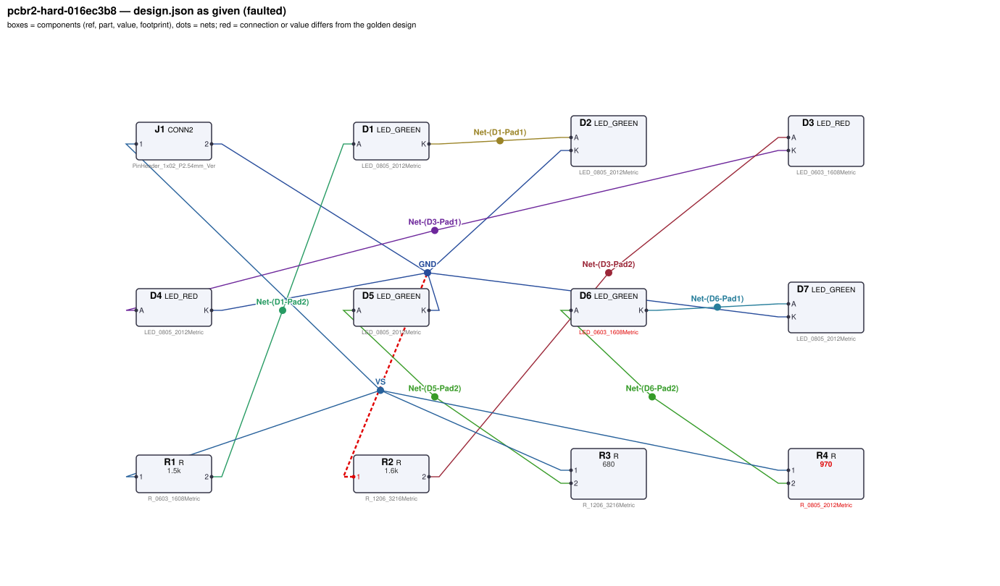
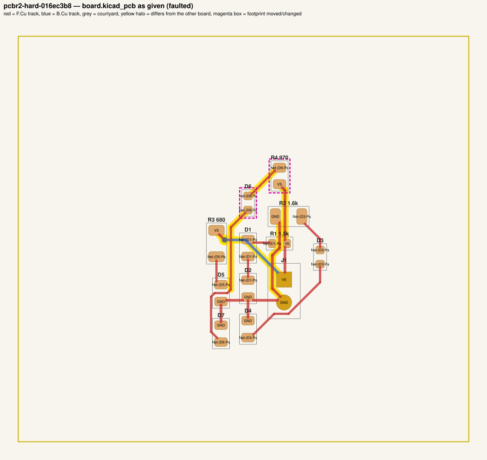
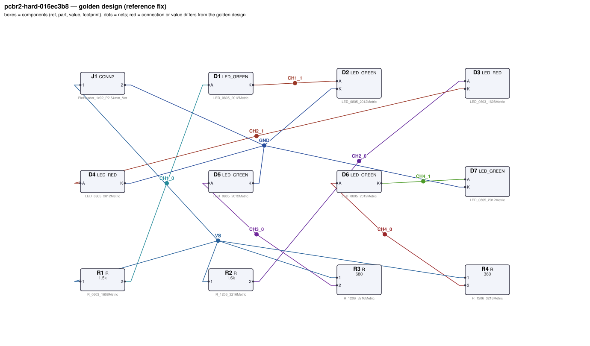
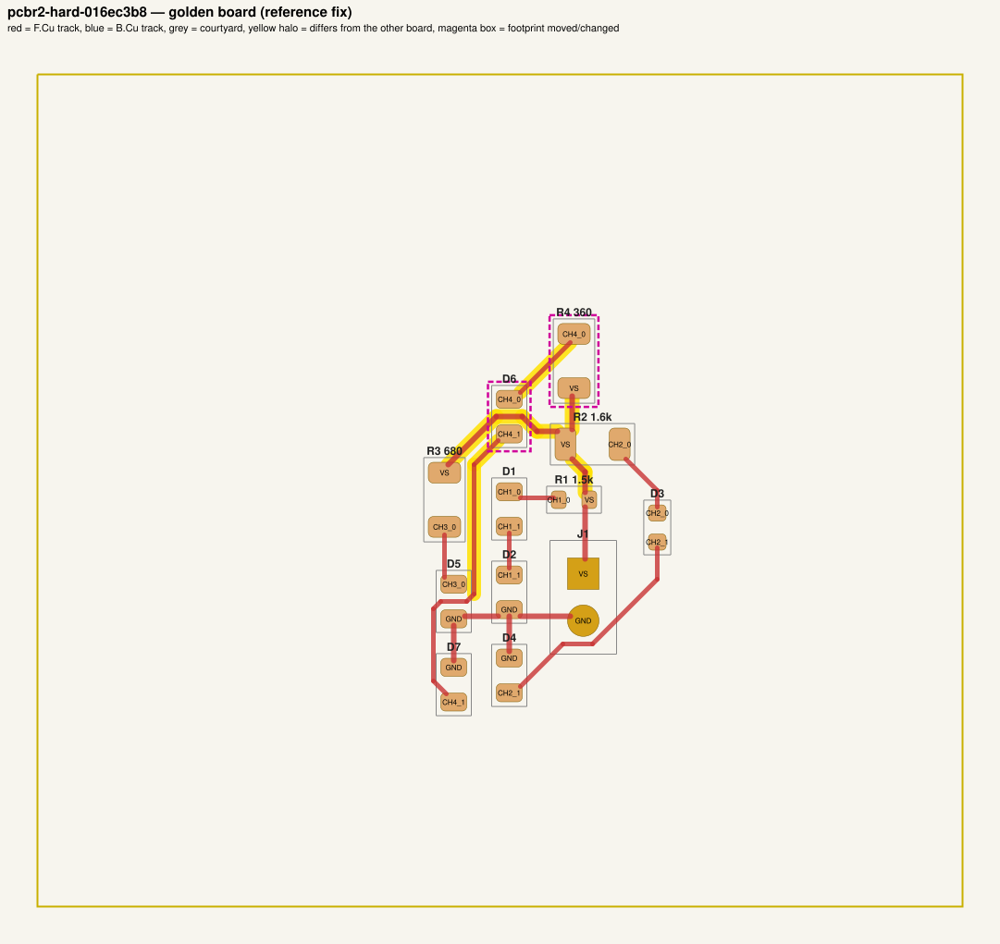

# QA packet 062: `pcbr2-hard-016ec3b8`

| family | tier | tool mode | hint level | intent in TASK.md | faults | latent | predicted difficulty |
|---|---|---|---|---|---|---|---|
| led_driver | hard | full | vague | reduced | 4 | 2 |  |

Task files: [`../../../tasks/v2/hard/pcbr2-hard-016ec3b8/public/`](../../../tasks/v2/hard/pcbr2-hard-016ec3b8/public/) (what the agent gets) and [`../../../tasks/v2/hard/pcbr2-hard-016ec3b8/hidden/`](../../../tasks/v2/hard/pcbr2-hard-016ec3b8/hidden/) (grader only). Why sampled: vague hint, connectivity fault, value near bounds: R4=970 inside [110, 1400], 2 latent (led_underrated, resistor_underrated), interacting value fault.

**How to review (≈5 min):** read section 1 as if you were the agent, decide whether you could find and fix the problems from it; then check section 2 (faults, reference fix, verifier verdicts) and fill `review.yaml`. Do not let section 2 influence your fairness judgement of section 1.

## 1. What the agent sees

### 1.1 TASK.md (verbatim)

````markdown
# Task: 4-channel LED indicator board

## Problem report

The first boards built from these files fail bring-up. Find and fix all problems: the design must meet its purpose and spec, the layout must match design.json, and DRC/ERC must be clean.

## Design intent

# 4-channel LED indicator board

Lights 7 indicator LEDs from a 12 V supply on J1
(pin 1 = +12 V, pin 2 = GND). Each channel is a series string of LEDs fed through its own
current-limiting resistor; the resistor sets the current from (Vs - n*Vf)/R.

Spec: each channel's LED current within ±10 % of its target. Resistors dissipating more than
~60 mW use a 1206 footprint.

Sub-circuits by purpose: supply connector (J1); channel 1 current-limiting resistor and LED string (R1, D1, D2); channel 2 current-limiting resistor and LED string (R2, D3, D4); channel 3 current-limiting resistor and LED string (R3, D5); channel 4 current-limiting resistor and LED string (R4, D6, D7).

_Connection details are intentionally not repeated here: wire each part as its datasheet in `parts/` describes (pinout and application notes), so that the circuit does what the purpose, interfaces and spec above require._

## Spec

The design must satisfy these assertions (`pcbtool sim` runs them; full definitions in `spec.json`):

- `string1_current`: DC current through D2 between 4.5 mA and 5.5 mA (J1.1 supplied with 12.0 V; ground = J1.2)
- `string2_current`: DC current through D4 between 4.5 mA and 5.5 mA (J1.1 supplied with 12.0 V; ground = J1.2)
- `string3_current`: DC current through D5 between 13.5 mA and 16.5 mA (J1.1 supplied with 12.0 V; ground = J1.2)
- `string4_current`: DC current through D7 between 18 mA and 22 mA (J1.1 supplied with 12.0 V; ground = J1.2)

Layout: every track of these nets must be at least the given width:

- GND (the net of J1.2): ≥ 0.3 mm
- VS (the net of J1.1): ≥ 0.3 mm

Component values: each value must lie in its acceptable range (inclusive; `value_bounds` in `spec.json`). Ranges come from the datasheets and the design intent; values the assertions already pin down get a wide sanity range, and the assertions still apply:

- R1 (R): 290 Ω … 4.8 kΩ
- R2 (R): 310 Ω … 5.2 kΩ
- R3 (R): 210 Ω … 2 kΩ
- R4 (R): 110 Ω … 1.4 kΩ

Board rules: 2 copper layers, clearance 0.2 mm, min track 0.2 mm, vias 0.6/0.3 mm, copper-to-edge 0.3 mm. DRC must be clean with no unconnected items.

## Design rules (design review)

Besides the spec, the design must pass an engineering design review. **`pcbtool` does not check any
of this — review the design yourself** against the datasheets in `parts/` (see each part's ratings /
design-rule section) and the design intent:

- **Absolute maximum ratings** of every part under every operating condition of the spec (no MCU pin
  above its VDD + 0.3 V or below -0.3 V, op-amp inputs within the rails, LDO EN ≤ VIN, MOSFET |VGS|,
  transistor / diode voltage and current limits).
- **Current limits:** MCU pin currents, LED forward current (by LED package), transistor collector /
  base currents; a saturated NPN switch needs a forced beta IC/IB ≤ 20.
- **Power / voltage ratings:** every resistor's I²R ≤ 50 % of its footprint's rating; every capacitor's
  working voltage ≤ 80 % of its footprint's rated voltage. Footprint choice matters.
- **Inductive loads** have a flyback diode directly across the load, cathode to the supply side.
- **Interfaces and pin assignments** stated in the design intent (connector pinouts, MCU pin functions,
  which rail each part connects to) must be respected exactly, even where the circuit would still
  simulate with a different assignment.

The grader checks these rules under the spec's operating conditions. A design can pass every
`pcbtool` check and still fail review.

## Deliverable

- Edit only `design.json` (the schematic of record) and `board.kicad_pcb` (the layout).
- Do not add, remove or rename components; keep each component's part.
- Keep the two files consistent: same connectivity, values and footprints on both.
- Values: `<number><SI prefix><unit>` such as `4.7k`, `100n`, `10kΩ`, `1meg`; unit letters, if any, must match the part (R: Ω/ohm/R, C: F, L: H, crystal: Hz); no spaces or control characters inside (full grammar: "Value notation" in `parts/R.md`, `parts/C.md`, ...).
- Do not change the board outline, add zones, or add DRC exclusions.
- Footprints must be unmodified library footprints from the part's allowed list (see `parts/<PART>.md`).
- Grading is pass/fail: topology, consistency, DRC, ERC, spec, component values, layout and the design rules above must all pass.

## Tools

Run `pcbtool <command>` inside this directory (you may also edit the two files directly).

Read-only:
- `pcbtool show` — components, values, footprints, positions and nets
- `pcbtool netlist` — design nets vs. board pad nets, with differences highlighted
- `pcbtool drc` — KiCad DRC under the canonical rules (the same rules the grader uses)
- `pcbtool erc` — electrical rule check of design.json
- `pcbtool sim` — run the spec assertions (spec.json) on design.json
- `pcbtool parts [PART]` — list parts / print a part's datasheet (also in `parts/`)
- `pcbtool check` — all of the above in one summary

Mutating (each keeps design.json and board.kicad_pcb consistent and saves both):
- `pcbtool set-value REF VALUE`
- `pcbtool set-footprint REF LIB:FOOTPRINT`
- `pcbtool connect REF.PIN NET` / `pcbtool disconnect REF.PIN`
- `pcbtool move REF X Y ROT` (absolute mm, degrees; tracks do not follow)
- `pcbtool unroute NET` / `pcbtool route NET [--width W]` (re-routes the whole net)
- `pcbtool sync` — push design.json connectivity and values onto the board pads
````

### 1.2 Public files

The agent also gets `design.json`, `board.kicad_pcb`, `spec.json` and the part datasheets below, plus the `pcbtool` commands listed in TASK.md (DRC, ERC, simulation of the public assertions, value-range check). Renders of the faulted files:





<details><summary>Datasheet <code>parts/CONN2.md</code></summary>

````markdown
# CONN2 — 2-pin header

Pin `1` = signal/supply, pin `2` = ground by board convention.

## Interface rule
The pin assignment of every connector is fixed by the design intent (cable / mating board):
swapping two connector pins breaks the interface even if the board itself still simulates.
````

</details>

<details><summary>Datasheet <code>parts/LED_GREEN.md</code></summary>

````markdown
# LED_GREEN — green SMD indicator LED (570 nm)

## Pinout
| Pin | Pad | Function |
|---|---|---|
| A | 2 | anode |
| K | 1 | cathode (marked) |

## Electrical characteristics (25 C)
- Forward voltage Vf = 2.2 V typ at IF = 10 mA
- Max continuous forward current 25 mA; reverse voltage max 5 V

| IF | Vf (typ) |
|---|---|
| 2 mA | 2.10 V |
| 5 mA | 2.15 V |
| 10 mA | 2.20 V |
| 15 mA | 2.23 V |
| 20 mA | 2.26 V |

## Application notes
- Always drive through a current-limiting resistor: R = (Vsupply - n*Vf) / IF for n LEDs in series.
- Current flows anode -> cathode; reversed LEDs do not light.

## Ratings by package

| Package | Max continuous IF | Design limit (80 %) |
|---|---|---|
| 0603 | 20 mA | 16 mA |
| 0805 | 30 mA | 24 mA |

**Design rule:** the forward current must not exceed 80 % of the package maximum; reverse voltage
≤ 5 V.
````

</details>

<details><summary>Datasheet <code>parts/LED_RED.md</code></summary>

````markdown
# LED_RED — red SMD indicator LED (625 nm)

## Pinout
| Pin | Pad | Function |
|---|---|---|
| A | 2 | anode |
| K | 1 | cathode (marked) |

## Electrical characteristics (25 C)
- Forward voltage Vf = 2.0 V typ at IF = 10 mA
- Max continuous forward current 25 mA; reverse voltage max 5 V

| IF | Vf (typ) |
|---|---|
| 2 mA | 1.90 V |
| 5 mA | 1.95 V |
| 10 mA | 2.00 V |
| 15 mA | 2.03 V |
| 20 mA | 2.06 V |

## Application notes
- Always drive through a current-limiting resistor: R = (Vsupply - n*Vf) / IF for n LEDs in series.
- Current flows anode -> cathode; reversed LEDs do not light.

## Ratings by package

| Package | Max continuous IF | Design limit (80 %) |
|---|---|---|
| 0603 | 20 mA | 16 mA |
| 0805 | 30 mA | 24 mA |

**Design rule:** the forward current must not exceed 80 % of the package maximum; reverse voltage
≤ 5 V.
````

</details>

<details><summary>Datasheet <code>parts/R.md</code></summary>

````markdown
# R — resistor

Two-terminal resistor. Pins `1`, `2` (non-polarised). Value in ohms.

## Value notation (all parts)

A value is `<number><SI prefix?><unit?>`, e.g. `4.7k`, `100n`, `2.2u`, `10R`, `1meg`, `1.5e3`:
- number: digits with an optional decimal point and an optional exponent (`1e3`); no sign, no
  digit grouping, no RKM notation (`4k7`);
- SI prefix (case-sensitive): `p` `n` `u`/`µ`/`μ` (micro) `m` (milli) `k`/`K` `M`/`meg`/`MEG` (mega) `G`;
  an exponent and a prefix together (`1e3k`) are rejected;
- unit letters, optional, must match the part: R `Ω`/`ohm`/`Ohm`/`R`; C `F`; L `H`; crystals `Hz`;
  other parts none (`100nH` on a capacitor is rejected);
- no whitespace or control characters inside the value (leading/trailing spaces are ignored).

design.json and the board must carry the same value; they are compared as numbers (`1k` == `1000`).

## Ratings by footprint (high-power thick-film series used on this board)

| Size | Rated power (70 C) | Design limit (50 % derating) |
|---|---|---|
| 0603 | 0.1 W | 50.0 mW |
| 0805 | 0.125 W | 62.5 mW |
| 1206 | 0.5 W | 250.0 mW |

**Design rule:** the continuous dissipation P = I²·R of every resistor must not exceed 50 % of its
footprint's rated power. Pick the footprint for the power, not just the value.
````

</details>

## 2. Reviewer-only (hidden from the agent)

### 2.1 Injected faults

| # | type | category | DRC/ERC-invisible | latent (pcbtool-clean) | detail | verifier, this fault alone |
|---|---|---|---|---|---|---|
| 1 | `resistor_underrated` | latent | yes | **yes** | R4 resistor footprint downsized R_1206_3216Metric -> R_0805_2012Metric; it now exceeds the rating of the smaller part | reward 0.0; fails rules |
| 2 | `led_underrated` | latent | yes | **yes** | D6 LED footprint downsized LED_0805_2012Metric -> LED_0603_1608Metric; it now exceeds the rating of the smaller part | reward 0.0; fails rules |
| 3 | `interacting_value` | value | yes |  | R4 is 970, should be ~360 (spec); restoring it while R4 keeps its latent fault breaks the resistor power rule | reward 0.0; fails spec |
| 4 | `pin_to_wrong_net` | connectivity | yes |  | R2.1 tied to net GND instead of VS | reward 0.0; fails spec, topology |

### 2.2 Reference fix (faulted → golden)

The reference repair is the hidden golden pair (`golden_design.json`, `golden_board.kicad_pcb`). Any repair that passes every gate and check scores 1.0; it need not be byte-identical.

**design.json: component changes**

- `D6` footprint: `LED_SMD:LED_0603_1608Metric` → `LED_SMD:LED_0805_2012Metric`
- `R4` value: `970` → `360`
- `R4` footprint: `Resistor_SMD:R_0805_2012Metric` → `Resistor_SMD:R_1206_3216Metric`

**design.json: connection changes** (per pin: what it connects to)

- `R2.1`: faulted net `GND` (D2.K, D4.K, D5.K, D7.K, J1.2) → golden net `VS` (J1.1, R1.1, R3.1, R4.1)

**board.kicad_pcb: footprints moved / changed**

- `D6` footprint `LED_SMD:LED_0603_1608Metric` → `LED_SMD:LED_0805_2012Metric`
- `R4` footprint `Resistor_SMD:R_0805_2012Metric` → `Resistor_SMD:R_1206_3216Metric`

**board.kicad_pcb: footprint values (BOM)**

- `R4` board value `970` → `360`

**board.kicad_pcb: pad-net changes**

- `D1` pad 1: net `Net-(D1-Pad1)` → `CH1_1`
- `D1` pad 2: net `Net-(D1-Pad2)` → `CH1_0`
- `D2` pad 2: net `Net-(D1-Pad1)` → `CH1_1`
- `D3` pad 1: net `Net-(D3-Pad1)` → `CH2_1`
- `D3` pad 2: net `Net-(D3-Pad2)` → `CH2_0`
- `D4` pad 2: net `Net-(D3-Pad1)` → `CH2_1`
- `D5` pad 2: net `Net-(D5-Pad2)` → `CH3_0`
- `D7` pad 2: net `Net-(D6-Pad1)` → `CH4_1`
- `R1` pad 2: net `Net-(D1-Pad2)` → `CH1_0`
- `R2` pad 1: net `GND` → `VS`
- `R2` pad 2: net `Net-(D3-Pad2)` → `CH2_0`
- `R3` pad 2: net `Net-(D5-Pad2)` → `CH3_0`

**board.kicad_pcb: nets re-routed** (track/via geometry differs)

- net `CH1_0`: 0 track/via item(s) removed, 1 added
- net `CH1_1`: 0 track/via item(s) removed, 1 added
- net `CH2_0`: 0 track/via item(s) removed, 2 added
- net `CH2_1`: 0 track/via item(s) removed, 4 added
- net `CH3_0`: 0 track/via item(s) removed, 1 added
- net `CH4_0`: 0 track/via item(s) removed, 1 added
- net `CH4_1`: 0 track/via item(s) removed, 7 added
- net `GND`: 4 track/via item(s) removed, 0 added
- net `Net-(D1-Pad1)`: 1 track/via item(s) removed, 0 added
- net `Net-(D1-Pad2)`: 1 track/via item(s) removed, 0 added
- net `Net-(D3-Pad1)`: 4 track/via item(s) removed, 0 added
- net `Net-(D3-Pad2)`: 2 track/via item(s) removed, 0 added
- net `Net-(D5-Pad2)`: 1 track/via item(s) removed, 0 added
- net `Net-(D6-Pad1)`: 7 track/via item(s) removed, 0 added
- net `Net-(D6-Pad2)`: 1 track/via item(s) removed, 0 added
- net `VS`: 6 track/via item(s) removed, 7 added

Golden renders (compare with 1.2; highlighted items differ):





### 2.3 Verifier verdicts

Reward is 1 only if every gate and check passes.

| stage | kind | faulted files | golden files |
|---|---|---|---|
| parse | gate | pass | pass |
| components | gate | pass | pass |
| topology | gate | **FAIL** | pass |
| consistency | gate | pass | pass |
| integrity | gate | pass | pass |
| drc | check | pass | pass |
| erc | check | pass | pass |
| spec | check | **FAIL** | pass |
| values | check | pass | pass |
| layout | check | pass | pass |
| rules | check | pass | pass |
| **reward** | | **0** | **1** |

Verifier messages on the faulted files:

- **layout_skipped**: no board net has the pins of golden net GND (connectivity differs: see topology)
- **layout_skipped**: no board net has the pins of golden net VS (connectivity differs: see topology)
- **spec**: string2_current: measured 1.2692429351e-35 expected [0.0045, 0.0055]
- **spec**: string4_current: measured 0.0078693810111 expected [0.018, 0.022]
- **topology**: nets only in candidate: [['D2.K', 'D4.K', 'D5.K', 'D7.K', 'J1.2', 'R2.1'], ['J1.1', 'R1.1', 'R3.1', 'R4.1']]; nets only in reference: [['D2.K', 'D4.K', 'D5.K', 'D7.K', 'J1.2'], ['J1.1', 'R1.1', 'R2.1', 'R3.1', 'R4.1']]

### 2.4 Spec assertions before / after

| assertion | what | allowed | faulted: measured | | golden: measured | |
|---|---|---|---|---|---|---|
| `string1_current` | DC current through D2 (J1.1 supplied with 12.0 V; ground = J1.2) | 4.5 mA … 5.5 mA | 5.126 mA | ✅ | 5.126 mA | ✅ |
| `string2_current` | DC current through D4 (J1.1 supplied with 12.0 V; ground = J1.2) | 4.5 mA … 5.5 mA | 1.269e-35 A | ❌ | 5.056 mA | ✅ |
| `string3_current` | DC current through D5 (J1.1 supplied with 12.0 V; ground = J1.2) | 13.5 mA … 16.5 mA | 14.37 mA | ✅ | 14.37 mA | ✅ |
| `string4_current` | DC current through D7 (J1.1 supplied with 12.0 V; ground = J1.2) | 18 mA … 22 mA | 7.869 mA | ❌ | 20.78 mA | ✅ |

### 2.5 Value bounds

Bounds are public (TASK.md / spec.json); `values` check = every value inside its range.

| ref | part | acceptable range | faulted design.json | faulted board | golden | touched by a fault |
|---|---|---|---|---|---|---|
| `R1` | R | 290 Ω … 4.8 kΩ | `1.5k` | `1.5k` | `1.5k` |  |
| `R2` | R | 310 Ω … 5.2 kΩ | `1.6k` | `1.6k` | `1.6k` | **yes** |
| `R3` | R | 210 Ω … 2 kΩ | `680` | `680` | `680` |  |
| `R4` | R | 110 Ω … 1.4 kΩ | `970` | `970` | `360` | **yes** |

### 2.6 Layout rules

- power net `GND` (golden pins D2.K, D4.K, D5.K, D7.K, J1.2): every track ≥ 0.3 mm
- power net `VS` (golden pins J1.1, R1.1, R2.1, R3.1, R4.1): every track ≥ 0.3 mm

### 2.7 Latent faults and their public evidence

A latent fault leaves `pcbtool check` clean; the agent can only find it by reading the public text. For each one: the generator's evidence claim, then every evidence group the generator's fairness gate requires (`pcbenv/faults/latent.py:evidence_groups`) with the exact public line it matched. Judge whether that text really lets an engineer infer the requirement (`task_fair`, `rule_stated_clearly`).

**Fault 1: `resistor_underrated`** — R4 resistor footprint downsized R_1206_3216Metric -> R_0805_2012Metric; it now exceeds the rating of the smaller part

- detected by: `rules`; rule violations it causes: resistor_power: R4 dissipates 155 mW > 62.5 mW (50 % of 0.125 W, R_0805_2012Metric) [condition 0]
- generator's evidence claim: parts/R.md ratings by footprint + 50 % power derating rule; TASK.md Design rules
- evidence group `the continuous dissipation P = I²·R of every resistor`: matched `the continuous dissipation P = I²·R of every resistor` in `parts/R.md`:
  > **Design rule:** the continuous dissipation P = I²·R of every resistor must not exceed 50 % of its
- evidence group `| 0805 |`: matched `| 0805 |` in `parts/LED_GREEN.md` (also in `parts/LED_RED.md`, `parts/R.md`):
  > \| 0805 \| 30 mA \| 24 mA \|

**Fault 2: `led_underrated`** — D6 LED footprint downsized LED_0805_2012Metric -> LED_0603_1608Metric; it now exceeds the rating of the smaller part

- detected by: `rules`; rule violations it causes: led_current: D6 forward current 20.8 mA > 16 mA (80 % of the LED_0603_1608Metric rating) [condition 0]
- generator's evidence claim: parts/LED_*.md max IF by package + 80 % rule; LED current in the spec; TASK.md Design rules
- evidence group `the forward current must not exceed 80 % of the package maximum`: matched `the forward current must not exceed 80 % of the package maximum` in `parts/LED_GREEN.md` (also in `parts/LED_RED.md`):
  > **Design rule:** the forward current must not exceed 80 % of the package maximum; reverse voltage
- evidence group `| 0603 |`: matched `| 0603 |` in `parts/LED_GREEN.md` (also in `parts/LED_RED.md`, `parts/R.md`):
  > \| 0603 \| 20 mA \| 16 mA \|


### 2.8 Design rules (`rules` check, not run by pcbtool)

Scope: all datasheet rules (hard tier); 1 operating condition(s) from the spec's stimuli; 18 rule quantities evaluated per design. Rows shown: violated on either side, on a part a fault touches (if ≥ 5 % of its limit or changed by ≥ 5 points or by a footprint change), or at ≥ 80% of the limit. Values are the worst case over the conditions (computed with `pcbenv.rules.operating_point`; limits from `pcbenv/rules.py`, stated in `parts/<PART>.md` and TASK.md "Design rules").

| rule | subject | quantity | limit | faulted (of limit) | golden (of limit) | shown because | worst condition (faulted) |
|---|---|---|---|---|---|---|---|
| `led_current` | `D6` | IF | per package / condition, see cells | 0603: 7.869 mA of 16 mA (49%) | 0805: 20.78 mA of 24 mA (87%) | fault target | cond 0 |
| `led_current` | `D7` | IF | 24 mA | 0805: 7.869 mA of 24 mA (33%) | 0805: 20.78 mA of 24 mA (87%) | near limit | cond 0 |
| `resistor_power` | `R2` | I²R | 250 mW | 1206: 0 W of 250 mW (0%) | 1206: 40.91 mW of 250 mW (16%) | fault target | cond 0 |
| `resistor_power` | `R4` | I²R | per package / condition, see cells | 0805: 60.07 mW of 62.5 mW (96%) | 1206: 155.5 mW of 250 mW (62%) | fault target | cond 0 |

Rule violations reported by the verifier: faulted: none; golden: none.

## 3. Review

Fill `review.yaml` in this directory (second reviewer: copy `../../review_template.yaml` to `review-<initials>.yaml` here, without looking at the first form). Questions to answer:

1. **task_fair / solvable_from_public_material**: from section 1 only, can a competent engineer locate and fix every injected fault? Is anything required that is not stated (a value with no assertion and no published range, a connection only the golden reveals)?
2. **reference_fix_correct**: is the golden (2.2) a correct design that meets the stated intent?
3. **verifier_verdict_agrees**: do you agree the faulted files fail and the golden passes, for the reasons given in 2.3?
4. **alternative_valid_fixes_rejected**: is there an engineering-valid repair the grader would reject (e.g. a different E-series value that meets intent but fails an assertion window or value bound; keeping a swapped footprint and re-routing; a different valid placement)?
5. **rule_stated_clearly**: is every design rule / layout rule / latent requirement this task grades (2.7–2.9) stated in the public material clearly enough that an engineer would apply it the way the grader does (limit, which part, which condition)? Normal-tier tasks: answer for the resistor-power rule (`yes` if no rule is involved).
6. **layout_rule_reasonable**: hard_layout tasks only (else `n/a`): are the layout-rule limits and their geometric definitions (2.9) defensible engineering practice for this board, i.e. would you reject the faulted layout in a design review, and accept the golden one?

