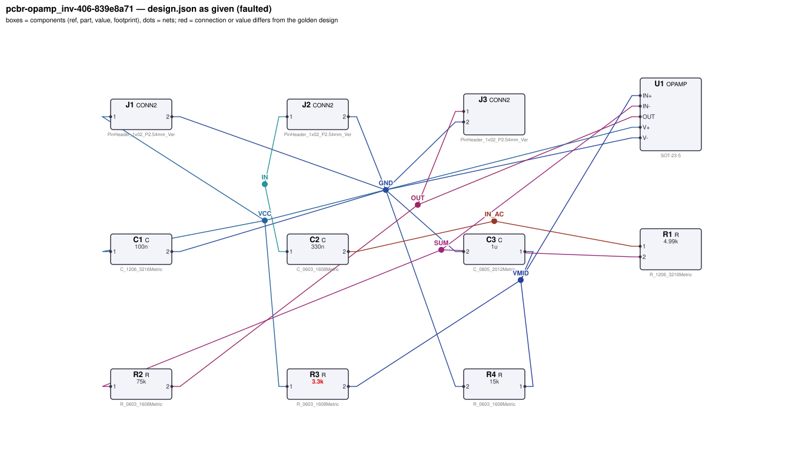
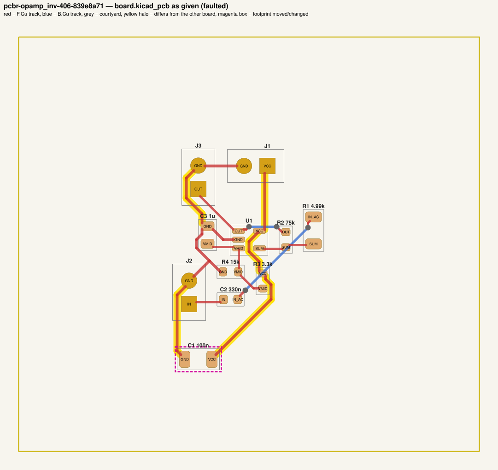
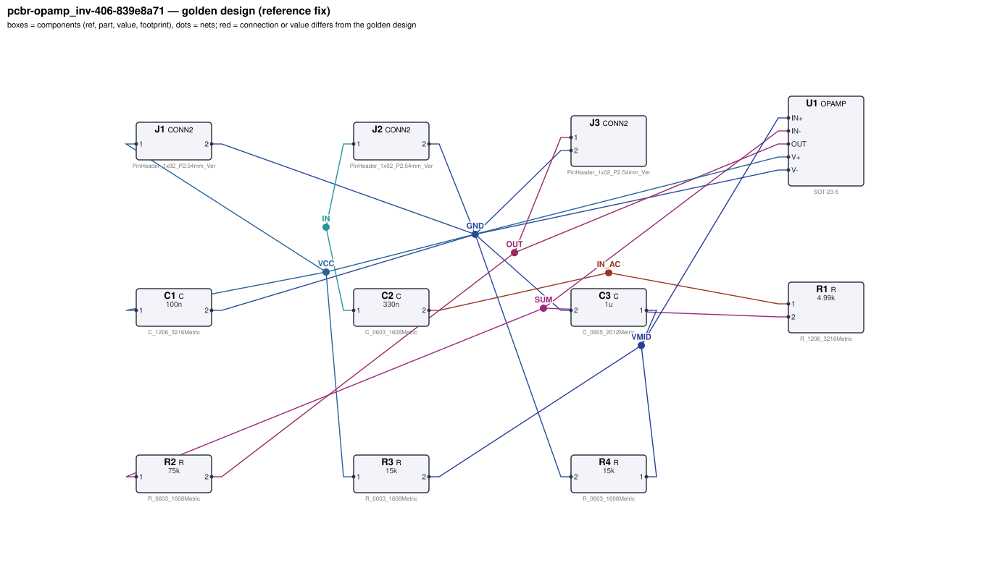
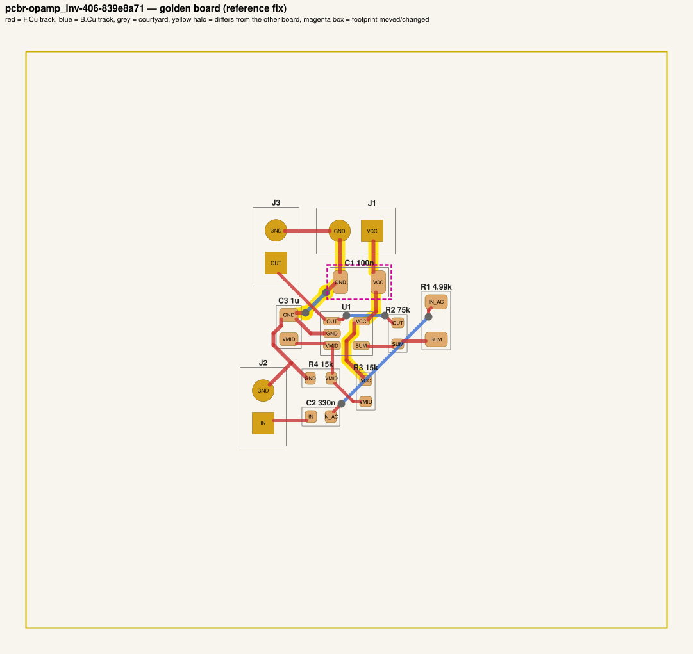

# QA packet 066: `pcbr-opamp_inv-406-839e8a71`

| family | seed | hint level | intent in TASK.md | faults | predicted difficulty |
|---|---|---|---|---|---|
| opamp_inv | 406 | vague | reduced | 2 | hard |

Task files: [`../../../tasks/train/pcbr-opamp_inv-406-839e8a71/public/`](../../../tasks/train/pcbr-opamp_inv-406-839e8a71/public/) (what the agent gets) and [`../../../tasks/train/pcbr-opamp_inv-406-839e8a71/hidden/`](../../../tasks/train/pcbr-opamp_inv-406-839e8a71/hidden/) (grader only). Why sampled: vague hint, disputable type decap_moved_far, value near bounds: R3=3.3k near [4700, 470000].

**How to review (≈5 min):** read section 1 as if you were the agent, decide whether you could find and fix the problems from it; then check section 2 (faults, reference fix, verifier verdicts) and fill `review.yaml`. Do not let section 2 influence your fairness judgement of section 1.

## 1. What the agent sees

### 1.1 TASK.md (verbatim)

````markdown
# Task: inverting x15 AC amplifier

## Problem report

The first boards built from these files fail bring-up. Find and fix all problems: the design must meet its purpose and spec, the layout must match design.json, and DRC/ERC must be clean.

## Design intent

# Inverting x15 AC amplifier (single supply)

Amplifies an AC signal on J2 (pin 1 = input, pin 2 = GND) with a gain of -15 and outputs it on
J3 (pin 1 = output, pin 2 = GND), centred at mid-supply. Single 5 V supply on J1
(pin 1 = VCC, pin 2 = GND).

Spec: output DC level VCC/2 ±3 %; |gain| 15 ±3 % at 1 kHz; low -3 dB corner 96.5 Hz ±15 %.
Component values: decoupling C1 47 nF–10 µF (100 nF typical); bias divider R3, R4 4.7 kΩ–470 kΩ each;
VMID bypass C3 470 nF–47 µF.

_Connection details are intentionally not repeated here: wire each part as its datasheet in `parts/` describes (pinout and application notes), so that the circuit does what the purpose, interfaces and spec above require._

## Spec

The design must satisfy these assertions (`pcbtool sim` runs them; full definitions in `spec.json`):

- `dc_bias_out`: DC voltage at J3.1 between 2.425 V and 2.575 V (J1.1 supplied with 5.0 V; dc source on J2.1; ground = J1.2)
- `midband_gain`: AC gain |V(J3.1)/V(J2.1)| at 1 kHz between 14.53 and 15.43 (J1.1 supplied with 5.0 V; dc source on J2.1; ground = J1.2)
- `low_cutoff`: -3 dB frequency from J2.1 to J3.1 between 82.01 Hz and 111 Hz (J1.1 supplied with 5.0 V; dc source on J2.1; ground = J1.2)

Layout: every track of these nets must be at least the given width:

- GND (the net of J1.2): ≥ 0.3 mm
- VCC (the net of J1.1): ≥ 0.3 mm

Decoupling: every pad of each capacitor within the given distance of the IC pin's pad:

- C1 within 5.0 mm of U1.V+

Component values: each value must lie in its acceptable range (inclusive; `value_bounds` in `spec.json`). Ranges come from the datasheets and the design intent; values the assertions already pin down get a wide sanity range, and the assertions still apply:

- C1 (C): 47 nF … 10 uF
- C2 (C): 88 nF … 1.3 uF
- C3 (C): 470 nF … 47 uF
- R1 (R): 1.6 kΩ … 13 kΩ
- R2 (R): 26 kΩ … 280 kΩ
- R3 (R): 4.7 kΩ … 470 kΩ
- R4 (R): 4.7 kΩ … 470 kΩ

Board rules: 2 copper layers, clearance 0.2 mm, min track 0.2 mm, vias 0.6/0.3 mm, copper-to-edge 0.3 mm. DRC must be clean with no unconnected items.

## Deliverable

- Edit only `design.json` (the schematic of record) and `board.kicad_pcb` (the layout).
- Do not add, remove or rename components; keep each component's part.
- Keep the two files consistent: same connectivity, values and footprints on both.
- Do not change the board outline, add zones, or add DRC exclusions.
- Footprints must be unmodified library footprints from the part's allowed list (see `parts/<PART>.md`).
- Grading is pass/fail: topology, consistency, DRC, ERC, spec, component values and layout must all pass.

## Tools

Run `pcbtool <command>` inside this directory (you may also edit the two files directly).

Read-only:
- `pcbtool show` — components, values, footprints, positions and nets
- `pcbtool netlist` — design nets vs. board pad nets, with differences highlighted
- `pcbtool drc` — KiCad DRC under the canonical rules (the same rules the grader uses)
- `pcbtool erc` — electrical rule check of design.json
- `pcbtool sim` — run the spec assertions (spec.json) on design.json
- `pcbtool parts [PART]` — list parts / print a part's datasheet (also in `parts/`)
- `pcbtool check` — all of the above in one summary

Mutating (each keeps design.json and board.kicad_pcb consistent and saves both):
- `pcbtool set-value REF VALUE`
- `pcbtool set-footprint REF LIB:FOOTPRINT`
- `pcbtool connect REF.PIN NET` / `pcbtool disconnect REF.PIN`
- `pcbtool move REF X Y ROT` (absolute mm, degrees; tracks do not follow)
- `pcbtool unroute NET` / `pcbtool route NET [--width W]` (re-routes the whole net)
- `pcbtool sync` — push design.json connectivity and values onto the board pads
````

### 1.2 Public files

The agent also gets `design.json`, `board.kicad_pcb`, `spec.json` and the part datasheets below, plus the `pcbtool` commands listed in TASK.md (DRC, ERC, simulation of the public assertions, value-range check). Renders of the faulted files:





<details><summary>Datasheet <code>parts/C.md</code></summary>

````markdown
# C — ceramic capacitor

Two-terminal non-polarised capacitor. Pins `1`, `2`. Value in farads.
````

</details>

<details><summary>Datasheet <code>parts/CONN2.md</code></summary>

````markdown
# CONN2 — 2-pin header

Pin `1` = signal/supply, pin `2` = ground by board convention.
````

</details>

<details><summary>Datasheet <code>parts/OPAMP.md</code></summary>

````markdown
# OPAMP — single rail-to-rail I/O operational amplifier (SOT-23-5)

## Pinout
| Pin | Pad | Function |
|---|---|---|
| OUT | 1 | output |
| V- | 2 | negative supply (GND in single-supply use) |
| IN+ | 3 | non-inverting input |
| IN- | 4 | inverting input |
| V+ | 5 | positive supply |

## Electrical characteristics
- Supply 1.8–5.5 V (V+ - V-); quiescent current 100 µA
- Open-loop gain 100 dB (1e5); gain-bandwidth product 1 MHz (single pole)
- Rail-to-rail input and output (output swings to within 5 mV of the rails, Rout 30 Ω)
- Input bias current < 1 pA; input offset modelled as 0

## Application notes
- Non-inverting gain: G = 1 + Rf / Rg (Rf from OUT to IN-, Rg from IN- to ground).
- Inverting gain: G = -Rf / Rin. In single-supply use bias IN+ at mid-supply (e.g. a
  resistor divider from V+ bypassed with a capacitor) and AC-couple the input.
- Closed-loop bandwidth ≈ 1 MHz / (noise gain).
- Decouple V+ with 100 nF ceramic to ground within 5 mm of the pin.
````

</details>

<details><summary>Datasheet <code>parts/R.md</code></summary>

````markdown
# R — resistor

Two-terminal resistor. Pins `1`, `2` (non-polarised). Value in ohms.
````

</details>

## 2. Reviewer-only (hidden from the agent)

### 2.1 Injected faults

| # | type | category | DRC/ERC-invisible | detail | verifier, this fault alone |
|---|---|---|---|---|---|
| 1 | `wrong_pull_resistor` | value | yes | R3 (pull-up/pull-down resistor) is 3.3k, should be 15k | reward 0.0; fails spec, values |
| 2 | `decap_moved_far` | board | yes | C1 placed at (119.5, 135.0), 14.9 mm from U1.V+ (max 5.0 mm) | reward 0.0; fails layout |

### 2.2 Reference fix (faulted → golden)

The reference repair is the hidden golden pair (`golden_design.json`, `golden_board.kicad_pcb`). Any repair that passes every gate and check scores 1.0; it need not be byte-identical.

**design.json: component changes**

- `R3` value: `3.3k` → `15k`

**design.json: connection changes** (per pin: what it connects to)

- none

**board.kicad_pcb: footprints moved / changed**

- `C1` moved (119.50, 135.00, 180°, F) → (126.00, 118.00, 180°, F), 18.20 mm

**board.kicad_pcb: footprint values (BOM)**

- `R3` board value `3.3k` → `15k`

**board.kicad_pcb: pad-net changes**

- none

**board.kicad_pcb: nets re-routed** (track/via geometry differs)

- net `GND`: 7 track/via item(s) removed, 6 added
- net `VCC`: 9 track/via item(s) removed, 7 added

Golden renders (compare with 1.2; highlighted items differ):





### 2.3 Verifier verdicts

Reward is 1 only if every gate and check passes.

| stage | kind | faulted files | golden files |
|---|---|---|---|
| parse | gate | pass | pass |
| components | gate | pass | pass |
| topology | gate | pass | pass |
| consistency | gate | pass | pass |
| integrity | gate | pass | pass |
| drc | check | pass | pass |
| erc | check | pass | pass |
| spec | check | **FAIL** | pass |
| values | check | **FAIL** | pass |
| layout | check | **FAIL** | pass |
| **reward** | | **0** | **1** |

Verifier messages on the faulted files:

- **layout**: decoupling: C1.1 is 14.87 mm from U1.V+ (max 5.0 mm)
- **layout**: decoupling: C1.2 is 16.14 mm from U1.V+ (max 5.0 mm)
- **spec**: dc_bias_out: measured 4.0983744745 expected [2.425, 2.575]
- **values**: R3: value '3.3k' outside acceptable range [4700, 470000]

### 2.4 Spec assertions before / after

| assertion | what | allowed | faulted: measured | | golden: measured | |
|---|---|---|---|---|---|---|
| `dc_bias_out` | DC voltage at J3.1 (J1.1 supplied with 5.0 V; dc source on J2.1; ground = J1.2) | 2.425 V … 2.575 V | 4.098 V | ❌ | 2.5 V | ✅ |
| `midband_gain` | AC gain \|V(J3.1)/V(J2.1)\| at 1 kHz (J1.1 supplied with 5.0 V; dc source on J2.1; ground = J1.2) | 14.53 … 15.43 | 14.98 | ✅ | 14.98 | ✅ |
| `low_cutoff` | -3 dB frequency from J2.1 to J3.1 (J1.1 supplied with 5.0 V; dc source on J2.1; ground = J1.2) | 82.01 Hz … 111 Hz | 96.5 Hz | ✅ | 96.5 Hz | ✅ |

### 2.5 Value bounds

Bounds are public (TASK.md / spec.json); `values` check = every value inside its range.

| ref | part | acceptable range | faulted design.json | faulted board | golden | touched by a fault |
|---|---|---|---|---|---|---|
| `C1` | C | 47 nF … 10 uF | `100n` | `100n` | `100n` | **yes** |
| `C2` | C | 88 nF … 1.3 uF | `330n` | `330n` | `330n` |  |
| `C3` | C | 470 nF … 47 uF | `1u` | `1u` | `1u` |  |
| `R1` | R | 1.6 kΩ … 13 kΩ | `4.99k` | `4.99k` | `4.99k` |  |
| `R2` | R | 26 kΩ … 280 kΩ | `75k` | `75k` | `75k` |  |
| `R3` | R | 4.7 kΩ … 470 kΩ | `3.3k` ⚠ out of range | `3.3k` ⚠ out of range | `15k` | **yes** |
| `R4` | R | 4.7 kΩ … 470 kΩ | `15k` | `15k` | `15k` |  |

### 2.6 Layout rules

- power net `GND` (golden pins C1.2, C3.2, J1.2, J2.2, J3.2, R4.2, U1.V-): every track ≥ 0.3 mm
- power net `VCC` (golden pins C1.1, J1.1, R3.1, U1.V+): every track ≥ 0.3 mm
- decoupling: `C1` within 5.0 mm of `U1.V+`

## 3. Review

Fill `review.yaml` in this directory (second reviewer: copy `../../review_template.yaml` to `review-<initials>.yaml` here, without looking at the first form). Questions to answer:

1. **task_fair / solvable_from_public_material**: from section 1 only, can a competent engineer locate and fix every injected fault? Is anything required that is not stated (a value with no assertion and no published range, a connection only the golden reveals)?
2. **reference_fix_correct**: is the golden (2.2) a correct design that meets the stated intent?
3. **verifier_verdict_agrees**: do you agree the faulted files fail and the golden passes, for the reasons given in 2.3?
4. **alternative_valid_fixes_rejected**: is there an engineering-valid repair the grader would reject (e.g. a different E-series value that meets intent but fails an assertion window or value bound; keeping a swapped footprint and re-routing; a different valid placement)?

