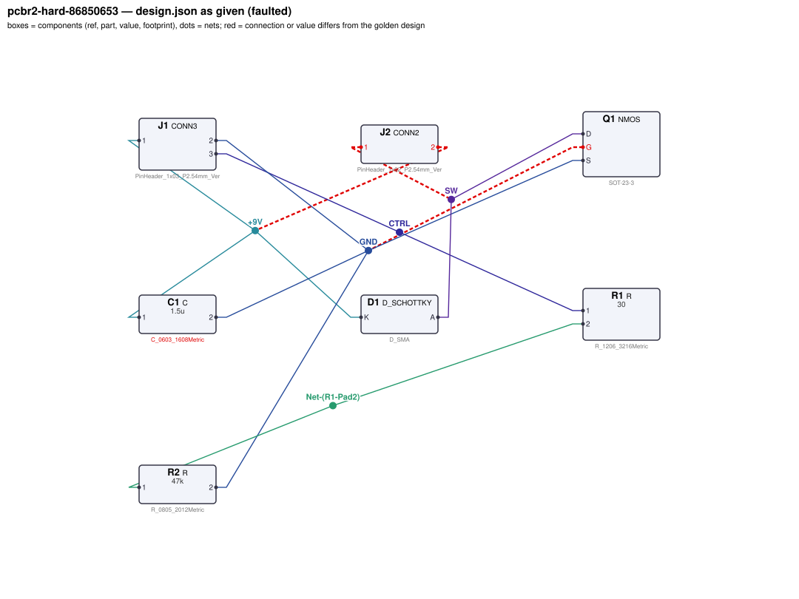
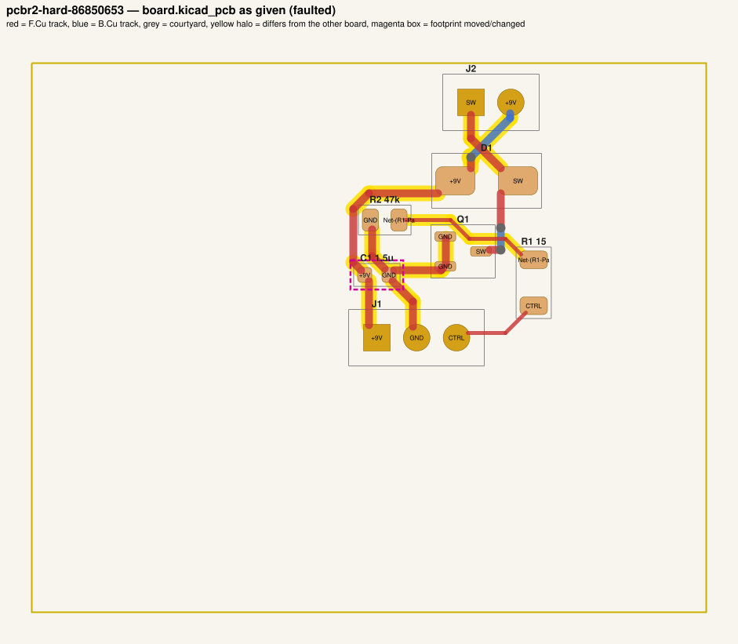
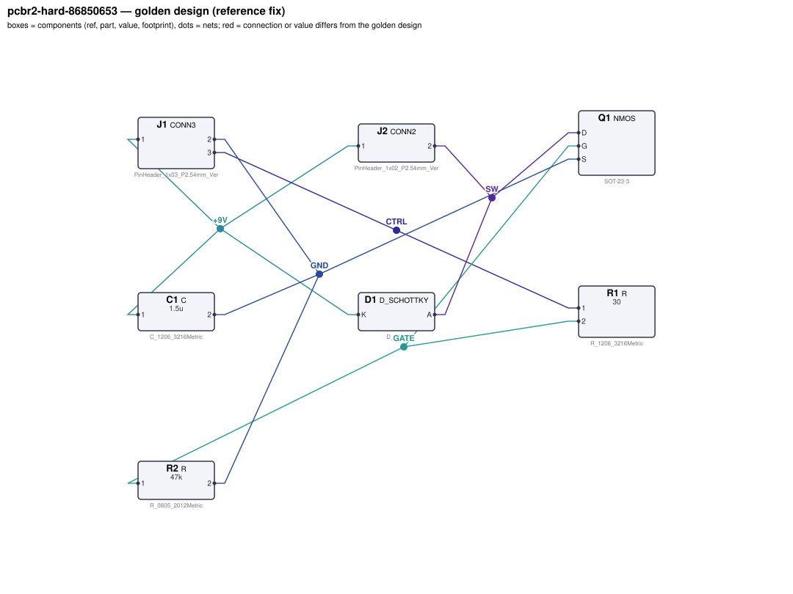
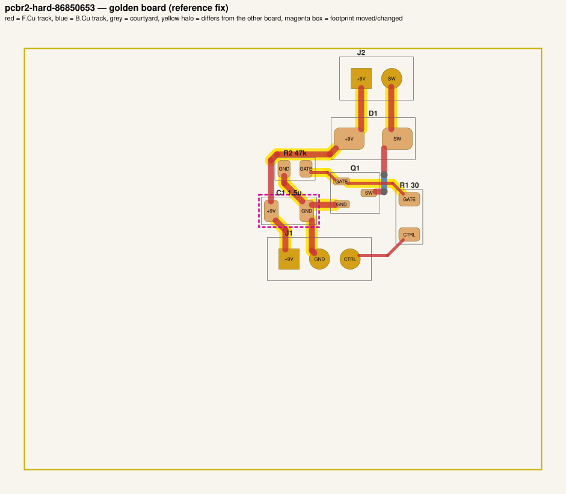

# QA packet 066: `pcbr2-hard-86850653`

| family | tier | tool mode | hint level | intent in TASK.md | faults | latent | predicted difficulty |
|---|---|---|---|---|---|---|---|
| nmos_switch | hard | no_autoroute | vague | reduced | 4 | 2 |  |

Task files: [`../../../tasks/v2/hard/pcbr2-hard-86850653/public/`](../../../tasks/v2/hard/pcbr2-hard-86850653/public/) (what the agent gets) and [`../../../tasks/v2/hard/pcbr2-hard-86850653/hidden/`](../../../tasks/v2/hard/pcbr2-hard-86850653/hidden/) (grader only). Why sampled: vague hint, connectivity fault, disputable type bom_mismatch, disputable type connector_pin_swap, value near bounds: R1=15 inside [4.7, 220], 2 latent (capacitor_underrated, connector_pin_swap), no_autoroute.

**How to review (≈5 min):** read section 1 as if you were the agent, decide whether you could find and fix the problems from it; then check section 2 (faults, reference fix, verifier verdicts) and fill `review.yaml`. Do not let section 2 influence your fairness judgement of section 1.

## 1. What the agent sees

### 1.1 TASK.md (verbatim)

````markdown
# Task: 9 V low-side MOSFET switch

## Problem report

The first boards built from these files fail bring-up. Find and fix all problems: the design must meet its purpose and spec, the layout must match design.json, and DRC/ERC must be clean.

## Design intent

# 9 V low-side MOSFET switch

A 5 V logic signal switches a 0.75 A load from a 9 V supply.
J1 is the input header: pin 1 = +9 V, pin 2 = GND, pin 3 = CTRL (logic input).
J2 connects the off-board load: pin 1 = +9 V, pin 2 = switched return to the MOSFET drain.
The load is an inductive load (solenoid/motor, ~12 Ω) with Schottky D1 as flyback clamp across J2: cathode to the supply pin, anode to the switched pin.

Spec: CTRL = 5 V -> load current 0.75 A ±5 % with VDS ≤ 0.3 V; CTRL floating ->
load off (< 0.1 mA) even with 10 MΩ of leakage from the supply to the gate. Load-current
traces (supply, switched node, GND) at least 0.5 mm wide.
Component values: gate series R1 4.7 Ω–220 Ω (datasheet: 10–100 Ω); gate pull-down R2 4.7 kΩ–220 kΩ
(datasheet: 10k–100k); bulk C1 1 µF–22 µF.

Sub-circuits by purpose: input header (J1); load connector (J2); low-side MOSFET (Q1); gate series resistor and gate pull-down (R1, R2); supply bulk capacitor (C1); flyback clamp diode (D1).

Interfaces and pin assignments (fixed):

- Q1 (logic-level NMOS) has its source on GND and drain on the switched node (J2 pin 2).

_Connection details are intentionally not repeated here: wire each part as its datasheet in `parts/` describes (pinout and application notes), so that the circuit does what the purpose, interfaces and spec above require._

## Spec

The design must satisfy these assertions (`pcbtool sim` runs them; full definitions in `spec.json`):

- `load_on_current`: DC current through J2.2 between 712.5 mA and 787.5 mA (J1.1 supplied with 9.0 V; 5.0 V DC source on J1.3; load R=12 L=0.005 from J2.1 to J2.2; ground = J1.2)
- `vds_on`: DC voltage at Q1.D between 0 V and 300 mV (J1.1 supplied with 9.0 V; 5.0 V DC source on J1.3; load R=12 L=0.005 from J2.1 to J2.2; ground = J1.2)
- `load_off_current`: DC current through J2.2 between 0 A and 100 uA (J1.1 supplied with 9.0 V; load R=12 L=0.005 from J2.1 to J2.2; load R=1e+07 from Q1.G to J1.1; ground = J1.2)
- `ctrl_current_on`: DC current through R1 between 0 A and 1 mA (J1.1 supplied with 9.0 V; 5.0 V DC source on J1.3; load R=12 L=0.005 from J2.1 to J2.2; ground = J1.2)

Layout: every track of these nets must be at least the given width:

- +9V (the net of J1.1): ≥ 0.5 mm
- GND (the net of J1.2): ≥ 0.5 mm
- SW (the net of J2.2): ≥ 0.5 mm

Component values: each value must lie in its acceptable range (inclusive; `value_bounds` in `spec.json`). Ranges come from the datasheets and the design intent; values the assertions already pin down get a wide sanity range, and the assertions still apply:

- C1 (C): 1 uF … 22 uF
- R1 (R): 4.7 Ω … 220 Ω
- R2 (R): 4.7 kΩ … 220 kΩ

Board rules: 2 copper layers, clearance 0.2 mm, min track 0.2 mm, vias 0.6/0.3 mm, copper-to-edge 0.3 mm. DRC must be clean with no unconnected items.

## Design rules (design review)

Besides the spec, the design must pass an engineering design review. **`pcbtool` does not check any
of this — review the design yourself** against the datasheets in `parts/` (see each part's ratings /
design-rule section) and the design intent:

- **Absolute maximum ratings** of every part under every operating condition of the spec (no MCU pin
  above its VDD + 0.3 V or below -0.3 V, op-amp inputs within the rails, LDO EN ≤ VIN, MOSFET |VGS|,
  transistor / diode voltage and current limits).
- **Current limits:** MCU pin currents, LED forward current (by LED package), transistor collector /
  base currents; a saturated NPN switch needs a forced beta IC/IB ≤ 20.
- **Power / voltage ratings:** every resistor's I²R ≤ 50 % of its footprint's rating; every capacitor's
  working voltage ≤ 80 % of its footprint's rated voltage. Footprint choice matters.
- **Inductive loads** have a flyback diode directly across the load, cathode to the supply side.
- **Interfaces and pin assignments** stated in the design intent (connector pinouts, MCU pin functions,
  which rail each part connects to) must be respected exactly, even where the circuit would still
  simulate with a different assignment.

The grader checks these rules under the spec's operating conditions. A design can pass every
`pcbtool` check and still fail review.

## Deliverable

- Edit only `design.json` (the schematic of record) and `board.kicad_pcb` (the layout).
- Do not add, remove or rename components; keep each component's part.
- Keep the two files consistent: same connectivity, values and footprints on both.
- Values: `<number><SI prefix><unit>` such as `4.7k`, `100n`, `10kΩ`, `1meg`; unit letters, if any, must match the part (R: Ω/ohm/R, C: F, L: H, crystal: Hz); no spaces or control characters inside (full grammar: "Value notation" in `parts/R.md`, `parts/C.md`, ...).
- Do not change the board outline, add zones, or add DRC exclusions.
- Footprints must be unmodified library footprints from the part's allowed list (see `parts/<PART>.md`).
- Grading is pass/fail: topology, consistency, DRC, ERC, spec, component values, layout and the design rules above must all pass.

## Tools

Run `pcbtool <command>` inside this directory (you may also edit the two files directly).

Read-only:
- `pcbtool show` — components, values, footprints, positions and nets
- `pcbtool netlist` — design nets vs. board pad nets, with differences highlighted
- `pcbtool drc` — KiCad DRC under the canonical rules (the same rules the grader uses)
- `pcbtool erc` — electrical rule check of design.json
- `pcbtool sim` — run the spec assertions (spec.json) on design.json
- `pcbtool parts [PART]` — list parts / print a part's datasheet (also in `parts/`)
- `pcbtool check` — all of the above in one summary

Mutating (each keeps design.json and board.kicad_pcb consistent and saves both):
- `pcbtool set-value REF VALUE`
- `pcbtool set-footprint REF LIB:FOOTPRINT`
- `pcbtool connect REF.PIN NET` / `pcbtool disconnect REF.PIN`
- `pcbtool move REF X Y ROT` (absolute mm, degrees; tracks do not follow)
- `pcbtool unroute NET` / `pcbtool route NET [--width W]` (re-routes the whole net)
- `pcbtool sync` — push design.json connectivity and values onto the board pads

**Tool mode for this task: `no_autoroute`** (`tools.json`). `pcbtool route` and `pcbtool sync` are
disabled: after changing connectivity or footprints, edit the tracks (`segment` / `via` items) in
`board.kicad_pcb` yourself, or move parts with `pcbtool move`. All other commands work.
````

### 1.2 Public files

The agent also gets `design.json`, `board.kicad_pcb`, `spec.json` and the part datasheets below, plus the `pcbtool` commands listed in TASK.md (DRC, ERC, simulation of the public assertions, value-range check). Renders of the faulted files:





<details><summary>Datasheet <code>parts/C.md</code></summary>

````markdown
# C — ceramic capacitor

Two-terminal non-polarised capacitor. Pins `1`, `2`. Value in farads.

## Value notation (all parts)

A value is `<number><SI prefix?><unit?>`, e.g. `4.7k`, `100n`, `2.2u`, `10R`, `1meg`, `1.5e3`:
- number: digits with an optional decimal point and an optional exponent (`1e3`); no sign, no
  digit grouping, no RKM notation (`4k7`);
- SI prefix (case-sensitive): `p` `n` `u`/`µ`/`μ` (micro) `m` (milli) `k`/`K` `M`/`meg`/`MEG` (mega) `G`;
  an exponent and a prefix together (`1e3k`) are rejected;
- unit letters, optional, must match the part: R `Ω`/`ohm`/`Ohm`/`R`; C `F`; L `H`; crystals `Hz`;
  other parts none (`100nH` on a capacitor is rejected);
- no whitespace or control characters inside the value (leading/trailing spaces are ignored).

design.json and the board must carry the same value; they are compared as numbers (`1k` == `1000`).

## Ratings by footprint (X7R series used on this board)

| Size | Rated voltage | Design limit (80 %) |
|---|---|---|
| 0603 | 10 V | 8 V |
| 0805 | 25 V | 20 V |
| 1206 | 50 V | 40 V |

**Design rule:** the DC working voltage across a capacitor must not exceed 80 % of its rated voltage
(MLCC capacitance collapses and reliability drops near the rating). The rating follows the footprint.
````

</details>

<details><summary>Datasheet <code>parts/CONN2.md</code></summary>

````markdown
# CONN2 — 2-pin header

Pin `1` = signal/supply, pin `2` = ground by board convention.

## Interface rule
The pin assignment of every connector is fixed by the design intent (cable / mating board):
swapping two connector pins breaks the interface even if the board itself still simulates.
````

</details>

<details><summary>Datasheet <code>parts/CONN3.md</code></summary>

````markdown
# CONN3 — 3-pin 2.54 mm header

Generic vertical pin header used for off-board power, signal and bus connections.

| Pin | Pad | Typical use |
|---|---|---|
| 1 | 1 | signal / supply |
| 2 | 2 | ground (board convention) |
| 3 | 3 | signal / supply |

## Notes
- Pin 2 is ground by board convention; the function of the other pins is set by the design.
- Rated 3 A per contact. Has no electrical model of its own (it is where external
  supplies, signals and loads attach).

## Interface rule
The pin assignment of every connector is fixed by the design intent (cable / mating board):
swapping two connector pins breaks the interface even if the board itself still simulates.
````

</details>

<details><summary>Datasheet <code>parts/D_SCHOTTKY.md</code></summary>

````markdown
# D_SCHOTTKY — 40 V / 1 A Schottky rectifier

## Pinout
| Pin | Pad | Function |
|---|---|---|
| A | 2 | anode |
| K | 1 | cathode (band) |

## Electrical characteristics
- VRRM 40 V, IF(AV) 1 A
- Vf = 0.30 V typ at 100 mA, 0.40 V at 1 A
- Reverse leakage 20 uA typ at 25 V

## Application notes
- Flyback / freewheel clamp across an inductive load (relay coil, solenoid, motor):
  cathode to the positive supply side, anode to the switched (transistor) side. In normal
  operation the diode is reverse biased; at turn-off it clamps the inductive kick.
- Reverse polarity protection: in series with the supply, anode to the input.

## Absolute maximum ratings
- Reverse voltage 40 V, forward current 1 A continuous.

**Design rule (inductive loads):** every inductive load (relay coil, solenoid, motor) must have a
flyback diode directly across it with the cathode on the load's supply-side terminal and the
anode on its switched terminal. A diode elsewhere (to ground, across the transistor, both ends
on one net) does not clamp the turn-off spike, even though nothing is visible in DC.
````

</details>

<details><summary>Datasheet <code>parts/NMOS.md</code></summary>

````markdown
# NMOS — logic-level N-channel MOSFET (SOT-23)

## Pinout
| Pin | Pad | Function |
|---|---|---|
| G | 1 | gate |
| S | 2 | source |
| D | 3 | drain |

## Electrical characteristics
- VDS max 30 V, ID max 2 A continuous, VGS max ±12 V
- VGS(th) 1.2 V typ (0.8–1.5 V)
- RDS(on) 0.10 Ω at VGS = 4.5 V; 0.15 Ω at VGS = 3.3 V; 0.25 Ω at 2.5 V
- Ciss ~300 pF; internal body diode source -> drain

## Application notes
- Low-side switch: source to ground, load between supply and drain.
- Gate series resistor 10–100 Ω limits ringing / driver current.
- Gate pull-down 10k–100k to source keeps the FET off when the control input floats.
- Inductive loads need a flyback diode across the load (cathode to supply).

## Absolute maximum ratings
- VGS ±12 V (never exceed, even transiently), VDS 30 V, ID 2 A continuous.
````

</details>

<details><summary>Datasheet <code>parts/R.md</code></summary>

````markdown
# R — resistor

Two-terminal resistor. Pins `1`, `2` (non-polarised). Value in ohms.

## Value notation (all parts)

A value is `<number><SI prefix?><unit?>`, e.g. `4.7k`, `100n`, `2.2u`, `10R`, `1meg`, `1.5e3`:
- number: digits with an optional decimal point and an optional exponent (`1e3`); no sign, no
  digit grouping, no RKM notation (`4k7`);
- SI prefix (case-sensitive): `p` `n` `u`/`µ`/`μ` (micro) `m` (milli) `k`/`K` `M`/`meg`/`MEG` (mega) `G`;
  an exponent and a prefix together (`1e3k`) are rejected;
- unit letters, optional, must match the part: R `Ω`/`ohm`/`Ohm`/`R`; C `F`; L `H`; crystals `Hz`;
  other parts none (`100nH` on a capacitor is rejected);
- no whitespace or control characters inside the value (leading/trailing spaces are ignored).

design.json and the board must carry the same value; they are compared as numbers (`1k` == `1000`).

## Ratings by footprint (high-power thick-film series used on this board)

| Size | Rated power (70 C) | Design limit (50 % derating) |
|---|---|---|
| 0603 | 0.1 W | 50.0 mW |
| 0805 | 0.125 W | 62.5 mW |
| 1206 | 0.5 W | 250.0 mW |

**Design rule:** the continuous dissipation P = I²·R of every resistor must not exceed 50 % of its
footprint's rated power. Pick the footprint for the power, not just the value.
````

</details>

## 2. Reviewer-only (hidden from the agent)

### 2.1 Injected faults

| # | type | category | DRC/ERC-invisible | latent (pcbtool-clean) | detail | verifier, this fault alone |
|---|---|---|---|---|---|---|
| 1 | `connector_pin_swap` | latent | yes | **yes** | connector J2 pins 1 and 2 exchanged (pinout fixed by the intent) | reward 0.0; fails rules, topology |
| 2 | `capacitor_underrated` | latent | yes | **yes** | C1 capacitor footprint downsized C_1206_3216Metric -> C_0603_1608Metric; it now exceeds the rating of the smaller part | reward 0.0; fails rules |
| 3 | `pin_to_wrong_net` | connectivity | yes |  | Q1.G tied to net GND instead of GATE | reward 0.0; fails spec, topology |
| 4 | `bom_mismatch` | value | yes |  | board value of R1 is 15, design.json says 30 | reward 0.0; fails consistency |

### 2.2 Reference fix (faulted → golden)

The reference repair is the hidden golden pair (`golden_design.json`, `golden_board.kicad_pcb`). Any repair that passes every gate and check scores 1.0; it need not be byte-identical.

**design.json: component changes**

- `C1` footprint: `Capacitor_SMD:C_0603_1608Metric` → `Capacitor_SMD:C_1206_3216Metric`

**design.json: connection changes** (per pin: what it connects to)

- `J2.1`: faulted net `SW` (D1.A, Q1.D) → golden net `+9V` (C1.1, D1.K, J1.1)
- `J2.2`: faulted net `+9V` (C1.1, D1.K, J1.1) → golden net `SW` (D1.A, Q1.D)
- `Q1.G`: faulted net `GND` (C1.2, J1.2, Q1.S, R2.2) → golden net `GATE` (R1.2, R2.1)

**board.kicad_pcb: footprints moved / changed**

- `C1` footprint `Capacitor_SMD:C_0603_1608Metric` → `Capacitor_SMD:C_1206_3216Metric`

**board.kicad_pcb: footprint values (BOM)**

- `R1` board value `15` → `30`

**board.kicad_pcb: pad-net changes**

- `J2` pad 1: net `SW` → `+9V`
- `J2` pad 2: net `+9V` → `SW`
- `Q1` pad 1: net `GND` → `GATE`
- `R1` pad 2: net `Net-(R1-Pad2)` → `GATE`
- `R2` pad 1: net `Net-(R1-Pad2)` → `GATE`

**board.kicad_pcb: nets re-routed** (track/via geometry differs)

- net `+9V`: 8 track/via item(s) removed, 6 added
- net `GATE`: 0 track/via item(s) removed, 4 added
- net `GND`: 7 track/via item(s) removed, 5 added
- net `Net-(R1-Pad2)`: 4 track/via item(s) removed, 0 added
- net `SW`: 2 track/via item(s) removed, 1 added

Golden renders (compare with 1.2; highlighted items differ):





### 2.3 Verifier verdicts

Reward is 1 only if every gate and check passes.

| stage | kind | faulted files | golden files |
|---|---|---|---|
| parse | gate | pass | pass |
| components | gate | pass | pass |
| topology | gate | **FAIL** | pass |
| consistency | gate | **FAIL** | pass |
| integrity | gate | pass | pass |
| drc | check | pass | pass |
| erc | check | pass | pass |
| spec | check | **FAIL** | pass |
| values | check | pass | pass |
| layout | check | pass | pass |
| rules | check | **FAIL** | pass |
| **reward** | | **0** | **1** |

Verifier messages on the faulted files:

- **consistency**: R1: board value '15' != design value '30'
- **layout_skipped**: no board net has the pins of golden net +9V (connectivity differs: see topology)
- **layout_skipped**: no board net has the pins of golden net GND (connectivity differs: see topology)
- **layout_skipped**: no board net has the pins of golden net SW (connectivity differs: see topology)
- **rules**: flyback: inductive load J2.1-J2.2 has no flyback diode across it (cathode on J2.1's net, anode on J2.2's net)
- **rules**: capacitor_voltage: C1 sees 9 V > 8 V (80 % of 10 V, C_0603_1608Metric) [condition 0]
- **spec**: load_on_current: measured 1.018634066e-09 expected [0.7125, 0.7875]
- **spec**: vds_on: measured 8.9999999879 expected [0.0, 0.3]
- **topology**: nets only in candidate: [['C1.1', 'D1.K', 'J1.1', 'J2.2'], ['C1.2', 'J1.2', 'Q1.G', 'Q1.S', 'R2.2'], ['D1.A', 'J2.1', 'Q1.D'], ['R1.2', 'R2.1']]; nets only in reference: [['C1.1', 'D1.K', 'J1.1', 'J2.1'], ['C1.2', 'J1.2', 'Q1.S', 'R2.2'], ['D1.A', 'J2.2', 'Q1.D'], ['Q1.G', 'R1.2', 'R2.1']]

### 2.4 Spec assertions before / after

| assertion | what | allowed | faulted: measured | | golden: measured | |
|---|---|---|---|---|---|---|
| `load_on_current` | DC current through J2.2 (J1.1 supplied with 9.0 V; 5.0 V DC source on J1.3; load R=12 L=0.005 from J2.1 to J2.2; ground = J1.2) | 712.5 mA … 787.5 mA | 1.019 nA | ❌ | 744.2 mA | ✅ |
| `vds_on` | DC voltage at Q1.D (J1.1 supplied with 9.0 V; 5.0 V DC source on J1.3; load R=12 L=0.005 from J2.1 to J2.2; ground = J1.2) | 0 V … 300 mV | 9 V | ❌ | 69.37 mV | ✅ |
| `load_off_current` | DC current through J2.2 (J1.1 supplied with 9.0 V; load R=12 L=0.005 from J2.1 to J2.2; load R=1e+07 from Q1.G to J1.1; ground = J1.2) | 0 A … 100 uA | 1.019 nA | ✅ | 1.009 nA | ✅ |
| `ctrl_current_on` | DC current through R1 (J1.1 supplied with 9.0 V; 5.0 V DC source on J1.3; load R=12 L=0.005 from J2.1 to J2.2; ground = J1.2) | 0 A … 1 mA | 106.2 uA | ✅ | 106.2 uA | ✅ |

### 2.5 Value bounds

Bounds are public (TASK.md / spec.json); `values` check = every value inside its range.

| ref | part | acceptable range | faulted design.json | faulted board | golden | touched by a fault |
|---|---|---|---|---|---|---|
| `C1` | C | 1 uF … 22 uF | `1.5u` | `1.5u` | `1.5u` | **yes** |
| `R1` | R | 4.7 Ω … 220 Ω | `30` | `15` | `30` | **yes** |
| `R2` | R | 4.7 kΩ … 220 kΩ | `47k` | `47k` | `47k` |  |

### 2.6 Layout rules

- power net `+9V` (golden pins C1.1, D1.K, J1.1, J2.1): every track ≥ 0.5 mm
- power net `GND` (golden pins C1.2, J1.2, Q1.S, R2.2): every track ≥ 0.5 mm
- power net `SW` (golden pins D1.A, J2.2, Q1.D): every track ≥ 0.5 mm

### 2.7 Latent faults and their public evidence

A latent fault leaves `pcbtool check` clean; the agent can only find it by reading the public text. For each one: the generator's evidence claim, then every evidence group the generator's fairness gate requires (`pcbenv/faults/latent.py:evidence_groups`) with the exact public line it matched. Judge whether that text really lets an engineer infer the requirement (`task_fair`, `rule_stated_clearly`).

**Fault 1: `connector_pin_swap`** — connector J2 pins 1 and 2 exchanged (pinout fixed by the intent)

- detected by: `topology`; rule violations it causes: flyback: inductive load J2.1-J2.2 has no flyback diode across it (cathode on J2.1's net, anode on J2.2's net)
- generator's evidence claim: design intent: connector pinouts (pin n = function), kept at every hint level
- evidence group `J2.1` / `| J2 | 1 |` / `J2 pin 1`: matched `J2.1` in `TASK.md` (also in `spec.json`):
  > - `load_on_current`: DC current through J2.2 between 712.5 mA and 787.5 mA (J1.1 supplied with 9.0 V; 5.0 V DC source on J1.3; load R=12 L=0.005 from J2.1 to J2.2; ground = J1.2)
- evidence group `J2.2` / `| J2 | 2 |` / `J2 pin 2`: matched `J2.2` in `TASK.md` (also in `spec.json`):
  > - `load_on_current`: DC current through J2.2 between 712.5 mA and 787.5 mA (J1.1 supplied with 9.0 V; 5.0 V DC source on J1.3; load R=12 L=0.005 from J2.1 to J2.2; ground = J1.2)

**Fault 2: `capacitor_underrated`** — C1 capacitor footprint downsized C_1206_3216Metric -> C_0603_1608Metric; it now exceeds the rating of the smaller part

- detected by: `rules`; rule violations it causes: capacitor_voltage: C1 sees 9 V > 8 V (80 % of 10 V, C_0603_1608Metric) [condition 0]
- generator's evidence claim: parts/C.md voltage rating by footprint + 80 % rule; rail voltages in the intent; TASK.md Design rules
- evidence group `the DC working voltage across a capacitor must not exceed 80 %`: matched `the DC working voltage across a capacitor must not exceed 80 %` in `parts/C.md`:
  > **Design rule:** the DC working voltage across a capacitor must not exceed 80 % of its rated voltage
- evidence group `| 0603 |`: matched `| 0603 |` in `parts/C.md` (also in `parts/R.md`):
  > \| 0603 \| 10 V \| 8 V \|


### 2.8 Design rules (`rules` check, not run by pcbtool)

Scope: all datasheet rules (hard tier); 2 operating condition(s) from the spec's stimuli; 9 rule quantities evaluated per design. Rows shown: violated on either side, on a part a fault touches (if ≥ 5 % of its limit or changed by ≥ 5 points or by a footprint change), or at ≥ 80% of the limit. Values are the worst case over the conditions (computed with `pcbenv.rules.operating_point`; limits from `pcbenv/rules.py`, stated in `parts/<PART>.md` and TASK.md "Design rules").

| rule | subject | quantity | limit | faulted (of limit) | golden (of limit) | shown because | worst condition (faulted) |
|---|---|---|---|---|---|---|---|
| `capacitor_voltage` | `C1` | \|V\| | per package / condition, see cells | 0603: 9 V of 8 V (112%) ❌ | 1206: 9 V of 40 V (22%) | violated | cond 0 |
| `flyback` | `J2.1-J2.2` | diode across load | K on supply side, A on switched side | missing (200%) ❌ | present (0%) | violated | D1: K on `+9V`, A on `SW` |
| `nmos_abs_max` | `Q1` | ID | 2 A | 1.011 nA (0%) | 744.2 mA (37%) | fault target | cond 0 |
| `nmos_abs_max` | `Q1` | VDS | 30 V | 9 V (30%) | 9 V (30%) | fault target | cond 0 |
| `nmos_abs_max` | `Q1` | \|VGS\| | 12 V | 0 V (0%) | 4.992 V (42%) | fault target | cond 0 |

Rule violations reported by the verifier: faulted: flyback: inductive load J2.1-J2.2 has no flyback diode across it (cathode on J2.1's net, anode on J2.2's net); capacitor_voltage: C1 sees 9 V > 8 V (80 % of 10 V, C_0603_1608Metric) [condition 0]; golden: none.

## 3. Review

Fill `review.yaml` in this directory (second reviewer: copy `../../review_template.yaml` to `review-<initials>.yaml` here, without looking at the first form). Questions to answer:

1. **task_fair / solvable_from_public_material**: from section 1 only, can a competent engineer locate and fix every injected fault? Is anything required that is not stated (a value with no assertion and no published range, a connection only the golden reveals)?
2. **reference_fix_correct**: is the golden (2.2) a correct design that meets the stated intent?
3. **verifier_verdict_agrees**: do you agree the faulted files fail and the golden passes, for the reasons given in 2.3?
4. **alternative_valid_fixes_rejected**: is there an engineering-valid repair the grader would reject (e.g. a different E-series value that meets intent but fails an assertion window or value bound; keeping a swapped footprint and re-routing; a different valid placement)?
5. **rule_stated_clearly**: is every design rule / layout rule / latent requirement this task grades (2.7–2.9) stated in the public material clearly enough that an engineer would apply it the way the grader does (limit, which part, which condition)? Normal-tier tasks: answer for the resistor-power rule (`yes` if no rule is involved).
6. **layout_rule_reasonable**: hard_layout tasks only (else `n/a`): are the layout-rule limits and their geometric definitions (2.9) defensible engineering practice for this board, i.e. would you reject the faulted layout in a design review, and accept the golden one?

