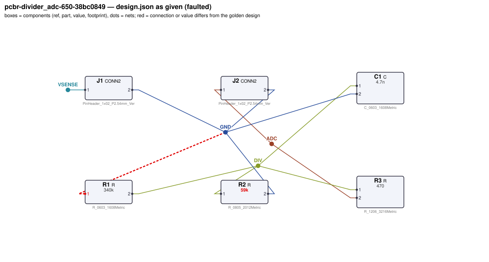
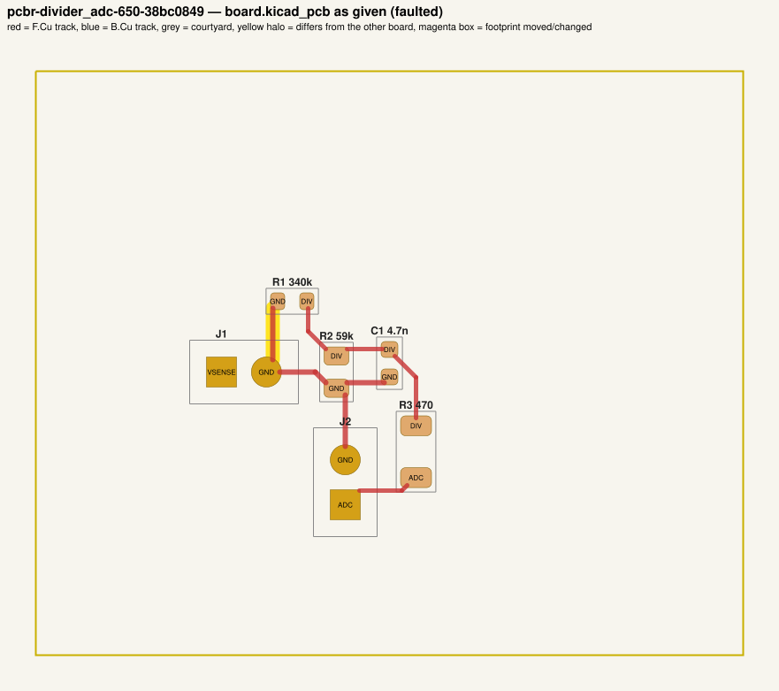
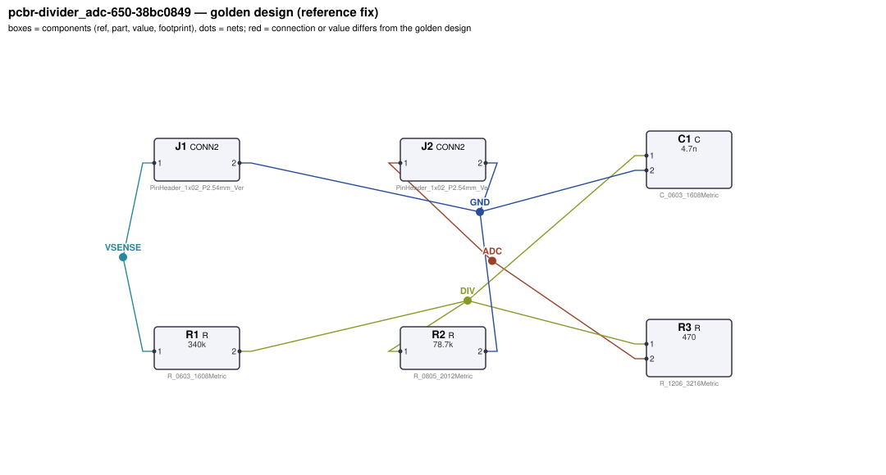
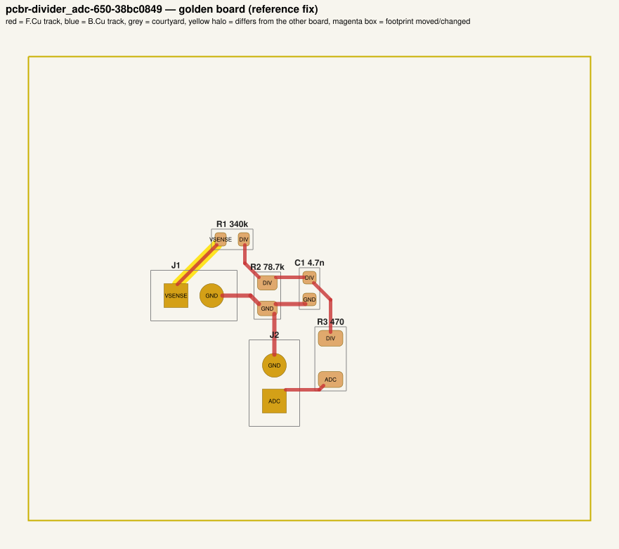

# QA packet 08: `pcbr-divider_adc-650-38bc0849`

| family | seed | hint level | intent in TASK.md | faults | predicted difficulty |
|---|---|---|---|---|---|
| divider_adc | 650 | explicit | full | 2 | medium |

Task files: [`../../../tasks/train/pcbr-divider_adc-650-38bc0849/public/`](../../../tasks/train/pcbr-divider_adc-650-38bc0849/public/) (what the agent gets) and [`../../../tasks/train/pcbr-divider_adc-650-38bc0849/hidden/`](../../../tasks/train/pcbr-divider_adc-650-38bc0849/hidden/) (grader only). Why sampled: connectivity fault, value near bounds: R2=59k inside [22000, 270000].

**How to review (≈5 min):** read section 1 as if you were the agent, decide whether you could find and fix the problems from it; then check section 2 (faults, reference fix, verifier verdicts) and fill `review.yaml`. Do not let section 2 influence your fairness judgement of section 1.

## 1. What the agent sees

### 1.1 TASK.md (verbatim)

````markdown
# Task: 0-12 V sense divider for a 2.5 V ADC

## Problem report

The first boards built from these files fail bring-up. Observations so far:

- Bench: J2.1 reads 0 V, expected 2.205 V to 2.295 V (`full_scale`).
- Bench: J2.1 reads 0 V, expected 1.103 V to 1.147 V (`half_scale`).
- `anti_alias_corner`: no valid measurement — the circuit does not reach a sensible operating point.
- Schematic ERC reports 1× single_pin_net.

A reviewer narrowed the failure down to these areas (each needs a fix):

- the connection of R1.1
- the value of R2

Fix every problem (there may be more than the observations show directly).

## Design intent

# Voltage-sense divider for an ADC

Scales a 0–12 V signal on J1 (pin 1 = sensed voltage, pin 2 = GND) down so that 12 V reads as
2.25 V (90 % of a 2.5 V ADC full scale) on the ADC header J2 (pin 1 = ADC input, pin 2 = GND).

- Divider: R1 from the sensed input to the divider node, R2 from the divider node to GND
  (ratio R2/(R1+R2)).
- Anti-alias filter: C1 from the divider node to GND, corner 1/(2π·(R1||R2)·C1) ≈ 500 Hz.
- R3 is a small series resistor from the divider node to the ADC pin (protection/isolation).

Spec: ADC voltage = 0.1875 × input ±2 %; anti-alias -3 dB corner 529.9 Hz ±10 %.
Component values: series resistor R3 47 Ω–2.2 kΩ (low enough for the ADC's sampling input).

## Spec

The design must satisfy these assertions (`pcbtool sim` runs them; full definitions in `spec.json`):

- `full_scale`: DC voltage at J2.1 between 2.205 V and 2.295 V (J1.1 supplied with 12.0 V; ground = J1.2)
- `half_scale`: DC voltage at J2.1 between 1.103 V and 1.147 V (J1.1 supplied with 6.0 V; ground = J1.2)
- `anti_alias_corner`: -3 dB frequency from J1.1 to J2.1 between 476.9 Hz and 582.9 Hz (dc source on J1.1; ground = J1.2)

Layout: every track of these nets must be at least the given width:

- GND (the net of J1.2): ≥ 0.3 mm

Component values: each value must lie in its acceptable range (inclusive; `value_bounds` in `spec.json`). Ranges come from the datasheets and the design intent; values the assertions already pin down get a wide sanity range, and the assertions still apply:

- C1 (C): 1.6 nF … 12 nF
- R1 (R): 87 kΩ … 1.3 MΩ
- R2 (R): 22 kΩ … 270 kΩ
- R3 (R): 47 Ω … 2.2 kΩ

Board rules: 2 copper layers, clearance 0.2 mm, min track 0.2 mm, vias 0.6/0.3 mm, copper-to-edge 0.3 mm. DRC must be clean with no unconnected items.

## Deliverable

- Edit only `design.json` (the schematic of record) and `board.kicad_pcb` (the layout).
- Do not add, remove or rename components; keep each component's part.
- Keep the two files consistent: same connectivity, values and footprints on both.
- Do not change the board outline, add zones, or add DRC exclusions.
- Footprints must be unmodified library footprints from the part's allowed list (see `parts/<PART>.md`).
- Grading is pass/fail: topology, consistency, DRC, ERC, spec, component values and layout must all pass.

## Tools

Run `pcbtool <command>` inside this directory (you may also edit the two files directly).

Read-only:
- `pcbtool show` — components, values, footprints, positions and nets
- `pcbtool netlist` — design nets vs. board pad nets, with differences highlighted
- `pcbtool drc` — KiCad DRC under the canonical rules (the same rules the grader uses)
- `pcbtool erc` — electrical rule check of design.json
- `pcbtool sim` — run the spec assertions (spec.json) on design.json
- `pcbtool parts [PART]` — list parts / print a part's datasheet (also in `parts/`)
- `pcbtool check` — all of the above in one summary

Mutating (each keeps design.json and board.kicad_pcb consistent and saves both):
- `pcbtool set-value REF VALUE`
- `pcbtool set-footprint REF LIB:FOOTPRINT`
- `pcbtool connect REF.PIN NET` / `pcbtool disconnect REF.PIN`
- `pcbtool move REF X Y ROT` (absolute mm, degrees; tracks do not follow)
- `pcbtool unroute NET` / `pcbtool route NET [--width W]` (re-routes the whole net)
- `pcbtool sync` — push design.json connectivity and values onto the board pads
````

### 1.2 Public files

The agent also gets `design.json`, `board.kicad_pcb`, `spec.json` and the part datasheets below, plus the `pcbtool` commands listed in TASK.md (DRC, ERC, simulation of the public assertions, value-range check). Renders of the faulted files:





<details><summary>Datasheet <code>parts/C.md</code></summary>

````markdown
# C — ceramic capacitor

Two-terminal non-polarised capacitor. Pins `1`, `2`. Value in farads.
````

</details>

<details><summary>Datasheet <code>parts/CONN2.md</code></summary>

````markdown
# CONN2 — 2-pin header

Pin `1` = signal/supply, pin `2` = ground by board convention.
````

</details>

<details><summary>Datasheet <code>parts/R.md</code></summary>

````markdown
# R — resistor

Two-terminal resistor. Pins `1`, `2` (non-polarised). Value in ohms.
````

</details>

## 2. Reviewer-only (hidden from the agent)

### 2.1 Injected faults

| # | type | category | DRC/ERC-invisible | detail | verifier, this fault alone |
|---|---|---|---|---|---|
| 1 | `pin_to_wrong_net` | connectivity | no | R1.1 tied to net GND instead of VSENSE | reward 0.0; fails erc, layout, spec, topology |
| 2 | `wrong_feedback_resistor` | value | yes | R2 (gain/divider-setting resistor) is 59k, should be 78.7k | reward 0.0; fails spec |

### 2.2 Reference fix (faulted → golden)

The reference repair is the hidden golden pair (`golden_design.json`, `golden_board.kicad_pcb`). Any repair that passes every gate and check scores 1.0; it need not be byte-identical.

**design.json: component changes**

- `R2` value: `59k` → `78.7k`

**design.json: connection changes** (per pin: what it connects to)

- `R1.1`: faulted net `GND` (C1.2, J1.2, J2.2, R2.2) → golden net `VSENSE` (J1.1)

**board.kicad_pcb: footprints moved / changed**

- none

**board.kicad_pcb: footprint values (BOM)**

- `R2` board value `59k` → `78.7k`

**board.kicad_pcb: pad-net changes**

- `R1` pad 1: net `GND` → `VSENSE`

**board.kicad_pcb: nets re-routed** (track/via geometry differs)

- net `GND`: 1 track/via item(s) removed, 0 added
- net `VSENSE`: 0 track/via item(s) removed, 1 added

Golden renders (compare with 1.2; highlighted items differ):





### 2.3 Verifier verdicts

Reward is 1 only if every gate and check passes.

| stage | kind | faulted files | golden files |
|---|---|---|---|
| parse | gate | pass | pass |
| components | gate | pass | pass |
| topology | gate | **FAIL** | pass |
| consistency | gate | pass | pass |
| integrity | gate | pass | pass |
| drc | check | pass | pass |
| erc | check | **FAIL** | pass |
| spec | check | **FAIL** | pass |
| values | check | pass | pass |
| layout | check | **FAIL** | pass |
| **reward** | | **0** | **1** |

Verifier messages on the faulted files:

- **erc**: single_pin_net: net 'VSENSE' (J1.1) has a single pin
- **layout**: power_net_missing: no board net has the pins of golden net GND
- **spec**: full_scale: measured 0.0 expected [2.205, 2.295]
- **spec**: half_scale: measured 0.0 expected [1.1025, 1.1475]
- **spec**: anti_alias_corner: measured None expected [476.884, 582.858] no -3 dB crossing in sweep
- **topology**: nets only in candidate: [['C1.2', 'J1.2', 'J2.2', 'R1.1', 'R2.2'], ['J1.1']]; nets only in reference: [['C1.2', 'J1.2', 'J2.2', 'R2.2'], ['J1.1', 'R1.1']]

### 2.4 Spec assertions before / after

| assertion | what | allowed | faulted: measured | | golden: measured | |
|---|---|---|---|---|---|---|
| `full_scale` | DC voltage at J2.1 (J1.1 supplied with 12.0 V; ground = J1.2) | 2.205 V … 2.295 V | 0 V | ❌ | 2.256 V | ✅ |
| `half_scale` | DC voltage at J2.1 (J1.1 supplied with 6.0 V; ground = J1.2) | 1.103 V … 1.147 V | 0 V | ❌ | 1.128 V | ✅ |
| `anti_alias_corner` | -3 dB frequency from J1.1 to J2.1 (dc source on J1.1; ground = J1.2) | 476.9 Hz … 582.9 Hz | — | ❌ | 529.8 Hz | ✅ |

### 2.5 Value bounds

Bounds are public (TASK.md / spec.json); `values` check = every value inside its range.

| ref | part | acceptable range | faulted design.json | faulted board | golden | touched by a fault |
|---|---|---|---|---|---|---|
| `C1` | C | 1.6 nF … 12 nF | `4.7n` | `4.7n` | `4.7n` |  |
| `R1` | R | 87 kΩ … 1.3 MΩ | `340k` | `340k` | `340k` | **yes** |
| `R2` | R | 22 kΩ … 270 kΩ | `59k` | `59k` | `78.7k` | **yes** |
| `R3` | R | 47 Ω … 2.2 kΩ | `470` | `470` | `470` |  |

### 2.6 Layout rules

- power net `GND` (golden pins C1.2, J1.2, J2.2, R2.2): every track ≥ 0.3 mm

## 3. Review

Fill `review.yaml` in this directory (second reviewer: copy `../../review_template.yaml` to `review-<initials>.yaml` here, without looking at the first form). Questions to answer:

1. **task_fair / solvable_from_public_material**: from section 1 only, can a competent engineer locate and fix every injected fault? Is anything required that is not stated (a value with no assertion and no published range, a connection only the golden reveals)?
2. **reference_fix_correct**: is the golden (2.2) a correct design that meets the stated intent?
3. **verifier_verdict_agrees**: do you agree the faulted files fail and the golden passes, for the reasons given in 2.3?
4. **alternative_valid_fixes_rejected**: is there an engineering-valid repair the grader would reject (e.g. a different E-series value that meets intent but fails an assertion window or value bound; keeping a swapped footprint and re-routing; a different valid placement)?

