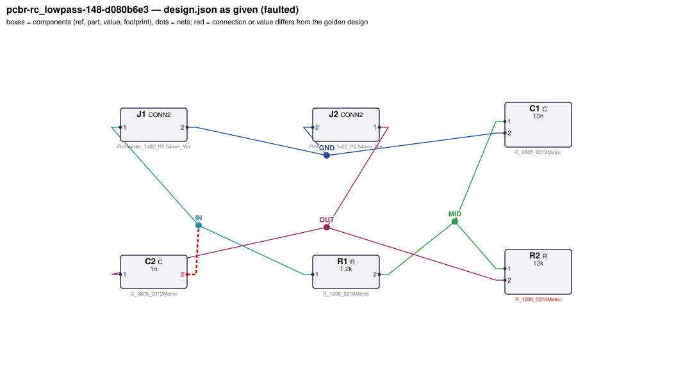
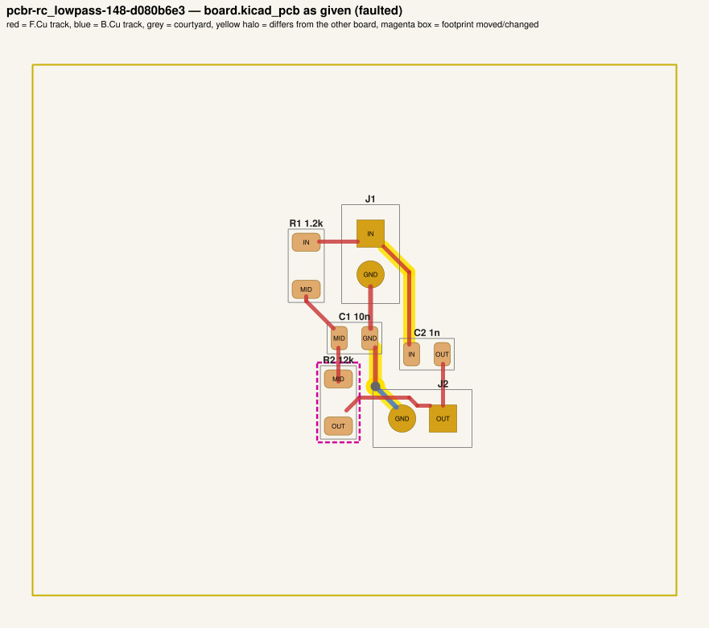
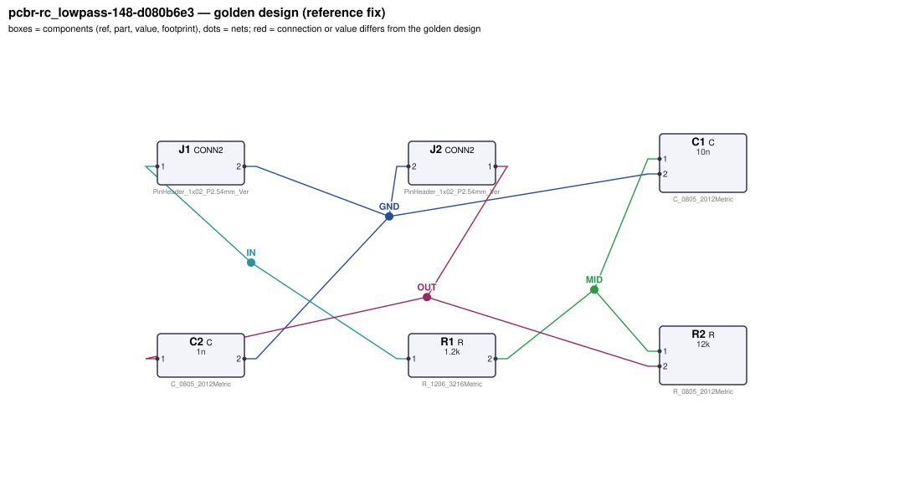
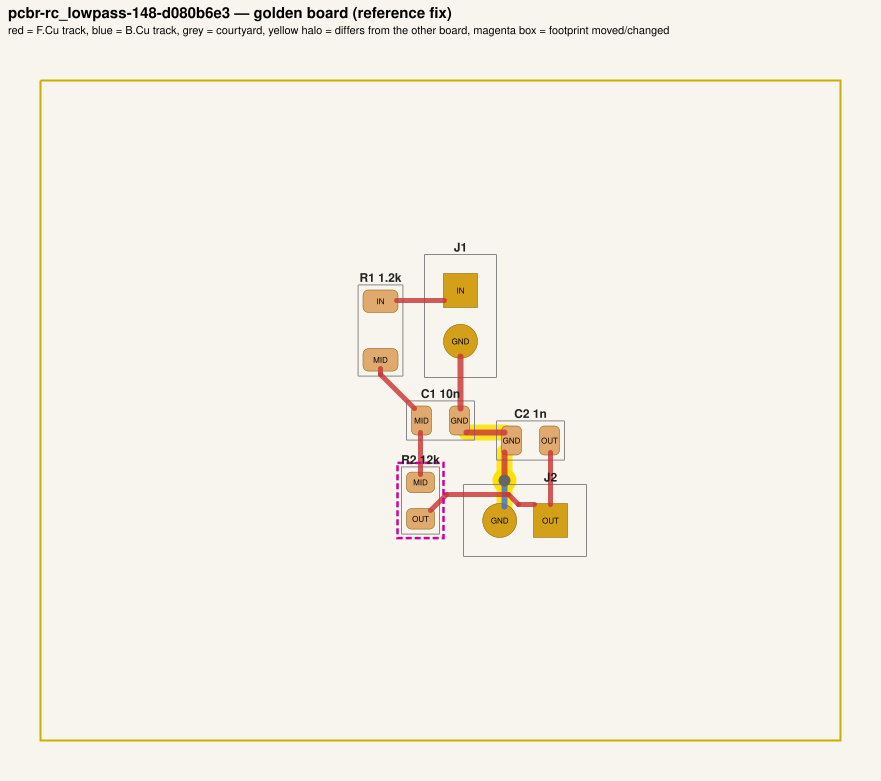

# QA packet 082: `pcbr-rc_lowpass-148-d080b6e3`

| family | seed | hint level | intent in TASK.md | faults | predicted difficulty |
|---|---|---|---|---|---|
| rc_lowpass | 148 | vague | reduced | 2 | hard |

Task files: [`../../../tasks/train/pcbr-rc_lowpass-148-d080b6e3/public/`](../../../tasks/train/pcbr-rc_lowpass-148-d080b6e3/public/) (what the agent gets) and [`../../../tasks/train/pcbr-rc_lowpass-148-d080b6e3/hidden/`](../../../tasks/train/pcbr-rc_lowpass-148-d080b6e3/hidden/) (grader only). Why sampled: vague hint, connectivity fault, disputable type footprint_swap.

**How to review (≈5 min):** read section 1 as if you were the agent, decide whether you could find and fix the problems from it; then check section 2 (faults, reference fix, verifier verdicts) and fill `review.yaml`. Do not let section 2 influence your fairness judgement of section 1.

## 1. What the agent sees

### 1.1 TASK.md (verbatim)

````markdown
# Task: 2nd-order RC low-pass filter

## Problem report

The first boards built from these files fail bring-up. Find and fix all problems: the design must meet its purpose and spec, the layout must match design.json, and DRC/ERC must be clean.

## Design intent

# 2nd-order RC low-pass filter

Removes high-frequency content from the signal entering on J1 (pin 1 = input, pin 2 = GND) and
delivers the filtered signal on J2 (pin 1 = output, pin 2 = GND). Grounds of J1 and J2 are common.

Spec: order 2; -3 dB corner 7968 Hz ±10 %; passband gain ≈ 0.999 at fc/20;
attenuation at 10·fc: gain 0.0268 ±25 %.

_Connection details are intentionally not repeated here: wire each part as its datasheet in `parts/` describes (pinout and application notes), so that the circuit does what the purpose, interfaces and spec above require._

## Spec

The design must satisfy these assertions (`pcbtool sim` runs them; full definitions in `spec.json`):

- `cutoff`: -3 dB frequency from J1.1 to J2.1 between 7.171 kHz and 8.764 kHz (dc source on J1.1; ground = J1.2)
- `passband_gain`: AC gain |V(J2.1)/V(J1.1)| at 398.4 Hz between 968.9 m and 1.029 (dc source on J1.1; ground = J1.2)
- `stopband_gain`: AC gain |V(J2.1)/V(J1.1)| at 79.68 kHz between 20.11 m and 33.52 m (dc source on J1.1; ground = J1.2)

Layout: every track of these nets must be at least the given width:

- GND (the net of J1.2): ≥ 0.3 mm

Component values: each value must lie in its acceptable range (inclusive; `value_bounds` in `spec.json`). Ranges come from the datasheets and the design intent; values the assertions already pin down get a wide sanity range, and the assertions still apply:

- C1 (C): 2.7 nF … 28 nF
- C2 (C): 360 pF … 2.5 nF
- R1 (R): 430 Ω … 4.7 kΩ
- R2 (R): 3.8 kΩ … 35 kΩ

Board rules: 2 copper layers, clearance 0.2 mm, min track 0.2 mm, vias 0.6/0.3 mm, copper-to-edge 0.3 mm. DRC must be clean with no unconnected items.

## Deliverable

- Edit only `design.json` (the schematic of record) and `board.kicad_pcb` (the layout).
- Do not add, remove or rename components; keep each component's part.
- Keep the two files consistent: same connectivity, values and footprints on both.
- Do not change the board outline, add zones, or add DRC exclusions.
- Footprints must be unmodified library footprints from the part's allowed list (see `parts/<PART>.md`).
- Grading is pass/fail: topology, consistency, DRC, ERC, spec, component values and layout must all pass.

## Tools

Run `pcbtool <command>` inside this directory (you may also edit the two files directly).

Read-only:
- `pcbtool show` — components, values, footprints, positions and nets
- `pcbtool netlist` — design nets vs. board pad nets, with differences highlighted
- `pcbtool drc` — KiCad DRC under the canonical rules (the same rules the grader uses)
- `pcbtool erc` — electrical rule check of design.json
- `pcbtool sim` — run the spec assertions (spec.json) on design.json
- `pcbtool parts [PART]` — list parts / print a part's datasheet (also in `parts/`)
- `pcbtool check` — all of the above in one summary

Mutating (each keeps design.json and board.kicad_pcb consistent and saves both):
- `pcbtool set-value REF VALUE`
- `pcbtool set-footprint REF LIB:FOOTPRINT`
- `pcbtool connect REF.PIN NET` / `pcbtool disconnect REF.PIN`
- `pcbtool move REF X Y ROT` (absolute mm, degrees; tracks do not follow)
- `pcbtool unroute NET` / `pcbtool route NET [--width W]` (re-routes the whole net)
- `pcbtool sync` — push design.json connectivity and values onto the board pads
````

### 1.2 Public files

The agent also gets `design.json`, `board.kicad_pcb`, `spec.json` and the part datasheets below, plus the `pcbtool` commands listed in TASK.md (DRC, ERC, simulation of the public assertions, value-range check). Renders of the faulted files:





<details><summary>Datasheet <code>parts/C.md</code></summary>

````markdown
# C — ceramic capacitor

Two-terminal non-polarised capacitor. Pins `1`, `2`. Value in farads.
````

</details>

<details><summary>Datasheet <code>parts/CONN2.md</code></summary>

````markdown
# CONN2 — 2-pin header

Pin `1` = signal/supply, pin `2` = ground by board convention.
````

</details>

<details><summary>Datasheet <code>parts/R.md</code></summary>

````markdown
# R — resistor

Two-terminal resistor. Pins `1`, `2` (non-polarised). Value in ohms.
````

</details>

## 2. Reviewer-only (hidden from the agent)

### 2.1 Injected faults

| # | type | category | DRC/ERC-invisible | detail | verifier, this fault alone |
|---|---|---|---|---|---|
| 1 | `pin_to_wrong_net` | connectivity | yes | C2.2 tied to net IN instead of GND | reward 0.0; fails layout, spec, topology |
| 2 | `footprint_swap` | board | no | R2 footprint changed to Resistor_SMD:R_1206_3216Metric (was Resistor_SMD:R_0805_2012Metric); tracks no longer fit | reward 0.0; fails drc |

### 2.2 Reference fix (faulted → golden)

The reference repair is the hidden golden pair (`golden_design.json`, `golden_board.kicad_pcb`). Any repair that passes every gate and check scores 1.0; it need not be byte-identical.

**design.json: component changes**

- `R2` footprint: `Resistor_SMD:R_1206_3216Metric` → `Resistor_SMD:R_0805_2012Metric`

**design.json: connection changes** (per pin: what it connects to)

- `C2.2`: faulted net `IN` (J1.1, R1.1) → golden net `GND` (C1.2, J1.2, J2.2)

**board.kicad_pcb: footprints moved / changed**

- `R2` footprint `Resistor_SMD:R_1206_3216Metric` → `Resistor_SMD:R_0805_2012Metric`

**board.kicad_pcb: footprint values (BOM)**

- none

**board.kicad_pcb: pad-net changes**

- `C2` pad 2: net `IN` → `GND`

**board.kicad_pcb: nets re-routed** (track/via geometry differs)

- net `GND`: 3 track/via item(s) removed, 4 added
- net `IN`: 2 track/via item(s) removed, 0 added

Golden renders (compare with 1.2; highlighted items differ):





### 2.3 Verifier verdicts

Reward is 1 only if every gate and check passes.

| stage | kind | faulted files | golden files |
|---|---|---|---|
| parse | gate | pass | pass |
| components | gate | pass | pass |
| topology | gate | **FAIL** | pass |
| consistency | gate | pass | pass |
| integrity | gate | pass | pass |
| drc | check | **FAIL** | pass |
| erc | check | pass | pass |
| spec | check | **FAIL** | pass |
| values | check | pass | pass |
| layout | check | **FAIL** | pass |
| **reward** | | **0** | **1** |

Verifier messages on the faulted files:

- **drc**: 1 unconnected items
- **layout**: power_net_missing: no board net has the pins of golden net GND
- **spec**: cutoff: measured 6874.500110180081 expected [7170.8234, 8764.3398]
- **spec**: stopband_gain: measured 0.9575702657967757 expected [0.020114, 0.033523]
- **topology**: nets only in candidate: [['C1.2', 'J1.2', 'J2.2'], ['C2.2', 'J1.1', 'R1.1']]; nets only in reference: [['C1.2', 'C2.2', 'J1.2', 'J2.2'], ['J1.1', 'R1.1']]

### 2.4 Spec assertions before / after

| assertion | what | allowed | faulted: measured | | golden: measured | |
|---|---|---|---|---|---|---|
| `cutoff` | -3 dB frequency from J1.1 to J2.1 (dc source on J1.1; ground = J1.2) | 7.171 kHz … 8.764 kHz | 6.875 kHz | ❌ | 7.967 kHz | ✅ |
| `passband_gain` | AC gain \|V(J2.1)/V(J1.1)\| at 398.4 Hz (dc source on J1.1; ground = J1.2) | 968.9 m … 1.029 | 998.6 m | ✅ | 998.9 m | ✅ |
| `stopband_gain` | AC gain \|V(J2.1)/V(J1.1)\| at 79.68 kHz (dc source on J1.1; ground = J1.2) | 20.11 m … 33.52 m | 957.6 m | ❌ | 26.82 m | ✅ |

### 2.5 Value bounds

Bounds are public (TASK.md / spec.json); `values` check = every value inside its range.

| ref | part | acceptable range | faulted design.json | faulted board | golden | touched by a fault |
|---|---|---|---|---|---|---|
| `C1` | C | 2.7 nF … 28 nF | `10n` | `10n` | `10n` |  |
| `C2` | C | 360 pF … 2.5 nF | `1n` | `1n` | `1n` | **yes** |
| `R1` | R | 430 Ω … 4.7 kΩ | `1.2k` | `1.2k` | `1.2k` |  |
| `R2` | R | 3.8 kΩ … 35 kΩ | `12k` | `12k` | `12k` | **yes** |

### 2.6 Layout rules

- power net `GND` (golden pins C1.2, C2.2, J1.2, J2.2): every track ≥ 0.3 mm

## 3. Review

Fill `review.yaml` in this directory (second reviewer: copy `../../review_template.yaml` to `review-<initials>.yaml` here, without looking at the first form). Questions to answer:

1. **task_fair / solvable_from_public_material**: from section 1 only, can a competent engineer locate and fix every injected fault? Is anything required that is not stated (a value with no assertion and no published range, a connection only the golden reveals)?
2. **reference_fix_correct**: is the golden (2.2) a correct design that meets the stated intent?
3. **verifier_verdict_agrees**: do you agree the faulted files fail and the golden passes, for the reasons given in 2.3?
4. **alternative_valid_fixes_rejected**: is there an engineering-valid repair the grader would reject (e.g. a different E-series value that meets intent but fails an assertion window or value bound; keeping a swapped footprint and re-routing; a different valid placement)?

