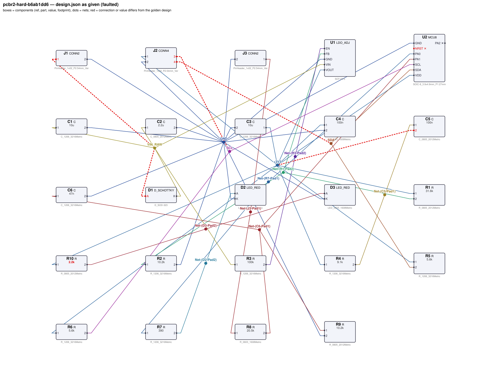
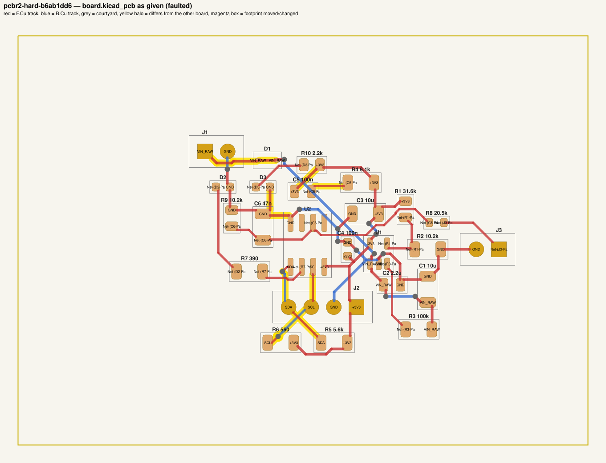
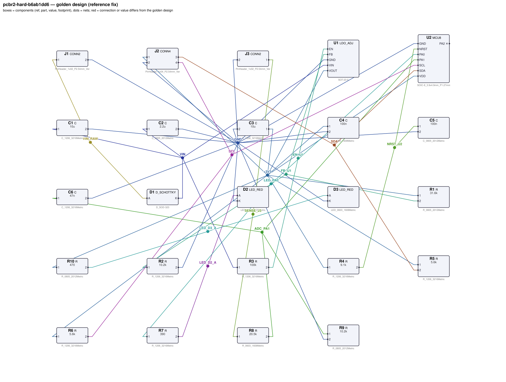
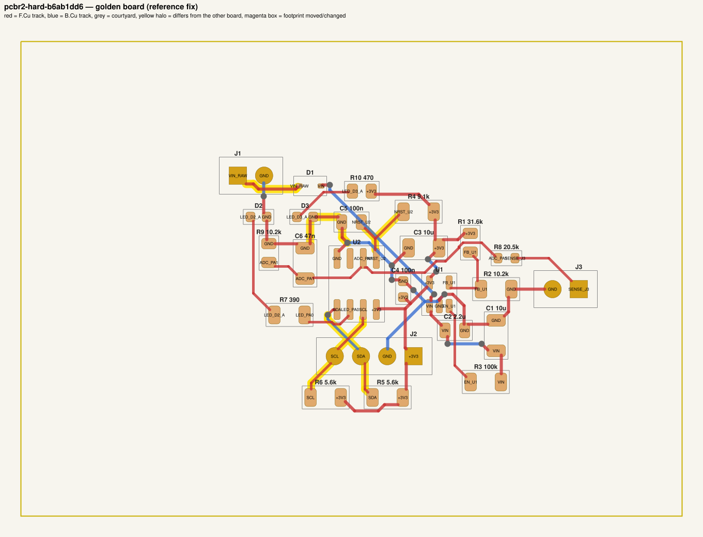

# QA packet 085: `pcbr2-hard-b6ab1dd6`

| family | tier | tool mode | hint level | intent in TASK.md | faults | latent | predicted difficulty |
|---|---|---|---|---|---|---|---|
| sys_sensor_node | hard | no_autoroute | vague | full | 6 | 3 |  |

Task files: [`../../../tasks/v2/hard/pcbr2-hard-b6ab1dd6/public/`](../../../tasks/v2/hard/pcbr2-hard-b6ab1dd6/public/) (what the agent gets) and [`../../../tasks/v2/hard/pcbr2-hard-b6ab1dd6/hidden/`](../../../tasks/v2/hard/pcbr2-hard-b6ab1dd6/hidden/) (grader only). Why sampled: 6 faults, vague hint, connectivity fault, disputable type bias_wrong_rail, disputable type bom_mismatch, disputable type connector_pin_swap, value near bounds: R10=2.2k near [48, 1600], 3 latent (bias_wrong_rail, connector_pin_swap, protection_bypassed), no_autoroute.

**How to review (≈5 min):** read section 1 as if you were the agent, decide whether you could find and fix the problems from it; then check section 2 (faults, reference fix, verifier verdicts) and fill `review.yaml`. Do not let section 2 influence your fairness judgement of section 1.

## 1. What the agent sees

### 1.1 TASK.md (verbatim)

````markdown
# Task: 9 V sensor node

## Problem report

The first boards built from these files fail bring-up. Find and fix all problems: the design must meet its purpose and spec, the layout must match design.json, and DRC/ERC must be clean.

## Design intent

# 9 V sensor node

A sensor node board. Power enters on J1 at +9 V; LDO U1 makes the +3V3 rail
(3.3 V) for MCU U2, the I2C bus pull-ups and the I2C bus header J2 (which also powers the
off-board sensors). The MCU reads an external voltage through a scaled, filtered divider on an ADC
pin and shows its state on a status LED.

Rails: +9 V (from J1) -> reverse-polarity diode -> VIN -> U1 -> +3V3 = 3.3 V.

## Connectors

| Connector | Pin | Signal |
|---|---|---|
| J1 | 1 | +9 V input |
| J1 | 2 | GND |
| J2 | 1 | +3V3 (bus supply) |
| J2 | 2 | GND |
| J2 | 3 | SDA |
| J2 | 4 | SCL |
| J3 | 1 | external voltage input, 0–9 V |
| J3 | 2 | GND |

## MCU pin assignment (firmware-fixed)

| MCU pin | Function |
|---|---|
| VDD | supply, +3V3 rail |
| GND | ground |
| NRST | reset input, held high (no internal pull-up) |
| SDA | I2C data -> J2 pin 3 |
| SCL | I2C clock -> J2 pin 4 |
| PA0 | status LED drive (push-pull, high = on) |
| PA1 | ADC input: external voltage (scaled so 9 V reads 90 % of full scale) |

## Circuit

- Reverse-polarity protection: Schottky D1 in series with the input, anode to J1 pin 1, cathode to the protected input rail VIN; C1 is a bulk capacitor on VIN.
- U1 (LDO_ADJ) regulates the 9 V input down to the 3.3 V rail +3V3: C2 is its input capacitor (VIN to GND) and C3 its output capacitor (VOUT to GND), each at its pin; R1 from VOUT to FB and R2 from FB to GND set VOUT = 0.8 V x (1 + R1/R2); EN is pulled up to the input through R3.
- U2 (MCU8) runs from +3V3; C4 decouples VDD at the pin; R4 pulls NRST up to +3V3 and C5 from NRST to GND gives a power-on reset delay.
- I2C: SDA (U2.SDA -> J2.3) and SCL (U2.SCL -> J2.4) are open-drain with pull-ups R5 (SDA) and R6 (SCL) to +3V3; J2 pin 1 supplies +3V3 to the off-board devices.
- PA0 drives the status LED D2 through R7 (U2.PA0 -> R7 -> D2 anode, cathode to GND).
- External voltage input: R8 from J3 pin 1 to the ADC node, R9 from the ADC node to GND, C6 from the ADC node to GND (anti-alias); the ADC node goes to U2.PA1.
- power indicator: R10 from +3V3 to the anode of D3, cathode to GND.

## Spec

MCU supply 3.3 V ±3 % at its VDD/GND pins; NRST ≥ 0.9·VDD.

I2C standard-mode, up to 150 pF off-board capacitance per line (+5 pF pin): rise time (30–70 % of VDD, UM10204) ≤ 1000 ns; pull-up current ≤ 3 mA at VOL = 0.4 V.

Status LED current 3.08 mA ±15 % with PA0 high.

External voltage: U2.PA1 = 0.3300 × input ±2 % (9 V -> 2.97 V); anti-alias -3 dB corner 497.1 Hz ±10 %.

Power indicator current 2.89 mA ±15 %.

Rail +3V3: 3.3 V ±3 % with 50 mA drawn by the off-board I2C devices from J2 pin 1, for inputs from 4.3 V to 9 V.

Component values: input bulk capacitor C1 1 µF–22 µF; C2, C3 1 µF–22 µF (LDO datasheet); feedback Rbot R2 3.3 kΩ–150 kΩ (10k–50k typical) with R1 scaled to match; EN pull-up R3 keeps EN above 1.2 V at the lowest input; MCU decoupling C4 47 nF–10 µF (100 nF typical); NRST pull-up R4 2.2 kΩ–100 kΩ; reset delay C5 10 nF–1 µF; I2C pull-ups R5, R6 within the datasheet range (VDD-0.4 V)/3 mA .. tr/(0.8473·Cbus) that meets the spec.

Sub-circuits by purpose: input reverse-polarity protection and bulk capacitor (D1, C1); 3.3 V regulator with input/output capacitors and feedback divider (U1, C2, C3, R1, R2, R3); MCU with VDD decoupling and reset pull-up / reset delay (U2, C4, R4, C5); I2C bus pull-ups and bus header (R5, R6, J2); status LED with series resistor (D2, R7); external voltage scaling divider with anti-alias capacitor (R8, R9, C6); external voltage input connector (J3); power indicator LED with series resistor (D3, R10).

## Spec

The design must satisfy these assertions (`pcbtool sim` runs them; full definitions in `spec.json`):

- `mcu_vdd`: DC voltage at U2.VDD relative to U2.GND between 3.201 V and 3.399 V (J1.1 supplied with 9.0 V; ground = J1.2)
- `nrst_high`: DC voltage at U2.NRST between 2.97 V and 3.432 V (J1.1 supplied with 9.0 V; ground = J1.2)
- `sda_rise_time`: 30-70 % transition time at U2.SDA between 0 s and 1 us (J1.1 supplied with 9.0 V; open-drain driver releasing the line on U2.SDA; load C=1.5e-10 from J2.3 to ground; load C=1.5e-10 from J2.4 to ground; ground = J1.2)
- `sda_sink_current`: DC current through R5 between 0 A and 3 mA (J1.1 supplied with 9.0 V; 0.4 V DC source on U2.SDA; ground = J1.2)
- `scl_rise_time`: 30-70 % transition time at U2.SCL between 0 s and 1 us (J1.1 supplied with 9.0 V; open-drain driver releasing the line on U2.SCL; load C=1.5e-10 from J2.3 to ground; load C=1.5e-10 from J2.4 to ground; ground = J1.2)
- `scl_sink_current`: DC current through R6 between 0 A and 3 mA (J1.1 supplied with 9.0 V; 0.4 V DC source on U2.SCL; ground = J1.2)
- `status_led_current`: DC current through D2 between 2.614 mA and 3.537 mA (J1.1 supplied with 9.0 V; 3.2784 V DC source on U2.PA0; ground = J1.2)
- `external voltage_full_scale`: DC voltage at U2.PA1 between 2.911 V and 3.029 V (J1.1 supplied with 9.0 V; 9.0 V DC source on J3.1; ground = J1.2)
- `external voltage_half_scale`: DC voltage at U2.PA1 between 1.455 V and 1.515 V (J1.1 supplied with 9.0 V; 4.5 V DC source on J3.1; ground = J1.2)
- `external voltage_anti_alias_corner`: -3 dB frequency from J3.1 to U2.PA1 between 447.4 Hz and 546.8 Hz (J1.1 supplied with 9.0 V; 1.0 V AC source on J3.1; ground = J1.2)
- `power_led_current`: DC current through D3 between 2.454 mA and 3.32 mA (J1.1 supplied with 9.0 V; ground = J1.2)
- `3v3_rail`: DC voltage at J2.1 between 3.201 V and 3.399 V (J1.1 supplied with 9.0 V; load R=66 from J2.1 to ground; ground = J1.2)
- `3v3_rail_low_vin`: DC voltage at J2.1 between 3.201 V and 3.399 V (J1.1 supplied with 4.3 V; load R=66 from J2.1 to ground; ground = J1.2)

Layout: every track of these nets must be at least the given width:

- +3V3 (the net of J2.1): ≥ 0.3 mm
- GND (the net of J1.2): ≥ 0.3 mm
- VIN (the net of C1.1): ≥ 0.3 mm
- VIN_RAW (the net of J1.1): ≥ 0.3 mm

Component values: each value must lie in its acceptable range (inclusive; `value_bounds` in `spec.json`). Ranges come from the datasheets and the design intent; values the assertions already pin down get a wide sanity range, and the assertions still apply:

- C1 (C): 1 uF … 22 uF
- C2 (C): 1 uF … 22 uF
- C3 (C): 1 uF … 22 uF
- C4 (C): 47 nF … 10 uF
- C5 (C): 10 nF … 1 uF
- C6 (C): 14 nF … 150 nF
- R1 (R): 10 kΩ … 470 kΩ
- R10 (R): 48 Ω … 1.6 kΩ
- R2 (R): 3.3 kΩ … 150 kΩ
- R3 (R): 1 Ω … 5.2 MΩ
- R4 (R): 2.2 kΩ … 100 kΩ
- R5 (R): 950 Ω … 17 kΩ
- R6 (R): 950 Ω … 14 kΩ
- R7 (R): 110 Ω … 1.3 kΩ
- R8 (R): 7.2 kΩ … 62 kΩ
- R9 (R): 2.6 kΩ … 32 kΩ

Board rules: 2 copper layers, clearance 0.2 mm, min track 0.2 mm, vias 0.6/0.3 mm, copper-to-edge 0.3 mm. DRC must be clean with no unconnected items.

## Design rules (design review)

Besides the spec, the design must pass an engineering design review. **`pcbtool` does not check any
of this — review the design yourself** against the datasheets in `parts/` (see each part's ratings /
design-rule section) and the design intent:

- **Absolute maximum ratings** of every part under every operating condition of the spec (no MCU pin
  above its VDD + 0.3 V or below -0.3 V, op-amp inputs within the rails, LDO EN ≤ VIN, MOSFET |VGS|,
  transistor / diode voltage and current limits).
- **Current limits:** MCU pin currents, LED forward current (by LED package), transistor collector /
  base currents; a saturated NPN switch needs a forced beta IC/IB ≤ 20.
- **Power / voltage ratings:** every resistor's I²R ≤ 50 % of its footprint's rating; every capacitor's
  working voltage ≤ 80 % of its footprint's rated voltage. Footprint choice matters.
- **Inductive loads** have a flyback diode directly across the load, cathode to the supply side.
- **Interfaces and pin assignments** stated in the design intent (connector pinouts, MCU pin functions,
  which rail each part connects to) must be respected exactly, even where the circuit would still
  simulate with a different assignment.

The grader checks these rules under the spec's operating conditions. A design can pass every
`pcbtool` check and still fail review.

**Decoupling** (graded as part of `layout`; `pcbtool` does not check it, `spec.json` lists it under `design_rules`): each capacitor's pad on the IC pin's net must reach that pin within the given length of copper path (shortest path along the net's tracks, vias and pads, pad centre to pad centre), and every pad of the capacitor must lie within the given straight-line distance of the pin:

- C2 within 8.0 mm of copper path of U1.VIN (and within 5.0 mm straight-line)
- C3 within 8.0 mm of copper path of U1.VOUT (and within 5.0 mm straight-line)
- C4 within 8.0 mm of copper path of U2.VDD (and within 5.0 mm straight-line)

## Deliverable

- Edit only `design.json` (the schematic of record) and `board.kicad_pcb` (the layout).
- Do not add, remove or rename components; keep each component's part.
- Keep the two files consistent: same connectivity, values and footprints on both.
- Values: `<number><SI prefix><unit>` such as `4.7k`, `100n`, `10kΩ`, `1meg`; unit letters, if any, must match the part (R: Ω/ohm/R, C: F, L: H, crystal: Hz); no spaces or control characters inside (full grammar: "Value notation" in `parts/R.md`, `parts/C.md`, ...).
- Do not change the board outline, add zones, or add DRC exclusions.
- Footprints must be unmodified library footprints from the part's allowed list (see `parts/<PART>.md`).
- Grading is pass/fail: topology, consistency, DRC, ERC, spec, component values, layout and the design rules above must all pass.

## Tools

Run `pcbtool <command>` inside this directory (you may also edit the two files directly).

Read-only:
- `pcbtool show` — components, values, footprints, positions and nets
- `pcbtool netlist` — design nets vs. board pad nets, with differences highlighted
- `pcbtool drc` — KiCad DRC under the canonical rules (the same rules the grader uses)
- `pcbtool erc` — electrical rule check of design.json
- `pcbtool sim` — run the spec assertions (spec.json) on design.json
- `pcbtool parts [PART]` — list parts / print a part's datasheet (also in `parts/`)
- `pcbtool check` — all of the above in one summary

Mutating (each keeps design.json and board.kicad_pcb consistent and saves both):
- `pcbtool set-value REF VALUE`
- `pcbtool set-footprint REF LIB:FOOTPRINT`
- `pcbtool connect REF.PIN NET` / `pcbtool disconnect REF.PIN`
- `pcbtool move REF X Y ROT` (absolute mm, degrees; tracks do not follow)
- `pcbtool unroute NET` / `pcbtool route NET [--width W]` (re-routes the whole net)
- `pcbtool sync` — push design.json connectivity and values onto the board pads

**Tool mode for this task: `no_autoroute`** (`tools.json`). `pcbtool route` and `pcbtool sync` are
disabled: after changing connectivity or footprints, edit the tracks (`segment` / `via` items) in
`board.kicad_pcb` yourself, or move parts with `pcbtool move`. All other commands work.
````

### 1.2 Public files

The agent also gets `design.json`, `board.kicad_pcb`, `spec.json` and the part datasheets below, plus the `pcbtool` commands listed in TASK.md (DRC, ERC, simulation of the public assertions, value-range check). Renders of the faulted files:





<details><summary>Datasheet <code>parts/C.md</code></summary>

````markdown
# C — ceramic capacitor

Two-terminal non-polarised capacitor. Pins `1`, `2`. Value in farads.

## Value notation (all parts)

A value is `<number><SI prefix?><unit?>`, e.g. `4.7k`, `100n`, `2.2u`, `10R`, `1meg`, `1.5e3`:
- number: digits with an optional decimal point and an optional exponent (`1e3`); no sign, no
  digit grouping, no RKM notation (`4k7`);
- SI prefix (case-sensitive): `p` `n` `u`/`µ`/`μ` (micro) `m` (milli) `k`/`K` `M`/`meg`/`MEG` (mega) `G`;
  an exponent and a prefix together (`1e3k`) are rejected;
- unit letters, optional, must match the part: R `Ω`/`ohm`/`Ohm`/`R`; C `F`; L `H`; crystals `Hz`;
  other parts none (`100nH` on a capacitor is rejected);
- no whitespace or control characters inside the value (leading/trailing spaces are ignored).

design.json and the board must carry the same value; they are compared as numbers (`1k` == `1000`).

## Ratings by footprint (X7R series used on this board)

| Size | Rated voltage | Design limit (80 %) |
|---|---|---|
| 0603 | 10 V | 8 V |
| 0805 | 25 V | 20 V |
| 1206 | 50 V | 40 V |

**Design rule:** the DC working voltage across a capacitor must not exceed 80 % of its rated voltage
(MLCC capacitance collapses and reliability drops near the rating). The rating follows the footprint.
````

</details>

<details><summary>Datasheet <code>parts/CONN2.md</code></summary>

````markdown
# CONN2 — 2-pin header

Pin `1` = signal/supply, pin `2` = ground by board convention.

## Interface rule
The pin assignment of every connector is fixed by the design intent (cable / mating board):
swapping two connector pins breaks the interface even if the board itself still simulates.
````

</details>

<details><summary>Datasheet <code>parts/CONN4.md</code></summary>

````markdown
# CONN4 — 4-pin 2.54 mm header

Generic vertical pin header used for off-board power, signal and bus connections.

| Pin | Pad | Typical use |
|---|---|---|
| 1 | 1 | signal / supply |
| 2 | 2 | ground (board convention) |
| 3 | 3 | signal / supply |
| 4 | 4 | signal / supply |

## Notes
- Pin 2 is ground by board convention; the function of the other pins is set by the design.
- Rated 3 A per contact. Has no electrical model of its own (it is where external
  supplies, signals and loads attach).

## Interface rule
The pin assignment of every connector is fixed by the design intent (cable / mating board):
swapping two connector pins breaks the interface even if the board itself still simulates.
````

</details>

<details><summary>Datasheet <code>parts/D_SCHOTTKY.md</code></summary>

````markdown
# D_SCHOTTKY — 40 V / 1 A Schottky rectifier

## Pinout
| Pin | Pad | Function |
|---|---|---|
| A | 2 | anode |
| K | 1 | cathode (band) |

## Electrical characteristics
- VRRM 40 V, IF(AV) 1 A
- Vf = 0.30 V typ at 100 mA, 0.40 V at 1 A
- Reverse leakage 20 uA typ at 25 V

## Application notes
- Flyback / freewheel clamp across an inductive load (relay coil, solenoid, motor):
  cathode to the positive supply side, anode to the switched (transistor) side. In normal
  operation the diode is reverse biased; at turn-off it clamps the inductive kick.
- Reverse polarity protection: in series with the supply, anode to the input.

## Absolute maximum ratings
- Reverse voltage 40 V, forward current 1 A continuous.

**Design rule (inductive loads):** every inductive load (relay coil, solenoid, motor) must have a
flyback diode directly across it with the cathode on the load's supply-side terminal and the
anode on its switched terminal. A diode elsewhere (to ground, across the transistor, both ends
on one net) does not clamp the turn-off spike, even though nothing is visible in DC.
````

</details>

<details><summary>Datasheet <code>parts/LDO_ADJ.md</code></summary>

````markdown
# LDO_ADJ — adjustable 300 mA low-dropout regulator (SOT-23-5)

## Pinout
| Pin | Pad | Function |
|---|---|---|
| VIN | 1 | input supply, 2.5–16 V |
| GND | 2 | ground |
| EN | 3 | enable, active high. Internal 2 MΩ pull-down: floating = OFF |
| FB | 4 | feedback; regulates to VREF = 0.800 V |
| VOUT | 5 | regulated output |

## Electrical characteristics
- VREF = 0.800 V ±1 %
- Output current 300 mA max; current limit ~500 mA
- Dropout 250 mV typ at 300 mA
- EN threshold 1.2 V (high = on); EN low or floating -> output off (0 V)
- Quiescent current 50 µA; package dissipation max 0.5 W

## Application notes
- Output voltage is set by a divider from VOUT to FB (Rtop) and FB to GND (Rbot):
  **VOUT = VREF × (1 + Rtop / Rbot)**. Rbot of 10k–50k is typical.
- Connect EN to VIN for always-on operation (or drive it from logic / a pull-up). A pull-up
  Rpu from VIN forms a divider with the internal 2 MΩ pull-down: VIN·2M/(Rpu + 2M) must exceed
  the 1.2 V threshold at the lowest VIN.
- Place a 1 µF–22 µF ceramic input capacitor and a 1 µF–22 µF ceramic output capacitor (the
  output capacitor range is the stability range of the regulation loop) within
  5 mm of the VIN and VOUT pins respectively, returned to GND.
- Power dissipation = (VIN - VOUT) × IOUT must stay below 0.5 W.

## Absolute maximum ratings
- VIN 16 V; EN ≤ VIN + 0.3 V (EN must never be above VIN); output current 300 mA;
  package dissipation (VIN - VOUT)·IOUT ≤ 0.5 W.
````

</details>

<details><summary>Datasheet <code>parts/LED_RED.md</code></summary>

````markdown
# LED_RED — red SMD indicator LED (625 nm)

## Pinout
| Pin | Pad | Function |
|---|---|---|
| A | 2 | anode |
| K | 1 | cathode (marked) |

## Electrical characteristics (25 C)
- Forward voltage Vf = 2.0 V typ at IF = 10 mA
- Max continuous forward current 25 mA; reverse voltage max 5 V

| IF | Vf (typ) |
|---|---|
| 2 mA | 1.90 V |
| 5 mA | 1.95 V |
| 10 mA | 2.00 V |
| 15 mA | 2.03 V |
| 20 mA | 2.06 V |

## Application notes
- Always drive through a current-limiting resistor: R = (Vsupply - n*Vf) / IF for n LEDs in series.
- Current flows anode -> cathode; reversed LEDs do not light.

## Ratings by package

| Package | Max continuous IF | Design limit (80 %) |
|---|---|---|
| 0603 | 20 mA | 16 mA |
| 0805 | 30 mA | 24 mA |

**Design rule:** the forward current must not exceed 80 % of the package maximum; reverse voltage
≤ 5 V.
````

</details>

<details><summary>Datasheet <code>parts/MCU8.md</code></summary>

````markdown
# MCU8 — generic 8-pin microcontroller (SOIC-8)

## Pinout
| Pin | Pad | Function |
|---|---|---|
| NRST | 1 | active-low reset input. **No internal pull-up**: needs an external pull-up to VDD, 2.2k–100k (10k typical); optional 10 nF–1 µF to GND (100 nF typical) for a power-on reset delay |
| PA1 | 2 | GPIO / ADC1 / XIN (crystal oscillator input) |
| PA2 | 3 | GPIO / ADC2 / XOUT (crystal oscillator output) |
| GND | 4 | ground |
| SDA | 5 | I2C data (open-drain) / GPIO |
| PA0 | 6 | GPIO / PWM output / ADC0 |
| SCL | 7 | I2C clock (open-drain) / GPIO |
| VDD | 8 | supply 1.8–5.5 V |

## Electrical characteristics
- Supply current 1.5 mA typ at 3.3 V
- GPIO output: VOH ≥ VDD - 0.4 V at 8 mA source (≈50 Ω output resistance); 8 mA max per pin
- Open-drain I2C pins sink max 3 mA at VOL = 0.4 V; no internal I2C pull-ups
- ADC (PA0, PA1, PA2): 12-bit, full scale = VDD, input range 0..VDD (never above VDD); the pin
  is high impedance (5 pF), so an RC anti-alias filter at the pin sets the input bandwidth
- Pin capacitance 5 pF per I/O; idle / reset I/O pins are high-impedance (no pulls)
- Crystal oscillator: 4–25 MHz fundamental crystal between XIN (PA1) and XOUT (PA2), each pin
  with a load capacitor to GND

## Application notes
- Decouple VDD with 100 nF ceramic (47 nF–10 µF) to GND within 5 mm of the VDD pin.
- I2C pull-ups: Rp ≥ (VDD - 0.4 V) / 3 mA (sink limit) and Rp ≤ tr / (0.8473 × Cbus) (rise time),
  where tr is the I2C rise time as defined by the I2C specification (UM10204): 30 % to 70 % of
  VDD, max 1000 ns standard-mode / 300 ns fast-mode; 0.8473 = ln(0.7/0.3). Cbus includes
  the 5 pF pin capacitance.
- Crystal load caps: CL = C1·C2/(C1+C2) + Cstray, i.e. C1 = C2 = 2·(CL - Cstray).

## Absolute maximum ratings
- VDD - GND ≤ 6 V.
- Any I/O pin (NRST, PA0-PA2, SDA, SCL): -0.3 V … VDD + 0.3 V. No pin may be pulled
  above the MCU's own VDD (e.g. by a pull-up to a higher rail): the ESD diodes conduct and
  back-power the chip.
- GPIO current (PA0-PA2, NRST): 8 mA max per pin; SDA/SCL: 3 mA max sink.
- Pin functions are fixed by the package: crystal on PA1 (XIN) / PA2 (XOUT), I2C on SDA / SCL;
  firmware assumes the assignment given in the design intent.
````

</details>

<details><summary>Datasheet <code>parts/R.md</code></summary>

````markdown
# R — resistor

Two-terminal resistor. Pins `1`, `2` (non-polarised). Value in ohms.

## Value notation (all parts)

A value is `<number><SI prefix?><unit?>`, e.g. `4.7k`, `100n`, `2.2u`, `10R`, `1meg`, `1.5e3`:
- number: digits with an optional decimal point and an optional exponent (`1e3`); no sign, no
  digit grouping, no RKM notation (`4k7`);
- SI prefix (case-sensitive): `p` `n` `u`/`µ`/`μ` (micro) `m` (milli) `k`/`K` `M`/`meg`/`MEG` (mega) `G`;
  an exponent and a prefix together (`1e3k`) are rejected;
- unit letters, optional, must match the part: R `Ω`/`ohm`/`Ohm`/`R`; C `F`; L `H`; crystals `Hz`;
  other parts none (`100nH` on a capacitor is rejected);
- no whitespace or control characters inside the value (leading/trailing spaces are ignored).

design.json and the board must carry the same value; they are compared as numbers (`1k` == `1000`).

## Ratings by footprint (high-power thick-film series used on this board)

| Size | Rated power (70 C) | Design limit (50 % derating) |
|---|---|---|
| 0603 | 0.1 W | 50.0 mW |
| 0805 | 0.125 W | 62.5 mW |
| 1206 | 0.5 W | 250.0 mW |

**Design rule:** the continuous dissipation P = I²·R of every resistor must not exceed 50 % of its
footprint's rated power. Pick the footprint for the power, not just the value.
````

</details>

## 2. Reviewer-only (hidden from the agent)

### 2.1 Injected faults

| # | type | category | DRC/ERC-invisible | latent (pcbtool-clean) | detail | verifier, this fault alone |
|---|---|---|---|---|---|---|
| 1 | `protection_bypassed` | latent | yes | **yes** | reverse-polarity diode D1 bypassed: VIN wired straight to the input VIN_RAW | reward 0.0; fails topology |
| 2 | `connector_pin_swap` | latent | yes | **yes** | connector J2 pins 3 and 4 exchanged (pinout fixed by the intent) | reward 0.0; fails topology |
| 3 | `bias_wrong_rail` | latent | yes | **yes** | C5.2 returned to +3V3 instead of GND | reward 0.0; fails topology |
| 4 | `floating_pin` | connectivity | no |  | U2.NRST left unconnected (should be on NRST_U2) | reward 0.0; fails erc, spec, topology |
| 5 | `bom_mismatch` | value | yes |  | board value of R6 is 560, design.json says 5.6k | reward 0.0; fails consistency |
| 6 | `wrong_led_resistor` | value | yes |  | R10 (LED current-limiting resistor) is 2.2k, should be 470 | reward 0.0; fails spec, values |

### 2.2 Reference fix (faulted → golden)

The reference repair is the hidden golden pair (`golden_design.json`, `golden_board.kicad_pcb`). Any repair that passes every gate and check scores 1.0; it need not be byte-identical.

**design.json: component changes**

- `R10` value: `2.2k` → `470`

**design.json: connection changes** (per pin: what it connects to)

- `C5.2`: faulted net `+3V3` (C3.1, C4.1, J2.1, R1.1, R10.1, R4.1, R5.1, R6.1, U1.VOUT, U2.VDD) → golden net `GND` (C1.2, C2.2, C3.2, C4.2, C6.2, D2.K, D3.K, J1.2, J2.2, J3.2, R2.2, R9.2, U1.GND, U2.GND)
- `D1.A`: faulted net `VIN_RAW` (C1.1, C2.1, D1.K, J1.1, R3.1, U1.VIN) → golden net `VIN_RAW` (J1.1)
- `J1.1`: faulted net `VIN_RAW` (C1.1, C2.1, D1.A, D1.K, R3.1, U1.VIN) → golden net `VIN_RAW` (D1.A)
- `J2.3`: faulted net `SCL` (R6.2, U2.SCL) → golden net `SDA` (R5.2, U2.SDA)
- `J2.4`: faulted net `SDA` (R5.2, U2.SDA) → golden net `SCL` (R6.2, U2.SCL)
- `U2.NRST`: faulted unconnected → golden net `NRST_U2` (C5.1, R4.2)

**board.kicad_pcb: footprints moved / changed**

- none

**board.kicad_pcb: footprint values (BOM)**

- `R10` board value `2.2k` → `470`
- `R6` board value `560` → `5.6k`

**board.kicad_pcb: pad-net changes**

- `C1` pad 1: net `VIN_RAW` → `VIN`
- `C2` pad 1: net `VIN_RAW` → `VIN`
- `C5` pad 1: net `Net-(C5-Pad1)` → `NRST_U2`
- `C5` pad 2: net `+3V3` → `GND`
- `C6` pad 1: net `Net-(C6-Pad1)` → `ADC_PA1`
- `D1` pad 1: net `VIN_RAW` → `VIN`
- `D2` pad 2: net `Net-(D2-Pad2)` → `LED_D2_A`
- `D3` pad 2: net `Net-(D3-Pad2)` → `LED_D3_A`
- `J2` pad 3: net `SCL` → `SDA`
- `J2` pad 4: net `SDA` → `SCL`
- `J3` pad 1: net `Net-(J3-Pad1)` → `SENSE_J3`
- `R1` pad 2: net `Net-(R1-Pad2)` → `FB_U1`
- `R10` pad 2: net `Net-(D3-Pad2)` → `LED_D3_A`
- `R2` pad 1: net `Net-(R1-Pad2)` → `FB_U1`
- `R3` pad 1: net `VIN_RAW` → `VIN`
- `R3` pad 2: net `Net-(R3-Pad2)` → `EN_U1`
- `R4` pad 2: net `Net-(C5-Pad1)` → `NRST_U2`
- `R7` pad 1: net `Net-(R7-Pad1)` → `LED_PA0`
- `R7` pad 2: net `Net-(D2-Pad2)` → `LED_D2_A`
- `R8` pad 1: net `Net-(J3-Pad1)` → `SENSE_J3`
- `R8` pad 2: net `Net-(C6-Pad1)` → `ADC_PA1`
- `R9` pad 1: net `Net-(C6-Pad1)` → `ADC_PA1`
- `U1` pad 1: net `VIN_RAW` → `VIN`
- `U1` pad 3: net `Net-(R3-Pad2)` → `EN_U1`
- `U1` pad 4: net `Net-(R1-Pad2)` → `FB_U1`
- `U2` pad 1: net `(none)` → `NRST_U2`
- `U2` pad 2: net `Net-(C6-Pad1)` → `ADC_PA1`
- `U2` pad 6: net `Net-(R7-Pad1)` → `LED_PA0`

**board.kicad_pcb: nets re-routed** (track/via geometry differs)

- net `+3V3`: 1 track/via item(s) removed, 0 added
- net `ADC_PA1`: 0 track/via item(s) removed, 14 added
- net `EN_U1`: 0 track/via item(s) removed, 3 added
- net `FB_U1`: 0 track/via item(s) removed, 3 added
- net `GND`: 2 track/via item(s) removed, 4 added
- net `LED_D2_A`: 0 track/via item(s) removed, 2 added
- net `LED_D3_A`: 0 track/via item(s) removed, 2 added
- net `LED_PA0`: 0 track/via item(s) removed, 4 added
- net `NRST_U2`: 0 track/via item(s) removed, 3 added
- net `Net-(C5-Pad1)`: 1 track/via item(s) removed, 0 added
- net `Net-(C6-Pad1)`: 14 track/via item(s) removed, 0 added
- net `Net-(D2-Pad2)`: 2 track/via item(s) removed, 0 added
- net `Net-(D3-Pad2)`: 2 track/via item(s) removed, 0 added
- net `Net-(J3-Pad1)`: 2 track/via item(s) removed, 0 added
- net `Net-(R1-Pad2)`: 3 track/via item(s) removed, 0 added
- net `Net-(R3-Pad2)`: 3 track/via item(s) removed, 0 added
- net `Net-(R7-Pad1)`: 4 track/via item(s) removed, 0 added
- net `SCL`: 4 track/via item(s) removed, 4 added
- net `SDA`: 3 track/via item(s) removed, 4 added
- net `SENSE_J3`: 0 track/via item(s) removed, 2 added
- net `VIN`: 0 track/via item(s) removed, 15 added
- net `VIN_RAW`: 20 track/via item(s) removed, 4 added

Golden renders (compare with 1.2; highlighted items differ):





### 2.3 Verifier verdicts

Reward is 1 only if every gate and check passes.

| stage | kind | faulted files | golden files |
|---|---|---|---|
| parse | gate | pass | pass |
| components | gate | pass | pass |
| topology | gate | **FAIL** | pass |
| consistency | gate | **FAIL** | pass |
| integrity | gate | pass | pass |
| drc | check | pass | pass |
| erc | check | **FAIL** | pass |
| spec | check | **FAIL** | pass |
| values | check | **FAIL** | pass |
| layout | check | pass | pass |
| rules | check | pass | pass |
| **reward** | | **0** | **1** |

Verifier messages on the faulted files:

- **consistency**: R6: board value '560' != design value '5.6k'
- **erc**: unconnected_required: U2.NRST must be connected
- **layout_skipped**: no board net has the pins of golden net +3V3 (connectivity differs: see topology)
- **layout_skipped**: no board net has the pins of golden net GND (connectivity differs: see topology)
- **layout_skipped**: no board net has the pins of golden net VIN (connectivity differs: see topology)
- **layout_skipped**: no board net has the pins of golden net VIN_RAW (connectivity differs: see topology)
- **spec**: nrst_high: measured 0.0 expected [2.97, 3.432]
- **spec**: power_led_current: measured 0.00065315171721 expected [0.00245396, 0.00332006]
- **topology**: nets only in candidate: [['C1.1', 'C2.1', 'D1.A', 'D1.K', 'J1.1', 'R3.1', 'U1.VIN'], ['C1.2', 'C2.2', 'C3.2', 'C4.2', 'C6.2', 'D2.K', 'D3.K', 'J1.2', 'J2.2', 'J3.2', 'R2.2', 'R9.2', 'U1.GND', 'U2.GND'], ['C3.1', 'C4.1', 'C5.2', 'J2.1', 'R1.1', 'R10.1', 'R4.1', 'R5.1', 'R6.1', 'U1.VOUT', 'U2.VDD'], ['C5.1', 'R4.2'], ['J2.3', 'R6.2', 'U2.SCL'], ['J2.4', 'R5.2', 'U2.SDA']]; nets only in reference: [['C1.1', 'C2.1', 'D1.K', 'R3.1', 'U1.VIN'], ['C1.2', 'C2.2', 'C3.2', 'C4.2', 'C5.2', 'C6.2', 'D2.K', 'D3.K', 'J1.2', 'J2.2', 'J3.2', 'R2.2', 'R9.2', 'U1.GND', 'U2.GND'], ['C3.1', 'C4.1', 'J2.1', 'R1.1', 'R10.1', 'R4.1', 'R5.1', 'R6.1', 'U1.VOUT', 'U2.VDD'], ['C5.1', 'R4.2', 'U2.NRST'], ['D1.A', 'J1.1'], ['J2.3', 'R5.2', 'U2.SDA'], ['J2.4', 'R6.2', 'U2.SCL']]
- **values**: R10: value '2.2k' outside acceptable range [48, 1600]

### 2.4 Spec assertions before / after

| assertion | what | allowed | faulted: measured | | golden: measured | |
|---|---|---|---|---|---|---|
| `mcu_vdd` | DC voltage at U2.VDD relative to U2.GND (J1.1 supplied with 9.0 V; ground = J1.2) | 3.201 V … 3.399 V | 3.277 V | ✅ | 3.277 V | ✅ |
| `nrst_high` | DC voltage at U2.NRST (J1.1 supplied with 9.0 V; ground = J1.2) | 2.97 V … 3.432 V | 0 V | ❌ | 3.277 V | ✅ |
| `sda_rise_time` | 30-70 % transition time at U2.SDA (J1.1 supplied with 9.0 V; open-drain driver releasing the line on U2.SDA; load C=1.5e-10 from J2.3 to ground; load C=1.5e-10 from J2.4 to ground; ground = J1.2) | 0 s … 1 us | 735.3 ns | ✅ | 735.3 ns | ✅ |
| `sda_sink_current` | DC current through R5 (J1.1 supplied with 9.0 V; 0.4 V DC source on U2.SDA; ground = J1.2) | 0 A … 3 mA | 513.8 uA | ✅ | 513.8 uA | ✅ |
| `scl_rise_time` | 30-70 % transition time at U2.SCL (J1.1 supplied with 9.0 V; open-drain driver releasing the line on U2.SCL; load C=1.5e-10 from J2.3 to ground; load C=1.5e-10 from J2.4 to ground; ground = J1.2) | 0 s … 1 us | 735.3 ns | ✅ | 735.3 ns | ✅ |
| `scl_sink_current` | DC current through R6 (J1.1 supplied with 9.0 V; 0.4 V DC source on U2.SCL; ground = J1.2) | 0 A … 3 mA | 513.8 uA | ✅ | 513.8 uA | ✅ |
| `status_led_current` | DC current through D2 (J1.1 supplied with 9.0 V; 3.2784 V DC source on U2.PA0; ground = J1.2) | 2.614 mA … 3.537 mA | 3.076 mA | ✅ | 3.076 mA | ✅ |
| `external voltage_full_scale` | DC voltage at U2.PA1 (J1.1 supplied with 9.0 V; 9.0 V DC source on J3.1; ground = J1.2) | 2.911 V … 3.029 V | 2.99 V | ✅ | 2.99 V | ✅ |
| `external voltage_half_scale` | DC voltage at U2.PA1 (J1.1 supplied with 9.0 V; 4.5 V DC source on J3.1; ground = J1.2) | 1.455 V … 1.515 V | 1.495 V | ✅ | 1.495 V | ✅ |
| `external voltage_anti_alias_corner` | -3 dB frequency from J3.1 to U2.PA1 (J1.1 supplied with 9.0 V; 1.0 V AC source on J3.1; ground = J1.2) | 447.4 Hz … 546.8 Hz | 497 Hz | ✅ | 497 Hz | ✅ |
| `power_led_current` | DC current through D3 (J1.1 supplied with 9.0 V; ground = J1.2) | 2.454 mA … 3.32 mA | 653.2 uA | ❌ | 2.884 mA | ✅ |
| `3v3_rail` | DC voltage at J2.1 (J1.1 supplied with 9.0 V; load R=66 from J2.1 to ground; ground = J1.2) | 3.201 V … 3.399 V | 3.277 V | ✅ | 3.277 V | ✅ |
| `3v3_rail_low_vin` | DC voltage at J2.1 (J1.1 supplied with 4.3 V; load R=66 from J2.1 to ground; ground = J1.2) | 3.201 V … 3.399 V | 3.277 V | ✅ | 3.277 V | ✅ |

### 2.5 Value bounds

Bounds are public (TASK.md / spec.json); `values` check = every value inside its range.

| ref | part | acceptable range | faulted design.json | faulted board | golden | touched by a fault |
|---|---|---|---|---|---|---|
| `C1` | C | 1 uF … 22 uF | `10u` | `10u` | `10u` | **yes** |
| `C2` | C | 1 uF … 22 uF | `2.2u` | `2.2u` | `2.2u` | **yes** |
| `C3` | C | 1 uF … 22 uF | `10u` | `10u` | `10u` |  |
| `C4` | C | 47 nF … 10 uF | `100n` | `100n` | `100n` |  |
| `C5` | C | 10 nF … 1 uF | `100n` | `100n` | `100n` | **yes** |
| `C6` | C | 14 nF … 150 nF | `47n` | `47n` | `47n` |  |
| `R1` | R | 10 kΩ … 470 kΩ | `31.6k` | `31.6k` | `31.6k` |  |
| `R10` | R | 48 Ω … 1.6 kΩ | `2.2k` ⚠ out of range | `2.2k` ⚠ out of range | `470` | **yes** |
| `R2` | R | 3.3 kΩ … 150 kΩ | `10.2k` | `10.2k` | `10.2k` |  |
| `R3` | R | 1 Ω … 5.2 MΩ | `100k` | `100k` | `100k` | **yes** |
| `R4` | R | 2.2 kΩ … 100 kΩ | `9.1k` | `9.1k` | `9.1k` |  |
| `R5` | R | 950 Ω … 17 kΩ | `5.6k` | `5.6k` | `5.6k` |  |
| `R6` | R | 950 Ω … 14 kΩ | `5.6k` | `560` ⚠ out of range | `5.6k` | **yes** |
| `R7` | R | 110 Ω … 1.3 kΩ | `390` | `390` | `390` |  |
| `R8` | R | 7.2 kΩ … 62 kΩ | `20.5k` | `20.5k` | `20.5k` |  |
| `R9` | R | 2.6 kΩ … 32 kΩ | `10.2k` | `10.2k` | `10.2k` |  |

### 2.6 Layout rules

- power net `+3V3` (golden pins C3.1, C4.1, J2.1, R1.1, R10.1, R4.1, R5.1, R6.1, U1.VOUT, U2.VDD): every track ≥ 0.3 mm
- power net `GND` (golden pins C1.2, C2.2, C3.2, C4.2, C5.2, C6.2, D2.K, D3.K, J1.2, J2.2, J3.2, R2.2, R9.2, U1.GND, U2.GND): every track ≥ 0.3 mm
- power net `VIN` (golden pins C1.1, C2.1, D1.K, R3.1, U1.VIN): every track ≥ 0.3 mm
- power net `VIN_RAW` (golden pins D1.A, J1.1): every track ≥ 0.3 mm
- decoupling: `C2` within 8.0 mm of copper path (and 5.0 mm straight-line) of `U1.VIN`
- decoupling: `C3` within 8.0 mm of copper path (and 5.0 mm straight-line) of `U1.VOUT`
- decoupling: `C4` within 8.0 mm of copper path (and 5.0 mm straight-line) of `U2.VDD`

### 2.7 Latent faults and their public evidence

A latent fault leaves `pcbtool check` clean; the agent can only find it by reading the public text. For each one: the generator's evidence claim, then every evidence group the generator's fairness gate requires (`pcbenv/faults/latent.py:evidence_groups`) with the exact public line it matched. Judge whether that text really lets an engineer infer the requirement (`task_fair`, `rule_stated_clearly`).

**Fault 1: `protection_bypassed`** — reverse-polarity diode D1 bypassed: VIN wired straight to the input VIN_RAW

- detected by: `topology`
- generator's evidence claim: design intent: rails line (input -> reverse-polarity diode -> VIN) and the protection bullet
- evidence group `reverse-polarity diode -> VIN` / `Schottky D1 in series`: matched `reverse-polarity diode -> VIN` in `TASK.md`:
  > Rails: +9 V (from J1) -> reverse-polarity diode -> VIN -> U1 -> +3V3 = 3.3 V.

**Fault 2: `connector_pin_swap`** — connector J2 pins 3 and 4 exchanged (pinout fixed by the intent)

- detected by: `topology`
- generator's evidence claim: design intent: connector pinouts (pin n = function), kept at every hint level
- evidence group `J2.3` / `| J2 | 3 |` / `J2 pin 3`: matched `J2.3` in `TASK.md` (also in `spec.json`):
  > - I2C: SDA (U2.SDA -> J2.3) and SCL (U2.SCL -> J2.4) are open-drain with pull-ups R5 (SDA) and R6 (SCL) to +3V3; J2 pin 1 supplies +3V3 to the off-board devices.
- evidence group `J2.4` / `| J2 | 4 |` / `J2 pin 4`: matched `J2.4` in `TASK.md` (also in `spec.json`):
  > - I2C: SDA (U2.SDA -> J2.3) and SCL (U2.SCL -> J2.4) are open-drain with pull-ups R5 (SDA) and R6 (SCL) to +3V3; J2 pin 1 supplies +3V3 to the off-board devices.

**Fault 3: `bias_wrong_rail`** — C5.2 returned to +3V3 instead of GND

- detected by: `topology`
- generator's evidence claim: design intent (full text kept): bias / bypass / reset parts returned to GND; MCU8 / OPAMP application notes
- evidence group `line:C5&GND`: matched `line:C5&GND` in `TASK.md`:
  > - U2 (MCU8) runs from +3V3; C4 decouples VDD at the pin; R4 pulls NRST up to +3V3 and C5 from NRST to GND gives a power-on reset delay.


### 2.8 Design rules (`rules` check, not run by pcbtool)

Scope: all datasheet rules (hard tier); 10 operating condition(s) from the spec's stimuli; 37 rule quantities evaluated per design. Rows shown: violated on either side, on a part a fault touches (if ≥ 5 % of its limit or changed by ≥ 5 points or by a footprint change), or at ≥ 80% of the limit. Values are the worst case over the conditions (computed with `pcbenv.rules.operating_point`; limits from `pcbenv/rules.py`, stated in `parts/<PART>.md` and TASK.md "Design rules").

| rule | subject | quantity | limit | faulted (of limit) | golden (of limit) | shown because | worst condition (faulted) |
|---|---|---|---|---|---|---|---|
| `capacitor_voltage` | `C1` | \|V\| | 40 V | 1206: 9 V of 40 V (22%) | 1206: 8.906 V of 40 V (22%) | fault target | cond 0 |
| `capacitor_voltage` | `C2` | \|V\| | 20 V | 0805: 9 V of 20 V (45%) | 0805: 8.906 V of 20 V (45%) | fault target | cond 0 |
| `capacitor_voltage` | `C5` | \|V\| | 20 V | 0805: 89.5 nV of 20 V (0%) | 0805: 3.277 V of 20 V (16%) | fault target | cond 2 |
| `ldo_abs_max` | `U1` | (VIN-VOUT)·IOUT | 500 mW | 296.9 mW (59%) | 304.5 mW (61%) | fault target | cond 8 |
| `ldo_abs_max` | `U1` | IOUT | 300 mA | 51.87 mA (17%) | 54.1 mA (18%) | fault target | cond 8 |
| `ldo_abs_max` | `U1` | VIN | 16 V | 9 V (56%) | 8.906 V (56%) | fault target | cond 0 |
| `mcu_abs_max` | `U2` | VDD-GND | 6 V | 3.277 V (55%) | 3.277 V (55%) | fault target | cond 0 |
| `mcu_pin_current` | `U2.PA0` | \|I\| | 8 mA | 3.076 mA (38%) | 3.076 mA (38%) | fault target | cond 4 |
| `mcu_pin_current` | `U2.SCL` | \|I\| | 3 mA | 513.8 uA (17%) | 513.8 uA (17%) | fault target | cond 3 |
| `mcu_pin_current` | `U2.SDA` | \|I\| | 3 mA | 513.8 uA (17%) | 513.8 uA (17%) | fault target | cond 2 |
| `resistor_power` | `R10` | I²R | 62.5 mW | 0805: 938.5 uW of 62.5 mW (2%) | 0805: 3.91 mW of 62.5 mW (6%) | fault target | cond 0 |

Rule violations reported by the verifier: faulted: none; golden: none.

## 3. Review

Fill `review.yaml` in this directory (second reviewer: copy `../../review_template.yaml` to `review-<initials>.yaml` here, without looking at the first form). Questions to answer:

1. **task_fair / solvable_from_public_material**: from section 1 only, can a competent engineer locate and fix every injected fault? Is anything required that is not stated (a value with no assertion and no published range, a connection only the golden reveals)?
2. **reference_fix_correct**: is the golden (2.2) a correct design that meets the stated intent?
3. **verifier_verdict_agrees**: do you agree the faulted files fail and the golden passes, for the reasons given in 2.3?
4. **alternative_valid_fixes_rejected**: is there an engineering-valid repair the grader would reject (e.g. a different E-series value that meets intent but fails an assertion window or value bound; keeping a swapped footprint and re-routing; a different valid placement)?
5. **rule_stated_clearly**: is every design rule / layout rule / latent requirement this task grades (2.7–2.9) stated in the public material clearly enough that an engineer would apply it the way the grader does (limit, which part, which condition)? Normal-tier tasks: answer for the resistor-power rule (`yes` if no rule is involved).
6. **layout_rule_reasonable**: hard_layout tasks only (else `n/a`): are the layout-rule limits and their geometric definitions (2.9) defensible engineering practice for this board, i.e. would you reject the faulted layout in a design review, and accept the golden one?

