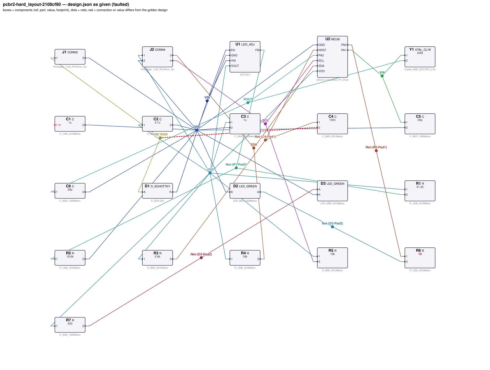
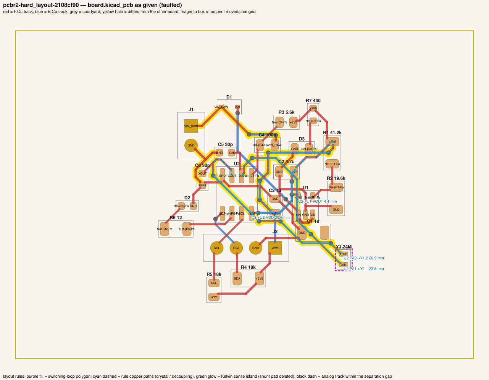
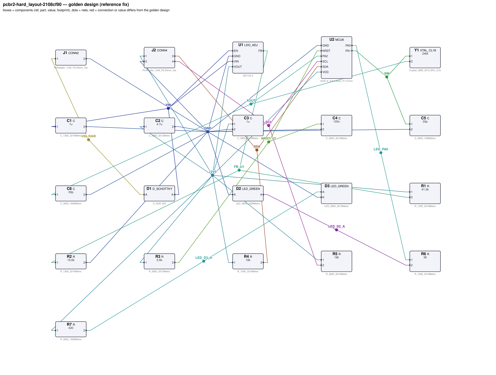
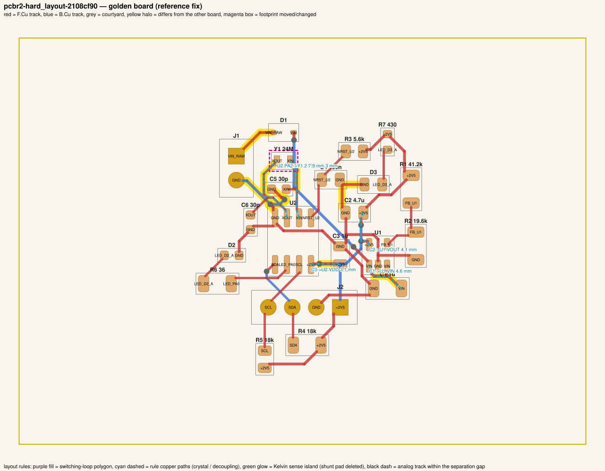

# QA packet 087: `pcbr2-hard_layout-2108cf90`

| family | tier | tool mode | hint level | intent in TASK.md | faults | latent | predicted difficulty |
|---|---|---|---|---|---|---|---|
| sys_clocked_mcu | hard_layout | no_autoroute | vague | full | 5 | 3 |  |

Task files: [`../../../tasks/v2/hard_layout/pcbr2-hard_layout-2108cf90/public/`](../../../tasks/v2/hard_layout/pcbr2-hard_layout-2108cf90/public/) (what the agent gets) and [`../../../tasks/v2/hard_layout/pcbr2-hard_layout-2108cf90/hidden/`](../../../tasks/v2/hard_layout/pcbr2-hard_layout-2108cf90/hidden/) (grader only). Why sampled: 5 faults, vague hint, connectivity fault, disputable type bias_wrong_rail, disputable type crystal_far, disputable type decap_long_path, value near bounds: R6=12 inside [11, 120], 3 latent (bias_wrong_rail, crystal_far, decap_long_path), no_autoroute.

**How to review (≈5 min):** read section 1 as if you were the agent, decide whether you could find and fix the problems from it; then check section 2 (faults, reference fix, verifier verdicts) and fill `review.yaml`. Do not let section 2 influence your fairness judgement of section 1.

## 1. What the agent sees

### 1.1 TASK.md (verbatim)

````markdown
# Task: crystal-clocked MCU board (12 V in)

## Problem report

The first boards built from these files fail bring-up. Find and fix all problems: the design must meet its purpose and spec, the layout must match design.json, and DRC/ERC must be clean.

## Design intent

# Crystal-clocked MCU board

MCU U2 runs from a 24MHz crystal and talks to off-board I2C devices on header J2,
which it also powers. Power (12 V) enters on J1 through a reverse-polarity diode; LDO U1
makes the +2V5 rail (2.5 V). A status LED on PA0 and an always-on power LED show the board state.

Rails: +12 V (from J1) -> reverse-polarity diode -> VIN -> U1 -> +2V5 = 2.5 V.

## Connectors

| Connector | Pin | Signal |
|---|---|---|
| J1 | 1 | +12 V input |
| J1 | 2 | GND |
| J2 | 1 | +2V5 (bus supply) |
| J2 | 2 | GND |
| J2 | 3 | SDA |
| J2 | 4 | SCL |

## MCU pin assignment (firmware-fixed)

| MCU pin | Function |
|---|---|
| VDD | supply, +2V5 rail |
| GND | ground |
| NRST | reset input, held high (no internal pull-up) |
| PA1 | XIN: 24MHz crystal |
| PA2 | XOUT: 24MHz crystal |
| SDA | I2C data -> J2 pin 3 |
| SCL | I2C clock -> J2 pin 4 |
| PA0 | status LED drive (push-pull, high = on) |

## Circuit

- Reverse-polarity protection: Schottky D1 in series with the input, anode to J1 pin 1, cathode to the protected input rail VIN.
- U1 (LDO_ADJ) regulates the 12 V input down to the 2.5 V rail +2V5: C1 is its input capacitor (VIN to GND) and C2 its output capacitor (VOUT to GND), each at its pin; R1 from VOUT to FB and R2 from FB to GND set VOUT = 0.8 V x (1 + R1/R2); EN is tied to the input (always on).
- U2 (MCU8) runs from +2V5; C3 decouples VDD at the pin; R3 pulls NRST up to +2V5 and C4 from NRST to GND gives a power-on reset delay.
- Clock: crystal Y1 (XTAL_CL18, rated CL 18 pF) between XIN (PA1) and XOUT (PA2); load capacitor C5 from XIN to GND and C6 from XOUT to GND, next to the crystal.
- I2C: SDA (U2.SDA -> J2.3) and SCL (U2.SCL -> J2.4) are open-drain with pull-ups R4 (SDA) and R5 (SCL) to +2V5; J2 pin 1 supplies +2V5 to the off-board devices.
- PA0 drives the status LED D2 through R6 (U2.PA0 -> R6 -> D2 anode, cathode to GND).
- power indicator: R7 from +2V5 to the anode of D3, cathode to GND.

## Spec

MCU supply 2.5 V ±3 % at its VDD/GND pins; NRST ≥ 0.9·VDD.

Crystal: CL_eff = C·C'/(C+C') + Cstray within ±10 % of 18 pF (Cstray = 3 pF from the layout estimate).

Clock: Y1 must be a 24MHz crystal (value `24M`, ±0.1 %): the firmware's clock tree assumes exactly this frequency; MCU8 supports 4–25 MHz crystals.

I2C standard-mode, up to 50 pF off-board capacitance per line (+5 pF pin): rise time (30–70 % of VDD, UM10204) ≤ 1000 ns; pull-up current ≤ 3 mA at VOL = 0.4 V.

Status LED current 3.97 mA ±15 % with PA0 high.

Power indicator current 0.98 mA ±15 %.

Rail +2V5: 2.5 V ±3 % with 20 mA drawn by the off-board I2C devices from J2 pin 1, for inputs from 3.5 V to 12 V.

Component values: C1, C2 1 µF–22 µF (LDO datasheet); feedback Rbot R2 3.3 kΩ–150 kΩ (10k–50k typical) with R1 scaled to match; MCU decoupling C3 47 nF–10 µF (100 nF typical); NRST pull-up R3 2.2 kΩ–100 kΩ; reset delay C4 10 nF–1 µF; I2C pull-ups R4, R5 within the datasheet range (VDD-0.4 V)/3 mA .. tr/(0.8473·Cbus) that meets the spec.

Sub-circuits by purpose: input reverse-polarity protection (D1); 2.5 V regulator with input/output capacitors and feedback divider (U1, C1, C2, R1, R2); MCU with VDD decoupling and reset pull-up / reset delay (U2, C3, R3, C4); crystal oscillator: crystal and load capacitors (Y1, C5, C6); I2C bus pull-ups and bus header (R4, R5, J2); status LED with series resistor (D2, R6); power indicator LED with series resistor (D3, R7).

## Spec

The design must satisfy these assertions (`pcbtool sim` runs them; full definitions in `spec.json`):

- `mcu_vdd`: DC voltage at U2.VDD relative to U2.GND between 2.425 V and 2.575 V (J1.1 supplied with 12.0 V; ground = J1.2)
- `nrst_high`: DC voltage at U2.NRST between 2.25 V and 2.6 V (J1.1 supplied with 12.0 V; ground = J1.2)
- `xtal_load_capacitance`: crystal Y1 effective load capacitance within ±10 % of its rated CL (stray 3 pF)
- `sda_rise_time`: 30-70 % transition time at U2.SDA between 0 s and 1 us (J1.1 supplied with 12.0 V; open-drain driver releasing the line on U2.SDA; load C=5e-11 from J2.3 to ground; load C=5e-11 from J2.4 to ground; ground = J1.2)
- `sda_sink_current`: DC current through R4 between 0 A and 3 mA (J1.1 supplied with 12.0 V; 0.4 V DC source on U2.SDA; ground = J1.2)
- `scl_rise_time`: 30-70 % transition time at U2.SCL between 0 s and 1 us (J1.1 supplied with 12.0 V; open-drain driver releasing the line on U2.SCL; load C=5e-11 from J2.3 to ground; load C=5e-11 from J2.4 to ground; ground = J1.2)
- `scl_sink_current`: DC current through R5 between 0 A and 3 mA (J1.1 supplied with 12.0 V; 0.4 V DC source on U2.SCL; ground = J1.2)
- `status_led_current`: DC current through D2 between 3.375 mA and 4.566 mA (J1.1 supplied with 12.0 V; 2.4816 V DC source on U2.PA0; ground = J1.2)
- `power_led_current`: DC current through D3 between 830.2 uA and 1.123 mA (J1.1 supplied with 12.0 V; ground = J1.2)
- `2v5_rail`: DC voltage at J2.1 between 2.425 V and 2.575 V (J1.1 supplied with 12.0 V; load R=125 from J2.1 to ground; ground = J1.2)
- `2v5_rail_low_vin`: DC voltage at J2.1 between 2.425 V and 2.575 V (J1.1 supplied with 3.5 V; load R=125 from J2.1 to ground; ground = J1.2)

Layout: every track of these nets must be at least the given width:

- +2V5 (the net of J2.1): ≥ 0.3 mm
- GND (the net of J1.2): ≥ 0.3 mm
- VIN (the net of C1.1): ≥ 0.3 mm
- VIN_RAW (the net of J1.1): ≥ 0.3 mm

Component values: each value must lie in its acceptable range (inclusive; `value_bounds` in `spec.json`). Ranges come from the datasheets and the design intent; values the assertions already pin down get a wide sanity range, and the assertions still apply:

- C1 (C): 1 uF … 22 uF
- C2 (C): 1 uF … 22 uF
- C3 (C): 47 nF … 10 uF
- C4 (C): 10 nF … 1 uF
- C5 (C): 11 pF … 86 pF
- C6 (C): 10 pF … 110 pF
- R1 (R): 7 kΩ … 320 kΩ
- R2 (R): 3.3 kΩ … 150 kΩ
- R3 (R): 2.2 kΩ … 100 kΩ
- R4 (R): 690 Ω … 69 kΩ
- R5 (R): 690 Ω … 49 kΩ
- R6 (R): 11 Ω … 120 Ω
- R7 (R): 8.1 Ω … 1.6 kΩ
- Y1 (XTAL_CL18): 23.98 MHz … 24.02 MHz

Board rules: 2 copper layers, clearance 0.2 mm, min track 0.2 mm, vias 0.6/0.3 mm, copper-to-edge 0.3 mm. DRC must be clean with no unconnected items.

## Design rules (design review)

Besides the spec, the design must pass an engineering design review. **`pcbtool` does not check any
of this — review the design yourself** against the datasheets in `parts/` (see each part's ratings /
design-rule section) and the design intent:

- **Absolute maximum ratings** of every part under every operating condition of the spec (no MCU pin
  above its VDD + 0.3 V or below -0.3 V, op-amp inputs within the rails, LDO EN ≤ VIN, MOSFET |VGS|,
  transistor / diode voltage and current limits).
- **Current limits:** MCU pin currents, LED forward current (by LED package), transistor collector /
  base currents; a saturated NPN switch needs a forced beta IC/IB ≤ 20.
- **Power / voltage ratings:** every resistor's I²R ≤ 50 % of its footprint's rating; every capacitor's
  working voltage ≤ 80 % of its footprint's rated voltage. Footprint choice matters.
- **Inductive loads** have a flyback diode directly across the load, cathode to the supply side.
- **Interfaces and pin assignments** stated in the design intent (connector pinouts, MCU pin functions,
  which rail each part connects to) must be respected exactly, even where the circuit would still
  simulate with a different assignment.

The grader checks these rules under the spec's operating conditions. A design can pass every
`pcbtool` check and still fail review.

**Decoupling** (graded as part of `layout`; `pcbtool` does not check it, `spec.json` lists it under `design_rules`): each capacitor's pad on the IC pin's net must reach that pin within the given length of copper path (shortest path along the net's tracks, vias and pads, pad centre to pad centre), and every pad of the capacitor must lie within the given straight-line distance of the pin:

- C1 within 8.0 mm of copper path of U1.VIN (and within 5.0 mm straight-line)
- C2 within 8.0 mm of copper path of U1.VOUT (and within 5.0 mm straight-line)
- C3 within 8.0 mm of copper path of U2.VDD (and within 5.0 mm straight-line)

## Layout rules (board geometry)

The board must also follow these layout rules. **`pcbtool` does not check any of them** (not `check`, not `drc`, not `show`) -- they are graded from the geometry in `board.kicad_pcb`; `spec.json` lists the same rules under `layout_rules` with their pins and limits. All lengths in mm, KiCad board coordinates (y grows downwards). Definitions used below:

- *Pad centre*: the pad's absolute position (footprint `(at x y rot)` plus the pad's `(at ...)` offset rotated by the footprint orientation; KiCad Python: `pad.GetPosition()`).
- *Copper path* from pad A to pad B: the shortest route along the net's copper -- track centrelines (each `segment` from start to end), vias (joining F.Cu and B.Cu at their centre) and pads (a pad joins every track point that lies inside it) -- measured from A's centre to B's centre. Tracks connect where their copper touches (same layer). As a polyline it runs through A's centre, the track end / junction points it follows, and B's centre.
- *Touch*: two copper items of a net touch when their copper overlaps or abuts (a track is its centreline swept by half its width, a via a disc of its diameter, a pad its outline).

**Crystal traces** (crystal Y1 on U2): the copper path of each oscillator connection (U2.PA1 -> Y1.1; U2.PA2 -> Y1.2) must be ≤ 10 mm, and the two oscillator nets (the nets of U2.PA1 and U2.PA2) must have no via at all.

**Decoupling** (as stated under Design rules: copper path cap pad -> IC pin, plus straight-line distance) is part of the same layout review.

Grading: the `layout_rules` check fails if any rule above is violated; the decoupling rule is graded by the `layout` check. `pcbtool route` knows nothing about these rules (it joins a net's pads as a shortest tree, which can itself violate them); review and, if needed, hand-edit the tracks.

## Deliverable

- Edit only `design.json` (the schematic of record) and `board.kicad_pcb` (the layout).
- Do not add, remove or rename components; keep each component's part.
- Keep the two files consistent: same connectivity, values and footprints on both.
- Values: `<number><SI prefix><unit>` such as `4.7k`, `100n`, `10kΩ`, `1meg`; unit letters, if any, must match the part (R: Ω/ohm/R, C: F, L: H, crystal: Hz); no spaces or control characters inside (full grammar: "Value notation" in `parts/R.md`, `parts/C.md`, ...).
- Do not change the board outline, add zones, or add DRC exclusions.
- Footprints must be unmodified library footprints from the part's allowed list (see `parts/<PART>.md`).
- Grading is pass/fail: topology, consistency, DRC, ERC, spec, component values, layout, the design rules and the layout rules above must all pass.

## Tools

Run `pcbtool <command>` inside this directory (you may also edit the two files directly).

Read-only:
- `pcbtool show` — components, values, footprints, positions and nets
- `pcbtool netlist` — design nets vs. board pad nets, with differences highlighted
- `pcbtool drc` — KiCad DRC under the canonical rules (the same rules the grader uses)
- `pcbtool erc` — electrical rule check of design.json
- `pcbtool sim` — run the spec assertions (spec.json) on design.json
- `pcbtool parts [PART]` — list parts / print a part's datasheet (also in `parts/`)
- `pcbtool check` — all of the above in one summary

Mutating (each keeps design.json and board.kicad_pcb consistent and saves both):
- `pcbtool set-value REF VALUE`
- `pcbtool set-footprint REF LIB:FOOTPRINT`
- `pcbtool connect REF.PIN NET` / `pcbtool disconnect REF.PIN`
- `pcbtool move REF X Y ROT` (absolute mm, degrees; tracks do not follow)
- `pcbtool unroute NET` / `pcbtool route NET [--width W]` (re-routes the whole net)
- `pcbtool sync` — push design.json connectivity and values onto the board pads

**Tool mode for this task: `no_autoroute`** (`tools.json`). `pcbtool route` and `pcbtool sync` are
disabled: after changing connectivity or footprints, edit the tracks (`segment` / `via` items) in
`board.kicad_pcb` yourself, or move parts with `pcbtool move`. All other commands work.
````

### 1.2 Public files

The agent also gets `design.json`, `board.kicad_pcb`, `spec.json` and the part datasheets below, plus the `pcbtool` commands listed in TASK.md (DRC, ERC, simulation of the public assertions, value-range check). Renders of the faulted files:





<details><summary>Datasheet <code>parts/C.md</code></summary>

````markdown
# C — ceramic capacitor

Two-terminal non-polarised capacitor. Pins `1`, `2`. Value in farads.

## Value notation (all parts)

A value is `<number><SI prefix?><unit?>`, e.g. `4.7k`, `100n`, `2.2u`, `10R`, `1meg`, `1.5e3`:
- number: digits with an optional decimal point and an optional exponent (`1e3`); no sign, no
  digit grouping, no RKM notation (`4k7`);
- SI prefix (case-sensitive): `p` `n` `u`/`µ`/`μ` (micro) `m` (milli) `k`/`K` `M`/`meg`/`MEG` (mega) `G`;
  an exponent and a prefix together (`1e3k`) are rejected;
- unit letters, optional, must match the part: R `Ω`/`ohm`/`Ohm`/`R`; C `F`; L `H`; crystals `Hz`;
  other parts none (`100nH` on a capacitor is rejected);
- no whitespace or control characters inside the value (leading/trailing spaces are ignored).

design.json and the board must carry the same value; they are compared as numbers (`1k` == `1000`).

## Ratings by footprint (X7R series used on this board)

| Size | Rated voltage | Design limit (80 %) |
|---|---|---|
| 0603 | 10 V | 8 V |
| 0805 | 25 V | 20 V |
| 1206 | 50 V | 40 V |

**Design rule:** the DC working voltage across a capacitor must not exceed 80 % of its rated voltage
(MLCC capacitance collapses and reliability drops near the rating). The rating follows the footprint.
````

</details>

<details><summary>Datasheet <code>parts/CONN2.md</code></summary>

````markdown
# CONN2 — 2-pin header

Pin `1` = signal/supply, pin `2` = ground by board convention.

## Interface rule
The pin assignment of every connector is fixed by the design intent (cable / mating board):
swapping two connector pins breaks the interface even if the board itself still simulates.
````

</details>

<details><summary>Datasheet <code>parts/CONN4.md</code></summary>

````markdown
# CONN4 — 4-pin 2.54 mm header

Generic vertical pin header used for off-board power, signal and bus connections.

| Pin | Pad | Typical use |
|---|---|---|
| 1 | 1 | signal / supply |
| 2 | 2 | ground (board convention) |
| 3 | 3 | signal / supply |
| 4 | 4 | signal / supply |

## Notes
- Pin 2 is ground by board convention; the function of the other pins is set by the design.
- Rated 3 A per contact. Has no electrical model of its own (it is where external
  supplies, signals and loads attach).

## Interface rule
The pin assignment of every connector is fixed by the design intent (cable / mating board):
swapping two connector pins breaks the interface even if the board itself still simulates.
````

</details>

<details><summary>Datasheet <code>parts/D_SCHOTTKY.md</code></summary>

````markdown
# D_SCHOTTKY — 40 V / 1 A Schottky rectifier

## Pinout
| Pin | Pad | Function |
|---|---|---|
| A | 2 | anode |
| K | 1 | cathode (band) |

## Electrical characteristics
- VRRM 40 V, IF(AV) 1 A
- Vf = 0.30 V typ at 100 mA, 0.40 V at 1 A
- Reverse leakage 20 uA typ at 25 V

## Application notes
- Flyback / freewheel clamp across an inductive load (relay coil, solenoid, motor):
  cathode to the positive supply side, anode to the switched (transistor) side. In normal
  operation the diode is reverse biased; at turn-off it clamps the inductive kick.
- Reverse polarity protection: in series with the supply, anode to the input.

## Absolute maximum ratings
- Reverse voltage 40 V, forward current 1 A continuous.

**Design rule (inductive loads):** every inductive load (relay coil, solenoid, motor) must have a
flyback diode directly across it with the cathode on the load's supply-side terminal and the
anode on its switched terminal. A diode elsewhere (to ground, across the transistor, both ends
on one net) does not clamp the turn-off spike, even though nothing is visible in DC.
````

</details>

<details><summary>Datasheet <code>parts/LDO_ADJ.md</code></summary>

````markdown
# LDO_ADJ — adjustable 300 mA low-dropout regulator (SOT-23-5)

## Pinout
| Pin | Pad | Function |
|---|---|---|
| VIN | 1 | input supply, 2.5–16 V |
| GND | 2 | ground |
| EN | 3 | enable, active high. Internal 2 MΩ pull-down: floating = OFF |
| FB | 4 | feedback; regulates to VREF = 0.800 V |
| VOUT | 5 | regulated output |

## Electrical characteristics
- VREF = 0.800 V ±1 %
- Output current 300 mA max; current limit ~500 mA
- Dropout 250 mV typ at 300 mA
- EN threshold 1.2 V (high = on); EN low or floating -> output off (0 V)
- Quiescent current 50 µA; package dissipation max 0.5 W

## Application notes
- Output voltage is set by a divider from VOUT to FB (Rtop) and FB to GND (Rbot):
  **VOUT = VREF × (1 + Rtop / Rbot)**. Rbot of 10k–50k is typical.
- Connect EN to VIN for always-on operation (or drive it from logic / a pull-up). A pull-up
  Rpu from VIN forms a divider with the internal 2 MΩ pull-down: VIN·2M/(Rpu + 2M) must exceed
  the 1.2 V threshold at the lowest VIN.
- Place a 1 µF–22 µF ceramic input capacitor and a 1 µF–22 µF ceramic output capacitor (the
  output capacitor range is the stability range of the regulation loop) within
  5 mm of the VIN and VOUT pins respectively, returned to GND.
- Power dissipation = (VIN - VOUT) × IOUT must stay below 0.5 W.

## Absolute maximum ratings
- VIN 16 V; EN ≤ VIN + 0.3 V (EN must never be above VIN); output current 300 mA;
  package dissipation (VIN - VOUT)·IOUT ≤ 0.5 W.
````

</details>

<details><summary>Datasheet <code>parts/LED_GREEN.md</code></summary>

````markdown
# LED_GREEN — green SMD indicator LED (570 nm)

## Pinout
| Pin | Pad | Function |
|---|---|---|
| A | 2 | anode |
| K | 1 | cathode (marked) |

## Electrical characteristics (25 C)
- Forward voltage Vf = 2.2 V typ at IF = 10 mA
- Max continuous forward current 25 mA; reverse voltage max 5 V

| IF | Vf (typ) |
|---|---|
| 2 mA | 2.10 V |
| 5 mA | 2.15 V |
| 10 mA | 2.20 V |
| 15 mA | 2.23 V |
| 20 mA | 2.26 V |

## Application notes
- Always drive through a current-limiting resistor: R = (Vsupply - n*Vf) / IF for n LEDs in series.
- Current flows anode -> cathode; reversed LEDs do not light.

## Ratings by package

| Package | Max continuous IF | Design limit (80 %) |
|---|---|---|
| 0603 | 20 mA | 16 mA |
| 0805 | 30 mA | 24 mA |

**Design rule:** the forward current must not exceed 80 % of the package maximum; reverse voltage
≤ 5 V.
````

</details>

<details><summary>Datasheet <code>parts/MCU8.md</code></summary>

````markdown
# MCU8 — generic 8-pin microcontroller (SOIC-8)

## Pinout
| Pin | Pad | Function |
|---|---|---|
| NRST | 1 | active-low reset input. **No internal pull-up**: needs an external pull-up to VDD, 2.2k–100k (10k typical); optional 10 nF–1 µF to GND (100 nF typical) for a power-on reset delay |
| PA1 | 2 | GPIO / ADC1 / XIN (crystal oscillator input) |
| PA2 | 3 | GPIO / ADC2 / XOUT (crystal oscillator output) |
| GND | 4 | ground |
| SDA | 5 | I2C data (open-drain) / GPIO |
| PA0 | 6 | GPIO / PWM output / ADC0 |
| SCL | 7 | I2C clock (open-drain) / GPIO |
| VDD | 8 | supply 1.8–5.5 V |

## Electrical characteristics
- Supply current 1.5 mA typ at 3.3 V
- GPIO output: VOH ≥ VDD - 0.4 V at 8 mA source (≈50 Ω output resistance); 8 mA max per pin
- Open-drain I2C pins sink max 3 mA at VOL = 0.4 V; no internal I2C pull-ups
- ADC (PA0, PA1, PA2): 12-bit, full scale = VDD, input range 0..VDD (never above VDD); the pin
  is high impedance (5 pF), so an RC anti-alias filter at the pin sets the input bandwidth
- Pin capacitance 5 pF per I/O; idle / reset I/O pins are high-impedance (no pulls)
- Crystal oscillator: 4–25 MHz fundamental crystal between XIN (PA1) and XOUT (PA2), each pin
  with a load capacitor to GND

## Application notes
- Decouple VDD with 100 nF ceramic (47 nF–10 µF) to GND within 5 mm of the VDD pin.
- I2C pull-ups: Rp ≥ (VDD - 0.4 V) / 3 mA (sink limit) and Rp ≤ tr / (0.8473 × Cbus) (rise time),
  where tr is the I2C rise time as defined by the I2C specification (UM10204): 30 % to 70 % of
  VDD, max 1000 ns standard-mode / 300 ns fast-mode; 0.8473 = ln(0.7/0.3). Cbus includes
  the 5 pF pin capacitance.
- Crystal load caps: CL = C1·C2/(C1+C2) + Cstray, i.e. C1 = C2 = 2·(CL - Cstray).

## Absolute maximum ratings
- VDD - GND ≤ 6 V.
- Any I/O pin (NRST, PA0-PA2, SDA, SCL): -0.3 V … VDD + 0.3 V. No pin may be pulled
  above the MCU's own VDD (e.g. by a pull-up to a higher rail): the ESD diodes conduct and
  back-power the chip.
- GPIO current (PA0-PA2, NRST): 8 mA max per pin; SDA/SCL: 3 mA max sink.
- Pin functions are fixed by the package: crystal on PA1 (XIN) / PA2 (XOUT), I2C on SDA / SCL;
  firmware assumes the assignment given in the design intent.
````

</details>

<details><summary>Datasheet <code>parts/R.md</code></summary>

````markdown
# R — resistor

Two-terminal resistor. Pins `1`, `2` (non-polarised). Value in ohms.

## Value notation (all parts)

A value is `<number><SI prefix?><unit?>`, e.g. `4.7k`, `100n`, `2.2u`, `10R`, `1meg`, `1.5e3`:
- number: digits with an optional decimal point and an optional exponent (`1e3`); no sign, no
  digit grouping, no RKM notation (`4k7`);
- SI prefix (case-sensitive): `p` `n` `u`/`µ`/`μ` (micro) `m` (milli) `k`/`K` `M`/`meg`/`MEG` (mega) `G`;
  an exponent and a prefix together (`1e3k`) are rejected;
- unit letters, optional, must match the part: R `Ω`/`ohm`/`Ohm`/`R`; C `F`; L `H`; crystals `Hz`;
  other parts none (`100nH` on a capacitor is rejected);
- no whitespace or control characters inside the value (leading/trailing spaces are ignored).

design.json and the board must carry the same value; they are compared as numbers (`1k` == `1000`).

## Ratings by footprint (high-power thick-film series used on this board)

| Size | Rated power (70 C) | Design limit (50 % derating) |
|---|---|---|
| 0603 | 0.1 W | 50.0 mW |
| 0805 | 0.125 W | 62.5 mW |
| 1206 | 0.5 W | 250.0 mW |

**Design rule:** the continuous dissipation P = I²·R of every resistor must not exceed 50 % of its
footprint's rated power. Pick the footprint for the power, not just the value.
````

</details>

<details><summary>Datasheet <code>parts/XTAL_CL18.md</code></summary>

````markdown
# XTAL_CL18 — 2-pin fundamental-mode quartz crystal

## Pinout
| Pin | Pad | Function |
|---|---|---|
| 1 | 1 | crystal terminal |
| 2 | 2 | crystal terminal |

(Non-polarised.) Value = nominal frequency, e.g. `16M`.

## Electrical characteristics
- **Rated load capacitance CL = 18 pF**
- Frequency tolerance ±20 ppm at rated CL
- ESR ≤ 60 Ω; shunt capacitance C0 = 3 pF; drive level ≤ 100 µW

## Application notes
- Pierce oscillator: one load capacitor from each crystal pin to GND.
  Effective load CL_eff = C1·C2/(C1+C2) + Cstray (Cstray = MCU pin + PCB capacitance).
  For C1 = C2: C = 2·(CL - Cstray). Must be within ±10 % of 18 pF or the oscillator runs off-frequency.
- Keep traces short and the load capacitors next to the crystal.

## Value notation (all parts)

A value is `<number><SI prefix?><unit?>`, e.g. `4.7k`, `100n`, `2.2u`, `10R`, `1meg`, `1.5e3`:
- number: digits with an optional decimal point and an optional exponent (`1e3`); no sign, no
  digit grouping, no RKM notation (`4k7`);
- SI prefix (case-sensitive): `p` `n` `u`/`µ`/`μ` (micro) `m` (milli) `k`/`K` `M`/`meg`/`MEG` (mega) `G`;
  an exponent and a prefix together (`1e3k`) are rejected;
- unit letters, optional, must match the part: R `Ω`/`ohm`/`Ohm`/`R`; C `F`; L `H`; crystals `Hz`;
  other parts none (`100nH` on a capacitor is rejected);
- no whitespace or control characters inside the value (leading/trailing spaces are ignored).

design.json and the board must carry the same value; they are compared as numbers (`1k` == `1000`).
````

</details>

## 2. Reviewer-only (hidden from the agent)

### 2.1 Injected faults

| # | type | category | DRC/ERC-invisible | latent (pcbtool-clean) | detail | verifier, this fault alone |
|---|---|---|---|---|---|---|
| 1 | `crystal_far` | latent | yes | **yes** (layout) | crystal Y1 moved away from U2 (ring 1) and re-routed: XIN/XOUT traces too long | reward 0.0; fails layout_rules |
| 2 | `decap_long_path` | latent | yes | **yes** (layout) | C3 (U2.VDD decoupling) re-routed the long way: its pad now joins +2V5 at R1.1 instead of running to the IC pin | reward 0.0; fails layout |
| 3 | `bias_wrong_rail` | latent | yes | **yes** | C4.2 returned to VIN_RAW instead of GND | reward 0.0; fails topology |
| 4 | `decap_misconnected` | connectivity | no |  | C1 supply-side pin C1.1 not connected (should be on VIN) | reward 0.0; fails erc, layout, topology |
| 5 | `wrong_led_resistor` | value | yes |  | R6 (LED current-limiting resistor) is 12, should be 36 | reward 0.0; fails spec |

### 2.2 Reference fix (faulted → golden)

The reference repair is the hidden golden pair (`golden_design.json`, `golden_board.kicad_pcb`). Any repair that passes every gate and check scores 1.0; it need not be byte-identical.

**design.json: component changes**

- `R6` value: `12` → `36`

**design.json: connection changes** (per pin: what it connects to)

- `C1.1`: faulted unconnected → golden net `VIN` (D1.K, U1.EN, U1.VIN)
- `C4.2`: faulted net `VIN_RAW` (D1.A, J1.1) → golden net `GND` (C1.2, C2.2, C3.2, C5.2, C6.2, D2.K, D3.K, J1.2, J2.2, R2.2, U1.GND, U2.GND)

**board.kicad_pcb: footprints moved / changed**

- `Y1` moved (143.00, 130.00, 90°, F) → (128.00, 113.00, 180°, F), 22.67 mm

**board.kicad_pcb: footprint values (BOM)**

- `R6` board value `12` → `36`

**board.kicad_pcb: pad-net changes**

- `C1` pad 1: net `(none)` → `VIN`
- `C4` pad 1: net `Net-(C4-Pad1)` → `NRST_U2`
- `C4` pad 2: net `VIN_RAW` → `GND`
- `D2` pad 2: net `Net-(D2-Pad2)` → `LED_D2_A`
- `D3` pad 2: net `Net-(D3-Pad2)` → `LED_D3_A`
- `R1` pad 2: net `Net-(R1-Pad2)` → `FB_U1`
- `R2` pad 1: net `Net-(R1-Pad2)` → `FB_U1`
- `R3` pad 2: net `Net-(C4-Pad1)` → `NRST_U2`
- `R6` pad 1: net `Net-(R6-Pad1)` → `LED_PA0`
- `R6` pad 2: net `Net-(D2-Pad2)` → `LED_D2_A`
- `R7` pad 2: net `Net-(D3-Pad2)` → `LED_D3_A`
- `U1` pad 4: net `Net-(R1-Pad2)` → `FB_U1`
- `U2` pad 1: net `Net-(C4-Pad1)` → `NRST_U2`
- `U2` pad 6: net `Net-(R6-Pad1)` → `LED_PA0`

**board.kicad_pcb: nets re-routed** (track/via geometry differs)

- net `+2V5`: 11 track/via item(s) removed, 1 added
- net `FB_U1`: 0 track/via item(s) removed, 3 added
- net `GND`: 9 track/via item(s) removed, 13 added
- net `LED_D2_A`: 0 track/via item(s) removed, 1 added
- net `LED_D3_A`: 0 track/via item(s) removed, 1 added
- net `LED_PA0`: 0 track/via item(s) removed, 2 added
- net `NRST_U2`: 0 track/via item(s) removed, 3 added
- net `Net-(C4-Pad1)`: 3 track/via item(s) removed, 0 added
- net `Net-(D2-Pad2)`: 1 track/via item(s) removed, 0 added
- net `Net-(D3-Pad2)`: 1 track/via item(s) removed, 0 added
- net `Net-(R1-Pad2)`: 3 track/via item(s) removed, 0 added
- net `Net-(R6-Pad1)`: 2 track/via item(s) removed, 0 added
- net `VIN`: 2 track/via item(s) removed, 4 added
- net `VIN_RAW`: 8 track/via item(s) removed, 2 added
- net `XIN`: 10 track/via item(s) removed, 2 added
- net `XOUT`: 11 track/via item(s) removed, 3 added

Golden renders (compare with 1.2; highlighted items differ):





### 2.3 Verifier verdicts

Reward is 1 only if every gate and check passes.

| stage | kind | faulted files | golden files |
|---|---|---|---|
| parse | gate | pass | pass |
| components | gate | pass | pass |
| topology | gate | **FAIL** | pass |
| consistency | gate | pass | pass |
| integrity | gate | pass | pass |
| drc | check | pass | pass |
| erc | check | **FAIL** | pass |
| spec | check | **FAIL** | pass |
| values | check | pass | pass |
| layout | check | **FAIL** | pass |
| layout_rules | check | **FAIL** | pass |
| rules | check | pass | pass |
| **reward** | | **0** | **1** |

Verifier messages on the faulted files:

- **erc**: unconnected_required: C1.1 must be connected
- **layout**: decoupling: C1 has no pad connected by copper to U1.VIN
- **layout**: decoupling: C3 reaches U2.VDD through 35.55 mm of copper (max 8.0 mm)
- **layout_rules**: crystal_trace: U2.PA1->Y1.1: copper path 23.79 mm > 10.0 mm
- **layout_rules**: crystal_via: U2.PA1->Y1.1: 2 via(s) on the oscillator net
- **layout_rules**: crystal_trace: U2.PA2->Y1.2: copper path 26.87 mm > 10.0 mm
- **layout_rules**: crystal_via: U2.PA2->Y1.2: 4 via(s) on the oscillator net
- **layout_skipped**: no board net has the pins of golden net GND (connectivity differs: see topology)
- **layout_skipped**: no board net has the pins of golden net VIN (connectivity differs: see topology)
- **layout_skipped**: no board net has the pins of golden net VIN_RAW (connectivity differs: see topology)
- **spec**: status_led_current: measured 0.0052356492718 expected [0.00337475, 0.00456583]
- **topology**: nets only in candidate: [['C1.2', 'C2.2', 'C3.2', 'C5.2', 'C6.2', 'D2.K', 'D3.K', 'J1.2', 'J2.2', 'R2.2', 'U1.GND', 'U2.GND'], ['C4.2', 'D1.A', 'J1.1'], ['D1.K', 'U1.EN', 'U1.VIN']]; nets only in reference: [['C1.1', 'D1.K', 'U1.EN', 'U1.VIN'], ['C1.2', 'C2.2', 'C3.2', 'C4.2', 'C5.2', 'C6.2', 'D2.K', 'D3.K', 'J1.2', 'J2.2', 'R2.2', 'U1.GND', 'U2.GND'], ['D1.A', 'J1.1']]

### 2.4 Spec assertions before / after

| assertion | what | allowed | faulted: measured | | golden: measured | |
|---|---|---|---|---|---|---|
| `mcu_vdd` | DC voltage at U2.VDD relative to U2.GND (J1.1 supplied with 12.0 V; ground = J1.2) | 2.425 V … 2.575 V | 2.481 V | ✅ | 2.481 V | ✅ |
| `nrst_high` | DC voltage at U2.NRST (J1.1 supplied with 12.0 V; ground = J1.2) | 2.25 V … 2.6 V | 2.481 V | ✅ | 2.481 V | ✅ |
| `xtal_load_capacitance` | crystal Y1 effective load capacitance within ±10 % of its rated CL (stray 3 pF) | see def. | 18 p | ✅ | 18 p | ✅ |
| `sda_rise_time` | 30-70 % transition time at U2.SDA (J1.1 supplied with 12.0 V; open-drain driver releasing the line on U2.SDA; load C=5e-11 from J2.3 to ground; load C=5e-11 from J2.4 to ground; ground = J1.2) | 0 s … 1 us | 838.1 ns | ✅ | 838.1 ns | ✅ |
| `sda_sink_current` | DC current through R4 (J1.1 supplied with 12.0 V; 0.4 V DC source on U2.SDA; ground = J1.2) | 0 A … 3 mA | 115.6 uA | ✅ | 115.6 uA | ✅ |
| `scl_rise_time` | 30-70 % transition time at U2.SCL (J1.1 supplied with 12.0 V; open-drain driver releasing the line on U2.SCL; load C=5e-11 from J2.3 to ground; load C=5e-11 from J2.4 to ground; ground = J1.2) | 0 s … 1 us | 838.1 ns | ✅ | 838.1 ns | ✅ |
| `scl_sink_current` | DC current through R5 (J1.1 supplied with 12.0 V; 0.4 V DC source on U2.SCL; ground = J1.2) | 0 A … 3 mA | 115.6 uA | ✅ | 115.6 uA | ✅ |
| `status_led_current` | DC current through D2 (J1.1 supplied with 12.0 V; 2.4816 V DC source on U2.PA0; ground = J1.2) | 3.375 mA … 4.566 mA | 5.236 mA | ❌ | 3.97 mA | ✅ |
| `power_led_current` | DC current through D3 (J1.1 supplied with 12.0 V; ground = J1.2) | 830.2 uA … 1.123 mA | 975.2 uA | ✅ | 975.2 uA | ✅ |
| `2v5_rail` | DC voltage at J2.1 (J1.1 supplied with 12.0 V; load R=125 from J2.1 to ground; ground = J1.2) | 2.425 V … 2.575 V | 2.481 V | ✅ | 2.481 V | ✅ |
| `2v5_rail_low_vin` | DC voltage at J2.1 (J1.1 supplied with 3.5 V; load R=125 from J2.1 to ground; ground = J1.2) | 2.425 V … 2.575 V | 2.481 V | ✅ | 2.481 V | ✅ |

### 2.5 Value bounds

Bounds are public (TASK.md / spec.json); `values` check = every value inside its range.

| ref | part | acceptable range | faulted design.json | faulted board | golden | touched by a fault |
|---|---|---|---|---|---|---|
| `C1` | C | 1 uF … 22 uF | `1u` | `1u` | `1u` | **yes** |
| `C2` | C | 1 uF … 22 uF | `4.7u` | `4.7u` | `4.7u` |  |
| `C3` | C | 47 nF … 10 uF | `1u` | `1u` | `1u` | **yes** |
| `C4` | C | 10 nF … 1 uF | `100n` | `100n` | `100n` | **yes** |
| `C5` | C | 11 pF … 86 pF | `30p` | `30p` | `30p` |  |
| `C6` | C | 10 pF … 110 pF | `30p` | `30p` | `30p` |  |
| `R1` | R | 7 kΩ … 320 kΩ | `41.2k` | `41.2k` | `41.2k` |  |
| `R2` | R | 3.3 kΩ … 150 kΩ | `19.6k` | `19.6k` | `19.6k` |  |
| `R3` | R | 2.2 kΩ … 100 kΩ | `5.6k` | `5.6k` | `5.6k` |  |
| `R4` | R | 690 Ω … 69 kΩ | `18k` | `18k` | `18k` |  |
| `R5` | R | 690 Ω … 49 kΩ | `18k` | `18k` | `18k` |  |
| `R6` | R | 11 Ω … 120 Ω | `12` | `12` | `36` | **yes** |
| `R7` | R | 8.1 Ω … 1.6 kΩ | `430` | `430` | `430` |  |
| `Y1` | XTAL_CL18 | 23.98 MHz … 24.02 MHz | `24M` | `24M` | `24M` | **yes** |

### 2.6 Layout rules

- power net `+2V5` (golden pins C2.1, C3.1, J2.1, R1.1, R3.1, R4.1, R5.1, R7.1, U1.VOUT, U2.VDD): every track ≥ 0.3 mm
- power net `GND` (golden pins C1.2, C2.2, C3.2, C4.2, C5.2, C6.2, D2.K, D3.K, J1.2, J2.2, R2.2, U1.GND, U2.GND): every track ≥ 0.3 mm
- power net `VIN` (golden pins C1.1, D1.K, U1.EN, U1.VIN): every track ≥ 0.3 mm
- power net `VIN_RAW` (golden pins D1.A, J1.1): every track ≥ 0.3 mm
- decoupling: `C1` within 8.0 mm of copper path (and 5.0 mm straight-line) of `U1.VIN`
- decoupling: `C2` within 8.0 mm of copper path (and 5.0 mm straight-line) of `U1.VOUT`
- decoupling: `C3` within 8.0 mm of copper path (and 5.0 mm straight-line) of `U2.VDD`

### 2.7 Latent faults and their public evidence

A latent fault leaves `pcbtool check` clean; the agent can only find it by reading the public text. For each one: the generator's evidence claim, then every evidence group the generator's fairness gate requires (`pcbenv/faults/latent.py:evidence_groups`) with the exact public line it matched. Judge whether that text really lets an engineer infer the requirement (`task_fair`, `rule_stated_clearly`).

**Fault 1: `crystal_far`** — crystal Y1 moved away from U2 (ring 1) and re-routed: XIN/XOUT traces too long

- detected by: `layout_rules`; rule violations it causes: crystal_trace: U2.PA1->Y1.1: copper path 23.79 mm > 10.0 mm; crystal_trace: U2.PA2->Y1.2: copper path 26.87 mm > 10.0 mm; crystal_via: U2.PA1->Y1.1: 2 via(s) on the oscillator net; crystal_via: U2.PA2->Y1.2: 4 via(s) on the oscillator net
- generator's evidence claim: TASK.md Layout rules / spec.json layout_rules.crystal: oscillator trace length limit
- evidence group `**Crystal traces**`: matched `**Crystal traces**` in `TASK.md`:
  > **Crystal traces** (crystal Y1 on U2): the copper path of each oscillator connection (U2.PA1 -> Y1.1; U2.PA2 -> Y1.2) must be ≤ 10 mm, and the two oscillator nets (the nets of U2.PA1 and U2.PA2) must have no via at all.
- evidence group `line:U2.PA1&Y1.1`: matched `line:U2.PA1&Y1.1` in `TASK.md`:
  > **Crystal traces** (crystal Y1 on U2): the copper path of each oscillator connection (U2.PA1 -> Y1.1; U2.PA2 -> Y1.2) must be ≤ 10 mm, and the two oscillator nets (the nets of U2.PA1 and U2.PA2) must have no via at all.

**Fault 2: `decap_long_path`** — C3 (U2.VDD decoupling) re-routed the long way: its pad now joins +2V5 at R1.1 instead of running to the IC pin

- detected by: `layout`; rule violations it causes: decoupling: C3 reaches U2.VDD through 35.55 mm of copper (max 8.0 mm)
- generator's evidence claim: TASK.md Design rules / spec.json design_rules.decoupling: copper-path limit cap -> IC pin
- evidence group `- C3 within`: matched `- C3 within` in `TASK.md`:
  > - C3 within 8.0 mm of copper path of U2.VDD (and within 5.0 mm straight-line)
- evidence group `copper path`: matched `copper path` in `TASK.md`:
  > … `pcbtool` does not check it, `spec.json` lists it under `design_rules`): each capacitor's pad on the IC pin's net must reach that pin within the given length of copper path (shortest path along the net's tracks, vias and pads, pad centre to pad centre), and every pad of the capacitor must lie within the given straight-line distance of the pin:

**Fault 3: `bias_wrong_rail`** — C4.2 returned to VIN_RAW instead of GND

- detected by: `topology`
- generator's evidence claim: design intent (full text kept): bias / bypass / reset parts returned to GND; MCU8 / OPAMP application notes
- evidence group `line:C4&GND`: matched `line:C4&GND` in `TASK.md`:
  > - U2 (MCU8) runs from +2V5; C3 decouples VDD at the pin; R3 pulls NRST up to +2V5 and C4 from NRST to GND gives a power-on reset delay.


### 2.8 Design rules (`rules` check, not run by pcbtool)

Scope: all datasheet rules (hard tier); 7 operating condition(s) from the spec's stimuli; 36 rule quantities evaluated per design. Rows shown: violated on either side, on a part a fault touches (if ≥ 5 % of its limit or changed by ≥ 5 points or by a footprint change), or at ≥ 80% of the limit. Values are the worst case over the conditions (computed with `pcbenv.rules.operating_point`; limits from `pcbenv/rules.py`, stated in `parts/<PART>.md` and TASK.md "Design rules").

| rule | subject | quantity | limit | faulted (of limit) | golden (of limit) | shown because | worst condition (faulted) |
|---|---|---|---|---|---|---|---|
| `capacitor_voltage` | `C1` | \|V\| | 40 V | 1206: 0 V of 40 V (0%) | 1206: 11.9 V of 40 V (30%) | fault target | cond 0 |
| `capacitor_voltage` | `C3` | \|V\| | 20 V | 0805: 2.481 V of 20 V (12%) | 0805: 2.481 V of 20 V (12%) | fault target | cond 0 |
| `capacitor_voltage` | `C4` | \|V\| | 20 V | 0805: 9.519 V of 20 V (48%) | 0805: 2.481 V of 20 V (12%) | fault target | cond 5 |

Rule violations reported by the verifier: faulted: none; golden: none.

### 2.9 Layout rules (`layout_rules` check + decoupling, not run by pcbtool)

Measured with `pcbenv/layout_rules.py` / `pcbenv/layout.py` on each board (definitions in TASK.md "Layout rules"). The board renders draw the loop polygon (purple), the rule copper paths (cyan dashed), the Kelvin sense island with the shunt pad deleted (green) and analog-track stretches inside the separation gap (black dashes).

| metric | limit | faulted | golden |
|---|---|---|---|
| crystal copper path U2.PA1->Y1.1 | 10 mm | 23.79 mm ❌ | 6.33 mm |
| crystal copper path U2.PA2->Y1.2 | 10 mm | 26.87 mm ❌ | 7.93 mm |
| crystal vias on net of U2.PA1 | 0 | 2 ❌ | 0 |
| crystal vias on net of U2.PA2 | 0 | 4 ❌ | 0 |
| decoupling copper path C1 -> U1.VIN | 8 mm | not connected ❌ | 4.62 mm |
| decoupling copper path C2 -> U1.VOUT | 8 mm | 4.14 mm | 4.14 mm |
| decoupling copper path C3 -> U2.VDD | 8 mm | 35.55 mm ❌ | 3.11 mm |
| decoupling straight line C1 pads -> U1.VIN | 5 mm | 4.16 mm | 4.16 mm |
| decoupling straight line C2 pads -> U1.VOUT | 5 mm | 4.19 mm | 4.19 mm |
| decoupling straight line C3 pads -> U2.VDD | 5 mm | 3.64 mm | 3.64 mm |

Golden builder target: every layout rule at 0.8 × its limit. Rules in this task: crystal.

## 3. Review

Fill `review.yaml` in this directory (second reviewer: copy `../../review_template.yaml` to `review-<initials>.yaml` here, without looking at the first form). Questions to answer:

1. **task_fair / solvable_from_public_material**: from section 1 only, can a competent engineer locate and fix every injected fault? Is anything required that is not stated (a value with no assertion and no published range, a connection only the golden reveals)?
2. **reference_fix_correct**: is the golden (2.2) a correct design that meets the stated intent?
3. **verifier_verdict_agrees**: do you agree the faulted files fail and the golden passes, for the reasons given in 2.3?
4. **alternative_valid_fixes_rejected**: is there an engineering-valid repair the grader would reject (e.g. a different E-series value that meets intent but fails an assertion window or value bound; keeping a swapped footprint and re-routing; a different valid placement)?
5. **rule_stated_clearly**: is every design rule / layout rule / latent requirement this task grades (2.7–2.9) stated in the public material clearly enough that an engineer would apply it the way the grader does (limit, which part, which condition)? Normal-tier tasks: answer for the resistor-power rule (`yes` if no rule is involved).
6. **layout_rule_reasonable**: hard_layout tasks only (else `n/a`): are the layout-rule limits and their geometric definitions (2.9) defensible engineering practice for this board, i.e. would you reject the faulted layout in a design review, and accept the golden one?

