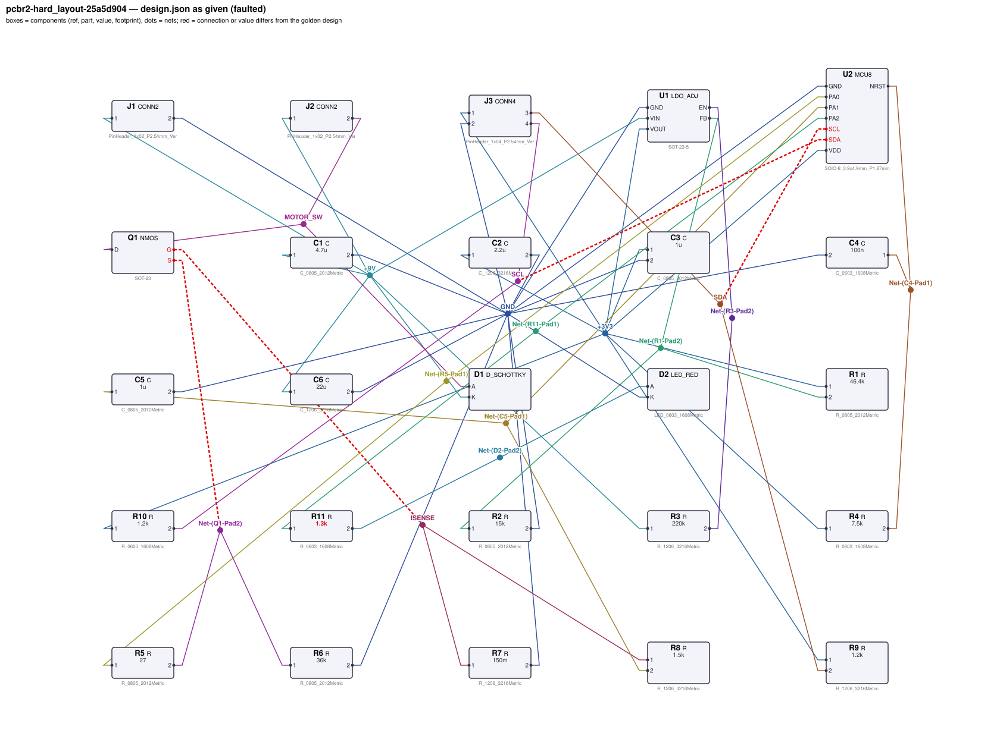
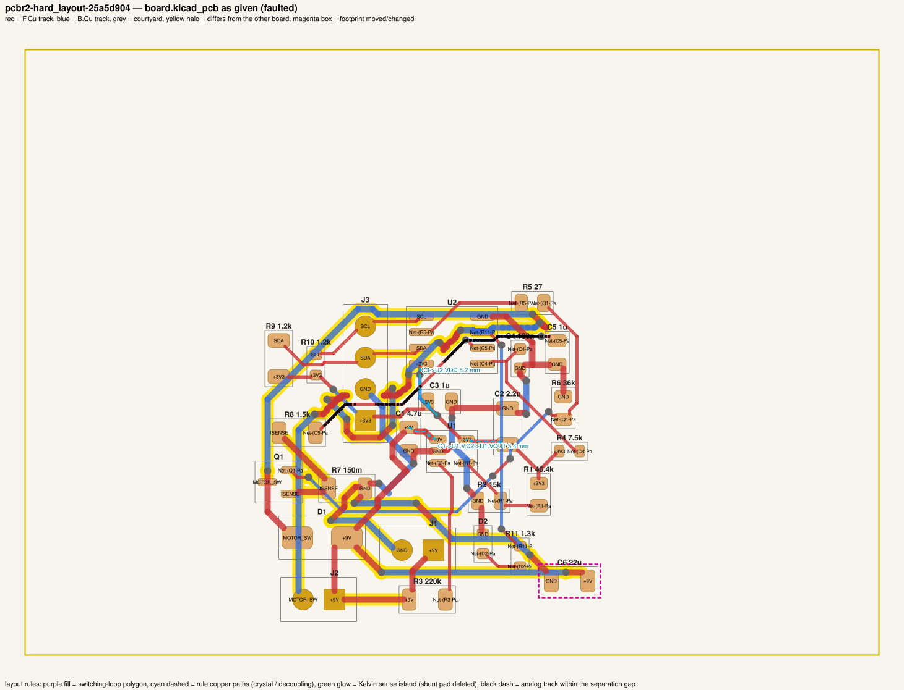
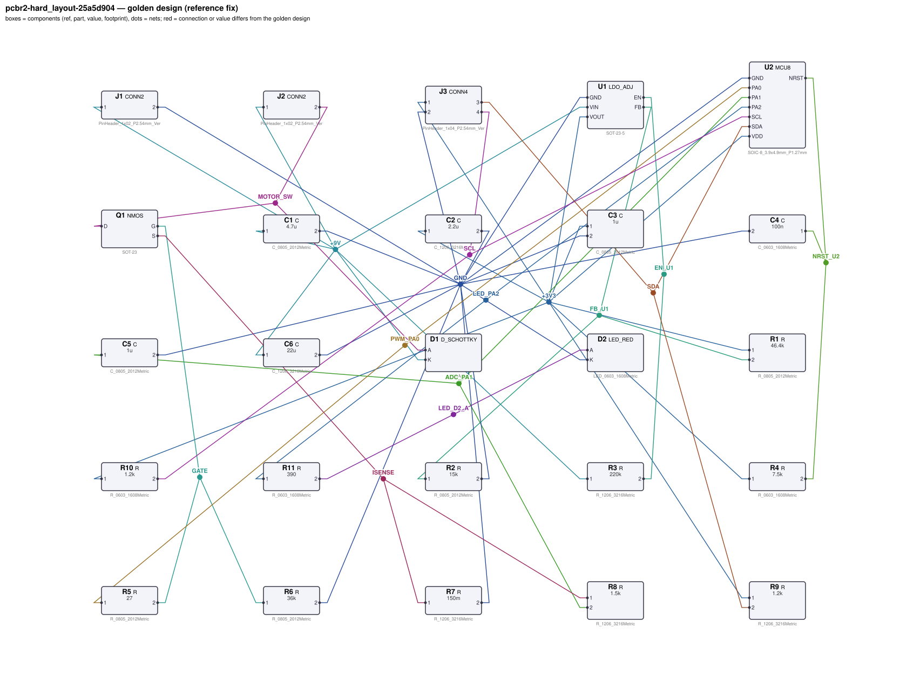
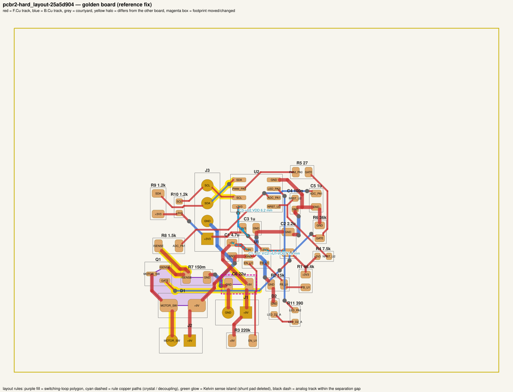

# QA packet 094: `pcbr2-hard_layout-25a5d904`

| family | tier | tool mode | hint level | intent in TASK.md | faults | latent | predicted difficulty |
|---|---|---|---|---|---|---|---|
| sys_motor_ctrl | hard_layout | no_autoroute | symptom | reduced | 5 | 3 |  |

Task files: [`../../../tasks/v2/hard_layout/pcbr2-hard_layout-25a5d904/public/`](../../../tasks/v2/hard_layout/pcbr2-hard_layout-25a5d904/public/) (what the agent gets) and [`../../../tasks/v2/hard_layout/pcbr2-hard_layout-25a5d904/hidden/`](../../../tasks/v2/hard_layout/pcbr2-hard_layout-25a5d904/hidden/) (grader only). Why sampled: 5 faults, connectivity fault, disputable type analog_near_switch, disputable type mcu_pin_swap, disputable type switch_loop_spread, value near bounds: R11=1.3k inside [130, 1500], 3 latent (analog_near_switch, mcu_pin_swap, switch_loop_spread), no_autoroute.

**How to review (≈5 min):** read section 1 as if you were the agent, decide whether you could find and fix the problems from it; then check section 2 (faults, reference fix, verifier verdicts) and fill `review.yaml`. Do not let section 2 influence your fairness judgement of section 1.

## 1. What the agent sees

### 1.1 TASK.md (verbatim)

````markdown
# Task: 9 V DC motor controller

## Problem report

The first boards built from these files fail bring-up. Observations so far:

- Bench: current through J2.2 is 1.009 nA, expected 712.5 mA to 787.5 mA (`motor_on_current`).
- Bench: Q1.D reads 5.732 V, expected 0 V to 300 mV (`vds_on`).
- Bench: U2.PA1 reads 0 V, expected 104.6 mV to 120.4 mV (`current_sense_voltage`).
- Bench: current through D2 is 1.044 mA, expected 2.607 mA to 3.528 mA (`fault_led_current`).

Fix every problem (there may be more than the observations show directly).

## Design intent

# 9 V DC motor controller

Drives a brushed DC motor (J2) from the +9 V supply on J1 with a low-side MOSFET under
PWM control of MCU U2, measures the motor current through a shunt on an ADC pin, reports over I2C
(header J3) and shows a fault LED. LDO U1 makes the +3V3 logic rail (3.3 V) from the
motor supply.

Rails: +9 V (from J1: motor, LDO input) -> U1 -> +3V3 = 3.3 V (MCU, I2C, LEDs).

## Connectors

| Connector | Pin | Signal |
|---|---|---|
| J1 | 1 | +9 V motor / board supply input |
| J1 | 2 | GND |
| J2 | 1 | motor + (+9 V) |
| J2 | 2 | motor - (switched return) |
| J3 | 1 | +3V3 (bus supply) |
| J3 | 2 | GND |
| J3 | 3 | SDA |
| J3 | 4 | SCL |

## MCU pin assignment (firmware-fixed)

| MCU pin | Function |
|---|---|
| VDD | supply, +3V3 rail |
| GND | ground |
| NRST | reset input, held high (no internal pull-up) |
| PA0 | PWM motor drive (high = motor on) |
| PA1 | ADC input: motor current sense, V = I x 0.15 Ω |
| SDA | I2C data -> J3 pin 3 |
| SCL | I2C clock -> J3 pin 4 |
| PA2 | fault LED drive (push-pull, high = on) |

## Spec

MCU supply 3.3 V ±3 % at its VDD/GND pins; NRST ≥ 0.9·VDD.

Motor (~11.7 Ω, 5 mH): PA0 high -> 0.75 A ±5 % with VDS ≤ 0.3 V and gate-drive current ≤ 1 mA; PA0 floating -> motor off (< 0.1 mA) even with 10 MΩ leakage from +9 V to the gate.

Current sense: U2.PA1 reads 112 mV ±7 % at 0.75 A; sense filter -3 dB corner 106.1 Hz ±10 %.

Motor-current traces (+9V, motor return, ISENSE, GND) at least 0.5 mm wide.

I2C fast-mode, up to 200 pF off-board capacitance per line (+5 pF pin): rise time (30–70 % of VDD, UM10204) ≤ 300 ns; pull-up current ≤ 3 mA at VOL = 0.4 V.

Fault LED current 3.07 mA ±15 % with PA2 high.

Rail +3V3: 3.3 V ±3 % with 10 mA drawn by the telemetry host interface from J3 pin 1, for inputs from 3.9 V to 9 V.

Component values: C1, C2 1 µF–22 µF (LDO datasheet); feedback Rbot R2 3.3 kΩ–150 kΩ (10k–50k typical) with R1 scaled to match; EN pull-up R3 keeps EN above 1.2 V at the lowest input; MCU decoupling C3 47 nF–10 µF (100 nF typical); NRST pull-up R4 2.2 kΩ–100 kΩ; reset delay C4 10 nF–1 µF; gate series resistor R5 4.7 Ω–220 Ω (datasheet: 10–100 Ω); gate pull-down R6 4.7 kΩ–220 kΩ (datasheet: 10k–100k); motor-supply bulk capacitor C6 1 µF–22 µF; I2C pull-ups R9, R10 within the datasheet range (VDD-0.4 V)/3 mA .. tr/(0.8473·Cbus) that meets the spec.

Sub-circuits by purpose: 3.3 V regulator with input/output capacitors and feedback divider (U1, C1, C2, R1, R2, R3); MCU with VDD decoupling and reset pull-up / reset delay (U2, C3, R4, C4); motor switch: MOSFET, gate resistor and gate pull-down (Q1, R5, R6); motor connector, flyback diode and motor-supply bulk capacitor (J2, D1, C6); current-sense shunt and RC filter into the ADC (R7, R8, C5); I2C bus pull-ups and bus header (R9, R10, J3); fault LED with series resistor (D2, R11).

Interfaces and pin assignments (fixed):

- U1 (LDO_ADJ) regulates the 9 V input down to the 3.3 V rail +3V3: C1 is its input capacitor (VIN to GND) and C2 its output capacitor (VOUT to GND), each at its pin; R1 from VOUT to FB and R2 from FB to GND set VOUT = 0.8 V x (1 + R1/R2); EN is pulled up to the input through R3.
- Motor switch: logic-level NMOS Q1 with its source on the sense node ISENSE and its drain on the switched motor return (J2 pin 2); PA0 drives the gate through R5 and R6 pulls the gate to GND so the motor is off while the MCU is in reset; Schottky D1 clamps the motor's inductive kick: cathode to J2 pin 1 (+9 V), anode to J2 pin 2; C6 is the bulk capacitor across the motor supply.
- Current sense: shunt R7 from ISENSE to GND; R8 from ISENSE to U2.PA1 with C5 from U2.PA1 to GND filters the sense voltage.
- I2C: SDA (U2.SDA -> J3.3) and SCL (U2.SCL -> J3.4) are open-drain with pull-ups R9 (SDA) and R10 (SCL) to +3V3; J3 pin 1 supplies +3V3 to the off-board devices.
- PA2 drives the fault LED D2 through R11 (U2.PA2 -> R11 -> D2 anode, cathode to GND).

_Connection details are intentionally not repeated here: wire each part as its datasheet in `parts/` describes (pinout and application notes), so that the circuit does what the purpose, interfaces and spec above require._

## Spec

The design must satisfy these assertions (`pcbtool sim` runs them; full definitions in `spec.json`):

- `mcu_vdd`: DC voltage at U2.VDD relative to U2.GND between 3.201 V and 3.399 V (J1.1 supplied with 9.0 V; ground = J1.2)
- `nrst_high`: DC voltage at U2.NRST between 2.97 V and 3.432 V (J1.1 supplied with 9.0 V; ground = J1.2)
- `motor_on_current`: DC current through J2.2 between 712.5 mA and 787.5 mA (J1.1 supplied with 9.0 V; 3.2747 V DC source on U2.PA0; load R=11.7 L=0.005 from J2.1 to J2.2; ground = J1.2)
- `vds_on`: DC voltage at Q1.D relative to Q1.S between 0 V and 300 mV (J1.1 supplied with 9.0 V; 3.2747 V DC source on U2.PA0; load R=11.7 L=0.005 from J2.1 to J2.2; ground = J1.2)
- `motor_off_current`: DC current through J2.2 between 0 A and 100 uA (J1.1 supplied with 9.0 V; load R=11.7 L=0.005 from J2.1 to J2.2; load R=1e+07 from Q1.G to J1.1; ground = J1.2)
- `gate_drive_current`: DC current through R5 between 0 A and 1 mA (J1.1 supplied with 9.0 V; 3.2747 V DC source on U2.PA0; load R=11.7 L=0.005 from J2.1 to J2.2; ground = J1.2)
- `current_sense_voltage`: DC voltage at U2.PA1 between 104.6 mV and 120.4 mV (J1.1 supplied with 9.0 V; 3.2747 V DC source on U2.PA0; load R=11.7 L=0.005 from J2.1 to J2.2; ground = J1.2)
- `current_sense_corner`: -3 dB frequency from R7.1 to U2.PA1 between 95.49 Hz and 116.7 Hz (J1.1 supplied with 9.0 V; 1.0 V AC source on R7.1; ground = J1.2)
- `sda_rise_time`: 30-70 % transition time at U2.SDA between 0 s and 300 ns (J1.1 supplied with 9.0 V; open-drain driver releasing the line on U2.SDA; load C=2e-10 from J3.3 to ground; load C=2e-10 from J3.4 to ground; ground = J1.2)
- `sda_sink_current`: DC current through R9 between 0 A and 3 mA (J1.1 supplied with 9.0 V; 0.4 V DC source on U2.SDA; ground = J1.2)
- `scl_rise_time`: 30-70 % transition time at U2.SCL between 0 s and 300 ns (J1.1 supplied with 9.0 V; open-drain driver releasing the line on U2.SCL; load C=2e-10 from J3.3 to ground; load C=2e-10 from J3.4 to ground; ground = J1.2)
- `scl_sink_current`: DC current through R10 between 0 A and 3 mA (J1.1 supplied with 9.0 V; 0.4 V DC source on U2.SCL; ground = J1.2)
- `fault_led_current`: DC current through D2 between 2.607 mA and 3.528 mA (J1.1 supplied with 9.0 V; 3.2747 V DC source on U2.PA2; ground = J1.2)
- `3v3_rail`: DC voltage at J3.1 between 3.201 V and 3.399 V (J1.1 supplied with 9.0 V; load R=330 from J3.1 to ground; ground = J1.2)
- `3v3_rail_low_vin`: DC voltage at J3.1 between 3.201 V and 3.399 V (J1.1 supplied with 3.9 V; load R=330 from J3.1 to ground; ground = J1.2)

Layout: every track of these nets must be at least the given width:

- +3V3 (the net of J3.1): ≥ 0.3 mm
- +9V (the net of J1.1): ≥ 0.5 mm
- GND (the net of J1.2): ≥ 0.5 mm
- ISENSE (the net of Q1.S): ≥ 0.5 mm
- MOTOR_SW (the net of J2.2): ≥ 0.5 mm

Component values: each value must lie in its acceptable range (inclusive; `value_bounds` in `spec.json`). Ranges come from the datasheets and the design intent; values the assertions already pin down get a wide sanity range, and the assertions still apply:

- C1 (C): 1 uF … 22 uF
- C2 (C): 1 uF … 22 uF
- C3 (C): 47 nF … 10 uF
- C4 (C): 10 nF … 1 uF
- C5 (C): 320 nF … 4 uF
- C6 (C): 1 uF … 22 uF
- R1 (R): 10 kΩ … 470 kΩ
- R10 (R): 390 Ω … 4 kΩ
- R11 (R): 130 Ω … 1.5 kΩ
- R2 (R): 3.3 kΩ … 150 kΩ
- R3 (R): 1 Ω … 4.5 MΩ
- R4 (R): 2.2 kΩ … 100 kΩ
- R5 (R): 4.7 Ω … 220 Ω
- R6 (R): 4.7 kΩ … 220 kΩ
- R7 (R): 40 mΩ … 590 mΩ
- R8 (R): 550 Ω … 3.9 kΩ
- R9 (R): 450 Ω … 3.7 kΩ

Board rules: 2 copper layers, clearance 0.2 mm, min track 0.2 mm, vias 0.6/0.3 mm, copper-to-edge 0.3 mm. DRC must be clean with no unconnected items.

## Design rules (design review)

Besides the spec, the design must pass an engineering design review. **`pcbtool` does not check any
of this — review the design yourself** against the datasheets in `parts/` (see each part's ratings /
design-rule section) and the design intent:

- **Absolute maximum ratings** of every part under every operating condition of the spec (no MCU pin
  above its VDD + 0.3 V or below -0.3 V, op-amp inputs within the rails, LDO EN ≤ VIN, MOSFET |VGS|,
  transistor / diode voltage and current limits).
- **Current limits:** MCU pin currents, LED forward current (by LED package), transistor collector /
  base currents; a saturated NPN switch needs a forced beta IC/IB ≤ 20.
- **Power / voltage ratings:** every resistor's I²R ≤ 50 % of its footprint's rating; every capacitor's
  working voltage ≤ 80 % of its footprint's rated voltage. Footprint choice matters.
- **Inductive loads** have a flyback diode directly across the load, cathode to the supply side.
- **Interfaces and pin assignments** stated in the design intent (connector pinouts, MCU pin functions,
  which rail each part connects to) must be respected exactly, even where the circuit would still
  simulate with a different assignment.

The grader checks these rules under the spec's operating conditions. A design can pass every
`pcbtool` check and still fail review.

**Decoupling** (graded as part of `layout`; `pcbtool` does not check it, `spec.json` lists it under `design_rules`): each capacitor's pad on the IC pin's net must reach that pin within the given length of copper path (shortest path along the net's tracks, vias and pads, pad centre to pad centre), and every pad of the capacitor must lie within the given straight-line distance of the pin:

- C1 within 8.0 mm of copper path of U1.VIN (and within 5.0 mm straight-line)
- C2 within 8.0 mm of copper path of U1.VOUT (and within 5.0 mm straight-line)
- C3 within 8.0 mm of copper path of U2.VDD (and within 5.0 mm straight-line)

## Layout rules (board geometry)

The board must also follow these layout rules. **`pcbtool` does not check any of them** (not `check`, not `drc`, not `show`) -- they are graded from the geometry in `board.kicad_pcb`; `spec.json` lists the same rules under `layout_rules` with their pins and limits. All lengths in mm, KiCad board coordinates (y grows downwards). Definitions used below:

- *Pad centre*: the pad's absolute position (footprint `(at x y rot)` plus the pad's `(at ...)` offset rotated by the footprint orientation; KiCad Python: `pad.GetPosition()`).
- *Copper path* from pad A to pad B: the shortest route along the net's copper -- track centrelines (each `segment` from start to end), vias (joining F.Cu and B.Cu at their centre) and pads (a pad joins every track point that lies inside it) -- measured from A's centre to B's centre. Tracks connect where their copper touches (same layer). As a polyline it runs through A's centre, the track end / junction points it follows, and B's centre.
- *Touch*: two copper items of a net touch when their copper overlaps or abuts (a track is its centreline swept by half its width, a via a disc of its diameter, a pad its outline).

**Kelvin sense connection** (current shunt R7): the ADC sense connection R8.1 must leave from the shunt pad R7.1 itself, on its own trace -- not from a point on the load-current path. Check: delete pad R7.1; the copper island (items of the net that touch, transitively) holding pad R8.1 must not contain pad Q1.S (the load current's pin). So the sense trace and the load-current copper may meet only through the shunt pad, never by touching each other (not even inside the pad). The power-net width rule still applies to the sense trace (it is on the same net).

**Switching loop area** (motor switch commutation loop): the loop through the bulk capacitor, the flyback diode, the switch and the shunt is the polygon made of the copper paths C6.1 -> D1.K, D1.A -> Q1.D, Q1.S -> R7.1, R7.2 -> C6.2 (each as a polyline, see above), joined by straight lines across each part from one leg's end pad to the next leg's start pad (D1.K -> D1.A, Q1.D -> Q1.S, R7.1 -> R7.2, C6.2 -> C6.1). Its area A = ½·|Σ (x_i·y_(i+1) − x_(i+1)·y_i)| over the polygon's vertices (shoelace formula) must be ≤ 60 mm². (If the polygon crosses itself, A is the area it encloses with every region counted |winding number| times, so lobes never cancel; the grader evaluates that case on a 0.02 mm grid.) Keep these parts tight together and route the legs directly.

**Analog / switching separation**: the analog net (the net of U2.PA1, the ADC input) must not run alongside the switching node (the net of Q1.D). For tracks on the same copper layer, the total length of analog-net track centreline that lies within 1 mm (centreline to centreline) of any switching-node track centreline must be ≤ 3 mm (crossings on opposite layers do not count).

**Decoupling** (as stated under Design rules: copper path cap pad -> IC pin, plus straight-line distance) is part of the same layout review.

Grading: the `layout_rules` check fails if any rule above is violated; the decoupling rule is graded by the `layout` check. `pcbtool route` knows nothing about these rules (it joins a net's pads as a shortest tree, which can itself violate them); review and, if needed, hand-edit the tracks.

## Deliverable

- Edit only `design.json` (the schematic of record) and `board.kicad_pcb` (the layout).
- Do not add, remove or rename components; keep each component's part.
- Keep the two files consistent: same connectivity, values and footprints on both.
- Values: `<number><SI prefix><unit>` such as `4.7k`, `100n`, `10kΩ`, `1meg`; unit letters, if any, must match the part (R: Ω/ohm/R, C: F, L: H, crystal: Hz); no spaces or control characters inside (full grammar: "Value notation" in `parts/R.md`, `parts/C.md`, ...).
- Do not change the board outline, add zones, or add DRC exclusions.
- Footprints must be unmodified library footprints from the part's allowed list (see `parts/<PART>.md`).
- Grading is pass/fail: topology, consistency, DRC, ERC, spec, component values, layout, the design rules and the layout rules above must all pass.

## Tools

Run `pcbtool <command>` inside this directory (you may also edit the two files directly).

Read-only:
- `pcbtool show` — components, values, footprints, positions and nets
- `pcbtool netlist` — design nets vs. board pad nets, with differences highlighted
- `pcbtool drc` — KiCad DRC under the canonical rules (the same rules the grader uses)
- `pcbtool erc` — electrical rule check of design.json
- `pcbtool sim` — run the spec assertions (spec.json) on design.json
- `pcbtool parts [PART]` — list parts / print a part's datasheet (also in `parts/`)
- `pcbtool check` — all of the above in one summary

Mutating (each keeps design.json and board.kicad_pcb consistent and saves both):
- `pcbtool set-value REF VALUE`
- `pcbtool set-footprint REF LIB:FOOTPRINT`
- `pcbtool connect REF.PIN NET` / `pcbtool disconnect REF.PIN`
- `pcbtool move REF X Y ROT` (absolute mm, degrees; tracks do not follow)
- `pcbtool unroute NET` / `pcbtool route NET [--width W]` (re-routes the whole net)
- `pcbtool sync` — push design.json connectivity and values onto the board pads

**Tool mode for this task: `no_autoroute`** (`tools.json`). `pcbtool route` and `pcbtool sync` are
disabled: after changing connectivity or footprints, edit the tracks (`segment` / `via` items) in
`board.kicad_pcb` yourself, or move parts with `pcbtool move`. All other commands work.
````

### 1.2 Public files

The agent also gets `design.json`, `board.kicad_pcb`, `spec.json` and the part datasheets below, plus the `pcbtool` commands listed in TASK.md (DRC, ERC, simulation of the public assertions, value-range check). Renders of the faulted files:





<details><summary>Datasheet <code>parts/C.md</code></summary>

````markdown
# C — ceramic capacitor

Two-terminal non-polarised capacitor. Pins `1`, `2`. Value in farads.

## Value notation (all parts)

A value is `<number><SI prefix?><unit?>`, e.g. `4.7k`, `100n`, `2.2u`, `10R`, `1meg`, `1.5e3`:
- number: digits with an optional decimal point and an optional exponent (`1e3`); no sign, no
  digit grouping, no RKM notation (`4k7`);
- SI prefix (case-sensitive): `p` `n` `u`/`µ`/`μ` (micro) `m` (milli) `k`/`K` `M`/`meg`/`MEG` (mega) `G`;
  an exponent and a prefix together (`1e3k`) are rejected;
- unit letters, optional, must match the part: R `Ω`/`ohm`/`Ohm`/`R`; C `F`; L `H`; crystals `Hz`;
  other parts none (`100nH` on a capacitor is rejected);
- no whitespace or control characters inside the value (leading/trailing spaces are ignored).

design.json and the board must carry the same value; they are compared as numbers (`1k` == `1000`).

## Ratings by footprint (X7R series used on this board)

| Size | Rated voltage | Design limit (80 %) |
|---|---|---|
| 0603 | 10 V | 8 V |
| 0805 | 25 V | 20 V |
| 1206 | 50 V | 40 V |

**Design rule:** the DC working voltage across a capacitor must not exceed 80 % of its rated voltage
(MLCC capacitance collapses and reliability drops near the rating). The rating follows the footprint.
````

</details>

<details><summary>Datasheet <code>parts/CONN2.md</code></summary>

````markdown
# CONN2 — 2-pin header

Pin `1` = signal/supply, pin `2` = ground by board convention.

## Interface rule
The pin assignment of every connector is fixed by the design intent (cable / mating board):
swapping two connector pins breaks the interface even if the board itself still simulates.
````

</details>

<details><summary>Datasheet <code>parts/CONN4.md</code></summary>

````markdown
# CONN4 — 4-pin 2.54 mm header

Generic vertical pin header used for off-board power, signal and bus connections.

| Pin | Pad | Typical use |
|---|---|---|
| 1 | 1 | signal / supply |
| 2 | 2 | ground (board convention) |
| 3 | 3 | signal / supply |
| 4 | 4 | signal / supply |

## Notes
- Pin 2 is ground by board convention; the function of the other pins is set by the design.
- Rated 3 A per contact. Has no electrical model of its own (it is where external
  supplies, signals and loads attach).

## Interface rule
The pin assignment of every connector is fixed by the design intent (cable / mating board):
swapping two connector pins breaks the interface even if the board itself still simulates.
````

</details>

<details><summary>Datasheet <code>parts/D_SCHOTTKY.md</code></summary>

````markdown
# D_SCHOTTKY — 40 V / 1 A Schottky rectifier

## Pinout
| Pin | Pad | Function |
|---|---|---|
| A | 2 | anode |
| K | 1 | cathode (band) |

## Electrical characteristics
- VRRM 40 V, IF(AV) 1 A
- Vf = 0.30 V typ at 100 mA, 0.40 V at 1 A
- Reverse leakage 20 uA typ at 25 V

## Application notes
- Flyback / freewheel clamp across an inductive load (relay coil, solenoid, motor):
  cathode to the positive supply side, anode to the switched (transistor) side. In normal
  operation the diode is reverse biased; at turn-off it clamps the inductive kick.
- Reverse polarity protection: in series with the supply, anode to the input.

## Absolute maximum ratings
- Reverse voltage 40 V, forward current 1 A continuous.

**Design rule (inductive loads):** every inductive load (relay coil, solenoid, motor) must have a
flyback diode directly across it with the cathode on the load's supply-side terminal and the
anode on its switched terminal. A diode elsewhere (to ground, across the transistor, both ends
on one net) does not clamp the turn-off spike, even though nothing is visible in DC.
````

</details>

<details><summary>Datasheet <code>parts/LDO_ADJ.md</code></summary>

````markdown
# LDO_ADJ — adjustable 300 mA low-dropout regulator (SOT-23-5)

## Pinout
| Pin | Pad | Function |
|---|---|---|
| VIN | 1 | input supply, 2.5–16 V |
| GND | 2 | ground |
| EN | 3 | enable, active high. Internal 2 MΩ pull-down: floating = OFF |
| FB | 4 | feedback; regulates to VREF = 0.800 V |
| VOUT | 5 | regulated output |

## Electrical characteristics
- VREF = 0.800 V ±1 %
- Output current 300 mA max; current limit ~500 mA
- Dropout 250 mV typ at 300 mA
- EN threshold 1.2 V (high = on); EN low or floating -> output off (0 V)
- Quiescent current 50 µA; package dissipation max 0.5 W

## Application notes
- Output voltage is set by a divider from VOUT to FB (Rtop) and FB to GND (Rbot):
  **VOUT = VREF × (1 + Rtop / Rbot)**. Rbot of 10k–50k is typical.
- Connect EN to VIN for always-on operation (or drive it from logic / a pull-up). A pull-up
  Rpu from VIN forms a divider with the internal 2 MΩ pull-down: VIN·2M/(Rpu + 2M) must exceed
  the 1.2 V threshold at the lowest VIN.
- Place a 1 µF–22 µF ceramic input capacitor and a 1 µF–22 µF ceramic output capacitor (the
  output capacitor range is the stability range of the regulation loop) within
  5 mm of the VIN and VOUT pins respectively, returned to GND.
- Power dissipation = (VIN - VOUT) × IOUT must stay below 0.5 W.

## Absolute maximum ratings
- VIN 16 V; EN ≤ VIN + 0.3 V (EN must never be above VIN); output current 300 mA;
  package dissipation (VIN - VOUT)·IOUT ≤ 0.5 W.
````

</details>

<details><summary>Datasheet <code>parts/LED_RED.md</code></summary>

````markdown
# LED_RED — red SMD indicator LED (625 nm)

## Pinout
| Pin | Pad | Function |
|---|---|---|
| A | 2 | anode |
| K | 1 | cathode (marked) |

## Electrical characteristics (25 C)
- Forward voltage Vf = 2.0 V typ at IF = 10 mA
- Max continuous forward current 25 mA; reverse voltage max 5 V

| IF | Vf (typ) |
|---|---|
| 2 mA | 1.90 V |
| 5 mA | 1.95 V |
| 10 mA | 2.00 V |
| 15 mA | 2.03 V |
| 20 mA | 2.06 V |

## Application notes
- Always drive through a current-limiting resistor: R = (Vsupply - n*Vf) / IF for n LEDs in series.
- Current flows anode -> cathode; reversed LEDs do not light.

## Ratings by package

| Package | Max continuous IF | Design limit (80 %) |
|---|---|---|
| 0603 | 20 mA | 16 mA |
| 0805 | 30 mA | 24 mA |

**Design rule:** the forward current must not exceed 80 % of the package maximum; reverse voltage
≤ 5 V.
````

</details>

<details><summary>Datasheet <code>parts/MCU8.md</code></summary>

````markdown
# MCU8 — generic 8-pin microcontroller (SOIC-8)

## Pinout
| Pin | Pad | Function |
|---|---|---|
| NRST | 1 | active-low reset input. **No internal pull-up**: needs an external pull-up to VDD, 2.2k–100k (10k typical); optional 10 nF–1 µF to GND (100 nF typical) for a power-on reset delay |
| PA1 | 2 | GPIO / ADC1 / XIN (crystal oscillator input) |
| PA2 | 3 | GPIO / ADC2 / XOUT (crystal oscillator output) |
| GND | 4 | ground |
| SDA | 5 | I2C data (open-drain) / GPIO |
| PA0 | 6 | GPIO / PWM output / ADC0 |
| SCL | 7 | I2C clock (open-drain) / GPIO |
| VDD | 8 | supply 1.8–5.5 V |

## Electrical characteristics
- Supply current 1.5 mA typ at 3.3 V
- GPIO output: VOH ≥ VDD - 0.4 V at 8 mA source (≈50 Ω output resistance); 8 mA max per pin
- Open-drain I2C pins sink max 3 mA at VOL = 0.4 V; no internal I2C pull-ups
- ADC (PA0, PA1, PA2): 12-bit, full scale = VDD, input range 0..VDD (never above VDD); the pin
  is high impedance (5 pF), so an RC anti-alias filter at the pin sets the input bandwidth
- Pin capacitance 5 pF per I/O; idle / reset I/O pins are high-impedance (no pulls)
- Crystal oscillator: 4–25 MHz fundamental crystal between XIN (PA1) and XOUT (PA2), each pin
  with a load capacitor to GND

## Application notes
- Decouple VDD with 100 nF ceramic (47 nF–10 µF) to GND within 5 mm of the VDD pin.
- I2C pull-ups: Rp ≥ (VDD - 0.4 V) / 3 mA (sink limit) and Rp ≤ tr / (0.8473 × Cbus) (rise time),
  where tr is the I2C rise time as defined by the I2C specification (UM10204): 30 % to 70 % of
  VDD, max 1000 ns standard-mode / 300 ns fast-mode; 0.8473 = ln(0.7/0.3). Cbus includes
  the 5 pF pin capacitance.
- Crystal load caps: CL = C1·C2/(C1+C2) + Cstray, i.e. C1 = C2 = 2·(CL - Cstray).

## Absolute maximum ratings
- VDD - GND ≤ 6 V.
- Any I/O pin (NRST, PA0-PA2, SDA, SCL): -0.3 V … VDD + 0.3 V. No pin may be pulled
  above the MCU's own VDD (e.g. by a pull-up to a higher rail): the ESD diodes conduct and
  back-power the chip.
- GPIO current (PA0-PA2, NRST): 8 mA max per pin; SDA/SCL: 3 mA max sink.
- Pin functions are fixed by the package: crystal on PA1 (XIN) / PA2 (XOUT), I2C on SDA / SCL;
  firmware assumes the assignment given in the design intent.
````

</details>

<details><summary>Datasheet <code>parts/NMOS.md</code></summary>

````markdown
# NMOS — logic-level N-channel MOSFET (SOT-23)

## Pinout
| Pin | Pad | Function |
|---|---|---|
| G | 1 | gate |
| S | 2 | source |
| D | 3 | drain |

## Electrical characteristics
- VDS max 30 V, ID max 2 A continuous, VGS max ±12 V
- VGS(th) 1.2 V typ (0.8–1.5 V)
- RDS(on) 0.10 Ω at VGS = 4.5 V; 0.15 Ω at VGS = 3.3 V; 0.25 Ω at 2.5 V
- Ciss ~300 pF; internal body diode source -> drain

## Application notes
- Low-side switch: source to ground, load between supply and drain.
- Gate series resistor 10–100 Ω limits ringing / driver current.
- Gate pull-down 10k–100k to source keeps the FET off when the control input floats.
- Inductive loads need a flyback diode across the load (cathode to supply).

## Absolute maximum ratings
- VGS ±12 V (never exceed, even transiently), VDS 30 V, ID 2 A continuous.
````

</details>

<details><summary>Datasheet <code>parts/R.md</code></summary>

````markdown
# R — resistor

Two-terminal resistor. Pins `1`, `2` (non-polarised). Value in ohms.

## Value notation (all parts)

A value is `<number><SI prefix?><unit?>`, e.g. `4.7k`, `100n`, `2.2u`, `10R`, `1meg`, `1.5e3`:
- number: digits with an optional decimal point and an optional exponent (`1e3`); no sign, no
  digit grouping, no RKM notation (`4k7`);
- SI prefix (case-sensitive): `p` `n` `u`/`µ`/`μ` (micro) `m` (milli) `k`/`K` `M`/`meg`/`MEG` (mega) `G`;
  an exponent and a prefix together (`1e3k`) are rejected;
- unit letters, optional, must match the part: R `Ω`/`ohm`/`Ohm`/`R`; C `F`; L `H`; crystals `Hz`;
  other parts none (`100nH` on a capacitor is rejected);
- no whitespace or control characters inside the value (leading/trailing spaces are ignored).

design.json and the board must carry the same value; they are compared as numbers (`1k` == `1000`).

## Ratings by footprint (high-power thick-film series used on this board)

| Size | Rated power (70 C) | Design limit (50 % derating) |
|---|---|---|
| 0603 | 0.1 W | 50.0 mW |
| 0805 | 0.125 W | 62.5 mW |
| 1206 | 0.5 W | 250.0 mW |

**Design rule:** the continuous dissipation P = I²·R of every resistor must not exceed 50 % of its
footprint's rated power. Pick the footprint for the power, not just the value.
````

</details>

## 2. Reviewer-only (hidden from the agent)

### 2.1 Injected faults

| # | type | category | DRC/ERC-invisible | latent (pcbtool-clean) | detail | verifier, this fault alone |
|---|---|---|---|---|---|---|
| 1 | `switch_loop_spread` | latent | yes | **yes** (layout) | C6 moved away from the switching loop (ring 0) and re-routed: the commutation loop C6.1 -> D1.A -> Q1.S -> R7.2 encloses too much area | reward 0.0; fails layout_rules |
| 2 | `analog_near_switch` | latent | yes | **yes** (layout) | switching-node branch MOTOR_SW to J2.2 re-routed past the ADC_PA1 trace (C5.1-R8.2 run, side 1) | reward 0.0; fails layout_rules |
| 3 | `mcu_pin_swap` | latent | yes | **yes** | U2.SDA and U2.SCL functions exchanged (pin assignment fixed by the intent / datasheet) | reward 0.0; fails topology |
| 4 | `transistor_pinout` | connectivity | yes |  | Q1.G and Q1.S connections exchanged (pinout error) | reward 0.0; fails layout_rules, spec, topology |
| 5 | `wrong_led_resistor` | value | yes |  | R11 (LED current-limiting resistor) is 1.3k, should be 390 | reward 0.0; fails spec |

### 2.2 Reference fix (faulted → golden)

The reference repair is the hidden golden pair (`golden_design.json`, `golden_board.kicad_pcb`). Any repair that passes every gate and check scores 1.0; it need not be byte-identical.

**design.json: component changes**

- `R11` value: `1.3k` → `390`

**design.json: connection changes** (per pin: what it connects to)

- `Q1.G`: faulted net `ISENSE` (R7.1, R8.1) → golden net `GATE` (R5.2, R6.1)
- `Q1.S`: faulted net `Net-(Q1-Pad2)` (R5.2, R6.1) → golden net `ISENSE` (R7.1, R8.1)
- `U2.SCL`: faulted net `SDA` (J3.3, R9.2) → golden net `SCL` (J3.4, R10.2)
- `U2.SDA`: faulted net `SCL` (J3.4, R10.2) → golden net `SDA` (J3.3, R9.2)

**board.kicad_pcb: footprints moved / changed**

- `C6` moved (144.00, 143.00, 180°, F) → (132.00, 136.50, 180°, F), 13.65 mm

**board.kicad_pcb: footprint values (BOM)**

- `R11` board value `1.3k` → `390`

**board.kicad_pcb: pad-net changes**

- `C4` pad 1: net `Net-(C4-Pad1)` → `NRST_U2`
- `C5` pad 1: net `Net-(C5-Pad1)` → `ADC_PA1`
- `D2` pad 2: net `Net-(D2-Pad2)` → `LED_D2_A`
- `Q1` pad 1: net `ISENSE` → `GATE`
- `Q1` pad 2: net `Net-(Q1-Pad2)` → `ISENSE`
- `R1` pad 2: net `Net-(R1-Pad2)` → `FB_U1`
- `R11` pad 1: net `Net-(R11-Pad1)` → `LED_PA2`
- `R11` pad 2: net `Net-(D2-Pad2)` → `LED_D2_A`
- `R2` pad 1: net `Net-(R1-Pad2)` → `FB_U1`
- `R3` pad 2: net `Net-(R3-Pad2)` → `EN_U1`
- `R4` pad 2: net `Net-(C4-Pad1)` → `NRST_U2`
- `R5` pad 1: net `Net-(R5-Pad1)` → `PWM_PA0`
- `R5` pad 2: net `Net-(Q1-Pad2)` → `GATE`
- `R6` pad 1: net `Net-(Q1-Pad2)` → `GATE`
- `R8` pad 2: net `Net-(C5-Pad1)` → `ADC_PA1`
- `U1` pad 3: net `Net-(R3-Pad2)` → `EN_U1`
- `U1` pad 4: net `Net-(R1-Pad2)` → `FB_U1`
- `U2` pad 1: net `Net-(C4-Pad1)` → `NRST_U2`
- `U2` pad 2: net `Net-(C5-Pad1)` → `ADC_PA1`
- `U2` pad 3: net `Net-(R11-Pad1)` → `LED_PA2`
- `U2` pad 5: net `SCL` → `SDA`
- `U2` pad 6: net `Net-(R5-Pad1)` → `PWM_PA0`
- `U2` pad 7: net `SDA` → `SCL`

**board.kicad_pcb: nets re-routed** (track/via geometry differs)

- net `+9V`: 6 track/via item(s) removed, 2 added
- net `ADC_PA1`: 0 track/via item(s) removed, 13 added
- net `EN_U1`: 0 track/via item(s) removed, 4 added
- net `FB_U1`: 0 track/via item(s) removed, 2 added
- net `GATE`: 0 track/via item(s) removed, 16 added
- net `GND`: 18 track/via item(s) removed, 4 added
- net `ISENSE`: 2 track/via item(s) removed, 5 added
- net `LED_D2_A`: 0 track/via item(s) removed, 2 added
- net `LED_PA2`: 0 track/via item(s) removed, 5 added
- net `MOTOR_SW`: 83 track/via item(s) removed, 1 added
- net `NRST_U2`: 0 track/via item(s) removed, 4 added
- net `Net-(C4-Pad1)`: 4 track/via item(s) removed, 0 added
- net `Net-(C5-Pad1)`: 13 track/via item(s) removed, 0 added
- net `Net-(D2-Pad2)`: 2 track/via item(s) removed, 0 added
- net `Net-(Q1-Pad2)`: 18 track/via item(s) removed, 0 added
- net `Net-(R1-Pad2)`: 2 track/via item(s) removed, 0 added
- net `Net-(R11-Pad1)`: 5 track/via item(s) removed, 0 added
- net `Net-(R3-Pad2)`: 4 track/via item(s) removed, 0 added
- net `Net-(R5-Pad1)`: 2 track/via item(s) removed, 0 added
- net `PWM_PA0`: 0 track/via item(s) removed, 2 added
- net `SCL`: 2 track/via item(s) removed, 2 added
- net `SDA`: 2 track/via item(s) removed, 3 added

Golden renders (compare with 1.2; highlighted items differ):





### 2.3 Verifier verdicts

Reward is 1 only if every gate and check passes.

| stage | kind | faulted files | golden files |
|---|---|---|---|
| parse | gate | pass | pass |
| components | gate | pass | pass |
| topology | gate | **FAIL** | pass |
| consistency | gate | pass | pass |
| integrity | gate | pass | pass |
| drc | check | pass | pass |
| erc | check | pass | pass |
| spec | check | **FAIL** | pass |
| values | check | pass | pass |
| layout | check | pass | pass |
| layout_rules | check | **FAIL** | pass |
| rules | check | pass | pass |
| **reward** | | **0** | **1** |

Verifier messages on the faulted files:

- **layout_rules**: kelvin_sense: Q1.S is not on the net of R7.1
- **layout_rules**: switch_loop_area: Q1.S and R7.1 are not connected by copper
- **layout_rules**: analog_separation: U2.PA1 net runs 17.38 mm within 1.0 mm of the switching node (Q1.D) > 3.0 mm
- **layout_skipped**: no board net has the pins of golden net ISENSE (connectivity differs: see topology)
- **spec**: motor_on_current: measured 1.0088242464e-09 expected [0.7125, 0.7875]
- **spec**: vds_on: measured 5.7322890878 expected [0.0, 0.3]
- **spec**: current_sense_voltage: measured 0.0 expected [0.104625, 0.120375]
- **spec**: fault_led_current: measured 0.0010440733544 expected [0.00260737, 0.00352761]
- **topology**: nets only in candidate: [['J3.3', 'R9.2', 'U2.SCL'], ['J3.4', 'R10.2', 'U2.SDA'], ['Q1.G', 'R7.1', 'R8.1'], ['Q1.S', 'R5.2', 'R6.1']]; nets only in reference: [['J3.3', 'R9.2', 'U2.SDA'], ['J3.4', 'R10.2', 'U2.SCL'], ['Q1.G', 'R5.2', 'R6.1'], ['Q1.S', 'R7.1', 'R8.1']]

### 2.4 Spec assertions before / after

| assertion | what | allowed | faulted: measured | | golden: measured | |
|---|---|---|---|---|---|---|
| `mcu_vdd` | DC voltage at U2.VDD relative to U2.GND (J1.1 supplied with 9.0 V; ground = J1.2) | 3.201 V … 3.399 V | 3.273 V | ✅ | 3.273 V | ✅ |
| `nrst_high` | DC voltage at U2.NRST (J1.1 supplied with 9.0 V; ground = J1.2) | 2.97 V … 3.432 V | 3.273 V | ✅ | 3.273 V | ✅ |
| `motor_on_current` | DC current through J2.2 (J1.1 supplied with 9.0 V; 3.2747 V DC source on U2.PA0; load R=11.7 L=0.005 from J2.1 to J2.2; ground = J1.2) | 712.5 mA … 787.5 mA | 1.009 nA | ❌ | 750.2 mA | ✅ |
| `vds_on` | DC voltage at Q1.D relative to Q1.S (J1.1 supplied with 9.0 V; 3.2747 V DC source on U2.PA0; load R=11.7 L=0.005 from J2.1 to J2.2; ground = J1.2) | 0 V … 300 mV | 5.732 V | ❌ | 108.9 mV | ✅ |
| `motor_off_current` | DC current through J2.2 (J1.1 supplied with 9.0 V; load R=11.7 L=0.005 from J2.1 to J2.2; load R=1e+07 from Q1.G to J1.1; ground = J1.2) | 0 A … 100 uA | 1.009 nA | ✅ | 1.01 nA | ✅ |
| `gate_drive_current` | DC current through R5 (J1.1 supplied with 9.0 V; 3.2747 V DC source on U2.PA0; load R=11.7 L=0.005 from J2.1 to J2.2; ground = J1.2) | 0 A … 1 mA | 90.77 uA | ✅ | 90.77 uA | ✅ |
| `current_sense_voltage` | DC voltage at U2.PA1 (J1.1 supplied with 9.0 V; 3.2747 V DC source on U2.PA0; load R=11.7 L=0.005 from J2.1 to J2.2; ground = J1.2) | 104.6 mV … 120.4 mV | 0 V | ❌ | 112.5 mV | ✅ |
| `current_sense_corner` | -3 dB frequency from R7.1 to U2.PA1 (J1.1 supplied with 9.0 V; 1.0 V AC source on R7.1; ground = J1.2) | 95.49 Hz … 116.7 Hz | 106.1 Hz | ✅ | 106.1 Hz | ✅ |
| `sda_rise_time` | 30-70 % transition time at U2.SDA (J1.1 supplied with 9.0 V; open-drain driver releasing the line on U2.SDA; load C=2e-10 from J3.3 to ground; load C=2e-10 from J3.4 to ground; ground = J1.2) | 0 s … 300 ns | 208.4 ns | ✅ | 208.4 ns | ✅ |
| `sda_sink_current` | DC current through R9 (J1.1 supplied with 9.0 V; 0.4 V DC source on U2.SDA; ground = J1.2) | 0 A … 3 mA | 7.86 pA | ✅ | 2.394 mA | ✅ |
| `scl_rise_time` | 30-70 % transition time at U2.SCL (J1.1 supplied with 9.0 V; open-drain driver releasing the line on U2.SCL; load C=2e-10 from J3.3 to ground; load C=2e-10 from J3.4 to ground; ground = J1.2) | 0 s … 300 ns | 208.4 ns | ✅ | 208.4 ns | ✅ |
| `scl_sink_current` | DC current through R10 (J1.1 supplied with 9.0 V; 0.4 V DC source on U2.SCL; ground = J1.2) | 0 A … 3 mA | 7.86 pA | ✅ | 2.394 mA | ✅ |
| `fault_led_current` | DC current through D2 (J1.1 supplied with 9.0 V; 3.2747 V DC source on U2.PA2; ground = J1.2) | 2.607 mA … 3.528 mA | 1.044 mA | ❌ | 3.068 mA | ✅ |
| `3v3_rail` | DC voltage at J3.1 (J1.1 supplied with 9.0 V; load R=330 from J3.1 to ground; ground = J1.2) | 3.201 V … 3.399 V | 3.273 V | ✅ | 3.273 V | ✅ |
| `3v3_rail_low_vin` | DC voltage at J3.1 (J1.1 supplied with 3.9 V; load R=330 from J3.1 to ground; ground = J1.2) | 3.201 V … 3.399 V | 3.273 V | ✅ | 3.273 V | ✅ |

### 2.5 Value bounds

Bounds are public (TASK.md / spec.json); `values` check = every value inside its range.

| ref | part | acceptable range | faulted design.json | faulted board | golden | touched by a fault |
|---|---|---|---|---|---|---|
| `C1` | C | 1 uF … 22 uF | `4.7u` | `4.7u` | `4.7u` |  |
| `C2` | C | 1 uF … 22 uF | `2.2u` | `2.2u` | `2.2u` |  |
| `C3` | C | 47 nF … 10 uF | `1u` | `1u` | `1u` |  |
| `C4` | C | 10 nF … 1 uF | `100n` | `100n` | `100n` |  |
| `C5` | C | 320 nF … 4 uF | `1u` | `1u` | `1u` |  |
| `C6` | C | 1 uF … 22 uF | `22u` | `22u` | `22u` | **yes** |
| `R1` | R | 10 kΩ … 470 kΩ | `46.4k` | `46.4k` | `46.4k` |  |
| `R10` | R | 390 Ω … 4 kΩ | `1.2k` | `1.2k` | `1.2k` |  |
| `R11` | R | 130 Ω … 1.5 kΩ | `1.3k` | `1.3k` | `390` | **yes** |
| `R2` | R | 3.3 kΩ … 150 kΩ | `15k` | `15k` | `15k` |  |
| `R3` | R | 1 Ω … 4.5 MΩ | `220k` | `220k` | `220k` |  |
| `R4` | R | 2.2 kΩ … 100 kΩ | `7.5k` | `7.5k` | `7.5k` |  |
| `R5` | R | 4.7 Ω … 220 Ω | `27` | `27` | `27` |  |
| `R6` | R | 4.7 kΩ … 220 kΩ | `36k` | `36k` | `36k` |  |
| `R7` | R | 40 mΩ … 590 mΩ | `150m` | `150m` | `150m` |  |
| `R8` | R | 550 Ω … 3.9 kΩ | `1.5k` | `1.5k` | `1.5k` |  |
| `R9` | R | 450 Ω … 3.7 kΩ | `1.2k` | `1.2k` | `1.2k` |  |

### 2.6 Layout rules

- power net `+3V3` (golden pins C2.1, C3.1, J3.1, R1.1, R10.1, R4.1, R9.1, U1.VOUT, U2.VDD): every track ≥ 0.3 mm
- power net `+9V` (golden pins C1.1, C6.1, D1.K, J1.1, J2.1, R3.1, U1.VIN): every track ≥ 0.5 mm
- power net `GND` (golden pins C1.2, C2.2, C3.2, C4.2, C5.2, C6.2, D2.K, J1.2, J3.2, R2.2, R6.2, R7.2, U1.GND, U2.GND): every track ≥ 0.5 mm
- power net `ISENSE` (golden pins Q1.S, R7.1, R8.1): every track ≥ 0.5 mm
- power net `MOTOR_SW` (golden pins D1.A, J2.2, Q1.D): every track ≥ 0.5 mm
- decoupling: `C1` within 8.0 mm of copper path (and 5.0 mm straight-line) of `U1.VIN`
- decoupling: `C2` within 8.0 mm of copper path (and 5.0 mm straight-line) of `U1.VOUT`
- decoupling: `C3` within 8.0 mm of copper path (and 5.0 mm straight-line) of `U2.VDD`

### 2.7 Latent faults and their public evidence

A latent fault leaves `pcbtool check` clean; the agent can only find it by reading the public text. For each one: the generator's evidence claim, then every evidence group the generator's fairness gate requires (`pcbenv/faults/latent.py:evidence_groups`) with the exact public line it matched. Judge whether that text really lets an engineer infer the requirement (`task_fair`, `rule_stated_clearly`).

**Fault 1: `switch_loop_spread`** — C6 moved away from the switching loop (ring 0) and re-routed: the commutation loop C6.1 -> D1.A -> Q1.S -> R7.2 encloses too much area

- detected by: `layout_rules`; rule violations it causes: switch_loop_area: motor switch commutation loop: loop area 87.3 mm² > 60.0 mm²
- generator's evidence claim: TASK.md Layout rules / spec.json layout_rules.switch_loop: commutation-loop area limit + formula
- evidence group `**Switching loop area**`: matched `**Switching loop area**` in `TASK.md`:
  > **Switching loop area** (motor switch commutation loop): the loop through the bulk capacitor, the flyback diode, the switch and the shunt is the polygon made of the copper paths C6.1 -> D1.K, D1.A -> Q1.D, Q1.S -> R7.1, R7.2 -> C6.2 (each as a polyline, see above), joined by straight lines across each part from one leg's end pad to the next leg's start pad (D1.K -> D1.A, Q1.D -> Q1.S, R7.1 -> R7.2, C6.2 -> C6.1). …
- evidence group `line:C6.1&D1.K`: matched `line:C6.1&D1.K` in `TASK.md`:
  > **Switching loop area** (motor switch commutation loop): the loop through the bulk capacitor, the flyback diode, the switch and the shunt is the polygon made of the copper paths C6.1 -> D1.K, D1.A -> Q1.D, Q1.S -> R7.1, R7.2 -> C6.2 (each as a polyline, see above), joined by straight lines across each part from one leg's end pad to the next leg's start pad (D1.K -> D1.A, Q1.D -> Q1.S, R7.1 -> R7.2, C6.2 -> C6.1). …
- evidence group `shoelace`: matched `shoelace` in `TASK.md`:
  > … Its area A = ½·\|Σ (x_i·y_(i+1) − x_(i+1)·y_i)\| over the polygon's vertices (shoelace formula) must be ≤ 60 mm². …

**Fault 2: `analog_near_switch`** — switching-node branch MOTOR_SW to J2.2 re-routed past the ADC_PA1 trace (C5.1-R8.2 run, side 1)

- detected by: `layout_rules`; rule violations it causes: analog_separation: U2.PA1 net runs 17.38 mm within 1.0 mm of the switching node (Q1.D) > 3.0 mm
- generator's evidence claim: TASK.md Layout rules / spec.json layout_rules.separation: gap / parallel-run limit
- evidence group `**Analog / switching separation**`: matched `**Analog / switching separation**` in `TASK.md`:
  > **Analog / switching separation**: the analog net (the net of U2.PA1, the ADC input) must not run alongside the switching node (the net of Q1.D). …
- evidence group `line:U2.PA1&Q1.D`: matched `line:U2.PA1&Q1.D` in `TASK.md`:
  > **Analog / switching separation**: the analog net (the net of U2.PA1, the ADC input) must not run alongside the switching node (the net of Q1.D). …

**Fault 3: `mcu_pin_swap`** — U2.SDA and U2.SCL functions exchanged (pin assignment fixed by the intent / datasheet)

- detected by: `topology`
- generator's evidence claim: parts/MCU8.md pin functions + intent's MCU pin assignment (e.g. SDA -> J2.3)
- evidence group `U2.SDA` / `| SDA |`: matched `U2.SDA` in `TASK.md` (also in `spec.json`):
  > - I2C: SDA (U2.SDA -> J3.3) and SCL (U2.SCL -> J3.4) are open-drain with pull-ups R9 (SDA) and R10 (SCL) to +3V3; J3 pin 1 supplies +3V3 to the off-board devices.
- evidence group `U2.SCL` / `| SCL |`: matched `U2.SCL` in `TASK.md` (also in `spec.json`):
  > - I2C: SDA (U2.SDA -> J3.3) and SCL (U2.SCL -> J3.4) are open-drain with pull-ups R9 (SDA) and R10 (SCL) to +3V3; J3 pin 1 supplies +3V3 to the off-board devices.


### 2.8 Design rules (`rules` check, not run by pcbtool)

Scope: all datasheet rules (hard tier); 10 operating condition(s) from the spec's stimuli; 42 rule quantities evaluated per design. Rows shown: violated on either side, on a part a fault touches (if ≥ 5 % of its limit or changed by ≥ 5 points or by a footprint change), or at ≥ 80% of the limit. Values are the worst case over the conditions (computed with `pcbenv.rules.operating_point`; limits from `pcbenv/rules.py`, stated in `parts/<PART>.md` and TASK.md "Design rules").

| rule | subject | quantity | limit | faulted (of limit) | golden (of limit) | shown because | worst condition (faulted) |
|---|---|---|---|---|---|---|---|
| `capacitor_voltage` | `C6` | \|V\| | 40 V | 1206: 9 V of 40 V (22%) | 1206: 9 V of 40 V (22%) | fault target | cond 0 |
| `flyback` | `J2.1-J2.2` | diode across load | K on supply side, A on switched side | present (0%) | present (0%) | fault target | D1: K on `+9V`, A on `MOTOR_SW` |
| `mcu_abs_max` | `U2` | VDD-GND | 6 V | 3.273 V (55%) | 3.273 V (55%) | fault target | cond 0 |
| `mcu_pin_current` | `U2.PA2` | \|I\| | 8 mA | 1.044 mA (13%) | 3.068 mA (38%) | fault target | cond 7 |
| `mcu_pin_current` | `U2.SCL` | \|I\| | 3 mA | 2.394 mA (80%) | 2.394 mA (80%) | fault target | cond 6 |
| `mcu_pin_current` | `U2.SDA` | \|I\| | 3 mA | 2.394 mA (80%) | 2.394 mA (80%) | fault target | cond 5 |
| `nmos_abs_max` | `Q1` | ID | 2 A | 1.011 nA (0%) | 750.2 mA (38%) | fault target | cond 0 |
| `nmos_abs_max` | `Q1` | VDS | 30 V | 9.001 V (30%) | 9 V (30%) | fault target | cond 7 |
| `nmos_abs_max` | `Q1` | \|VGS\| | 12 V | 3.268 V (27%) | 3.155 V (26%) | fault target | cond 1 |
| `resistor_power` | `R11` | I²R | 50 mW | 0603: 1.417 mW of 50 mW (3%) | 0603: 3.67 mW of 50 mW (7%) | fault target | cond 7 |

Rule violations reported by the verifier: faulted: none; golden: none.

### 2.9 Layout rules (`layout_rules` check + decoupling, not run by pcbtool)

Measured with `pcbenv/layout_rules.py` / `pcbenv/layout.py` on each board (definitions in TASK.md "Layout rules"). The board renders draw the loop polygon (purple), the rule copper paths (cyan dashed), the Kelvin sense island with the shunt pad deleted (green) and analog-track stretches inside the separation gap (black dashes).

| metric | limit | faulted | golden |
|---|---|---|---|
| Kelvin: R8.1 leaves from R7.1 (not sharing copper with Q1.S) | own trace from shunt pad | VIOLATED: Q1.S is not on the net of R7.1 ❌ | ok |
| decoupling copper path C1 -> U1.VIN | 8 mm | 2.68 mm | 2.68 mm |
| decoupling copper path C2 -> U1.VOUT | 8 mm | 3.43 mm | 3.43 mm |
| decoupling copper path C3 -> U2.VDD | 8 mm | 6.17 mm | 6.17 mm |
| decoupling straight line C1 pads -> U1.VIN | 5 mm | 2.57 mm | 2.57 mm |
| decoupling straight line C2 pads -> U1.VOUT | 5 mm | 4.21 mm | 4.21 mm |
| decoupling straight line C3 pads -> U2.VDD | 5 mm | 3.93 mm | 3.93 mm |
| separation: U2.PA1 net length within 1 mm of Q1.D net | 3 mm | 17.38 mm ❌ | 0.00 mm |
| switching-loop area (motor switch commutation loop) | 60 mm² | Q1.S and R7.1 are not connected by copper ❌ | 40.48 mm² |

Golden builder target: every layout rule at 0.8 × its limit. Rules in this task: kelvin, separation, switch_loop.

## 3. Review

Fill `review.yaml` in this directory (second reviewer: copy `../../review_template.yaml` to `review-<initials>.yaml` here, without looking at the first form). Questions to answer:

1. **task_fair / solvable_from_public_material**: from section 1 only, can a competent engineer locate and fix every injected fault? Is anything required that is not stated (a value with no assertion and no published range, a connection only the golden reveals)?
2. **reference_fix_correct**: is the golden (2.2) a correct design that meets the stated intent?
3. **verifier_verdict_agrees**: do you agree the faulted files fail and the golden passes, for the reasons given in 2.3?
4. **alternative_valid_fixes_rejected**: is there an engineering-valid repair the grader would reject (e.g. a different E-series value that meets intent but fails an assertion window or value bound; keeping a swapped footprint and re-routing; a different valid placement)?
5. **rule_stated_clearly**: is every design rule / layout rule / latent requirement this task grades (2.7–2.9) stated in the public material clearly enough that an engineer would apply it the way the grader does (limit, which part, which condition)? Normal-tier tasks: answer for the resistor-power rule (`yes` if no rule is involved).
6. **layout_rule_reasonable**: hard_layout tasks only (else `n/a`): are the layout-rule limits and their geometric definitions (2.9) defensible engineering practice for this board, i.e. would you reject the faulted layout in a design review, and accept the golden one?

