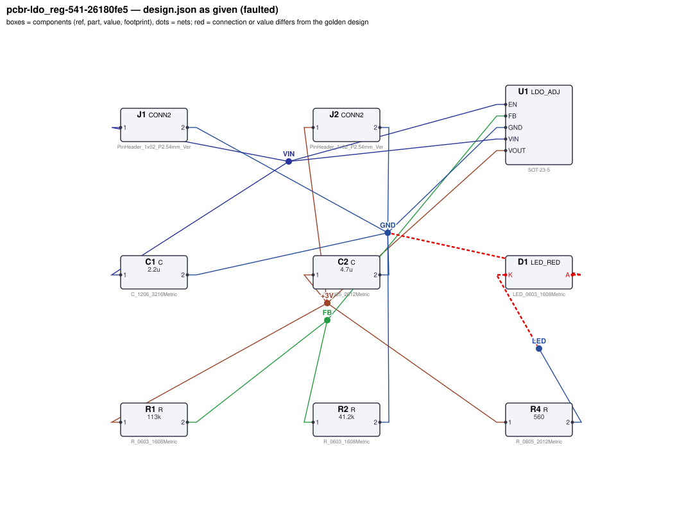
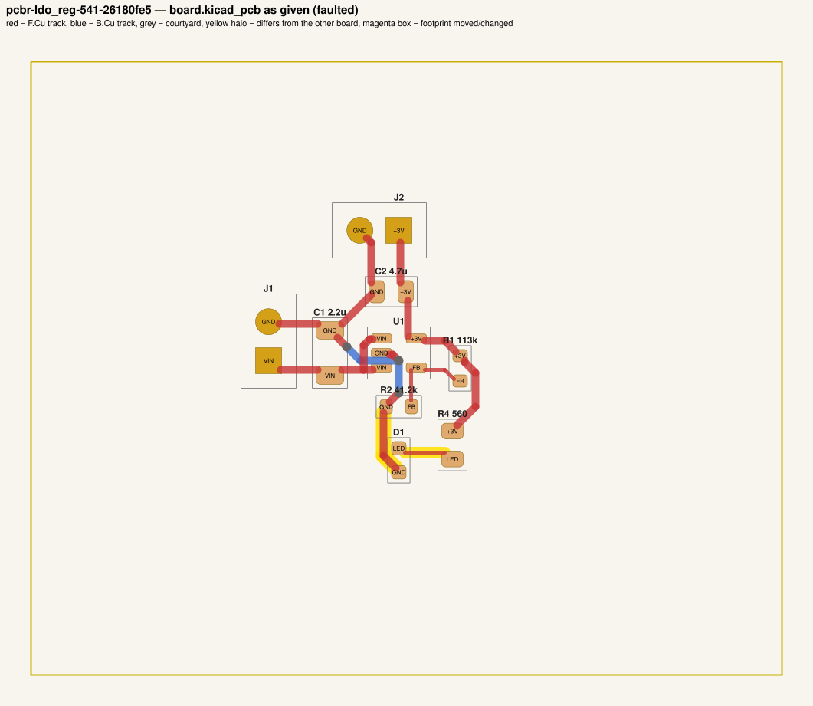
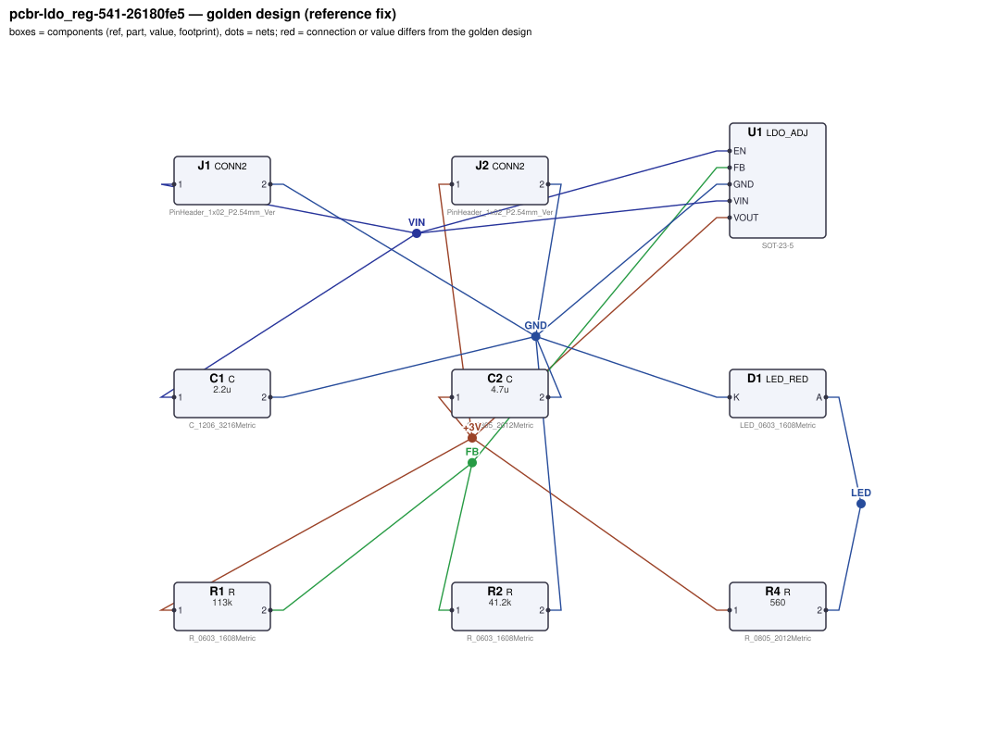
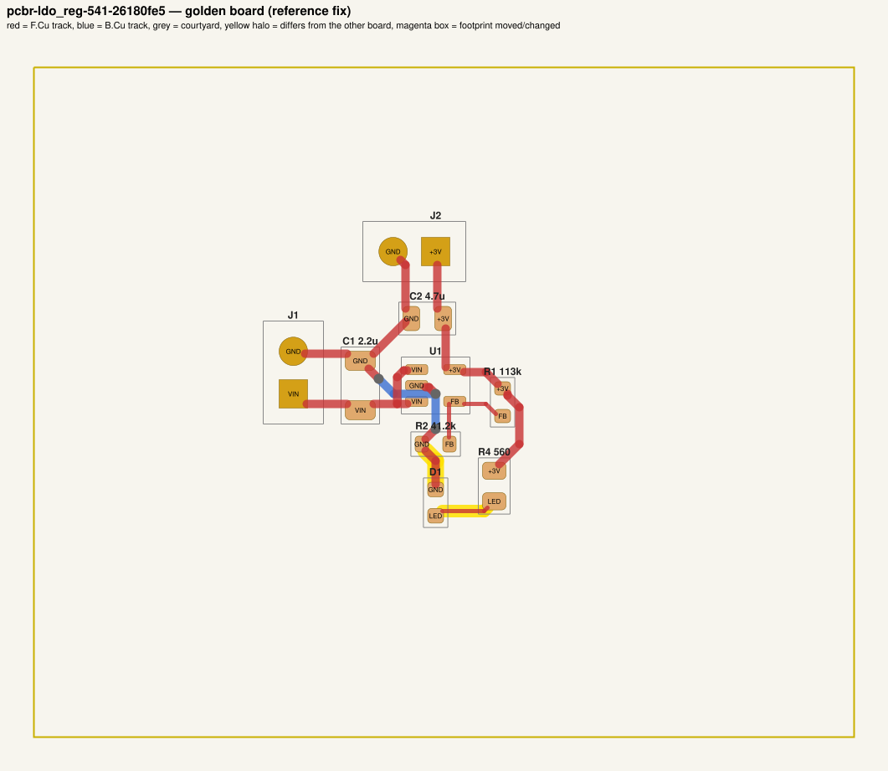

# QA packet 19: `pcbr-ldo_reg-541-26180fe5`

| family | seed | hint level | intent in TASK.md | faults | predicted difficulty |
|---|---|---|---|---|---|
| ldo_reg | 541 | symptom | reduced | 1 | medium |

Task files: [`../../../tasks/train/pcbr-ldo_reg-541-26180fe5/public/`](../../../tasks/train/pcbr-ldo_reg-541-26180fe5/public/) (what the agent gets) and [`../../../tasks/train/pcbr-ldo_reg-541-26180fe5/hidden/`](../../../tasks/train/pcbr-ldo_reg-541-26180fe5/hidden/) (grader only). Why sampled: connectivity fault.

**How to review (≈5 min):** read section 1 as if you were the agent, decide whether you could find and fix the problems from it; then check section 2 (faults, reference fix, verifier verdicts) and fill `review.yaml`. Do not let section 2 influence your fairness judgement of section 1.

## 1. What the agent sees

### 1.1 TASK.md (verbatim)

````markdown
# Task: 3 V LDO regulator

## Problem report

The first boards built from these files fail bring-up. Observations so far:

- LED D1 never lights (`indicator_current`: 2.995e-13 A; expected 1.669 mA to 2.257 mA).

Fix every problem (there may be more than the observations show directly).

## Design intent

# 3 V LDO regulator

Converts a 5 V input (J1: pin 1 = +5 V, pin 2 = GND) into a regulated 3 V rail
(J2: pin 1 = +3 V, pin 2 = GND) able to deliver 150 mA.

Spec: output 3 V ±3 % at 150 mA load, for input voltages from 3.6 V up to 5 V.
Supply and ground traces carrying the load current must be at least 0.5 mm wide.
Component values: C1 and C2 are 1 µF–22 µF ceramics (datasheet: ≥ 1 µF);
feedback divider Rbot (R2) 3.3 kΩ–150 kΩ (datasheet: 10k–50k typical) with R1 scaled to match.

_Connection details are intentionally not repeated here: wire each part as its datasheet in `parts/` describes (pinout and application notes), so that the circuit does what the purpose, interfaces and spec above require._

## Spec

The design must satisfy these assertions (`pcbtool sim` runs them; full definitions in `spec.json`):

- `vout_loaded`: DC voltage at J2.1 between 2.91 V and 3.09 V (J1.1 supplied with 5.0 V; load R=20 from J2.1 to ground; ground = J1.2)
- `vout_low_vin`: DC voltage at J2.1 between 2.91 V and 3.09 V (J1.1 supplied with 3.6 V; load R=20 from J2.1 to ground; ground = J1.2)
- `load_current`: DC current through J2.1 between 142.5 mA and 157.5 mA (J1.1 supplied with 5.0 V; load R=20 from J2.1 to ground; ground = J1.2)
- `indicator_current`: DC current through D1 between 1.669 mA and 2.257 mA (J1.1 supplied with 5.0 V; load R=20 from J2.1 to ground; ground = J1.2)

Layout: every track of these nets must be at least the given width:

- +3V (the net of J2.1): ≥ 0.5 mm
- GND (the net of J1.2): ≥ 0.5 mm
- VIN (the net of J1.1): ≥ 0.5 mm

Decoupling: every pad of each capacitor within the given distance of the IC pin's pad:

- C1 within 5.0 mm of U1.VIN
- C2 within 5.0 mm of U1.VOUT

Component values: each value must lie in its acceptable range (inclusive; `value_bounds` in `spec.json`). Ranges come from the datasheets and the design intent; values the assertions already pin down get a wide sanity range, and the assertions still apply:

- C1 (C): 1 uF … 22 uF
- C2 (C): 1 uF … 22 uF
- R1 (R): 9.1 kΩ … 410 kΩ
- R2 (R): 3.3 kΩ … 150 kΩ
- R4 (R): 150 Ω … 2.2 kΩ

Board rules: 2 copper layers, clearance 0.2 mm, min track 0.2 mm, vias 0.6/0.3 mm, copper-to-edge 0.3 mm. DRC must be clean with no unconnected items.

## Deliverable

- Edit only `design.json` (the schematic of record) and `board.kicad_pcb` (the layout).
- Do not add, remove or rename components; keep each component's part.
- Keep the two files consistent: same connectivity, values and footprints on both.
- Do not change the board outline, add zones, or add DRC exclusions.
- Footprints must be unmodified library footprints from the part's allowed list (see `parts/<PART>.md`).
- Grading is pass/fail: topology, consistency, DRC, ERC, spec, component values and layout must all pass.

## Tools

Run `pcbtool <command>` inside this directory (you may also edit the two files directly).

Read-only:
- `pcbtool show` — components, values, footprints, positions and nets
- `pcbtool netlist` — design nets vs. board pad nets, with differences highlighted
- `pcbtool drc` — KiCad DRC under the canonical rules (the same rules the grader uses)
- `pcbtool erc` — electrical rule check of design.json
- `pcbtool sim` — run the spec assertions (spec.json) on design.json
- `pcbtool parts [PART]` — list parts / print a part's datasheet (also in `parts/`)
- `pcbtool check` — all of the above in one summary

Mutating (each keeps design.json and board.kicad_pcb consistent and saves both):
- `pcbtool set-value REF VALUE`
- `pcbtool set-footprint REF LIB:FOOTPRINT`
- `pcbtool connect REF.PIN NET` / `pcbtool disconnect REF.PIN`
- `pcbtool move REF X Y ROT` (absolute mm, degrees; tracks do not follow)
- `pcbtool unroute NET` / `pcbtool route NET [--width W]` (re-routes the whole net)
- `pcbtool sync` — push design.json connectivity and values onto the board pads
````

### 1.2 Public files

The agent also gets `design.json`, `board.kicad_pcb`, `spec.json` and the part datasheets below, plus the `pcbtool` commands listed in TASK.md (DRC, ERC, simulation of the public assertions, value-range check). Renders of the faulted files:





<details><summary>Datasheet <code>parts/C.md</code></summary>

````markdown
# C — ceramic capacitor

Two-terminal non-polarised capacitor. Pins `1`, `2`. Value in farads.
````

</details>

<details><summary>Datasheet <code>parts/CONN2.md</code></summary>

````markdown
# CONN2 — 2-pin header

Pin `1` = signal/supply, pin `2` = ground by board convention.
````

</details>

<details><summary>Datasheet <code>parts/LDO_ADJ.md</code></summary>

````markdown
# LDO_ADJ — adjustable 300 mA low-dropout regulator (SOT-23-5)

## Pinout
| Pin | Pad | Function |
|---|---|---|
| VIN | 1 | input supply, 2.5–16 V |
| GND | 2 | ground |
| EN | 3 | enable, active high. Internal 2 MΩ pull-down: floating = OFF |
| FB | 4 | feedback; regulates to VREF = 0.800 V |
| VOUT | 5 | regulated output |

## Electrical characteristics
- VREF = 0.800 V ±1 %
- Output current 300 mA max; current limit ~500 mA
- Dropout 250 mV typ at 300 mA
- EN threshold 1.2 V (high = on); EN low or floating -> output off (0 V)
- Quiescent current 50 µA; package dissipation max 0.5 W

## Application notes
- Output voltage is set by a divider from VOUT to FB (Rtop) and FB to GND (Rbot):
  **VOUT = VREF × (1 + Rtop / Rbot)**. Rbot of 10k–50k is typical.
- Connect EN to VIN for always-on operation (or drive it from logic / a pull-up).
- Place a ≥1 µF ceramic input capacitor and a ≥1 µF ceramic output capacitor within
  5 mm of the VIN and VOUT pins respectively, returned to GND.
- Power dissipation = (VIN - VOUT) × IOUT must stay below 0.5 W.
````

</details>

<details><summary>Datasheet <code>parts/LED_RED.md</code></summary>

````markdown
# LED_RED — red SMD indicator LED (625 nm)

## Pinout
| Pin | Pad | Function |
|---|---|---|
| A | 2 | anode |
| K | 1 | cathode (marked) |

## Electrical characteristics (25 C)
- Forward voltage Vf = 2.0 V typ at IF = 10 mA
- Max continuous forward current 25 mA; reverse voltage max 5 V

| IF | Vf (typ) |
|---|---|
| 2 mA | 1.90 V |
| 5 mA | 1.95 V |
| 10 mA | 2.00 V |
| 15 mA | 2.03 V |
| 20 mA | 2.06 V |

## Application notes
- Always drive through a current-limiting resistor: R = (Vsupply - n*Vf) / IF for n LEDs in series.
- Current flows anode -> cathode; reversed LEDs do not light.
````

</details>

<details><summary>Datasheet <code>parts/R.md</code></summary>

````markdown
# R — resistor

Two-terminal resistor. Pins `1`, `2` (non-polarised). Value in ohms.
````

</details>

## 2. Reviewer-only (hidden from the agent)

### 2.1 Injected faults

| # | type | category | DRC/ERC-invisible | detail | verifier, this fault alone |
|---|---|---|---|---|---|
| 1 | `reversed_polarity` | connectivity | yes | D1 anode/cathode reversed | reward 0.0; fails layout, spec, topology |

### 2.2 Reference fix (faulted → golden)

The reference repair is the hidden golden pair (`golden_design.json`, `golden_board.kicad_pcb`). Any repair that passes every gate and check scores 1.0; it need not be byte-identical.

**design.json: component changes**

- none

**design.json: connection changes** (per pin: what it connects to)

- `D1.A`: faulted net `GND` (C1.2, C2.2, J1.2, J2.2, R2.2, U1.GND) → golden net `LED` (R4.2)
- `D1.K`: faulted net `LED` (R4.2) → golden net `GND` (C1.2, C2.2, J1.2, J2.2, R2.2, U1.GND)

**board.kicad_pcb: footprints moved / changed**

- none

**board.kicad_pcb: footprint values (BOM)**

- none

**board.kicad_pcb: pad-net changes**

- `D1` pad 1: net `LED` → `GND`
- `D1` pad 2: net `GND` → `LED`

**board.kicad_pcb: nets re-routed** (track/via geometry differs)

- net `GND`: 2 track/via item(s) removed, 2 added
- net `LED`: 1 track/via item(s) removed, 2 added

Golden renders (compare with 1.2; highlighted items differ):





### 2.3 Verifier verdicts

Reward is 1 only if every gate and check passes.

| stage | kind | faulted files | golden files |
|---|---|---|---|
| parse | gate | pass | pass |
| components | gate | pass | pass |
| topology | gate | **FAIL** | pass |
| consistency | gate | pass | pass |
| integrity | gate | pass | pass |
| drc | check | pass | pass |
| erc | check | pass | pass |
| spec | check | **FAIL** | pass |
| values | check | pass | pass |
| layout | check | **FAIL** | pass |
| **reward** | | **0** | **1** |

Verifier messages on the faulted files:

- **layout**: power_net_missing: no board net has the pins of golden net GND
- **spec**: indicator_current: measured 2.9945747381e-13 expected [0.00166851, 0.0022574]
- **topology**: nets only in candidate: [['C1.2', 'C2.2', 'D1.A', 'J1.2', 'J2.2', 'R2.2', 'U1.GND'], ['D1.K', 'R4.2']]; nets only in reference: [['C1.2', 'C2.2', 'D1.K', 'J1.2', 'J2.2', 'R2.2', 'U1.GND'], ['D1.A', 'R4.2']]

### 2.4 Spec assertions before / after

| assertion | what | allowed | faulted: measured | | golden: measured | |
|---|---|---|---|---|---|---|
| `vout_loaded` | DC voltage at J2.1 (J1.1 supplied with 5.0 V; load R=20 from J2.1 to ground; ground = J1.2) | 2.91 V … 3.09 V | 2.995 V | ✅ | 2.995 V | ✅ |
| `vout_low_vin` | DC voltage at J2.1 (J1.1 supplied with 3.6 V; load R=20 from J2.1 to ground; ground = J1.2) | 2.91 V … 3.09 V | 2.995 V | ✅ | 2.995 V | ✅ |
| `load_current` | DC current through J2.1 (J1.1 supplied with 5.0 V; load R=20 from J2.1 to ground; ground = J1.2) | 142.5 mA … 157.5 mA | 149.7 mA | ✅ | 149.7 mA | ✅ |
| `indicator_current` | DC current through D1 (J1.1 supplied with 5.0 V; load R=20 from J2.1 to ground; ground = J1.2) | 1.669 mA … 2.257 mA | 2.995e-13 A | ❌ | 1.955 mA | ✅ |

### 2.5 Value bounds

Bounds are public (TASK.md / spec.json); `values` check = every value inside its range.

| ref | part | acceptable range | faulted design.json | faulted board | golden | touched by a fault |
|---|---|---|---|---|---|---|
| `C1` | C | 1 uF … 22 uF | `2.2u` | `2.2u` | `2.2u` |  |
| `C2` | C | 1 uF … 22 uF | `4.7u` | `4.7u` | `4.7u` |  |
| `R1` | R | 9.1 kΩ … 410 kΩ | `113k` | `113k` | `113k` |  |
| `R2` | R | 3.3 kΩ … 150 kΩ | `41.2k` | `41.2k` | `41.2k` |  |
| `R4` | R | 150 Ω … 2.2 kΩ | `560` | `560` | `560` |  |

### 2.6 Layout rules

- power net `+3V` (golden pins C2.1, J2.1, R1.1, R4.1, U1.VOUT): every track ≥ 0.5 mm
- power net `GND` (golden pins C1.2, C2.2, D1.K, J1.2, J2.2, R2.2, U1.GND): every track ≥ 0.5 mm
- power net `VIN` (golden pins C1.1, J1.1, U1.EN, U1.VIN): every track ≥ 0.5 mm
- decoupling: `C1` within 5.0 mm of `U1.VIN`
- decoupling: `C2` within 5.0 mm of `U1.VOUT`

## 3. Review

Fill `review.yaml` in this directory (second reviewer: copy `../../review_template.yaml` to `review-<initials>.yaml` here, without looking at the first form). Questions to answer:

1. **task_fair / solvable_from_public_material**: from section 1 only, can a competent engineer locate and fix every injected fault? Is anything required that is not stated (a value with no assertion and no published range, a connection only the golden reveals)?
2. **reference_fix_correct**: is the golden (2.2) a correct design that meets the stated intent?
3. **verifier_verdict_agrees**: do you agree the faulted files fail and the golden passes, for the reasons given in 2.3?
4. **alternative_valid_fixes_rejected**: is there an engineering-valid repair the grader would reject (e.g. a different E-series value that meets intent but fails an assertion window or value bound; keeping a swapped footprint and re-routing; a different valid placement)?

