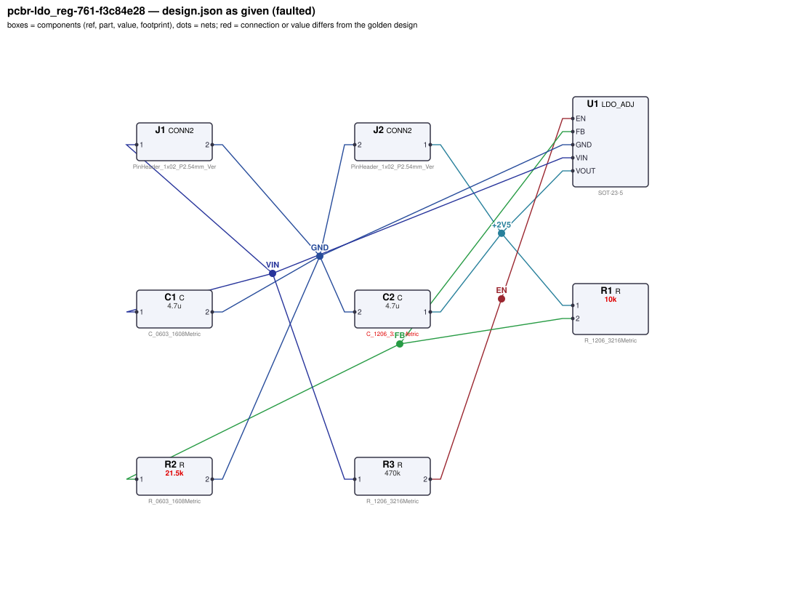
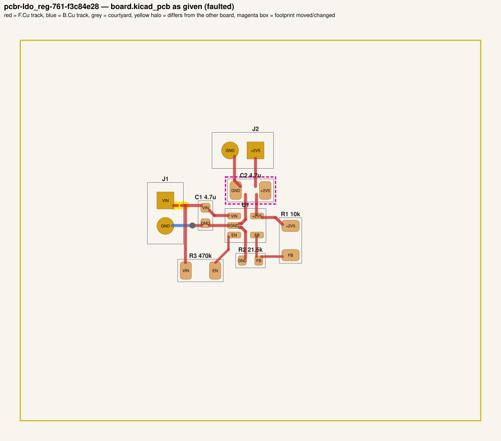
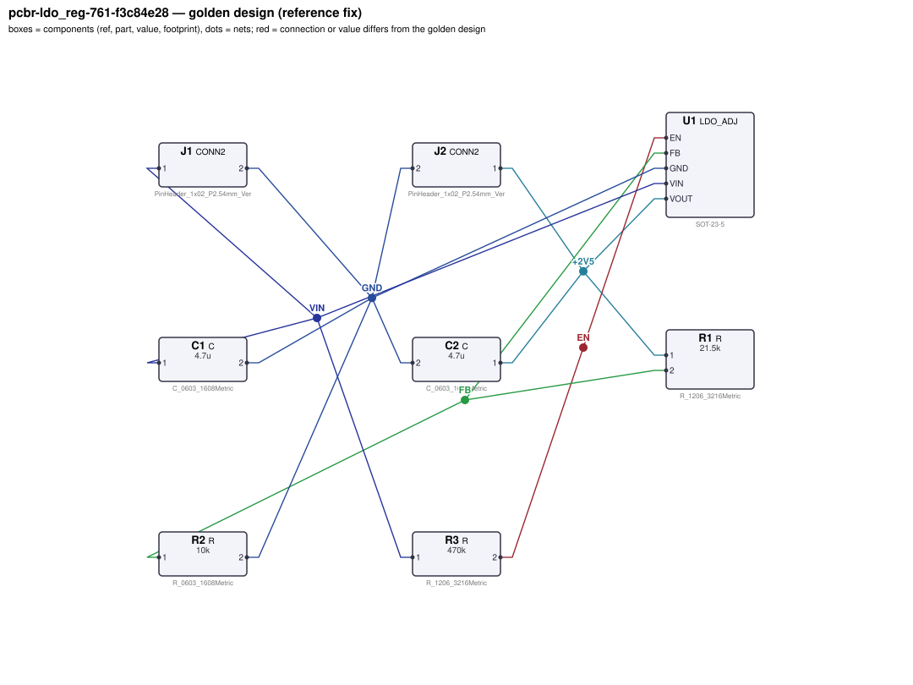
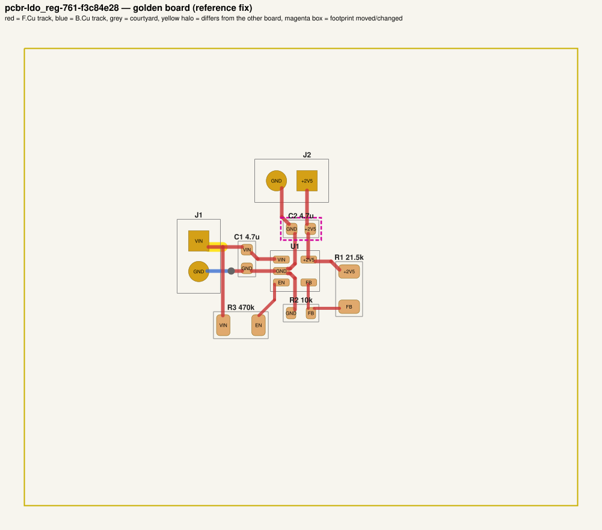

# QA packet 20: `pcbr-ldo_reg-761-f3c84e28`

| family | seed | hint level | intent in TASK.md | faults | predicted difficulty |
|---|---|---|---|---|---|
| ldo_reg | 761 | explicit | full | 3 | medium |

Task files: [`../../../tasks/train/pcbr-ldo_reg-761-f3c84e28/public/`](../../../tasks/train/pcbr-ldo_reg-761-f3c84e28/public/) (what the agent gets) and [`../../../tasks/train/pcbr-ldo_reg-761-f3c84e28/hidden/`](../../../tasks/train/pcbr-ldo_reg-761-f3c84e28/hidden/) (grader only). Why sampled: 3 faults, disputable type footprint_swap, value near bounds: R1=10k inside [7000, 320000].

**How to review (≈5 min):** read section 1 as if you were the agent, decide whether you could find and fix the problems from it; then check section 2 (faults, reference fix, verifier verdicts) and fill `review.yaml`. Do not let section 2 influence your fairness judgement of section 1.

## 1. What the agent sees

### 1.1 TASK.md (verbatim)

````markdown
# Task: 2.5 V LDO regulator

## Problem report

The first boards built from these files fail bring-up. Observations so far:

- Bench: J2.1 reads 1.173 V, expected 2.425 V to 2.575 V (`vout_loaded`).
- Bench: J2.1 reads 1.173 V, expected 2.425 V to 2.575 V (`vout_low_vin`).
- Bench: current through J2.1 is 9.383 mA, expected 19 mA to 21 mA (`load_current`).
- The fab's DRC run reports 4 unconnected item(s).

A reviewer narrowed the failure down to these areas (each needs a fix):

- the values of R1 and R2
- the routing of net VIN
- the footprint of C2 and its tracks

Fix every problem (there may be more than the observations show directly).

## Design intent

# 2.5 V LDO regulator

Converts a 12 V input (J1: pin 1 = +12 V, pin 2 = GND) into a regulated 2.5 V rail
(J2: pin 1 = +2.5 V, pin 2 = GND) able to deliver 20 mA.

- U1 (LDO_ADJ) takes its input on VIN with C1 as the input capacitor from VIN to GND, placed at the pin.
- C2 is the output capacitor from VOUT to GND, placed at the VOUT pin.
- The output voltage is programmed by a divider: R1 from VOUT down to the FB pin, R2 from FB to GND
  (VOUT = 0.8 V x (1 + R1/R2)).
- EN is pulled up to VIN through R3 so the regulator is on whenever input power is present.


Spec: output 2.5 V ±3 % at 20 mA load, for input voltages from 3.1 V up to 12 V.
Supply and ground traces carrying the load current must be at least 0.3 mm wide.
Component values: C1 and C2 are 1 µF–22 µF ceramics (datasheet: ≥ 1 µF); the EN pull-up R3 is 1 kΩ–1 MΩ;
feedback divider Rbot (R2) 3.3 kΩ–150 kΩ (datasheet: 10k–50k typical) with R1 scaled to match.

## Spec

The design must satisfy these assertions (`pcbtool sim` runs them; full definitions in `spec.json`):

- `vout_loaded`: DC voltage at J2.1 between 2.425 V and 2.575 V (J1.1 supplied with 12.0 V; load R=125 from J2.1 to ground; ground = J1.2)
- `vout_low_vin`: DC voltage at J2.1 between 2.425 V and 2.575 V (J1.1 supplied with 3.1 V; load R=125 from J2.1 to ground; ground = J1.2)
- `load_current`: DC current through J2.1 between 19 mA and 21 mA (J1.1 supplied with 12.0 V; load R=125 from J2.1 to ground; ground = J1.2)

Layout: every track of these nets must be at least the given width:

- +2V5 (the net of J2.1): ≥ 0.3 mm
- GND (the net of J1.2): ≥ 0.3 mm
- VIN (the net of J1.1): ≥ 0.3 mm

Decoupling: every pad of each capacitor within the given distance of the IC pin's pad:

- C1 within 5.0 mm of U1.VIN
- C2 within 5.0 mm of U1.VOUT

Component values: each value must lie in its acceptable range (inclusive; `value_bounds` in `spec.json`). Ranges come from the datasheets and the design intent; values the assertions already pin down get a wide sanity range, and the assertions still apply:

- C1 (C): 1 uF … 22 uF
- C2 (C): 1 uF … 22 uF
- R1 (R): 7 kΩ … 320 kΩ
- R2 (R): 3.3 kΩ … 150 kΩ
- R3 (R): 1 kΩ … 1 MΩ

Board rules: 2 copper layers, clearance 0.2 mm, min track 0.2 mm, vias 0.6/0.3 mm, copper-to-edge 0.3 mm. DRC must be clean with no unconnected items.

## Deliverable

- Edit only `design.json` (the schematic of record) and `board.kicad_pcb` (the layout).
- Do not add, remove or rename components; keep each component's part.
- Keep the two files consistent: same connectivity, values and footprints on both.
- Do not change the board outline, add zones, or add DRC exclusions.
- Footprints must be unmodified library footprints from the part's allowed list (see `parts/<PART>.md`).
- Grading is pass/fail: topology, consistency, DRC, ERC, spec, component values and layout must all pass.

## Tools

Run `pcbtool <command>` inside this directory (you may also edit the two files directly).

Read-only:
- `pcbtool show` — components, values, footprints, positions and nets
- `pcbtool netlist` — design nets vs. board pad nets, with differences highlighted
- `pcbtool drc` — KiCad DRC under the canonical rules (the same rules the grader uses)
- `pcbtool erc` — electrical rule check of design.json
- `pcbtool sim` — run the spec assertions (spec.json) on design.json
- `pcbtool parts [PART]` — list parts / print a part's datasheet (also in `parts/`)
- `pcbtool check` — all of the above in one summary

Mutating (each keeps design.json and board.kicad_pcb consistent and saves both):
- `pcbtool set-value REF VALUE`
- `pcbtool set-footprint REF LIB:FOOTPRINT`
- `pcbtool connect REF.PIN NET` / `pcbtool disconnect REF.PIN`
- `pcbtool move REF X Y ROT` (absolute mm, degrees; tracks do not follow)
- `pcbtool unroute NET` / `pcbtool route NET [--width W]` (re-routes the whole net)
- `pcbtool sync` — push design.json connectivity and values onto the board pads
````

### 1.2 Public files

The agent also gets `design.json`, `board.kicad_pcb`, `spec.json` and the part datasheets below, plus the `pcbtool` commands listed in TASK.md (DRC, ERC, simulation of the public assertions, value-range check). Renders of the faulted files:





<details><summary>Datasheet <code>parts/C.md</code></summary>

````markdown
# C — ceramic capacitor

Two-terminal non-polarised capacitor. Pins `1`, `2`. Value in farads.
````

</details>

<details><summary>Datasheet <code>parts/CONN2.md</code></summary>

````markdown
# CONN2 — 2-pin header

Pin `1` = signal/supply, pin `2` = ground by board convention.
````

</details>

<details><summary>Datasheet <code>parts/LDO_ADJ.md</code></summary>

````markdown
# LDO_ADJ — adjustable 300 mA low-dropout regulator (SOT-23-5)

## Pinout
| Pin | Pad | Function |
|---|---|---|
| VIN | 1 | input supply, 2.5–16 V |
| GND | 2 | ground |
| EN | 3 | enable, active high. Internal 2 MΩ pull-down: floating = OFF |
| FB | 4 | feedback; regulates to VREF = 0.800 V |
| VOUT | 5 | regulated output |

## Electrical characteristics
- VREF = 0.800 V ±1 %
- Output current 300 mA max; current limit ~500 mA
- Dropout 250 mV typ at 300 mA
- EN threshold 1.2 V (high = on); EN low or floating -> output off (0 V)
- Quiescent current 50 µA; package dissipation max 0.5 W

## Application notes
- Output voltage is set by a divider from VOUT to FB (Rtop) and FB to GND (Rbot):
  **VOUT = VREF × (1 + Rtop / Rbot)**. Rbot of 10k–50k is typical.
- Connect EN to VIN for always-on operation (or drive it from logic / a pull-up).
- Place a ≥1 µF ceramic input capacitor and a ≥1 µF ceramic output capacitor within
  5 mm of the VIN and VOUT pins respectively, returned to GND.
- Power dissipation = (VIN - VOUT) × IOUT must stay below 0.5 W.
````

</details>

<details><summary>Datasheet <code>parts/R.md</code></summary>

````markdown
# R — resistor

Two-terminal resistor. Pins `1`, `2` (non-polarised). Value in ohms.
````

</details>

## 2. Reviewer-only (hidden from the agent)

### 2.1 Injected faults

| # | type | category | DRC/ERC-invisible | detail | verifier, this fault alone |
|---|---|---|---|---|---|
| 1 | `wrong_feedback_resistor` | value | yes | R1 and R2 values swapped (R1=10k, R2=21.5k) | reward 0.0; fails spec |
| 2 | `broken_trace` | board | no | track of net VIN on F.Cu cut near (115.90, 116.50) | reward 0.0; fails drc |
| 3 | `footprint_swap` | board | no | C2 footprint changed to Capacitor_SMD:C_1206_3216Metric (was Capacitor_SMD:C_0603_1608Metric); tracks no longer fit | reward 0.0; fails drc |

### 2.2 Reference fix (faulted → golden)

The reference repair is the hidden golden pair (`golden_design.json`, `golden_board.kicad_pcb`). Any repair that passes every gate and check scores 1.0; it need not be byte-identical.

**design.json: component changes**

- `C2` footprint: `Capacitor_SMD:C_1206_3216Metric` → `Capacitor_SMD:C_0603_1608Metric`
- `R1` value: `10k` → `21.5k`
- `R2` value: `21.5k` → `10k`

**design.json: connection changes** (per pin: what it connects to)

- none

**board.kicad_pcb: footprints moved / changed**

- `C2` footprint `Capacitor_SMD:C_1206_3216Metric` → `Capacitor_SMD:C_0603_1608Metric`

**board.kicad_pcb: footprint values (BOM)**

- `R1` board value `10k` → `21.5k`
- `R2` board value `21.5k` → `10k`

**board.kicad_pcb: pad-net changes**

- none

**board.kicad_pcb: nets re-routed** (track/via geometry differs)

- net `VIN`: 2 track/via item(s) removed, 1 added

Golden renders (compare with 1.2; highlighted items differ):





### 2.3 Verifier verdicts

Reward is 1 only if every gate and check passes.

| stage | kind | faulted files | golden files |
|---|---|---|---|
| parse | gate | pass | pass |
| components | gate | pass | pass |
| topology | gate | pass | pass |
| consistency | gate | pass | pass |
| integrity | gate | pass | pass |
| drc | check | **FAIL** | pass |
| erc | check | pass | pass |
| spec | check | **FAIL** | pass |
| values | check | pass | pass |
| layout | check | pass | pass |
| **reward** | | **0** | **1** |

Verifier messages on the faulted files:

- **drc**: 4 unconnected items
- **spec**: vout_loaded: measured 1.172816918 expected [2.425, 2.575]
- **spec**: vout_low_vin: measured 1.172816918 expected [2.425, 2.575]
- **spec**: load_current: measured 0.0093825353454 expected [0.019, 0.021]

### 2.4 Spec assertions before / after

| assertion | what | allowed | faulted: measured | | golden: measured | |
|---|---|---|---|---|---|---|
| `vout_loaded` | DC voltage at J2.1 (J1.1 supplied with 12.0 V; load R=125 from J2.1 to ground; ground = J1.2) | 2.425 V … 2.575 V | 1.173 V | ❌ | 2.521 V | ✅ |
| `vout_low_vin` | DC voltage at J2.1 (J1.1 supplied with 3.1 V; load R=125 from J2.1 to ground; ground = J1.2) | 2.425 V … 2.575 V | 1.173 V | ❌ | 2.521 V | ✅ |
| `load_current` | DC current through J2.1 (J1.1 supplied with 12.0 V; load R=125 from J2.1 to ground; ground = J1.2) | 19 mA … 21 mA | 9.383 mA | ❌ | 20.17 mA | ✅ |

### 2.5 Value bounds

Bounds are public (TASK.md / spec.json); `values` check = every value inside its range.

| ref | part | acceptable range | faulted design.json | faulted board | golden | touched by a fault |
|---|---|---|---|---|---|---|
| `C1` | C | 1 uF … 22 uF | `4.7u` | `4.7u` | `4.7u` |  |
| `C2` | C | 1 uF … 22 uF | `4.7u` | `4.7u` | `4.7u` | **yes** |
| `R1` | R | 7 kΩ … 320 kΩ | `10k` | `10k` | `21.5k` | **yes** |
| `R2` | R | 3.3 kΩ … 150 kΩ | `21.5k` | `21.5k` | `10k` | **yes** |
| `R3` | R | 1 kΩ … 1 MΩ | `470k` | `470k` | `470k` |  |

### 2.6 Layout rules

- power net `+2V5` (golden pins C2.1, J2.1, R1.1, U1.VOUT): every track ≥ 0.3 mm
- power net `GND` (golden pins C1.2, C2.2, J1.2, J2.2, R2.2, U1.GND): every track ≥ 0.3 mm
- power net `VIN` (golden pins C1.1, J1.1, R3.1, U1.VIN): every track ≥ 0.3 mm
- decoupling: `C1` within 5.0 mm of `U1.VIN`
- decoupling: `C2` within 5.0 mm of `U1.VOUT`

## 3. Review

Fill `review.yaml` in this directory (second reviewer: copy `../../review_template.yaml` to `review-<initials>.yaml` here, without looking at the first form). Questions to answer:

1. **task_fair / solvable_from_public_material**: from section 1 only, can a competent engineer locate and fix every injected fault? Is anything required that is not stated (a value with no assertion and no published range, a connection only the golden reveals)?
2. **reference_fix_correct**: is the golden (2.2) a correct design that meets the stated intent?
3. **verifier_verdict_agrees**: do you agree the faulted files fail and the golden passes, for the reasons given in 2.3?
4. **alternative_valid_fixes_rejected**: is there an engineering-valid repair the grader would reject (e.g. a different E-series value that meets intent but fails an assertion window or value bound; keeping a swapped footprint and re-routing; a different valid placement)?

