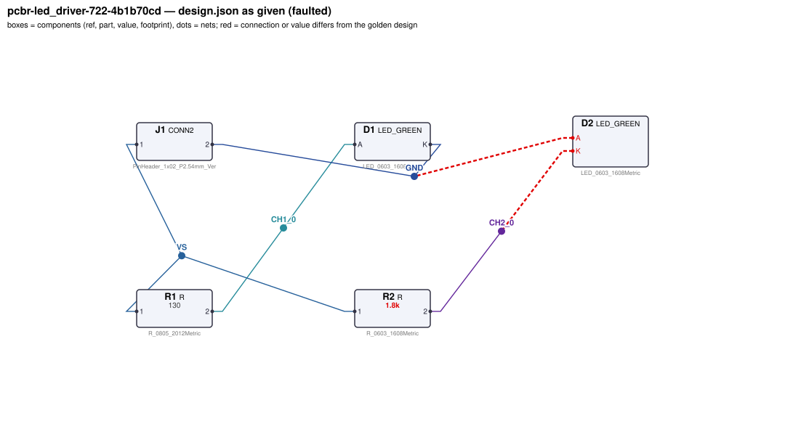
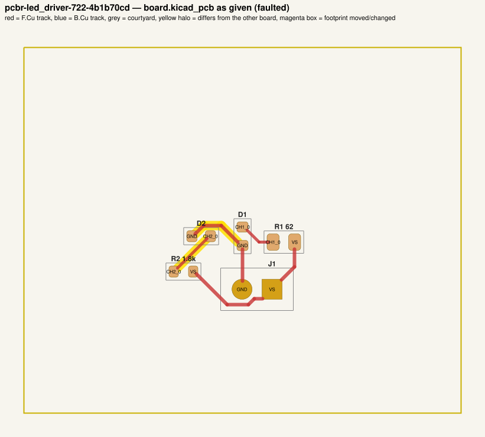
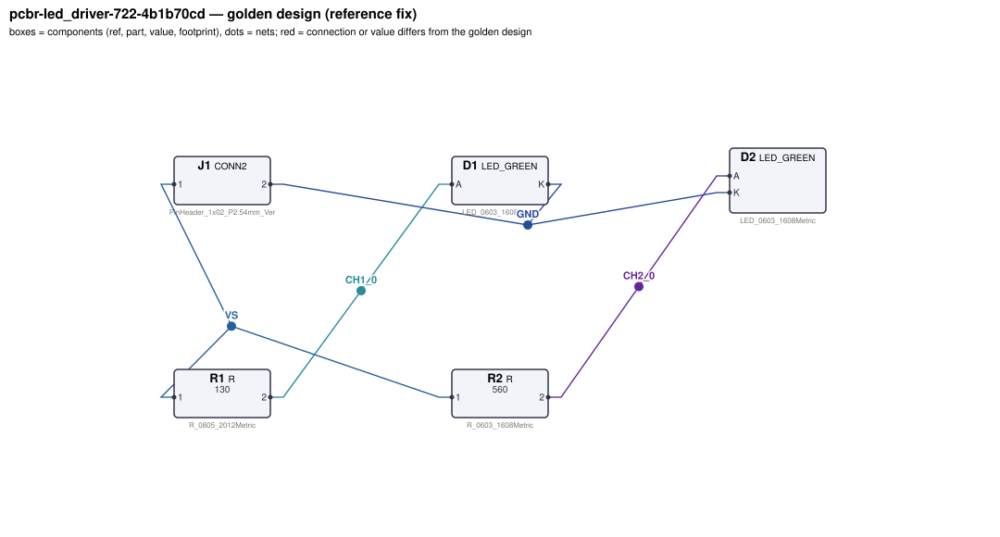
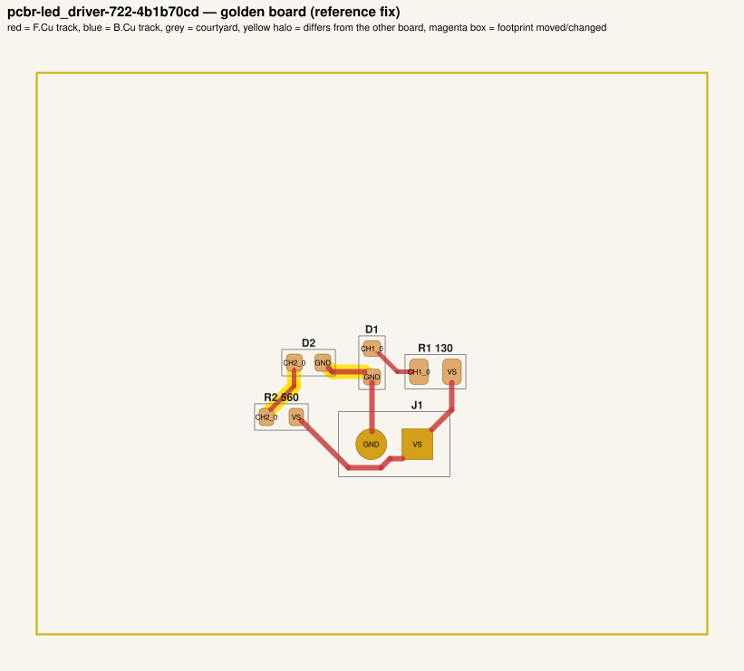

# QA packet 27: `pcbr-led_driver-722-4b1b70cd`

| family | seed | hint level | intent in TASK.md | faults | predicted difficulty |
|---|---|---|---|---|---|
| led_driver | 722 | vague | reduced | 3 | hard |

Task files: [`../../../tasks/train/pcbr-led_driver-722-4b1b70cd/public/`](../../../tasks/train/pcbr-led_driver-722-4b1b70cd/public/) (what the agent gets) and [`../../../tasks/train/pcbr-led_driver-722-4b1b70cd/hidden/`](../../../tasks/train/pcbr-led_driver-722-4b1b70cd/hidden/) (grader only). Why sampled: 3 faults, vague hint, connectivity fault, disputable type bom_mismatch, value near bounds: R2=1.8k near [150, 1400]; R1=62 inside [39, 500].

**How to review (≈5 min):** read section 1 as if you were the agent, decide whether you could find and fix the problems from it; then check section 2 (faults, reference fix, verifier verdicts) and fill `review.yaml`. Do not let section 2 influence your fairness judgement of section 1.

## 1. What the agent sees

### 1.1 TASK.md (verbatim)

````markdown
# Task: 2-channel LED indicator board

## Problem report

The first boards built from these files fail bring-up. Find and fix all problems: the design must meet its purpose and spec, the layout must match design.json, and DRC/ERC must be clean.

## Design intent

# 2-channel LED indicator board

Lights 2 indicator LEDs from a 5 V supply on J1
(pin 1 = +5 V, pin 2 = GND). Each channel is a series string of LEDs fed through its own
current-limiting resistor; the resistor sets the current from (Vs - n*Vf)/R.

Spec: each channel's LED current within ±10 % of its target. Resistors dissipating more than
~60 mW use a 1206 footprint.

_Connection details are intentionally not repeated here: wire each part as its datasheet in `parts/` describes (pinout and application notes), so that the circuit does what the purpose, interfaces and spec above require._

## Spec

The design must satisfy these assertions (`pcbtool sim` runs them; full definitions in `spec.json`):

- `string1_current`: DC current through D1 between 18 mA and 22 mA (J1.1 supplied with 5.0 V; ground = J1.2)
- `string2_current`: DC current through D2 between 4.5 mA and 5.5 mA (J1.1 supplied with 5.0 V; ground = J1.2)

Layout: every track of these nets must be at least the given width:

- GND (the net of J1.2): ≥ 0.3 mm
- VS (the net of J1.1): ≥ 0.3 mm

Component values: each value must lie in its acceptable range (inclusive; `value_bounds` in `spec.json`). Ranges come from the datasheets and the design intent; values the assertions already pin down get a wide sanity range, and the assertions still apply:

- R1 (R): 39 Ω … 500 Ω
- R2 (R): 150 Ω … 1.4 kΩ

Board rules: 2 copper layers, clearance 0.2 mm, min track 0.2 mm, vias 0.6/0.3 mm, copper-to-edge 0.3 mm. DRC must be clean with no unconnected items.

## Deliverable

- Edit only `design.json` (the schematic of record) and `board.kicad_pcb` (the layout).
- Do not add, remove or rename components; keep each component's part.
- Keep the two files consistent: same connectivity, values and footprints on both.
- Do not change the board outline, add zones, or add DRC exclusions.
- Footprints must be unmodified library footprints from the part's allowed list (see `parts/<PART>.md`).
- Grading is pass/fail: topology, consistency, DRC, ERC, spec, component values and layout must all pass.

## Tools

Run `pcbtool <command>` inside this directory (you may also edit the two files directly).

Read-only:
- `pcbtool show` — components, values, footprints, positions and nets
- `pcbtool netlist` — design nets vs. board pad nets, with differences highlighted
- `pcbtool drc` — KiCad DRC under the canonical rules (the same rules the grader uses)
- `pcbtool erc` — electrical rule check of design.json
- `pcbtool sim` — run the spec assertions (spec.json) on design.json
- `pcbtool parts [PART]` — list parts / print a part's datasheet (also in `parts/`)
- `pcbtool check` — all of the above in one summary

Mutating (each keeps design.json and board.kicad_pcb consistent and saves both):
- `pcbtool set-value REF VALUE`
- `pcbtool set-footprint REF LIB:FOOTPRINT`
- `pcbtool connect REF.PIN NET` / `pcbtool disconnect REF.PIN`
- `pcbtool move REF X Y ROT` (absolute mm, degrees; tracks do not follow)
- `pcbtool unroute NET` / `pcbtool route NET [--width W]` (re-routes the whole net)
- `pcbtool sync` — push design.json connectivity and values onto the board pads
````

### 1.2 Public files

The agent also gets `design.json`, `board.kicad_pcb`, `spec.json` and the part datasheets below, plus the `pcbtool` commands listed in TASK.md (DRC, ERC, simulation of the public assertions, value-range check). Renders of the faulted files:





<details><summary>Datasheet <code>parts/CONN2.md</code></summary>

````markdown
# CONN2 — 2-pin header

Pin `1` = signal/supply, pin `2` = ground by board convention.
````

</details>

<details><summary>Datasheet <code>parts/LED_GREEN.md</code></summary>

````markdown
# LED_GREEN — green SMD indicator LED (570 nm)

## Pinout
| Pin | Pad | Function |
|---|---|---|
| A | 2 | anode |
| K | 1 | cathode (marked) |

## Electrical characteristics (25 C)
- Forward voltage Vf = 2.2 V typ at IF = 10 mA
- Max continuous forward current 25 mA; reverse voltage max 5 V

| IF | Vf (typ) |
|---|---|
| 2 mA | 2.10 V |
| 5 mA | 2.15 V |
| 10 mA | 2.20 V |
| 15 mA | 2.23 V |
| 20 mA | 2.26 V |

## Application notes
- Always drive through a current-limiting resistor: R = (Vsupply - n*Vf) / IF for n LEDs in series.
- Current flows anode -> cathode; reversed LEDs do not light.
````

</details>

<details><summary>Datasheet <code>parts/R.md</code></summary>

````markdown
# R — resistor

Two-terminal resistor. Pins `1`, `2` (non-polarised). Value in ohms.
````

</details>

## 2. Reviewer-only (hidden from the agent)

### 2.1 Injected faults

| # | type | category | DRC/ERC-invisible | detail | verifier, this fault alone |
|---|---|---|---|---|---|
| 1 | `reversed_polarity` | connectivity | yes | D2 anode/cathode reversed | reward 0.0; fails layout, spec, topology |
| 2 | `wrong_led_resistor` | value | yes | R2 (LED current-limiting resistor) is 1.8k, should be 560 | reward 0.0; fails spec, values |
| 3 | `bom_mismatch` | value | yes | board value of R1 is 62, design.json says 130 | reward 0.0; fails consistency |

### 2.2 Reference fix (faulted → golden)

The reference repair is the hidden golden pair (`golden_design.json`, `golden_board.kicad_pcb`). Any repair that passes every gate and check scores 1.0; it need not be byte-identical.

**design.json: component changes**

- `R2` value: `1.8k` → `560`

**design.json: connection changes** (per pin: what it connects to)

- `D2.A`: faulted net `GND` (D1.K, J1.2) → golden net `CH2_0` (R2.2)
- `D2.K`: faulted net `CH2_0` (R2.2) → golden net `GND` (D1.K, J1.2)

**board.kicad_pcb: footprints moved / changed**

- none

**board.kicad_pcb: footprint values (BOM)**

- `R1` board value `62` → `130`
- `R2` board value `1.8k` → `560`

**board.kicad_pcb: pad-net changes**

- `D2` pad 1: net `CH2_0` → `GND`
- `D2` pad 2: net `GND` → `CH2_0`

**board.kicad_pcb: nets re-routed** (track/via geometry differs)

- net `CH2_0`: 1 track/via item(s) removed, 2 added
- net `GND`: 3 track/via item(s) removed, 2 added

Golden renders (compare with 1.2; highlighted items differ):





### 2.3 Verifier verdicts

Reward is 1 only if every gate and check passes.

| stage | kind | faulted files | golden files |
|---|---|---|---|
| parse | gate | pass | pass |
| components | gate | pass | pass |
| topology | gate | **FAIL** | pass |
| consistency | gate | **FAIL** | pass |
| integrity | gate | pass | pass |
| drc | check | pass | pass |
| erc | check | pass | pass |
| spec | check | **FAIL** | pass |
| values | check | **FAIL** | pass |
| layout | check | **FAIL** | pass |
| **reward** | | **0** | **1** |

Verifier messages on the faulted files:

- **consistency**: R1: board value '62' != design value '130'
- **layout**: power_net_missing: no board net has the pins of golden net GND
- **spec**: string2_current: measured 7.6559539669e-06 expected [0.0045, 0.0055]
- **topology**: nets only in candidate: [['D1.K', 'D2.A', 'J1.2'], ['D2.K', 'R2.2']]; nets only in reference: [['D1.K', 'D2.K', 'J1.2'], ['D2.A', 'R2.2']]
- **values**: R2: value '1.8k' outside acceptable range [150, 1400]

### 2.4 Spec assertions before / after

| assertion | what | allowed | faulted: measured | | golden: measured | |
|---|---|---|---|---|---|---|
| `string1_current` | DC current through D1 (J1.1 supplied with 5.0 V; ground = J1.2) | 18 mA … 22 mA | 21.07 mA | ✅ | 21.07 mA | ✅ |
| `string2_current` | DC current through D2 (J1.1 supplied with 5.0 V; ground = J1.2) | 4.5 mA … 5.5 mA | 7.656 uA | ❌ | 5.08 mA | ✅ |

### 2.5 Value bounds

Bounds are public (TASK.md / spec.json); `values` check = every value inside its range.

| ref | part | acceptable range | faulted design.json | faulted board | golden | touched by a fault |
|---|---|---|---|---|---|---|
| `R1` | R | 39 Ω … 500 Ω | `130` | `62` | `130` | **yes** |
| `R2` | R | 150 Ω … 1.4 kΩ | `1.8k` ⚠ out of range | `1.8k` ⚠ out of range | `560` | **yes** |

### 2.6 Layout rules

- power net `GND` (golden pins D1.K, D2.K, J1.2): every track ≥ 0.3 mm
- power net `VS` (golden pins J1.1, R1.1, R2.1): every track ≥ 0.3 mm

## 3. Review

Fill `review.yaml` in this directory (second reviewer: copy `../../review_template.yaml` to `review-<initials>.yaml` here, without looking at the first form). Questions to answer:

1. **task_fair / solvable_from_public_material**: from section 1 only, can a competent engineer locate and fix every injected fault? Is anything required that is not stated (a value with no assertion and no published range, a connection only the golden reveals)?
2. **reference_fix_correct**: is the golden (2.2) a correct design that meets the stated intent?
3. **verifier_verdict_agrees**: do you agree the faulted files fail and the golden passes, for the reasons given in 2.3?
4. **alternative_valid_fixes_rejected**: is there an engineering-valid repair the grader would reject (e.g. a different E-series value that meets intent but fails an assertion window or value bound; keeping a swapped footprint and re-routing; a different valid placement)?

