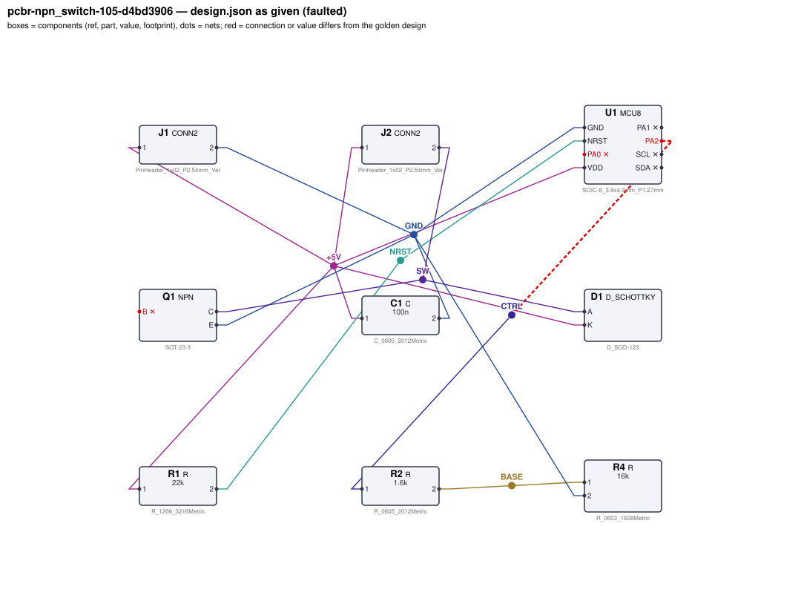
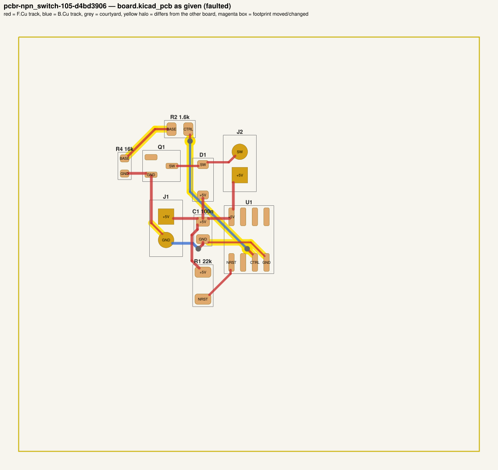
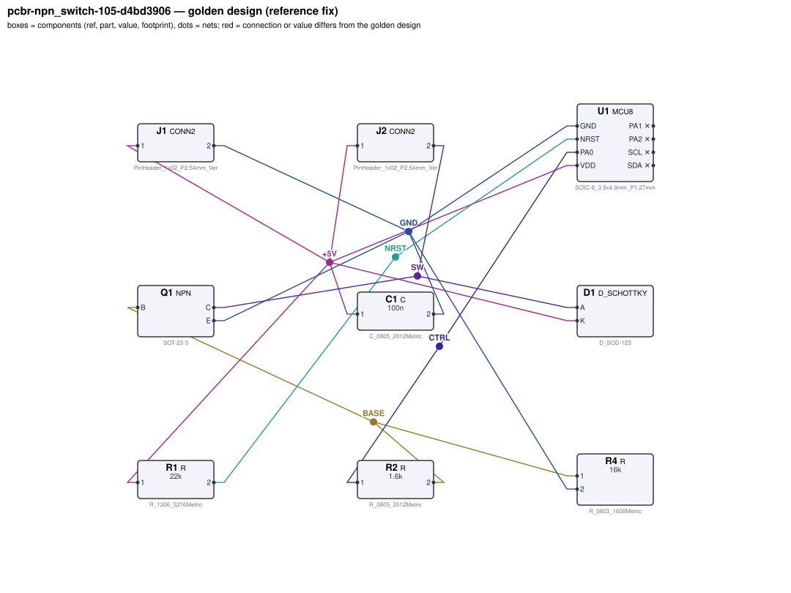
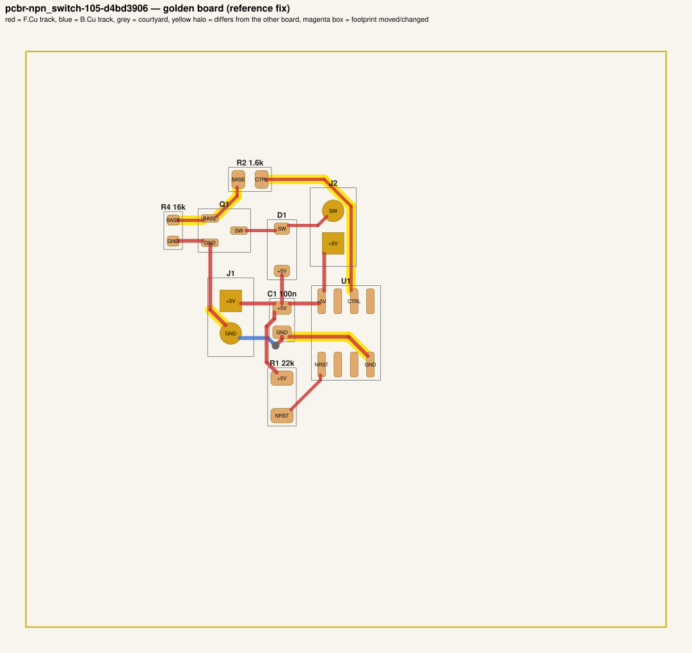

# QA packet 51: `pcbr-npn_switch-105-d4bd3906`

| family | seed | hint level | intent in TASK.md | faults | predicted difficulty |
|---|---|---|---|---|---|
| npn_switch | 105 | explicit | full | 3 | hard |

Task files: [`../../../tasks/train/pcbr-npn_switch-105-d4bd3906/public/`](../../../tasks/train/pcbr-npn_switch-105-d4bd3906/public/) (what the agent gets) and [`../../../tasks/train/pcbr-npn_switch-105-d4bd3906/hidden/`](../../../tasks/train/pcbr-npn_switch-105-d4bd3906/hidden/) (grader only). Why sampled: 3 faults, connectivity fault, disputable type narrow_power_trace.

**How to review (≈5 min):** read section 1 as if you were the agent, decide whether you could find and fix the problems from it; then check section 2 (faults, reference fix, verifier verdicts) and fill `review.yaml`. Do not let section 2 influence your fairness judgement of section 1.

## 1. What the agent sees

### 1.1 TASK.md (verbatim)

````markdown
# Task: MCU-controlled relay switch

## Problem report

The first boards built from these files fail bring-up. Observations so far:

- Bench: current through J2.2 is 6.777 pA, expected 19.32 mA to 26.14 mA (`load_on_current`).
- Bench: Q1.C reads 5 V, expected 0 V to 300 mV (`vce_sat`).
- Bench: current through J2.2 is 558.7 uA, expected 0 A to 100 uA (`load_off_current`).
- Schematic ERC reports 1× unconnected_required.
- Layout review: a supply trace is narrower than its required width (it runs hot at full load).

A reviewer narrowed the failure down to these areas (each needs a fix):

- the connection of Q1.B
- the connections of U1.PA0 / U1.PA2
- the routing of net GND

Fix every problem (there may be more than the observations show directly).

## Design intent

# MCU-controlled low-side switch

A small MCU (U1, MCU8) switches a load through an NPN low-side transistor Q1. Power (5 V) comes in
on J1 (pin 1 = +5 V, pin 2 = GND); the MCU runs from the same rail.

- U1 is decoupled by C1 at its VDD pin; NRST is held high by the pull-up R1 to VDD.
- GPIO PA0 drives Q1's base through R2 (sized for a forced beta of about 10, keeping the pin under 8 mA);
  R4 pulls the base to ground so the load stays off while the MCU pin is high-impedance (reset/boot).
- Q1 emitter to GND; the load sits between the supply and the collector: an off-board relay coil (~220 Ω, 10 mH) plugged into J2 (pin 1 = supply, pin 2 = switched side to Q1 collector). Schottky D1 is the flyback clamp across the coil: cathode to the supply, anode to the collector.

Spec: with PA0 driven high the load current is 22.7 mA ±15 % and Q1 is saturated (VCE ≤ 0.3 V);
with PA0 high-impedance the load stays off even with 1 MΩ of leakage from the supply into the base.
Component values: decoupling C1 47 nF–10 µF (100 nF typical); NRST pull-up R1 2.2 kΩ–100 kΩ;
base pull-down R4 4.7 kΩ–220 kΩ (datasheet: 10k–100k).

## Spec

The design must satisfy these assertions (`pcbtool sim` runs them; full definitions in `spec.json`):

- `load_on_current`: DC current through J2.2 between 19.32 mA and 26.14 mA (J1.1 supplied with 5.0 V; dc source on U1.PA0; load R=220 L=0.01 from J2.1 to J2.2; ground = J1.2)
- `vce_sat`: DC voltage at Q1.C between 0 V and 300 mV (J1.1 supplied with 5.0 V; dc source on U1.PA0; load R=220 L=0.01 from J2.1 to J2.2; ground = J1.2)
- `gpio_current`: DC current through R2 between 0 A and 8 mA (J1.1 supplied with 5.0 V; dc source on U1.PA0; load R=220 L=0.01 from J2.1 to J2.2; ground = J1.2)
- `load_off_current`: DC current through J2.2 between 0 A and 100 uA (J1.1 supplied with 5.0 V; load R=220 L=0.01 from J2.1 to J2.2; load R=1e+06 from Q1.B to J1.1; ground = J1.2)
- `vdd`: DC voltage at U1.VDD relative to U1.GND between 4.9 V and 5.1 V (J1.1 supplied with 5.0 V; ground = J1.2)
- `nrst_high`: DC voltage at U1.NRST between 4.5 V and 5.05 V (J1.1 supplied with 5.0 V; ground = J1.2)

Layout: every track of these nets must be at least the given width:

- +5V (the net of J1.1): ≥ 0.3 mm
- GND (the net of J1.2): ≥ 0.3 mm

Decoupling: every pad of each capacitor within the given distance of the IC pin's pad:

- C1 within 5.0 mm of U1.VDD

Component values: each value must lie in its acceptable range (inclusive; `value_bounds` in `spec.json`). Ranges come from the datasheets and the design intent; values the assertions already pin down get a wide sanity range, and the assertions still apply:

- C1 (C): 47 nF … 10 uF
- R1 (R): 2.2 kΩ … 100 kΩ
- R2 (R): 460 Ω … 5.1 kΩ
- R4 (R): 4.7 kΩ … 220 kΩ

Board rules: 2 copper layers, clearance 0.2 mm, min track 0.2 mm, vias 0.6/0.3 mm, copper-to-edge 0.3 mm. DRC must be clean with no unconnected items.

## Deliverable

- Edit only `design.json` (the schematic of record) and `board.kicad_pcb` (the layout).
- Do not add, remove or rename components; keep each component's part.
- Keep the two files consistent: same connectivity, values and footprints on both.
- Do not change the board outline, add zones, or add DRC exclusions.
- Footprints must be unmodified library footprints from the part's allowed list (see `parts/<PART>.md`).
- Grading is pass/fail: topology, consistency, DRC, ERC, spec, component values and layout must all pass.

## Tools

Run `pcbtool <command>` inside this directory (you may also edit the two files directly).

Read-only:
- `pcbtool show` — components, values, footprints, positions and nets
- `pcbtool netlist` — design nets vs. board pad nets, with differences highlighted
- `pcbtool drc` — KiCad DRC under the canonical rules (the same rules the grader uses)
- `pcbtool erc` — electrical rule check of design.json
- `pcbtool sim` — run the spec assertions (spec.json) on design.json
- `pcbtool parts [PART]` — list parts / print a part's datasheet (also in `parts/`)
- `pcbtool check` — all of the above in one summary

Mutating (each keeps design.json and board.kicad_pcb consistent and saves both):
- `pcbtool set-value REF VALUE`
- `pcbtool set-footprint REF LIB:FOOTPRINT`
- `pcbtool connect REF.PIN NET` / `pcbtool disconnect REF.PIN`
- `pcbtool move REF X Y ROT` (absolute mm, degrees; tracks do not follow)
- `pcbtool unroute NET` / `pcbtool route NET [--width W]` (re-routes the whole net)
- `pcbtool sync` — push design.json connectivity and values onto the board pads
````

### 1.2 Public files

The agent also gets `design.json`, `board.kicad_pcb`, `spec.json` and the part datasheets below, plus the `pcbtool` commands listed in TASK.md (DRC, ERC, simulation of the public assertions, value-range check). Renders of the faulted files:





<details><summary>Datasheet <code>parts/C.md</code></summary>

````markdown
# C — ceramic capacitor

Two-terminal non-polarised capacitor. Pins `1`, `2`. Value in farads.
````

</details>

<details><summary>Datasheet <code>parts/CONN2.md</code></summary>

````markdown
# CONN2 — 2-pin header

Pin `1` = signal/supply, pin `2` = ground by board convention.
````

</details>

<details><summary>Datasheet <code>parts/D_SCHOTTKY.md</code></summary>

````markdown
# D_SCHOTTKY — 40 V / 1 A Schottky rectifier

## Pinout
| Pin | Pad | Function |
|---|---|---|
| A | 2 | anode |
| K | 1 | cathode (band) |

## Electrical characteristics
- VRRM 40 V, IF(AV) 1 A
- Vf = 0.30 V typ at 100 mA, 0.40 V at 1 A
- Reverse leakage 20 uA typ at 25 V

## Application notes
- Flyback / freewheel clamp across an inductive load (relay coil, solenoid, motor):
  cathode to the positive supply side, anode to the switched (transistor) side. In normal
  operation the diode is reverse biased; at turn-off it clamps the inductive kick.
- Reverse polarity protection: in series with the supply, anode to the input.
````

</details>

<details><summary>Datasheet <code>parts/MCU8.md</code></summary>

````markdown
# MCU8 — generic 8-pin microcontroller (SOIC-8)

## Pinout
| Pin | Pad | Function |
|---|---|---|
| NRST | 1 | active-low reset input. **No internal pull-up**: needs an external 10k pull-up to VDD (optional 100 nF to GND) |
| PA1 | 2 | GPIO / XIN (crystal oscillator input) |
| PA2 | 3 | GPIO / XOUT (crystal oscillator output) |
| GND | 4 | ground |
| SDA | 5 | I2C data (open-drain) / GPIO |
| PA0 | 6 | GPIO / PWM output |
| SCL | 7 | I2C clock (open-drain) / GPIO |
| VDD | 8 | supply 1.8–5.5 V |

## Electrical characteristics
- Supply current 1.5 mA typ at 3.3 V
- GPIO output: VOH ≥ VDD - 0.4 V at 8 mA source (≈50 Ω output resistance); 8 mA max per pin
- Open-drain I2C pins sink max 3 mA at VOL = 0.4 V; no internal I2C pull-ups
- Pin capacitance 5 pF per I/O; idle / reset I/O pins are high-impedance (no pulls)
- Crystal oscillator: 4–25 MHz fundamental crystal between XIN (PA1) and XOUT (PA2), each pin
  with a load capacitor to GND

## Application notes
- Decouple VDD with 100 nF ceramic to GND within 5 mm of the VDD pin.
- I2C pull-ups: Rp ≥ (VDD - 0.4 V) / 3 mA and Rp ≤ tr / (2.2 × Cbus) for a 10–90 % rise time tr
  (Cbus includes the 5 pF pin capacitance).
- Crystal load caps: CL = C1·C2/(C1+C2) + Cstray, i.e. C1 = C2 = 2·(CL - Cstray).
````

</details>

<details><summary>Datasheet <code>parts/NPN.md</code></summary>

````markdown
# NPN — general-purpose NPN BJT (SOT-23)

## Pinout
| Pin | Pad | Function |
|---|---|---|
| B | 1 | base |
| E | 2 | emitter |
| C | 3 | collector |

## Electrical characteristics
- VCEO 40 V, IC max 200 mA, Ptot 250 mW
- hFE 100–300 at IC = 10 mA, VCE = 1 V
- VBE(on) ~0.65–0.8 V
- VCE(sat) < 0.2 V at IC = 50 mA, IB = 5 mA

## Application notes
- Low-side switch: emitter to ground, load between supply and collector.
- For hard saturation size the base resistor for a forced beta of ~10:
  RB = (Vdrive - 0.75 V) / (IC / 10).
- Add a base-emitter pull-down (10k–100k) so the transistor stays off while the driver
  is high-impedance (e.g. MCU in reset).
- Inductive loads need a flyback diode across the load.
````

</details>

<details><summary>Datasheet <code>parts/R.md</code></summary>

````markdown
# R — resistor

Two-terminal resistor. Pins `1`, `2` (non-polarised). Value in ohms.
````

</details>

## 2. Reviewer-only (hidden from the agent)

### 2.1 Injected faults

| # | type | category | DRC/ERC-invisible | detail | verifier, this fault alone |
|---|---|---|---|---|---|
| 1 | `floating_pin` | connectivity | no | Q1.B left unconnected (should be on BASE) | reward 0.0; fails erc, spec, topology |
| 2 | `swapped_ic_pins` | connectivity | yes | U1.PA0 and U1.PA2 connections exchanged | reward 0.0; fails spec, topology |
| 3 | `narrow_power_trace` | board | yes | 3 segment(s) of power net GND are 0.2 mm wide (required 0.3 mm) | reward 0.0; fails layout |

### 2.2 Reference fix (faulted → golden)

The reference repair is the hidden golden pair (`golden_design.json`, `golden_board.kicad_pcb`). Any repair that passes every gate and check scores 1.0; it need not be byte-identical.

**design.json: component changes**

- none

**design.json: connection changes** (per pin: what it connects to)

- `Q1.B`: faulted unconnected → golden net `BASE` (R2.2, R4.1)
- `U1.PA0`: faulted unconnected → golden net `CTRL` (R2.1)
- `U1.PA2`: faulted net `CTRL` (R2.1) → golden unconnected

**board.kicad_pcb: footprints moved / changed**

- none

**board.kicad_pcb: footprint values (BOM)**

- none

**board.kicad_pcb: pad-net changes**

- `Q1` pad 1: net `(none)` → `BASE`
- `U1` pad 3: net `CTRL` → `(none)`
- `U1` pad 6: net `(none)` → `CTRL`

**board.kicad_pcb: nets re-routed** (track/via geometry differs)

- net `BASE`: 2 track/via item(s) removed, 3 added
- net `CTRL`: 6 track/via item(s) removed, 3 added
- net `GND`: 3 track/via item(s) removed, 3 added; narrowest track 0.2 mm → 0.3 mm

Golden renders (compare with 1.2; highlighted items differ):





### 2.3 Verifier verdicts

Reward is 1 only if every gate and check passes.

| stage | kind | faulted files | golden files |
|---|---|---|---|
| parse | gate | pass | pass |
| components | gate | pass | pass |
| topology | gate | **FAIL** | pass |
| consistency | gate | pass | pass |
| integrity | gate | pass | pass |
| drc | check | pass | pass |
| erc | check | **FAIL** | pass |
| spec | check | **FAIL** | pass |
| values | check | pass | pass |
| layout | check | **FAIL** | pass |
| **reward** | | **0** | **1** |

Verifier messages on the faulted files:

- **erc**: unconnected_required: Q1.B must be connected
- **layout**: power_width: power net GND: narrowest track 0.200 mm < required 0.3 mm
- **spec**: load_on_current: measured 6.7768013423e-12 expected [0.0193182, 0.0261364]
- **spec**: vce_sat: measured 4.9999977247 expected [0.0, 0.3]
- **spec**: load_off_current: measured 0.00055872683186 expected [0.0, 0.0001]
- **topology**: nets only in candidate: [['R2.1', 'U1.PA2'], ['R2.2', 'R4.1']]; nets only in reference: [['Q1.B', 'R2.2', 'R4.1'], ['R2.1', 'U1.PA0']]

### 2.4 Spec assertions before / after

| assertion | what | allowed | faulted: measured | | golden: measured | |
|---|---|---|---|---|---|---|
| `load_on_current` | DC current through J2.2 (J1.1 supplied with 5.0 V; dc source on U1.PA0; load R=220 L=0.01 from J2.1 to J2.2; ground = J1.2) | 19.32 mA … 26.14 mA | 6.777 pA | ❌ | 22.27 mA | ✅ |
| `vce_sat` | DC voltage at Q1.C (J1.1 supplied with 5.0 V; dc source on U1.PA0; load R=220 L=0.01 from J2.1 to J2.2; ground = J1.2) | 0 V … 300 mV | 5 V | ❌ | 101.1 mV | ✅ |
| `gpio_current` | DC current through R2 (J1.1 supplied with 5.0 V; dc source on U1.PA0; load R=220 L=0.01 from J2.1 to J2.2; ground = J1.2) | 0 A … 8 mA | 0 A | ✅ | 2.556 mA | ✅ |
| `load_off_current` | DC current through J2.2 (J1.1 supplied with 5.0 V; load R=220 L=0.01 from J2.1 to J2.2; load R=1e+06 from Q1.B to J1.1; ground = J1.2) | 0 A … 100 uA | 558.7 uA | ❌ | 5.897 pA | ✅ |
| `vdd` | DC voltage at U1.VDD relative to U1.GND (J1.1 supplied with 5.0 V; ground = J1.2) | 4.9 V … 5.1 V | 5 V | ✅ | 5 V | ✅ |
| `nrst_high` | DC voltage at U1.NRST (J1.1 supplied with 5.0 V; ground = J1.2) | 4.5 V … 5.05 V | 5 V | ✅ | 5 V | ✅ |

### 2.5 Value bounds

Bounds are public (TASK.md / spec.json); `values` check = every value inside its range.

| ref | part | acceptable range | faulted design.json | faulted board | golden | touched by a fault |
|---|---|---|---|---|---|---|
| `C1` | C | 47 nF … 10 uF | `100n` | `100n` | `100n` |  |
| `R1` | R | 2.2 kΩ … 100 kΩ | `22k` | `22k` | `22k` |  |
| `R2` | R | 460 Ω … 5.1 kΩ | `1.6k` | `1.6k` | `1.6k` |  |
| `R4` | R | 4.7 kΩ … 220 kΩ | `16k` | `16k` | `16k` |  |

### 2.6 Layout rules

- power net `+5V` (golden pins C1.1, D1.K, J1.1, J2.1, R1.1, U1.VDD): every track ≥ 0.3 mm
- power net `GND` (golden pins C1.2, J1.2, Q1.E, R4.2, U1.GND): every track ≥ 0.3 mm
- decoupling: `C1` within 5.0 mm of `U1.VDD`

## 3. Review

Fill `review.yaml` in this directory (second reviewer: copy `../../review_template.yaml` to `review-<initials>.yaml` here, without looking at the first form). Questions to answer:

1. **task_fair / solvable_from_public_material**: from section 1 only, can a competent engineer locate and fix every injected fault? Is anything required that is not stated (a value with no assertion and no published range, a connection only the golden reveals)?
2. **reference_fix_correct**: is the golden (2.2) a correct design that meets the stated intent?
3. **verifier_verdict_agrees**: do you agree the faulted files fail and the golden passes, for the reasons given in 2.3?
4. **alternative_valid_fixes_rejected**: is there an engineering-valid repair the grader would reject (e.g. a different E-series value that meets intent but fails an assertion window or value bound; keeping a swapped footprint and re-routing; a different valid placement)?

