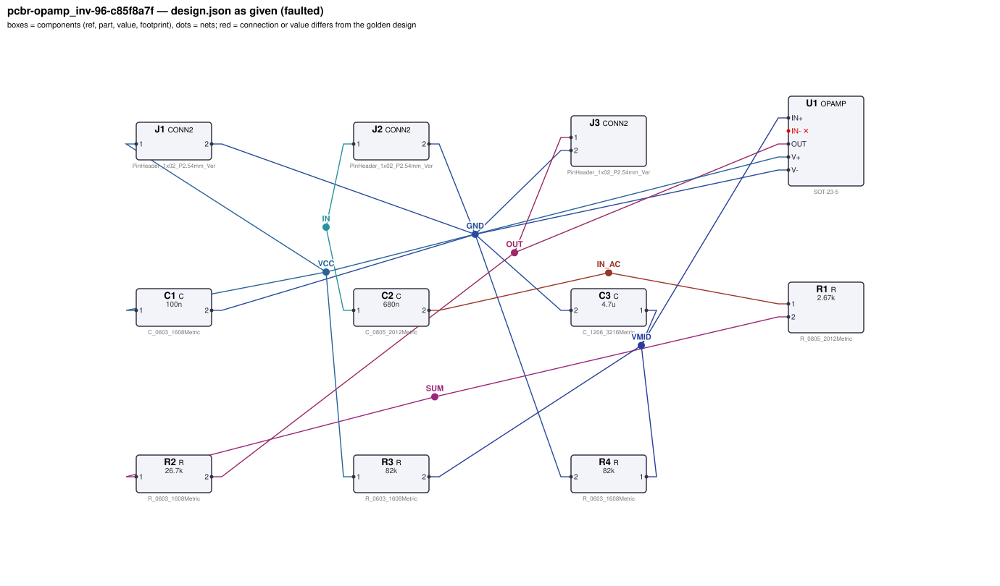
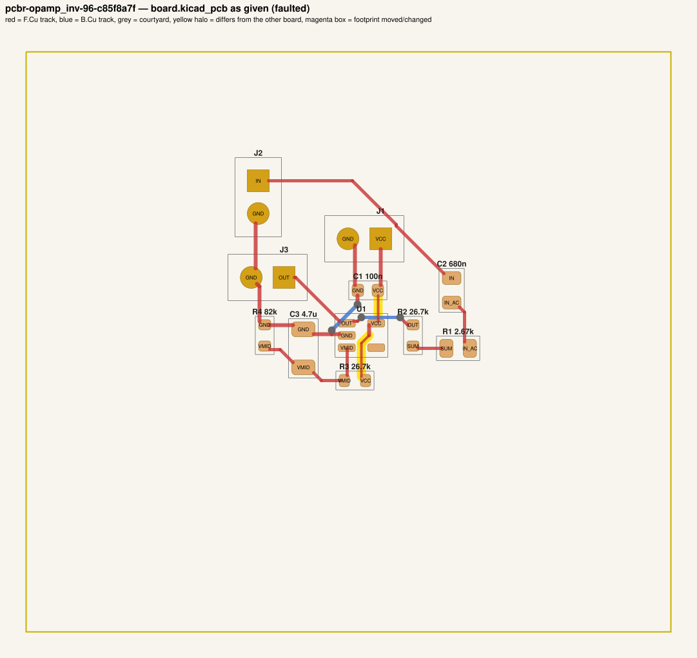
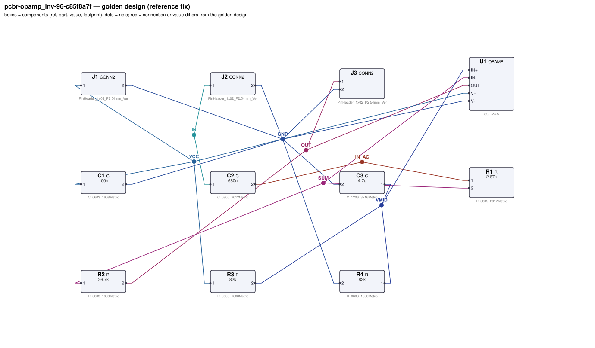
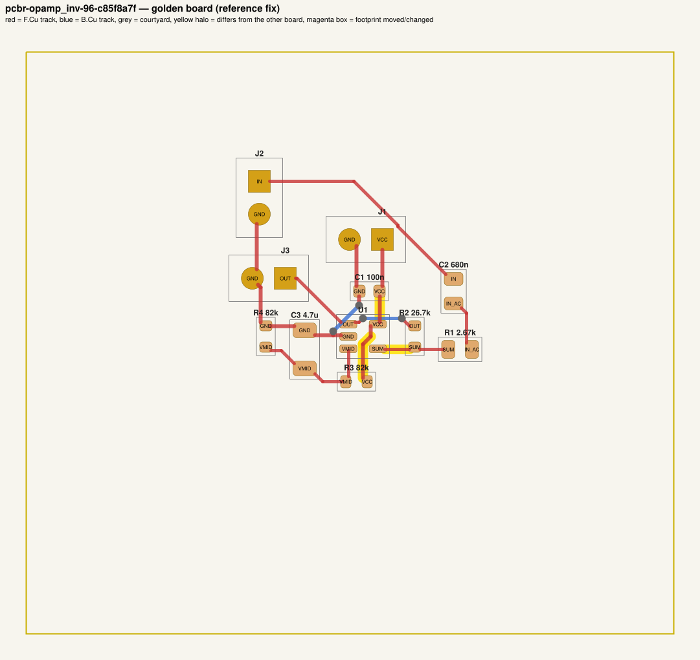

# QA packet 71: `pcbr-opamp_inv-96-c85f8a7f`

| family | seed | hint level | intent in TASK.md | faults | predicted difficulty |
|---|---|---|---|---|---|
| opamp_inv | 96 | explicit | full | 3 | hard |

Task files: [`../../../tasks/train/pcbr-opamp_inv-96-c85f8a7f/public/`](../../../tasks/train/pcbr-opamp_inv-96-c85f8a7f/public/) (what the agent gets) and [`../../../tasks/train/pcbr-opamp_inv-96-c85f8a7f/hidden/`](../../../tasks/train/pcbr-opamp_inv-96-c85f8a7f/hidden/) (grader only). Why sampled: 3 faults, connectivity fault, disputable type bom_mismatch, disputable type narrow_power_trace, value near bounds: R3=26.7k inside [4700, 470000].

**How to review (≈5 min):** read section 1 as if you were the agent, decide whether you could find and fix the problems from it; then check section 2 (faults, reference fix, verifier verdicts) and fill `review.yaml`. Do not let section 2 influence your fairness judgement of section 1.

## 1. What the agent sees

### 1.1 TASK.md (verbatim)

````markdown
# Task: inverting x10 AC amplifier

## Problem report

The first boards built from these files fail bring-up. Observations so far:

- Bench: J3.1 reads 4.995 V, expected 2.425 V to 2.575 V (`dc_bias_out`).
- Network analyser: gain J2.1 → J3.1 at 1 kHz is 0.00102, expected 9.67 to 10.27 (`midband_gain`).
- Network analyser: −3 dB corner J2.1 → J3.1 measured at 7.961 Hz, expected 74.43 Hz to 100.7 Hz (`low_cutoff`).
- Schematic ERC reports 1× unconnected_required.
- Incoming inspection: a part value on the layout does not match the design.json BOM.
- Layout review: a supply trace is narrower than its required width (it runs hot at full load).

A reviewer narrowed the failure down to these areas (each needs a fix):

- the connection of U1.IN-
- the value of R3 on the board vs. design.json
- the routing of net VCC

Fix every problem (there may be more than the observations show directly).

## Design intent

# Inverting x10 AC amplifier (single supply)

Amplifies an AC signal on J2 (pin 1 = input, pin 2 = GND) with a gain of -10 and outputs it on
J3 (pin 1 = output, pin 2 = GND), centred at mid-supply. Single 5 V supply on J1
(pin 1 = VCC, pin 2 = GND).

- U1 (OPAMP): V+ on VCC (decoupled by C1 at the pin), V- on GND.
- Mid-supply reference: equal resistors R3 (VCC to VMID) and R4 (VMID to GND), bypassed by C3 to GND;
  VMID drives the non-inverting input.
- The input is AC-coupled: J2 pin 1 -> C2 -> R1 -> IN-. R2 is the feedback resistor from OUT to IN-.
  Gain = -R2/R1; the coupling capacitor sets the low cut-off 1/(2π·R1·C2) ≈ 100 Hz.

Spec: output DC level VCC/2 ±3 %; |gain| 9.97 ±3 % at 1 kHz; low -3 dB corner 87.6 Hz ±15 %.
Component values: decoupling C1 47 nF–10 µF (100 nF typical); bias divider R3, R4 4.7 kΩ–470 kΩ each;
VMID bypass C3 470 nF–47 µF.

## Spec

The design must satisfy these assertions (`pcbtool sim` runs them; full definitions in `spec.json`):

- `dc_bias_out`: DC voltage at J3.1 between 2.425 V and 2.575 V (J1.1 supplied with 5.0 V; dc source on J2.1; ground = J1.2)
- `midband_gain`: AC gain |V(J3.1)/V(J2.1)| at 1 kHz between 9.67 and 10.27 (J1.1 supplied with 5.0 V; dc source on J2.1; ground = J1.2)
- `low_cutoff`: -3 dB frequency from J2.1 to J3.1 between 74.43 Hz and 100.7 Hz (J1.1 supplied with 5.0 V; dc source on J2.1; ground = J1.2)

Layout: every track of these nets must be at least the given width:

- GND (the net of J1.2): ≥ 0.3 mm
- VCC (the net of J1.1): ≥ 0.3 mm

Decoupling: every pad of each capacitor within the given distance of the IC pin's pad:

- C1 within 5.0 mm of U1.V+

Component values: each value must lie in its acceptable range (inclusive; `value_bounds` in `spec.json`). Ranges come from the datasheets and the design intent; values the assertions already pin down get a wide sanity range, and the assertions still apply:

- C1 (C): 47 nF … 10 uF
- C2 (C): 200 nF … 2.2 uF
- C3 (C): 470 nF … 47 uF
- R1 (R): 710 Ω … 8.3 kΩ
- R2 (R): 7.9 kΩ … 88 kΩ
- R3 (R): 4.7 kΩ … 470 kΩ
- R4 (R): 4.7 kΩ … 470 kΩ

Board rules: 2 copper layers, clearance 0.2 mm, min track 0.2 mm, vias 0.6/0.3 mm, copper-to-edge 0.3 mm. DRC must be clean with no unconnected items.

## Deliverable

- Edit only `design.json` (the schematic of record) and `board.kicad_pcb` (the layout).
- Do not add, remove or rename components; keep each component's part.
- Keep the two files consistent: same connectivity, values and footprints on both.
- Do not change the board outline, add zones, or add DRC exclusions.
- Footprints must be unmodified library footprints from the part's allowed list (see `parts/<PART>.md`).
- Grading is pass/fail: topology, consistency, DRC, ERC, spec, component values and layout must all pass.

## Tools

Run `pcbtool <command>` inside this directory (you may also edit the two files directly).

Read-only:
- `pcbtool show` — components, values, footprints, positions and nets
- `pcbtool netlist` — design nets vs. board pad nets, with differences highlighted
- `pcbtool drc` — KiCad DRC under the canonical rules (the same rules the grader uses)
- `pcbtool erc` — electrical rule check of design.json
- `pcbtool sim` — run the spec assertions (spec.json) on design.json
- `pcbtool parts [PART]` — list parts / print a part's datasheet (also in `parts/`)
- `pcbtool check` — all of the above in one summary

Mutating (each keeps design.json and board.kicad_pcb consistent and saves both):
- `pcbtool set-value REF VALUE`
- `pcbtool set-footprint REF LIB:FOOTPRINT`
- `pcbtool connect REF.PIN NET` / `pcbtool disconnect REF.PIN`
- `pcbtool move REF X Y ROT` (absolute mm, degrees; tracks do not follow)
- `pcbtool unroute NET` / `pcbtool route NET [--width W]` (re-routes the whole net)
- `pcbtool sync` — push design.json connectivity and values onto the board pads
````

### 1.2 Public files

The agent also gets `design.json`, `board.kicad_pcb`, `spec.json` and the part datasheets below, plus the `pcbtool` commands listed in TASK.md (DRC, ERC, simulation of the public assertions, value-range check). Renders of the faulted files:





<details><summary>Datasheet <code>parts/C.md</code></summary>

````markdown
# C — ceramic capacitor

Two-terminal non-polarised capacitor. Pins `1`, `2`. Value in farads.
````

</details>

<details><summary>Datasheet <code>parts/CONN2.md</code></summary>

````markdown
# CONN2 — 2-pin header

Pin `1` = signal/supply, pin `2` = ground by board convention.
````

</details>

<details><summary>Datasheet <code>parts/OPAMP.md</code></summary>

````markdown
# OPAMP — single rail-to-rail I/O operational amplifier (SOT-23-5)

## Pinout
| Pin | Pad | Function |
|---|---|---|
| OUT | 1 | output |
| V- | 2 | negative supply (GND in single-supply use) |
| IN+ | 3 | non-inverting input |
| IN- | 4 | inverting input |
| V+ | 5 | positive supply |

## Electrical characteristics
- Supply 1.8–5.5 V (V+ - V-); quiescent current 100 µA
- Open-loop gain 100 dB (1e5); gain-bandwidth product 1 MHz (single pole)
- Rail-to-rail input and output (output swings to within 5 mV of the rails, Rout 30 Ω)
- Input bias current < 1 pA; input offset modelled as 0

## Application notes
- Non-inverting gain: G = 1 + Rf / Rg (Rf from OUT to IN-, Rg from IN- to ground).
- Inverting gain: G = -Rf / Rin. In single-supply use bias IN+ at mid-supply (e.g. a
  resistor divider from V+ bypassed with a capacitor) and AC-couple the input.
- Closed-loop bandwidth ≈ 1 MHz / (noise gain).
- Decouple V+ with 100 nF ceramic to ground within 5 mm of the pin.
````

</details>

<details><summary>Datasheet <code>parts/R.md</code></summary>

````markdown
# R — resistor

Two-terminal resistor. Pins `1`, `2` (non-polarised). Value in ohms.
````

</details>

## 2. Reviewer-only (hidden from the agent)

### 2.1 Injected faults

| # | type | category | DRC/ERC-invisible | detail | verifier, this fault alone |
|---|---|---|---|---|---|
| 1 | `floating_pin` | connectivity | no | U1.IN- left unconnected (should be on SUM) | reward 0.0; fails erc, spec, topology |
| 2 | `bom_mismatch` | value | yes | board value of R3 is 26.7k, design.json says 82k | reward 0.0; fails consistency |
| 3 | `narrow_power_trace` | board | yes | 3 segment(s) of power net VCC are 0.2 mm wide (required 0.3 mm) | reward 0.0; fails layout |

### 2.2 Reference fix (faulted → golden)

The reference repair is the hidden golden pair (`golden_design.json`, `golden_board.kicad_pcb`). Any repair that passes every gate and check scores 1.0; it need not be byte-identical.

**design.json: component changes**

- none

**design.json: connection changes** (per pin: what it connects to)

- `U1.IN-`: faulted unconnected → golden net `SUM` (R1.2, R2.1)

**board.kicad_pcb: footprints moved / changed**

- none

**board.kicad_pcb: footprint values (BOM)**

- `R3` board value `26.7k` → `82k`

**board.kicad_pcb: pad-net changes**

- `U1` pad 4: net `(none)` → `SUM`

**board.kicad_pcb: nets re-routed** (track/via geometry differs)

- net `SUM`: 0 track/via item(s) removed, 1 added
- net `VCC`: 3 track/via item(s) removed, 3 added; narrowest track 0.2 mm → 0.3 mm

Golden renders (compare with 1.2; highlighted items differ):





### 2.3 Verifier verdicts

Reward is 1 only if every gate and check passes.

| stage | kind | faulted files | golden files |
|---|---|---|---|
| parse | gate | pass | pass |
| components | gate | pass | pass |
| topology | gate | **FAIL** | pass |
| consistency | gate | **FAIL** | pass |
| integrity | gate | pass | pass |
| drc | check | pass | pass |
| erc | check | **FAIL** | pass |
| spec | check | **FAIL** | pass |
| values | check | pass | pass |
| layout | check | **FAIL** | pass |
| **reward** | | **0** | **1** |

Verifier messages on the faulted files:

- **consistency**: R3: board value '26.7k' != design value '82k'
- **erc**: unconnected_required: U1.IN- must be connected
- **layout**: power_width: power net VCC: narrowest track 0.200 mm < required 0.3 mm
- **spec**: dc_bias_out: measured 4.9949998691 expected [2.425, 2.575]
- **spec**: midband_gain: measured 0.0010203758273553297 expected [9.66972, 10.2678]
- **spec**: low_cutoff: measured 7.961327309519471 expected [74.4252, 100.693]
- **topology**: nets only in candidate: [['R1.2', 'R2.1']]; nets only in reference: [['R1.2', 'R2.1', 'U1.IN-']]

### 2.4 Spec assertions before / after

| assertion | what | allowed | faulted: measured | | golden: measured | |
|---|---|---|---|---|---|---|
| `dc_bias_out` | DC voltage at J3.1 (J1.1 supplied with 5.0 V; dc source on J2.1; ground = J1.2) | 2.425 V … 2.575 V | 4.995 V | ❌ | 2.5 V | ✅ |
| `midband_gain` | AC gain \|V(J3.1)/V(J2.1)\| at 1 kHz (J1.1 supplied with 5.0 V; dc source on J2.1; ground = J1.2) | 9.67 … 10.27 | 1.02 m | ❌ | 9.969 | ✅ |
| `low_cutoff` | -3 dB frequency from J2.1 to J3.1 (J1.1 supplied with 5.0 V; dc source on J2.1; ground = J1.2) | 74.43 Hz … 100.7 Hz | 7.961 Hz | ❌ | 87.57 Hz | ✅ |

### 2.5 Value bounds

Bounds are public (TASK.md / spec.json); `values` check = every value inside its range.

| ref | part | acceptable range | faulted design.json | faulted board | golden | touched by a fault |
|---|---|---|---|---|---|---|
| `C1` | C | 47 nF … 10 uF | `100n` | `100n` | `100n` |  |
| `C2` | C | 200 nF … 2.2 uF | `680n` | `680n` | `680n` |  |
| `C3` | C | 470 nF … 47 uF | `4.7u` | `4.7u` | `4.7u` |  |
| `R1` | R | 710 Ω … 8.3 kΩ | `2.67k` | `2.67k` | `2.67k` |  |
| `R2` | R | 7.9 kΩ … 88 kΩ | `26.7k` | `26.7k` | `26.7k` |  |
| `R3` | R | 4.7 kΩ … 470 kΩ | `82k` | `26.7k` | `82k` | **yes** |
| `R4` | R | 4.7 kΩ … 470 kΩ | `82k` | `82k` | `82k` |  |

### 2.6 Layout rules

- power net `GND` (golden pins C1.2, C3.2, J1.2, J2.2, J3.2, R4.2, U1.V-): every track ≥ 0.3 mm
- power net `VCC` (golden pins C1.1, J1.1, R3.1, U1.V+): every track ≥ 0.3 mm
- decoupling: `C1` within 5.0 mm of `U1.V+`

## 3. Review

Fill `review.yaml` in this directory (second reviewer: copy `../../review_template.yaml` to `review-<initials>.yaml` here, without looking at the first form). Questions to answer:

1. **task_fair / solvable_from_public_material**: from section 1 only, can a competent engineer locate and fix every injected fault? Is anything required that is not stated (a value with no assertion and no published range, a connection only the golden reveals)?
2. **reference_fix_correct**: is the golden (2.2) a correct design that meets the stated intent?
3. **verifier_verdict_agrees**: do you agree the faulted files fail and the golden passes, for the reasons given in 2.3?
4. **alternative_valid_fixes_rejected**: is there an engineering-valid repair the grader would reject (e.g. a different E-series value that meets intent but fails an assertion window or value bound; keeping a swapped footprint and re-routing; a different valid placement)?

