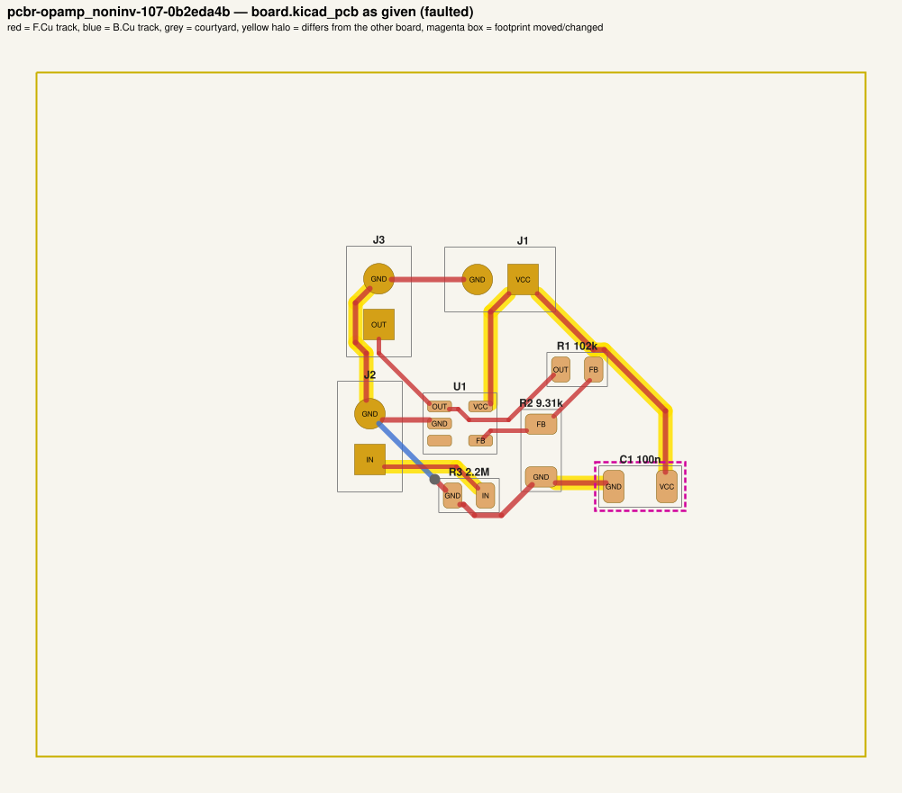
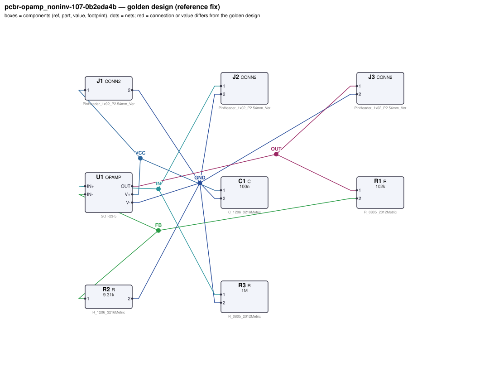
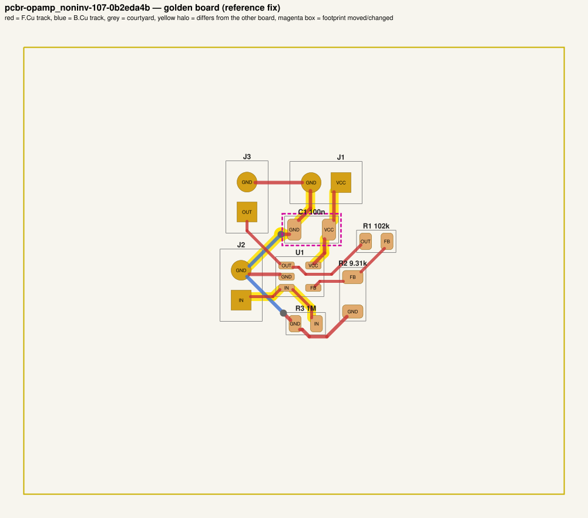

# QA packet 72: `pcbr-opamp_noninv-107-0b2eda4b`

| family | seed | hint level | intent in TASK.md | faults | predicted difficulty |
|---|---|---|---|---|---|
| opamp_noninv | 107 | explicit | full | 3 | hard |

Task files: [`../../../tasks/train/pcbr-opamp_noninv-107-0b2eda4b/public/`](../../../tasks/train/pcbr-opamp_noninv-107-0b2eda4b/public/) (what the agent gets) and [`../../../tasks/train/pcbr-opamp_noninv-107-0b2eda4b/hidden/`](../../../tasks/train/pcbr-opamp_noninv-107-0b2eda4b/hidden/) (grader only). Why sampled: 3 faults, connectivity fault, disputable type bom_mismatch, disputable type decap_moved_far, value near bounds: R3=2.2M inside [47000, 2.2e+06].

**How to review (≈5 min):** read section 1 as if you were the agent, decide whether you could find and fix the problems from it; then check section 2 (faults, reference fix, verifier verdicts) and fill `review.yaml`. Do not let section 2 influence your fairness judgement of section 1.

## 1. What the agent sees

### 1.1 TASK.md (verbatim)

````markdown
# Task: x12 non-inverting amplifier

## Problem report

The first boards built from these files fail bring-up. Observations so far:

- Network analyser: gain J2.1 → J3.1 at 100 Hz is 0, expected 11.64 to 12.36 (`gain`).
- Bench: J3.1 reads 174.8 mV, expected 1.275 V to 1.365 V (`dc_out`).
- `bandwidth`: no valid measurement — the circuit does not reach a sensible operating point.
- Schematic ERC reports 1× unconnected_required.
- Incoming inspection: a part value on the layout does not match the design.json BOM.
- Layout review: a decoupling capacitor sits too far from the IC pin it decouples.

A reviewer narrowed the failure down to these areas (each needs a fix):

- the connection of U1.IN+
- the value of R3 on the board vs. design.json
- the placement of C1

Fix every problem (there may be more than the observations show directly).

## Design intent

# x12 non-inverting amplifier

Amplifies the signal on J2 (pin 1 = input, pin 2 = GND) by 12 and presents it on J3
(pin 1 = output, pin 2 = GND). Single 3.3 V supply on J1 (pin 1 = VCC, pin 2 = GND).

- U1 (OPAMP) runs from VCC on V+ with V- on GND; C1 decouples V+ at the pin.
- The input goes straight to IN+; R3 is a bias resistor from the input to GND so the input is
  defined when nothing is connected.
- Gain is set by R1 from OUT to IN- and R2 from IN- to GND (G = 1 + R1/R2).
- No bandwidth-limiting capacitor; the bandwidth is set by the op-amp GBW.

Spec: gain 12 ±3 % at 100 Hz; -3 dB bandwidth 83.7 kHz ±10 %; DC-coupled
(input 0.1104 V DC -> output 1.32 V).
Component values: decoupling C1 47 nF–10 µF (100 nF typical); input bias resistor R3 47 kΩ–2.2 MΩ
(sets the input impedance).

## Spec

The design must satisfy these assertions (`pcbtool sim` runs them; full definitions in `spec.json`):

- `gain`: AC gain |V(J3.1)/V(J2.1)| at 100 Hz between 11.64 and 12.36 (J1.1 supplied with 3.3 V; dc source on J2.1; ground = J1.2)
- `dc_out`: DC voltage at J3.1 between 1.275 V and 1.365 V (J1.1 supplied with 3.3 V; dc source on J2.1; ground = J1.2)
- `bandwidth`: -3 dB frequency from J2.1 to J3.1 between 75.29 kHz and 92.02 kHz (J1.1 supplied with 3.3 V; dc source on J2.1; ground = J1.2)

Layout: every track of these nets must be at least the given width:

- GND (the net of J1.2): ≥ 0.3 mm
- VCC (the net of J1.1): ≥ 0.3 mm

Decoupling: every pad of each capacitor within the given distance of the IC pin's pad:

- C1 within 5.0 mm of U1.V+

Component values: each value must lie in its acceptable range (inclusive; `value_bounds` in `spec.json`). Ranges come from the datasheets and the design intent; values the assertions already pin down get a wide sanity range, and the assertions still apply:

- C1 (C): 47 nF … 10 uF
- R1 (R): 26 kΩ … 320 kΩ
- R2 (R): 2.5 kΩ … 33 kΩ
- R3 (R): 47 kΩ … 2.2 MΩ

Board rules: 2 copper layers, clearance 0.2 mm, min track 0.2 mm, vias 0.6/0.3 mm, copper-to-edge 0.3 mm. DRC must be clean with no unconnected items.

## Deliverable

- Edit only `design.json` (the schematic of record) and `board.kicad_pcb` (the layout).
- Do not add, remove or rename components; keep each component's part.
- Keep the two files consistent: same connectivity, values and footprints on both.
- Do not change the board outline, add zones, or add DRC exclusions.
- Footprints must be unmodified library footprints from the part's allowed list (see `parts/<PART>.md`).
- Grading is pass/fail: topology, consistency, DRC, ERC, spec, component values and layout must all pass.

## Tools

Run `pcbtool <command>` inside this directory (you may also edit the two files directly).

Read-only:
- `pcbtool show` — components, values, footprints, positions and nets
- `pcbtool netlist` — design nets vs. board pad nets, with differences highlighted
- `pcbtool drc` — KiCad DRC under the canonical rules (the same rules the grader uses)
- `pcbtool erc` — electrical rule check of design.json
- `pcbtool sim` — run the spec assertions (spec.json) on design.json
- `pcbtool parts [PART]` — list parts / print a part's datasheet (also in `parts/`)
- `pcbtool check` — all of the above in one summary

Mutating (each keeps design.json and board.kicad_pcb consistent and saves both):
- `pcbtool set-value REF VALUE`
- `pcbtool set-footprint REF LIB:FOOTPRINT`
- `pcbtool connect REF.PIN NET` / `pcbtool disconnect REF.PIN`
- `pcbtool move REF X Y ROT` (absolute mm, degrees; tracks do not follow)
- `pcbtool unroute NET` / `pcbtool route NET [--width W]` (re-routes the whole net)
- `pcbtool sync` — push design.json connectivity and values onto the board pads
````

### 1.2 Public files

The agent also gets `design.json`, `board.kicad_pcb`, `spec.json` and the part datasheets below, plus the `pcbtool` commands listed in TASK.md (DRC, ERC, simulation of the public assertions, value-range check). Renders of the faulted files:




<details><summary>Datasheet <code>parts/C.md</code></summary>

````markdown
# C — ceramic capacitor

Two-terminal non-polarised capacitor. Pins `1`, `2`. Value in farads.
````

</details>

<details><summary>Datasheet <code>parts/CONN2.md</code></summary>

````markdown
# CONN2 — 2-pin header

Pin `1` = signal/supply, pin `2` = ground by board convention.
````

</details>

<details><summary>Datasheet <code>parts/OPAMP.md</code></summary>

````markdown
# OPAMP — single rail-to-rail I/O operational amplifier (SOT-23-5)

## Pinout
| Pin | Pad | Function |
|---|---|---|
| OUT | 1 | output |
| V- | 2 | negative supply (GND in single-supply use) |
| IN+ | 3 | non-inverting input |
| IN- | 4 | inverting input |
| V+ | 5 | positive supply |

## Electrical characteristics
- Supply 1.8–5.5 V (V+ - V-); quiescent current 100 µA
- Open-loop gain 100 dB (1e5); gain-bandwidth product 1 MHz (single pole)
- Rail-to-rail input and output (output swings to within 5 mV of the rails, Rout 30 Ω)
- Input bias current < 1 pA; input offset modelled as 0

## Application notes
- Non-inverting gain: G = 1 + Rf / Rg (Rf from OUT to IN-, Rg from IN- to ground).
- Inverting gain: G = -Rf / Rin. In single-supply use bias IN+ at mid-supply (e.g. a
  resistor divider from V+ bypassed with a capacitor) and AC-couple the input.
- Closed-loop bandwidth ≈ 1 MHz / (noise gain).
- Decouple V+ with 100 nF ceramic to ground within 5 mm of the pin.
````

</details>

<details><summary>Datasheet <code>parts/R.md</code></summary>

````markdown
# R — resistor

Two-terminal resistor. Pins `1`, `2` (non-polarised). Value in ohms.
````

</details>

## 2. Reviewer-only (hidden from the agent)

### 2.1 Injected faults

| # | type | category | DRC/ERC-invisible | detail | verifier, this fault alone |
|---|---|---|---|---|---|
| 1 | `floating_pin` | connectivity | no | U1.IN+ left unconnected (should be on IN) | reward 0.0; fails erc, spec, topology |
| 2 | `bom_mismatch` | value | yes | board value of R3 is 2.2M, design.json says 1M | reward 0.0; fails consistency |
| 3 | `decap_moved_far` | board | yes | C1 placed at (133.5, 123.0), 8.6 mm from U1.V+ (max 5.0 mm) | reward 0.0; fails layout |

### 2.2 Reference fix (faulted → golden)

The reference repair is the hidden golden pair (`golden_design.json`, `golden_board.kicad_pcb`). Any repair that passes every gate and check scores 1.0; it need not be byte-identical.

**design.json: component changes**

- none

**design.json: connection changes** (per pin: what it connects to)

- `U1.IN+`: faulted unconnected → golden net `IN` (J2.1, R3.1)

**board.kicad_pcb: footprints moved / changed**

- `C1` moved (133.50, 123.00, 180°, F) → (124.50, 115.50, 180°, F), 11.72 mm

**board.kicad_pcb: footprint values (BOM)**

- `R3` board value `2.2M` → `1M`

**board.kicad_pcb: pad-net changes**

- `U1` pad 3: net `(none)` → `IN`

**board.kicad_pcb: nets re-routed** (track/via geometry differs)

- net `GND`: 5 track/via item(s) removed, 5 added
- net `IN`: 2 track/via item(s) removed, 4 added
- net `VCC`: 6 track/via item(s) removed, 3 added

Golden renders (compare with 1.2; highlighted items differ):





### 2.3 Verifier verdicts

Reward is 1 only if every gate and check passes.

| stage | kind | faulted files | golden files |
|---|---|---|---|
| parse | gate | pass | pass |
| components | gate | pass | pass |
| topology | gate | **FAIL** | pass |
| consistency | gate | **FAIL** | pass |
| integrity | gate | pass | pass |
| drc | check | pass | pass |
| erc | check | **FAIL** | pass |
| spec | check | **FAIL** | pass |
| values | check | pass | pass |
| layout | check | **FAIL** | pass |
| **reward** | | **0** | **1** |

Verifier messages on the faulted files:

- **consistency**: R3: board value '2.2M' != design value '1M'
- **erc**: unconnected_required: U1.IN+ must be connected
- **layout**: decoupling: C1.1 is 11.25 mm from U1.V+ (max 5.0 mm)
- **layout**: decoupling: C1.2 is 8.62 mm from U1.V+ (max 5.0 mm)
- **spec**: gain: measured 0.0 expected [11.64, 12.36]
- **spec**: dc_out: measured 0.17479924003 expected [1.27534, 1.36454]
- **spec**: bandwidth: measured None expected [75285.2, 92015.3] no -3 dB crossing in sweep
- **topology**: nets only in candidate: [['J2.1', 'R3.1']]; nets only in reference: [['J2.1', 'R3.1', 'U1.IN+']]

### 2.4 Spec assertions before / after

| assertion | what | allowed | faulted: measured | | golden: measured | |
|---|---|---|---|---|---|---|
| `gain` | AC gain \|V(J3.1)/V(J2.1)\| at 100 Hz (J1.1 supplied with 3.3 V; dc source on J2.1; ground = J1.2) | 11.64 … 12.36 | 0 | ❌ | 11.95 | ✅ |
| `dc_out` | DC voltage at J3.1 (J1.1 supplied with 3.3 V; dc source on J2.1; ground = J1.2) | 1.275 V … 1.365 V | 174.8 mV | ❌ | 1.32 V | ✅ |
| `bandwidth` | -3 dB frequency from J2.1 to J3.1 (J1.1 supplied with 3.3 V; dc source on J2.1; ground = J1.2) | 75.29 kHz … 92.02 kHz | — | ❌ | 83.55 kHz | ✅ |

### 2.5 Value bounds

Bounds are public (TASK.md / spec.json); `values` check = every value inside its range.

| ref | part | acceptable range | faulted design.json | faulted board | golden | touched by a fault |
|---|---|---|---|---|---|---|
| `C1` | C | 47 nF … 10 uF | `100n` | `100n` | `100n` | **yes** |
| `R1` | R | 26 kΩ … 320 kΩ | `102k` | `102k` | `102k` |  |
| `R2` | R | 2.5 kΩ … 33 kΩ | `9.31k` | `9.31k` | `9.31k` |  |
| `R3` | R | 47 kΩ … 2.2 MΩ | `1M` | `2.2M` | `1M` | **yes** |

### 2.6 Layout rules

- power net `GND` (golden pins C1.2, J1.2, J2.2, J3.2, R2.2, R3.2, U1.V-): every track ≥ 0.3 mm
- power net `VCC` (golden pins C1.1, J1.1, U1.V+): every track ≥ 0.3 mm
- decoupling: `C1` within 5.0 mm of `U1.V+`

## 3. Review

Fill `review.yaml` in this directory (second reviewer: copy `../../review_template.yaml` to `review-<initials>.yaml` here, without looking at the first form). Questions to answer:

1. **task_fair / solvable_from_public_material**: from section 1 only, can a competent engineer locate and fix every injected fault? Is anything required that is not stated (a value with no assertion and no published range, a connection only the golden reveals)?
2. **reference_fix_correct**: is the golden (2.2) a correct design that meets the stated intent?
3. **verifier_verdict_agrees**: do you agree the faulted files fail and the golden passes, for the reasons given in 2.3?
4. **alternative_valid_fixes_rejected**: is there an engineering-valid repair the grader would reject (e.g. a different E-series value that meets intent but fails an assertion window or value bound; keeping a swapped footprint and re-routing; a different valid placement)?

