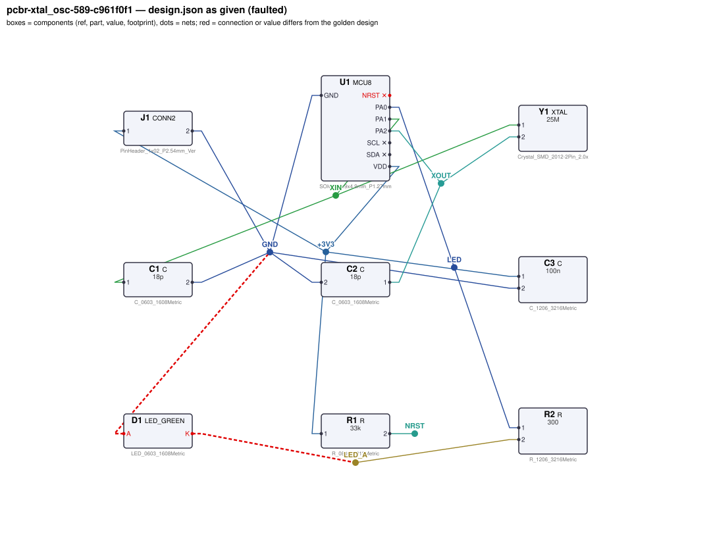
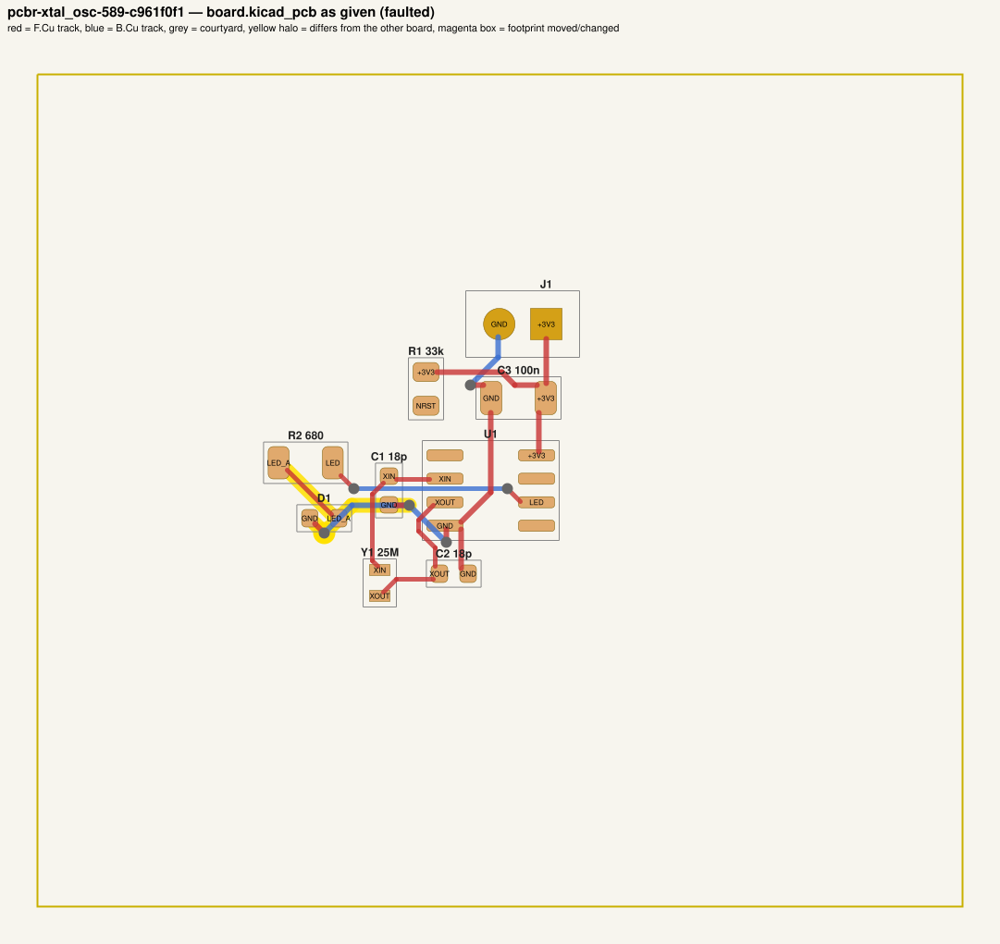
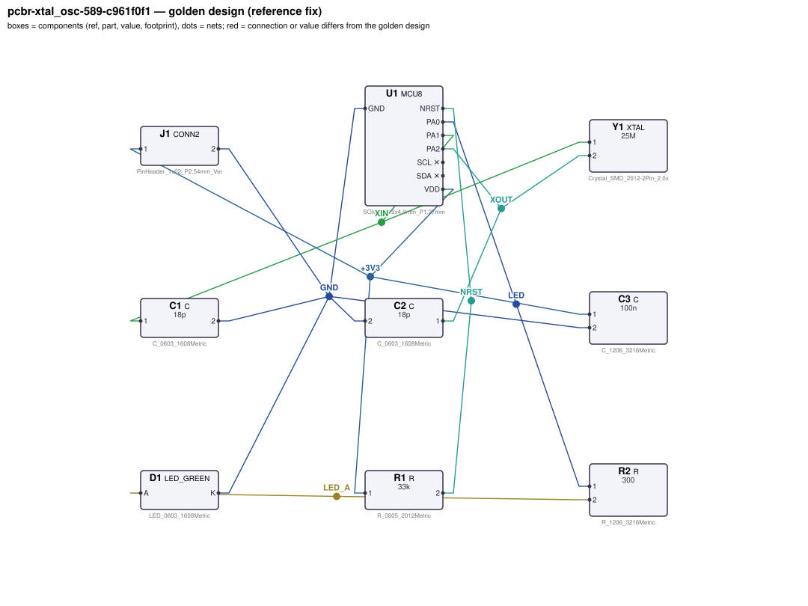
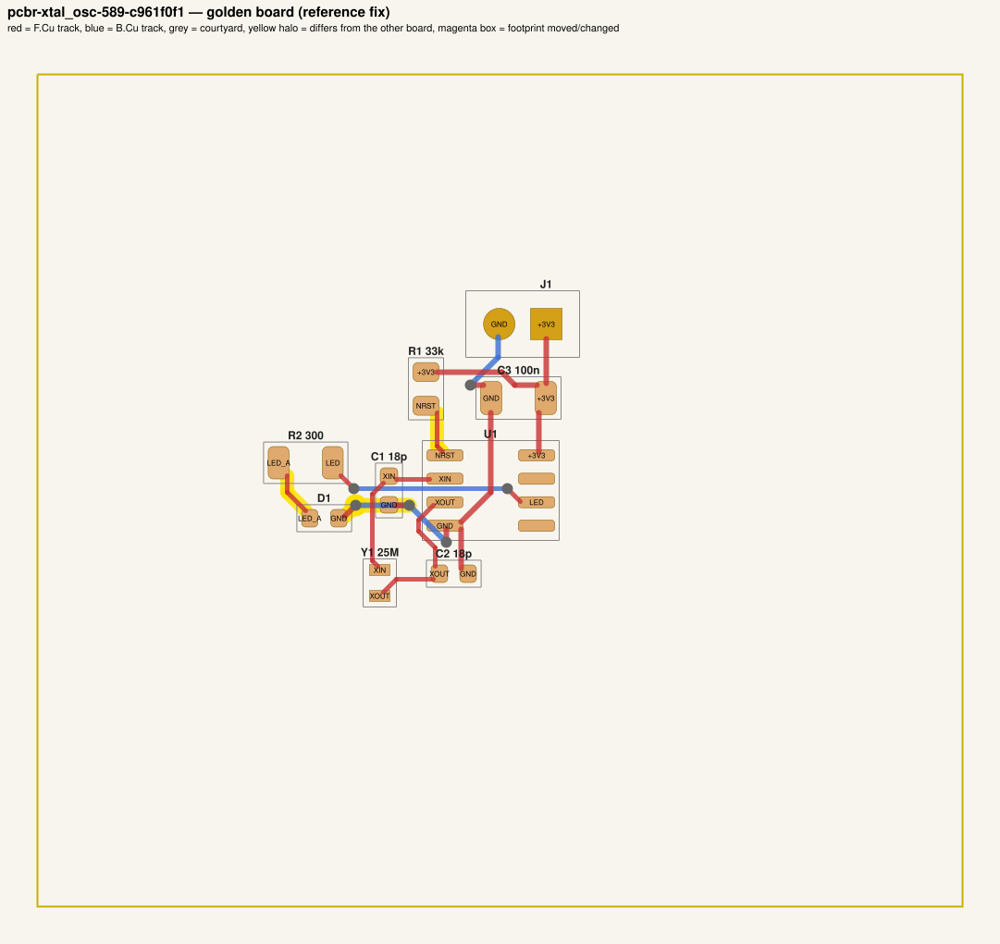

# QA packet 95: `pcbr-xtal_osc-589-c961f0f1`

| family | seed | hint level | intent in TASK.md | faults | predicted difficulty |
|---|---|---|---|---|---|
| xtal_osc | 589 | symptom | reduced | 3 | hard |

Task files: [`../../../tasks/train/pcbr-xtal_osc-589-c961f0f1/public/`](../../../tasks/train/pcbr-xtal_osc-589-c961f0f1/public/) (what the agent gets) and [`../../../tasks/train/pcbr-xtal_osc-589-c961f0f1/hidden/`](../../../tasks/train/pcbr-xtal_osc-589-c961f0f1/hidden/) (grader only). Why sampled: 3 faults, connectivity fault, disputable type bom_mismatch, value near bounds: R2=680 inside [110, 890].

**How to review (≈5 min):** read section 1 as if you were the agent, decide whether you could find and fix the problems from it; then check section 2 (faults, reference fix, verifier verdicts) and fill `review.yaml`. Do not let section 2 influence your fairness judgement of section 1.

## 1. What the agent sees

### 1.1 TASK.md (verbatim)

````markdown
# Task: MCU with 25MHz crystal

## Problem report

The first boards built from these files fail bring-up. Observations so far:

- Bench: U1.NRST reads 0 V, expected 2.97 V to 3.333 V (`nrst_high`).
- LED D1 never lights (`led_current`: 3.3e-13 A; expected 2 mA to 6 mA).
- Schematic ERC reports 1× single_pin_net, 1× unconnected_required.
- Incoming inspection: a part value on the layout does not match the design.json BOM.

Fix every problem (there may be more than the observations show directly).

## Design intent

# MCU with 25MHz crystal oscillator

An MCU (U1, MCU8) clocked from a 25MHz crystal Y1 (XTAL, rated load capacitance 12 pF),
powered from 3.3 V on J1 (pin 1 = +3.3 V, pin 2 = GND).

Spec: effective crystal load CL_eff = C1·C2/(C1+C2) + Cstray within ±10 % of 12 pF
(golden: 12.0 pF); NRST ≥ 0.9·VDD.
Clock: Y1 must be a 25MHz crystal (value `25M`, ±0.1 %): the firmware's clock tree assumes exactly
this frequency, and MCU8 only supports 4–25 MHz crystals.
Component values: decoupling C3 47 nF–10 µF (100 nF typical); NRST pull-up R1 2.2 kΩ–100 kΩ.

_Connection details are intentionally not repeated here: wire each part as its datasheet in `parts/` describes (pinout and application notes), so that the circuit does what the purpose, interfaces and spec above require._

## Spec

The design must satisfy these assertions (`pcbtool sim` runs them; full definitions in `spec.json`):

- `xtal_load_capacitance`: crystal Y1 effective load capacitance within ±10 % of its rated CL (stray 3 pF)
- `vdd`: DC voltage at U1.VDD relative to U1.GND between 3.234 V and 3.366 V (J1.1 supplied with 3.3 V; ground = J1.2)
- `nrst_high`: DC voltage at U1.NRST between 2.97 V and 3.333 V (J1.1 supplied with 3.3 V; ground = J1.2)
- `led_current`: DC current through D1 between 2 mA and 6 mA (J1.1 supplied with 3.3 V; dc source on U1.PA0; ground = J1.2)

Layout: every track of these nets must be at least the given width:

- +3V3 (the net of J1.1): ≥ 0.3 mm
- GND (the net of J1.2): ≥ 0.3 mm

Decoupling: every pad of each capacitor within the given distance of the IC pin's pad:

- C3 within 5.0 mm of U1.VDD

Component values: each value must lie in its acceptable range (inclusive; `value_bounds` in `spec.json`). Ranges come from the datasheets and the design intent; values the assertions already pin down get a wide sanity range, and the assertions still apply:

- C1 (C): 6.8 pF … 63 pF
- C2 (C): 5.9 pF … 61 pF
- C3 (C): 47 nF … 10 uF
- R1 (R): 2.2 kΩ … 100 kΩ
- R2 (R): 110 Ω … 890 Ω
- Y1 (XTAL): 24.98 MHz … 25.02 MHz

Board rules: 2 copper layers, clearance 0.2 mm, min track 0.2 mm, vias 0.6/0.3 mm, copper-to-edge 0.3 mm. DRC must be clean with no unconnected items.

## Deliverable

- Edit only `design.json` (the schematic of record) and `board.kicad_pcb` (the layout).
- Do not add, remove or rename components; keep each component's part.
- Keep the two files consistent: same connectivity, values and footprints on both.
- Do not change the board outline, add zones, or add DRC exclusions.
- Footprints must be unmodified library footprints from the part's allowed list (see `parts/<PART>.md`).
- Grading is pass/fail: topology, consistency, DRC, ERC, spec, component values and layout must all pass.

## Tools

Run `pcbtool <command>` inside this directory (you may also edit the two files directly).

Read-only:
- `pcbtool show` — components, values, footprints, positions and nets
- `pcbtool netlist` — design nets vs. board pad nets, with differences highlighted
- `pcbtool drc` — KiCad DRC under the canonical rules (the same rules the grader uses)
- `pcbtool erc` — electrical rule check of design.json
- `pcbtool sim` — run the spec assertions (spec.json) on design.json
- `pcbtool parts [PART]` — list parts / print a part's datasheet (also in `parts/`)
- `pcbtool check` — all of the above in one summary

Mutating (each keeps design.json and board.kicad_pcb consistent and saves both):
- `pcbtool set-value REF VALUE`
- `pcbtool set-footprint REF LIB:FOOTPRINT`
- `pcbtool connect REF.PIN NET` / `pcbtool disconnect REF.PIN`
- `pcbtool move REF X Y ROT` (absolute mm, degrees; tracks do not follow)
- `pcbtool unroute NET` / `pcbtool route NET [--width W]` (re-routes the whole net)
- `pcbtool sync` — push design.json connectivity and values onto the board pads
````

### 1.2 Public files

The agent also gets `design.json`, `board.kicad_pcb`, `spec.json` and the part datasheets below, plus the `pcbtool` commands listed in TASK.md (DRC, ERC, simulation of the public assertions, value-range check). Renders of the faulted files:





<details><summary>Datasheet <code>parts/C.md</code></summary>

````markdown
# C — ceramic capacitor

Two-terminal non-polarised capacitor. Pins `1`, `2`. Value in farads.
````

</details>

<details><summary>Datasheet <code>parts/CONN2.md</code></summary>

````markdown
# CONN2 — 2-pin header

Pin `1` = signal/supply, pin `2` = ground by board convention.
````

</details>

<details><summary>Datasheet <code>parts/LED_GREEN.md</code></summary>

````markdown
# LED_GREEN — green SMD indicator LED (570 nm)

## Pinout
| Pin | Pad | Function |
|---|---|---|
| A | 2 | anode |
| K | 1 | cathode (marked) |

## Electrical characteristics (25 C)
- Forward voltage Vf = 2.2 V typ at IF = 10 mA
- Max continuous forward current 25 mA; reverse voltage max 5 V

| IF | Vf (typ) |
|---|---|
| 2 mA | 2.10 V |
| 5 mA | 2.15 V |
| 10 mA | 2.20 V |
| 15 mA | 2.23 V |
| 20 mA | 2.26 V |

## Application notes
- Always drive through a current-limiting resistor: R = (Vsupply - n*Vf) / IF for n LEDs in series.
- Current flows anode -> cathode; reversed LEDs do not light.
````

</details>

<details><summary>Datasheet <code>parts/MCU8.md</code></summary>

````markdown
# MCU8 — generic 8-pin microcontroller (SOIC-8)

## Pinout
| Pin | Pad | Function |
|---|---|---|
| NRST | 1 | active-low reset input. **No internal pull-up**: needs an external 10k pull-up to VDD (optional 100 nF to GND) |
| PA1 | 2 | GPIO / XIN (crystal oscillator input) |
| PA2 | 3 | GPIO / XOUT (crystal oscillator output) |
| GND | 4 | ground |
| SDA | 5 | I2C data (open-drain) / GPIO |
| PA0 | 6 | GPIO / PWM output |
| SCL | 7 | I2C clock (open-drain) / GPIO |
| VDD | 8 | supply 1.8–5.5 V |

## Electrical characteristics
- Supply current 1.5 mA typ at 3.3 V
- GPIO output: VOH ≥ VDD - 0.4 V at 8 mA source (≈50 Ω output resistance); 8 mA max per pin
- Open-drain I2C pins sink max 3 mA at VOL = 0.4 V; no internal I2C pull-ups
- Pin capacitance 5 pF per I/O; idle / reset I/O pins are high-impedance (no pulls)
- Crystal oscillator: 4–25 MHz fundamental crystal between XIN (PA1) and XOUT (PA2), each pin
  with a load capacitor to GND

## Application notes
- Decouple VDD with 100 nF ceramic to GND within 5 mm of the VDD pin.
- I2C pull-ups: Rp ≥ (VDD - 0.4 V) / 3 mA and Rp ≤ tr / (2.2 × Cbus) for a 10–90 % rise time tr
  (Cbus includes the 5 pF pin capacitance).
- Crystal load caps: CL = C1·C2/(C1+C2) + Cstray, i.e. C1 = C2 = 2·(CL - Cstray).
````

</details>

<details><summary>Datasheet <code>parts/R.md</code></summary>

````markdown
# R — resistor

Two-terminal resistor. Pins `1`, `2` (non-polarised). Value in ohms.
````

</details>

<details><summary>Datasheet <code>parts/XTAL.md</code></summary>

````markdown
# XTAL — 2-pin fundamental-mode quartz crystal

## Pinout
| Pin | Pad | Function |
|---|---|---|
| 1 | 1 | crystal terminal |
| 2 | 2 | crystal terminal |

(Non-polarised.) Value = nominal frequency, e.g. `16M`.

## Electrical characteristics
- **Rated load capacitance CL = 12 pF**
- Frequency tolerance ±20 ppm at rated CL
- ESR ≤ 60 Ω; shunt capacitance C0 = 3 pF; drive level ≤ 100 µW

## Application notes
- Pierce oscillator: one load capacitor from each crystal pin to GND.
  Effective load CL_eff = C1·C2/(C1+C2) + Cstray (Cstray = MCU pin + PCB capacitance).
  For C1 = C2: C = 2·(CL - Cstray). Must be within ±10 % of 12 pF or the oscillator runs off-frequency.
- Keep traces short and the load capacitors next to the crystal.
````

</details>

## 2. Reviewer-only (hidden from the agent)

### 2.1 Injected faults

| # | type | category | DRC/ERC-invisible | detail | verifier, this fault alone |
|---|---|---|---|---|---|
| 1 | `reversed_polarity` | connectivity | yes | D1 anode/cathode reversed | reward 0.0; fails layout, spec, topology |
| 2 | `floating_pin` | connectivity | no | U1.NRST left unconnected (should be on NRST) | reward 0.0; fails erc, spec, topology |
| 3 | `bom_mismatch` | value | yes | board value of R2 is 680, design.json says 300 | reward 0.0; fails consistency |

### 2.2 Reference fix (faulted → golden)

The reference repair is the hidden golden pair (`golden_design.json`, `golden_board.kicad_pcb`). Any repair that passes every gate and check scores 1.0; it need not be byte-identical.

**design.json: component changes**

- none

**design.json: connection changes** (per pin: what it connects to)

- `D1.A`: faulted net `GND` (C1.2, C2.2, C3.2, J1.2, U1.GND) → golden net `LED_A` (R2.2)
- `D1.K`: faulted net `LED_A` (R2.2) → golden net `GND` (C1.2, C2.2, C3.2, J1.2, U1.GND)
- `U1.NRST`: faulted unconnected → golden net `NRST` (R1.2)

**board.kicad_pcb: footprints moved / changed**

- none

**board.kicad_pcb: footprint values (BOM)**

- `R2` board value `680` → `300`

**board.kicad_pcb: pad-net changes**

- `D1` pad 1: net `LED_A` → `GND`
- `D1` pad 2: net `GND` → `LED_A`
- `U1` pad 1: net `(none)` → `NRST`

**board.kicad_pcb: nets re-routed** (track/via geometry differs)

- net `GND`: 4 track/via item(s) removed, 3 added
- net `LED_A`: 1 track/via item(s) removed, 2 added
- net `NRST`: 0 track/via item(s) removed, 2 added

Golden renders (compare with 1.2; highlighted items differ):





### 2.3 Verifier verdicts

Reward is 1 only if every gate and check passes.

| stage | kind | faulted files | golden files |
|---|---|---|---|
| parse | gate | pass | pass |
| components | gate | pass | pass |
| topology | gate | **FAIL** | pass |
| consistency | gate | **FAIL** | pass |
| integrity | gate | pass | pass |
| drc | check | pass | pass |
| erc | check | **FAIL** | pass |
| spec | check | **FAIL** | pass |
| values | check | pass | pass |
| layout | check | **FAIL** | pass |
| **reward** | | **0** | **1** |

Verifier messages on the faulted files:

- **consistency**: R2: board value '680' != design value '300'
- **erc**: unconnected_required: U1.NRST must be connected
- **erc**: single_pin_net: net 'NRST' (R1.2) has a single pin
- **layout**: power_net_missing: no board net has the pins of golden net GND
- **spec**: nrst_high: measured 0.0 expected [2.97, 3.333]
- **spec**: led_current: measured 3.3000005328e-13 expected [0.002, 0.006]
- **topology**: nets only in candidate: [['C1.2', 'C2.2', 'C3.2', 'D1.A', 'J1.2', 'U1.GND'], ['D1.K', 'R2.2'], ['R1.2']]; nets only in reference: [['C1.2', 'C2.2', 'C3.2', 'D1.K', 'J1.2', 'U1.GND'], ['D1.A', 'R2.2'], ['R1.2', 'U1.NRST']]

### 2.4 Spec assertions before / after

| assertion | what | allowed | faulted: measured | | golden: measured | |
|---|---|---|---|---|---|---|
| `xtal_load_capacitance` | crystal Y1 effective load capacitance within ±10 % of its rated CL (stray 3 pF) | see def. | 12 p | ✅ | 12 p | ✅ |
| `vdd` | DC voltage at U1.VDD relative to U1.GND (J1.1 supplied with 3.3 V; ground = J1.2) | 3.234 V … 3.366 V | 3.3 V | ✅ | 3.3 V | ✅ |
| `nrst_high` | DC voltage at U1.NRST (J1.1 supplied with 3.3 V; ground = J1.2) | 2.97 V … 3.333 V | 0 V | ❌ | 3.3 V | ✅ |
| `led_current` | DC current through D1 (J1.1 supplied with 3.3 V; dc source on U1.PA0; ground = J1.2) | 2 mA … 6 mA | 3.3e-13 A | ❌ | 3.343 mA | ✅ |

### 2.5 Value bounds

Bounds are public (TASK.md / spec.json); `values` check = every value inside its range.

| ref | part | acceptable range | faulted design.json | faulted board | golden | touched by a fault |
|---|---|---|---|---|---|---|
| `C1` | C | 6.8 pF … 63 pF | `18p` | `18p` | `18p` |  |
| `C2` | C | 5.9 pF … 61 pF | `18p` | `18p` | `18p` |  |
| `C3` | C | 47 nF … 10 uF | `100n` | `100n` | `100n` |  |
| `R1` | R | 2.2 kΩ … 100 kΩ | `33k` | `33k` | `33k` |  |
| `R2` | R | 110 Ω … 890 Ω | `300` | `680` | `300` | **yes** |
| `Y1` | XTAL | 24.98 MHz … 25.02 MHz | `25M` | `25M` | `25M` |  |

### 2.6 Layout rules

- power net `+3V3` (golden pins C3.1, J1.1, R1.1, U1.VDD): every track ≥ 0.3 mm
- power net `GND` (golden pins C1.2, C2.2, C3.2, D1.K, J1.2, U1.GND): every track ≥ 0.3 mm
- decoupling: `C3` within 5.0 mm of `U1.VDD`

## 3. Review

Fill `review.yaml` in this directory (second reviewer: copy `../../review_template.yaml` to `review-<initials>.yaml` here, without looking at the first form). Questions to answer:

1. **task_fair / solvable_from_public_material**: from section 1 only, can a competent engineer locate and fix every injected fault? Is anything required that is not stated (a value with no assertion and no published range, a connection only the golden reveals)?
2. **reference_fix_correct**: is the golden (2.2) a correct design that meets the stated intent?
3. **verifier_verdict_agrees**: do you agree the faulted files fail and the golden passes, for the reasons given in 2.3?
4. **alternative_valid_fixes_rejected**: is there an engineering-valid repair the grader would reject (e.g. a different E-series value that meets intent but fails an assertion window or value bound; keeping a swapped footprint and re-routing; a different valid placement)?

